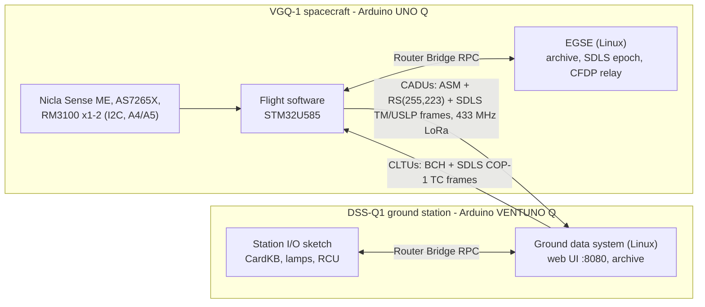

# VGQ-1 / DSS-Q1 - a CCSDS deep-space-style telemetry link on Arduino UNO Q and VENTUNO Q

[](https://github.com/Tanay7/vgq1-deep-space-link/actions/workflows/ci.yml)

A complete model of a deep-space telemetry and telecommand system, built from two Arduino boards
and two 433 MHz LoRa radios, using the CCSDS standards space agencies use:

* **VGQ-1 spacecraft** - Arduino **UNO Q**. Flight software in C++ on the STM32U585 (CCSDS TM / USLP
  telemetry, COP-1 telecommanding, SDLS link security, fault protection, solid-state recorder,
  CFDP file delivery, stored sequences) and an EGSE on its Linux side. Instruments: **Nicla Sense
  ME** (attitude, environment), **AS7265X** 18-band spectrometer, one or two **RM3100**
  magnetometers.
* **DSS-Q1 ground station** - Arduino **VENTUNO Q**. The ground data system in Python (standard
  library only) on its Linux side - frame sync, Reed-Solomon decoding, SDLS, packet decoding,
  limits, archive, COP-1 commanding, receiver statistics, link budget, CCSDS TDM and XTCE - with an
  11-tab **web dashboard**; its MCU runs the **CardKB** command keyboard, station lamps and the radio
  control unit.
* **Radio:** EBYTE **E22-400T33D** (2 W) at both ends by default; the 5 W **E22-400T37S** selected by
  a jumper on the spacecraft and one setting on the ground, no code edit; an **SX126x** (SPI, via a bundled patched RadioLib) for LoRa profiles down
  to SF12 / 31.25 kHz with SNR, frequency error, Doppler and automatic frequency correction.

> **Status: first bench link, downlink only.** Every automated check passes (section
> "Verification" below). The flight App has run on a UNO Q with its radio and the AS7265X
> (2026-10-12), and the ground station on the VENTUNO Q received and decoded its downlink on the
> bench (2026-10-13; [docs/21_Test_Records.md](docs/21_Test_Records.md) records 2026-10-12-A and
> 2026-10-13-A). Commanding (the uplink) has not been run on hardware yet. What only hardware
> can confirm is listed in [docs/20_Known_Limitations.md](docs/20_Known_Limitations.md) with the
> test that confirms it in [docs/08_Verification_and_Test.md](docs/08_Verification_and_Test.md).




*The ground station's web dashboard (OVERVIEW tab, from a simulator run). Every tab and every
number on it is explained in [docs/13_Web_UI_Reference.md](docs/13_Web_UI_Reference.md).*

## At a glance

| Item | Value | Source |
|---|---|---|
| Frequency, modulation | 433 MHz band, LoRa | [docs/02](docs/02_Link_Budget_and_RF_Analysis.md) |
| Downlink unit | one 236-octet CADU per radio packet: 4-octet sync marker + Reed-Solomon (232,200) codeblock (RS(255,223) shortened) carrying one 200-octet transfer frame | [docs/04](docs/04_Space_Data_Link_ICD.md) section 2 |
| Payload per frame | 158 octets of packets with TM + SDLS authenticated encryption | [docs/02](docs/02_Link_Budget_and_RF_Analysis.md) section 7.1 |
| Downlink capacity, E22 at 2.4 kbit/s | 31.2 octets/s in SAFE, 62.4 octets/s in ENCOUNTER (frame period 5.068 / 2.534 s, transmit duty at most 50 %) | same |
| Downlink capacity, SX126x profile 1 (the SX126x default) | 2.28 / 4.56 octets/s (frame period 69.3 / 34.6 s) | same |
| Free-space range, 10 dB fade margin, dipoles | T33D 2,698 km; T37S 3,396 km; SX126x profile 1 10,740 km; profile 0 15,346 km | [docs/02](docs/02_Link_Budget_and_RF_Analysis.md) section 6.2 |
| What really limits range | the radio horizon: 11.7 km with both antennas at 2 m, 18.9 km with 2 m / 10 m, 93.9 km hill to hill (30 m / 300 m), 726.6 km for a balloon at 30 km | same |
| Link security | SDLS (CCSDS 355.0): AES-256-GCM encryption + authentication, or authentication only (the choice on amateur frequencies, where encryption is generally not permitted) | [docs/17](docs/17_Security_Model.md), [docs/09](docs/09_Regulatory_and_Safety.md) |
| Commanding | COP-1 (FOP-1 / FARM-1) with retransmission; 8 hazardous commands need a second confirmation | [docs/07](docs/07_Operations_Procedures.md) |

Free space is not the limit: every radio has power to spare at the horizon (31 dB of margin
even for the balloon case with the default T33D). Antenna height and a clear path decide the
range, which is why the slow SX126x profiles buy tolerance of obstacles, not line-of-sight distance.

## Highlights

* **Standards:** CCSDS 131.0 (TM coding), 132.0 (TM), 133.0 (Space Packets), 231.0 / 232.0 / 232.1
  (TC, COP-1), 301.0 (time codes), 355.0 (SDLS: AES-256-GCM or authentication only), 732.1 (USLP),
  727.0 (CFDP class 1), 121.0 (lossless compression), 503.0 (Tracking Data Message), 660.0 / XTCE 1.2.
* **Bit-exact both ways:** every packet, frame, CLTU, SDLS frame and CFDP file the flight C++ builds
  is decoded identically by the Python ground; the Rice codec reproduces the official CCSDS 121.0
  test data.
* **Autonomy and fault protection:** boot to SAFE, hardware watchdog (40 s), transmit-duty cap,
  command-loss timer, self-reverting radio changes, brown-out derating, PA over-temperature
  response, stored command sequences, Deep-Space-1-style beacon urgency levels.
* **Science:** spectroscopy with automatic exposure, HDR, lock-in, fluorescence and burst modes,
  light-source classification and change detection on board; reflectance, indices, colorimetry,
  PPFD and a sky map on the ground; magnetometer self-test and ground-fitted calibration.
* **Offline install:** two Arduino App Lab zips; no pip package at run time; the two Arduino
  libraries the sketches need are bundled as exact, verified, minimally patched releases.
* **Engineering discipline:** NASA/JPL "Power of Ten" rules for the flight C++, every VERIFY
  assumption tracked to a hardware test, an 18-reviewer adversarial review with 62 confirmed
  findings fixed.

## Repository map

```
vgq1-spacecraft/              Arduino App Lab App for the UNO Q (the spacecraft)
  app.yaml, README.md
  python/main.py              EGSE (Linux side): CADU archive, SCLK partition = SDLS TM epoch,
                              SDLS SN restore, hardline commanding
  python/cfdp_tx.py           CFDP class 1 relay sender
  sketch/sketch.ino, sketch.yaml
  sketch/src/config.h         every pin, address, radio default, limit and build switch
  sketch/src/ccsds/           CRC, RS encoder, randomizer, TM / USLP / TC frames, CLTU / FARM-1,
                              SHA-256, AES-256-GCM, SDLS, CFDP, Rice
  sketch/src/drivers/         E22 and SX126x radios, I2C bus, RM3100, AS7265X, Nicla link
  sketch/src/fsw/             executive, packets, commands, data link, recorder, autonomy,
                              attitude, spectral processing, RPC mailbox
dssq-groundstation/           Arduino App Lab App for the VENTUNO Q (the ground station)
  app.yaml, README.md
  python/main.py              App Lab entry point
  python/dssq/                ground data system: ccsds/ (protocols), radio/ (E22, SX126x), gds,
                              framesync, fop, decom, dictionary, rxstats, link, products,
                              spectral, magcal, datalog, export, replay, sim, display/ (web UI)
  python/config/station.toml  station configuration (copied to <App>/data on first start)
  sketch/                     station I/O sketch: CardKB, lamps, buzzer, Radio Control Unit,
                              optional SX126x radio
  host/                       install_station.sh + dssq-gds.service: optional host (systemd) mode
nicla_sense_me_aru/           Nicla Sense ME firmware (Arduino IDE, Mbed Nicla core + Arduino_BHY2)
tools/
  host_test/                  flight C++ host tests, check_firmware.sh, station/ and
                              routerbridge/ harnesses
  libbundle.py, radiolib.py, routerbridge.py, *.patch
                              fetch, verify and patch the bundled RadioLib / Arduino_RouterBridge
  package_apps.py             builds and verifies the two App Lab zips in dist/
  gen_sdls_key.py             SDLS key for both ends (never committed, never packaged)
  gen_dictionary_doc.py       regenerates docs/05 from the code
  link_budget.py              link budget; T-RF-03 sensitivity analysis
tests/                        pytest suite (run from the repository root)
docs/                         documentation (index below); docs/img: web UI screenshots
dist/                         the two App Lab zips + SHA256SUMS
.github/workflows/ci.yml      CI: lint, host tests, ground tests, real Arduino builds
pyproject.toml, requirements-dev.txt   PC test / lint settings and tools (not needed on the boards)
CHANGELOG.md
```

## Quick start

**Without hardware (any PC with Python 3.11+):**

```bash
cd dssq-groundstation/python
python3 -m dssq.gds --sim          # ground station + software spacecraft
# open http://127.0.0.1:8080 (served on this PC only) and type NOOP in the COMMANDING tab
```

What to expect: the simulated spacecraft starts in SAFE mode, as the real one does, so the
beacon shows **URGENT** and the alarm is **RED** at first. That is normal. Type `MODE CRUISE`;
with the next housekeeping packet the beacon returns to NOMINAL and the alarm drops to
**YELLOW**. The yellow that remains is expected: the simulator runs without a key file, so SDLS
is off (`NONE`) and the station says so. Stop it with Ctrl+C.

**With the boards:** follow [docs/00_Beginner_Setup_Guide.md](docs/00_Beginner_Setup_Guide.md)
step by step. In short:

1. Flash the Nicla Sense ME firmware (`nicla_sense_me_aru/`) with the Arduino IDE.
2. Import `dist/vgq1-spacecraft-unoq.zip` into Arduino App Lab on the UNO Q and
   `dist/dssq-groundstation-ventunoq.zip` on the VENTUNO Q (My Apps -> open any App -> menu ->
   Import App). Do not unzip them first; check them with `cd dist && sha256sum -c SHA256SUMS`.
   Run the ground App once so that it creates its `data/` folder.
3. **Generate one SDLS key pair, once, on the PC**, in a folder outside the repository. Both
   files come from the same key; never run the tool separately for each board:

   ```bash
   python3 tools/gen_sdls_key.py --flight-header ~/vgq1-keys/sdls_key.h --ground-key ~/vgq1-keys/sdls_key.hex
   scp ~/vgq1-keys/sdls_key.h   arduino@<UNO-Q-IP>:ArduinoApps/vgq1-spacecraft/sketch/src/sdls_key.h
   scp ~/vgq1-keys/sdls_key.hex arduino@<VENTUNO-Q-IP>:ArduinoApps/dssq-groundstation/data/sdls_key.hex
   ```

   Keys are never in a zip and never committed. Restart both Apps afterwards. On this first
   start with the key the ground shows YELLOW `TC uplink BLOCKED` and refuses commands until a
   housekeeping packet arrives that the spacecraft sent at least 2 minutes after it started; the
   ground then sets its command counter above every number the key can have used
   ([docs/17](docs/17_Security_Model.md) section 7.6). That is normal; it happens once.
4. **Set the link security and your callsign.** Encryption is not allowed on amateur
   frequencies: use authentication only (`VGQ_SDLS_TC 1` and `VGQ_SDLS_TM 0` in the spacecraft's
   `sketch/src/config.h`; `tc_service = "AUTH"` and `tm_service = "NONE"` in the ground's
   `data/station.toml`). Replace the placeholder `N0CALL` with your callsign at both ends:
   `VGQ_CALLSIGN` in `config.h` and `callsign` in the `[station]` section of `data/station.toml`.
   Both ends then identify themselves in clear text (`DE <callsign> ...`) at least every 10 minutes
   while transmitting ([docs/09_Regulatory_and_Safety.md](docs/09_Regulatory_and_Safety.md),
   [docs/15_Configuration_Reference.md](docs/15_Configuration_Reference.md)).
5. Wire the radios and instruments ([docs/03_Hardware_Integration.md](docs/03_Hardware_Integration.md)).
   Fit antennas or dummy loads **before** power-up. For the 5 W E22-400T37S: on the spacecraft,
   a jumper from A0 to GND (no code change); on the ground, `model = "E22-400T37S"` (or `"auto"`)
   in `data/station.toml`. Never put that jumper on the VENTUNO Q, whose A0 drives the buzzer
   ([docs/03](docs/03_Hardware_Integration.md) section 4.5). Run both Apps and open
   `http://<VENTUNO-Q-address>:8080`.
6. Work through the hardware tests in [docs/08_Verification_and_Test.md](docs/08_Verification_and_Test.md)
   and record the results in [docs/21_Test_Records.md](docs/21_Test_Records.md).

## Documentation

| # | Document |
|---|---|
| 00 | [Beginner setup guide (step by step)](docs/00_Beginner_Setup_Guide.md) |
| 01 | [System design, concept of operations, resource budgets](docs/01_System_Design.md) |
| 02 | [Link budget and RF analysis](docs/02_Link_Budget_and_RF_Analysis.md) |
| 03 | [Hardware integration: wiring, pins, power, bill of materials](docs/03_Hardware_Integration.md) |
| 04 | [Space data link ICD](docs/04_Space_Data_Link_ICD.md) |
| 05 | [Telemetry and command dictionary (generated from the code)](docs/05_Telemetry_and_Command_Dictionary.md) |
| 06 | [Displays: station lamps, CardKB console, front panel](docs/06_Displays.md) |
| 07 | [Operations procedures](docs/07_Operations_Procedures.md) |
| 08 | [Verification and test](docs/08_Verification_and_Test.md) |
| 09 | [Regulatory and safety](docs/09_Regulatory_and_Safety.md) |
| 10 | [References](docs/10_References.md) |
| 11 | [Standards status and roadmap](docs/11_Standards_Status_and_Roadmap.md) |
| 12 | [Design decisions](docs/12_Design_Decisions.md) |
| 13 | [Web UI reference (every tab and metric)](docs/13_Web_UI_Reference.md) |
| 14 | [Troubleshooting and event response](docs/14_Troubleshooting_and_Event_Response.md) |
| 15 | [Configuration reference](docs/15_Configuration_Reference.md) |
| 16 | [Developer guide](docs/16_Developer_Guide.md) |
| 17 | [Security model](docs/17_Security_Model.md) |
| 18 | [Data products](docs/18_Data_Products.md) |
| 19 | [Glossary and acronyms](docs/19_Glossary.md) |
| 20 | [Known limitations and open items](docs/20_Known_Limitations.md) |
| 21 | [Hardware test records (templates)](docs/21_Test_Records.md) |
| 22 | [Bundled third-party libraries (patched)](docs/22_Bundled_Libraries.md) |
| - | [FAQ](docs/FAQ.md) |
| - | [One-page project summary](docs/Project_Summary.md) |
| - | [Changelog](CHANGELOG.md) |

## Verification

Results on the current tree (details and commands: [docs/08](docs/08_Verification_and_Test.md)):

| Layer | Result |
|---|---|
| Host tests (flight C++ on a PC; `-Werror` and ASan + UBSan) | 977 checks, 0 failures |
| Ground tests (pytest, Python 3.11 and 3.13) | 752 tests: 749 passed, 3 skipped (optional reference files) |
| Firmware type-check, every build option (`check_firmware.sh`) | 70 ok, 0 fail, 0 warn |
| Station sketch harness (plain, ASan + UBSan, TSan) / RouterBridge harness | 26 / 12 checks pass; negative controls fail as intended |
| Real Arduino builds (arduino-cli + `arduino:zephyr`): both sketches, default and SX126x radio, core 1.0.0 and main; the flight sketch also on 0.90.0, the core of App Lab installations that were not updated | 0 warnings in project code; every symbol resolvable by the board's loader (`tools/llext_check.py`); flash and RAM per build in [docs/01](docs/01_System_Design.md) section 9.1 |
| Lint and types | ruff, mypy, shellcheck (in CI); actionlint for the workflow file (locally) |
| CI on every push | lint, host-tests, ground-tests, arduino-build |
| Hardware tests | not yet run |

## Licences

No licence file is included for the project's own code yet. The bundled libraries keep their own
licences inside each copy: RadioLib (MIT) and Arduino_RouterBridge (MPL-2.0); see
[docs/22_Bundled_Libraries.md](docs/22_Bundled_Libraries.md).
