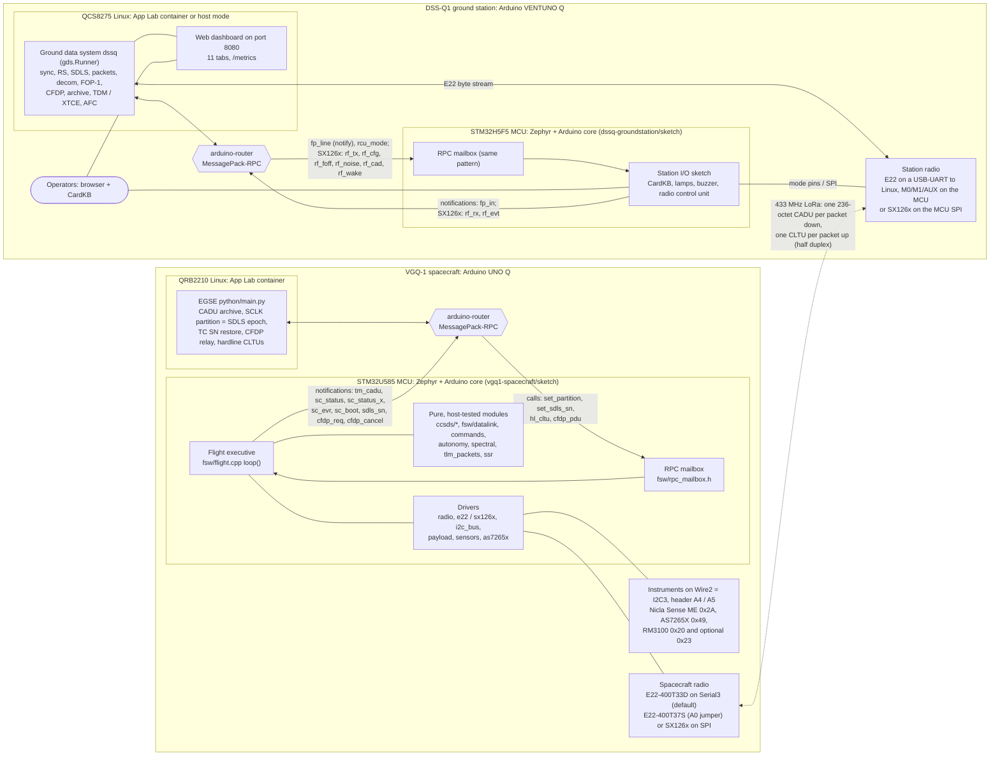
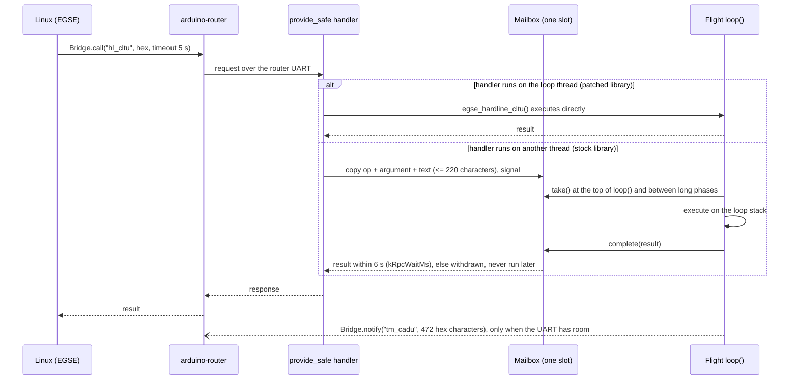
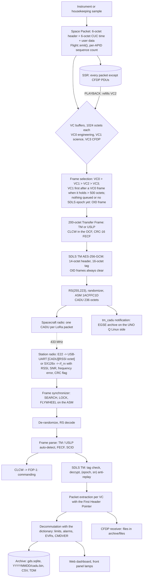
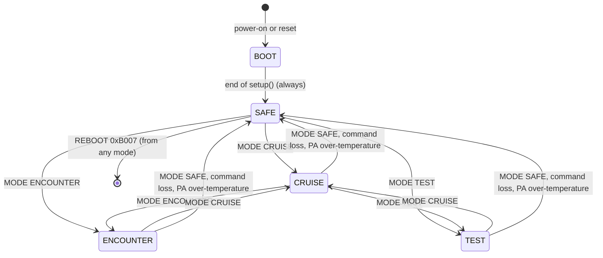
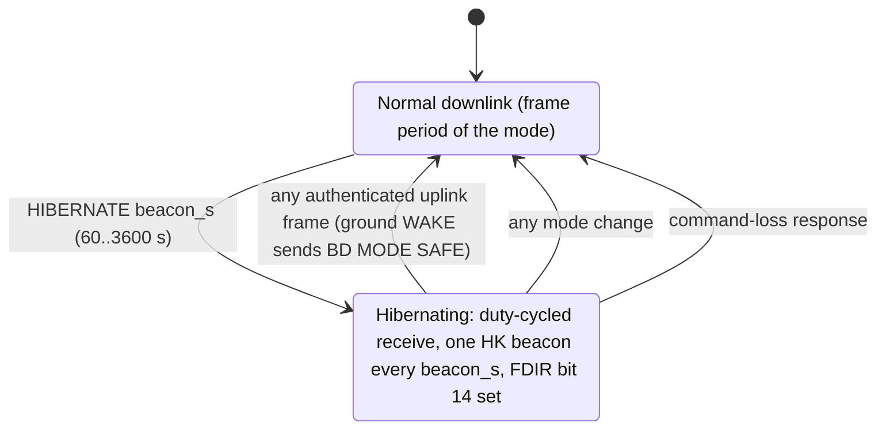
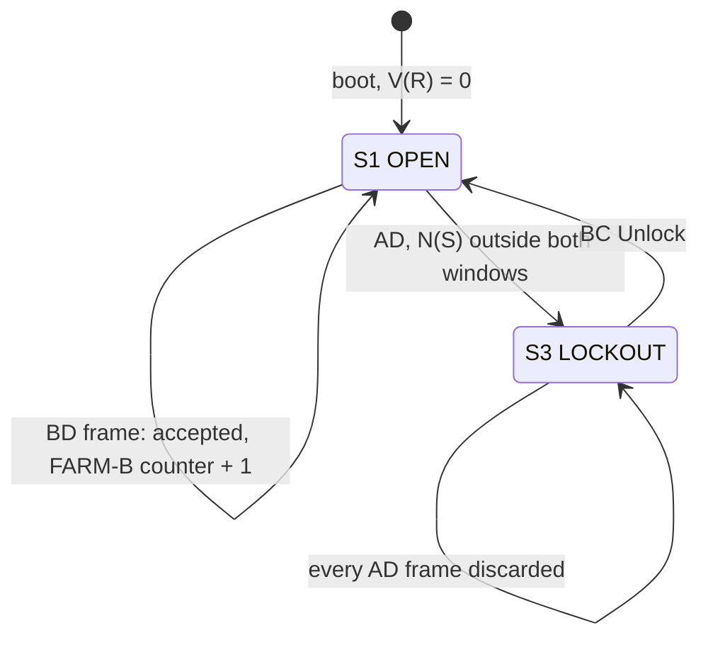
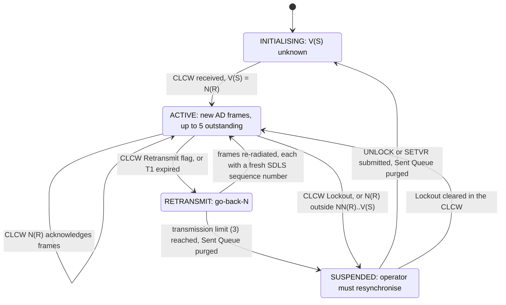

# 01 - System Design and Concept of Operations

This document explains what VGQ-1 / DSS-Q1 is, how the two boards are built inside, how data
moves from a sensor to the operator's screen and back, how the flight software behaves (modes,
fault protection, autonomy), and how much flash, RAM, stack, loop time and link capacity it uses.

| If you need ... | read |
|---|---|
| wiring, pins, power | [03_Hardware_Integration.md](03_Hardware_Integration.md) |
| radio physics, range, link budgets | [02_Link_Budget_and_RF_Analysis.md](02_Link_Budget_and_RF_Analysis.md) |
| every bit of every frame, packet and RPC | [04_Space_Data_Link_ICD.md](04_Space_Data_Link_ICD.md) |
| packet fields, commands, EVR texts | [05_Telemetry_and_Command_Dictionary.md](05_Telemetry_and_Command_Dictionary.md) (generated from the code) |
| how to operate it | [07_Operations_Procedures.md](07_Operations_Procedures.md) |
| why each choice was made | [12_Design_Decisions.md](12_Design_Decisions.md) |
| every setting | [15_Configuration_Reference.md](15_Configuration_Reference.md) |

Conventions: "the code" means the files of this repository; every number below names its
source (a file and symbol, a datasheet section, a standard clause, a commit or a measurement).
Values that only the hardware can confirm are marked **VERIFY** and are listed in
[20_Known_Limitations.md](20_Known_Limitations.md).

---

## 1 Purpose

### 1.1 In plain words

A deep-space probe and its ground station never "chat". The probe packs every measurement
into small numbered packets, puts the packets into fixed-size frames, protects the frames
against noise and tampering, and sends them down one by one. The station checks and unpacks
them, and sends back commands that are acknowledged, verified and logged. Everything follows
international standards written by CCSDS (the Consultative Committee for Space Data Systems).

VGQ-1 / DSS-Q1 does exactly that with hobby hardware:

* **VGQ-1** is the "spacecraft": an Arduino UNO Q with sensors and a 433 MHz LoRa radio.
* **DSS-Q1** is the "deep space station": an Arduino VENTUNO Q with the same kind of radio,
  a ground data system and a web dashboard.
* Between them runs the same protocol stack a real mission uses (section 4).

It is a working, end-to-end engineering model, built for the longest range the radios allow
at a useful data rate ([02](02_Link_Budget_and_RF_Analysis.md)). It does not imitate one
historic probe; it takes ideas from several (Voyager's stored command sequences, Deep Space 1's
beacon levels, the JPL clock "partitions").

### 1.2 Elements and their deep-space analogues

| Element | Deep-space analogue | VGQ-1 / DSS-Q1 | Code |
|---|---|---|---|
| Flight computer | command and data handling computer | UNO Q STM32U585 MCU: Arm Cortex-M33 up to 160 MHz, 2 MB flash, 786 kB SRAM (ABX00162 datasheet) running Zephyr + the Arduino core | [vgq1-spacecraft/sketch](../vgq1-spacecraft/sketch) |
| Electrical ground support equipment (EGSE) | test rack and umbilical next to the spacecraft | UNO Q Linux side: Qualcomm QRB2210, 4 x Cortex-A53 at 2.0 GHz, Debian (ABX00162) | [vgq1-spacecraft/python/main.py](../vgq1-spacecraft/python/main.py) |
| Transponder | X-band transponder | EBYTE E22-400T33D 2 W UART LoRa module (default); E22-400T37S 5 W (jumper on A0); SX1268/SX1262 module on SPI (build option) | [drivers/radio.h](../vgq1-spacecraft/sketch/src/drivers/radio.h) |
| Instruments | magnetometer, spectrometer, attitude reference | Nicla Sense ME (attitude reference unit, BMM150, BMP390, BME688), AS7265X 18-channel spectrometer, RM3100 magnetometer at the boom tip (+ optional mid-boom unit) | [drivers/](../vgq1-spacecraft/sketch/src/drivers) |
| Ground antenna and receiver | DSN 34 m / 70 m antenna | a 433 MHz antenna (a 12 dBi Yagi in the default station.toml) and the same radio model | [radio/](../dssq-groundstation/python/dssq/radio) |
| Ground data system and mission control | DSN telemetry and command processors, MCS | VENTUNO Q Linux side: Qualcomm Dragonwing QCS8275, Ubuntu Linux, 16 GB LPDDR5, 64 GB eMMC (ABX00181), running the `dssq` package and a web dashboard on port 8080 | [dssq-groundstation/python/dssq](../dssq-groundstation/python/dssq) |
| Station front panel | operator consoles, alarm lamps | VENTUNO Q STM32H5F5 MCU (Cortex-M33 up to 250 MHz, ABX00181): CardKB keyboard, AOS / ALARM / UPLINK lamps, buzzer, radio control unit | [dssq-groundstation/sketch](../dssq-groundstation/sketch/sketch.ino) |
| Data products | archives, tracking data, telemetry databases | SQLite archive, raw CADU files, CSV export, CCSDS TDM, XTCE | [18_Data_Products.md](18_Data_Products.md) |

### 1.3 What it is not

* Not flight hardware: no radiation tolerance, no redundancy, commercial temperature ranges.
* The spacecraft ID 0x0A7 is a private value, not registered with SANA
  ([ccsds_types.h](../vgq1-spacecraft/sketch/src/ccsds/ccsds_types.h) `kSpacecraftId`).
* Range is terrestrial: the radio horizon, not the radio, limits it
  ([02](02_Link_Budget_and_RF_Analysis.md) section 6).
* Encryption (the default SDLS AE service) is generally not permitted on amateur
  frequencies: use AUTH or NONE there ([09_Regulatory_and_Safety.md](09_Regulatory_and_Safety.md)).

---

## 2 Concept of operations

### 2.1 A mission day, step by step

1. **Preparation (bench).** Keys are generated once for both ends
   ([17_Security_Model.md](17_Security_Model.md)), both App Lab Apps are imported, the radios are
   wired ([00_Beginner_Setup_Guide.md](00_Beginner_Setup_Guide.md)). The first bench contact may
   run without a key: both ends then run SDLS NONE and say so.
2. **Power-up and boot (spacecraft).** The flight software comes up in **SAFE**, as real
   spacecraft do ([fsw/flight.cpp](../vgq1-spacecraft/sketch/src/fsw/flight.cpp) `setup()`):
   it allocates the solid-state recorder (SSR), configures the radio from flight constants
   (volatile register write plus read-back, EVR 0x0306), identifies the instruments, runs the
   RM3100 self-test, emits the boot events (EVR 0x0001 to 0x0005) and notifies its Linux side
   (`sc_boot`).
3. **Epoch and counter restore (EGSE).** The EGSE answers every MCU boot with a new SCLK
   partition, which is also the SDLS TM epoch, and gives back the last accepted uplink sequence
   number. Until the epoch arrives the spacecraft sends only identification frames (OID, the
   callsign in clear text); after 120 s without one it sends clearly flagged unprotected frames
   (`kSdlsEpochWaitS`, EVR 0x0121). Uplink frames that are authentic are refused until the
   counter is restored or 120 s pass (`kSdlsSnWaitS`, EVR 0x0123 / 0x0124).
4. **Acquisition (station).** The frame synchronizer finds the attached sync marker, the
   Reed-Solomon decoder repairs the frame, the first good frame declares **AOS** (acquisition of
   signal), the station's AOS lamp lights, and the CLCW in the frame initialises the
   commanding protocol (COP-1, section 8).
5. **Commanding.** The operator types a command on the CardKB or in the COMMANDING tab. The
   ground checks it against the dictionary, asks for confirmation if it is hazardous (optionally
   a second operator), wraps it in an SDLS-protected TC frame and a CLTU, and radiates it in the
   quiet window right after a received frame. The life cycle QUEUED, RADIATED, ACCEPTED,
   EXECUTED is shown on every display ([07](07_Operations_Procedures.md)).
6. **Science.** `MODE CRUISE` or `MODE ENCOUNTER` starts the instruments. Samples are taken in
   transmitter-off windows (no RF in the magnetometer data), engineering and science travel on
   separate virtual channels, and every packet is also recorded in the SSR for later playback.
7. **Link management.** The ground measures the margin continuously; the link manager
   recommends (ADVISE) or performs (AUTO) a slower or faster rate. Every rate or channel change
   reverts by itself if the ground does not prove it followed (section 7.2).
8. **File delivery.** `CFDPPUT` sends the SSR contents or an EGSE file to the ground as one
   CFDP class-1 file on virtual channel 3 ([04](04_Space_Data_Link_ICD.md) section 7).
9. **Hibernation.** `HIBERNATE beacon_s` makes the spacecraft listen duty-cycled and send one
   HK beacon every `beacon_s`; the ground directive `WAKE` ends it (section 5.3).
10. **Contingencies.** Command loss (24 h without a valid uplink), PA over-temperature,
    instrument loss, I2C bus faults, FARM lockout and brown-outs are handled on board without
    the ground (section 6); the beacon level tells the ground how urgent its attention is
    (section 7.4).

### 2.2 Who decides what

| Decision | Made by | Bound |
|---|---|---|
| Packet cadence per mode | flight table `kModeCadence`, stretched to the measured link capacity | [fsw/datalink.cpp](../vgq1-spacecraft/sketch/src/fsw/datalink.cpp) |
| Which frame goes next | flight `Downlink::next_cadu()` (VC priorities) | section 4.4 |
| Radio rate / channel | operator (AIRRATE / CHANNEL, LINKRATE / LINKCHAN) or the link manager in AUTO | auto-revert after `revert_s` |
| Safe mode | operator (`MODE`) or fault protection (command loss, PA over-temperature) | section 6 |
| Stored command execution | onboard sequencer, after an operator `SEQCTRL START` | hazardous commands refused |
| Which uplink frame is accepted | flight FARM-1 + SDLS | section 8 |

---

## 3 Architecture

### 3.1 Both boards at a glance

Each Arduino "Q" board has two computers: a microcontroller (MCU) for real-time work and a
Linux processor for everything else. They talk through the Arduino Router Bridge, a
MessagePack-RPC link over an internal UART (ABX00162 / ABX00181 "Bridge"). On both boards the
time-critical code runs on the MCU and the Linux side never sits in the real-time path.



### 3.2 Spacecraft MCU: the flight software

One `loop()` on the Zephyr main thread runs everything; there are no application threads.
The executive ([fsw/flight.h](../vgq1-spacecraft/sketch/src/fsw/flight.h)) wires pure modules
to the hardware. Every module that decides something about protocols, security or autonomy is
pure C++ without the Arduino core and is compiled and tested on a PC
([tools/host_test](../tools/host_test); the test inventory and its current counts are in
[08_Verification_and_Test.md](08_Verification_and_Test.md)).

| Subsystem (analogue) | Responsibility | Module |
|---|---|---|
| Executive | boot sequence, one bounded loop pass, EGSE notifications | [fsw/flight.cpp](../vgq1-spacecraft/sketch/src/fsw/flight.cpp) |
| Command subsystem (CCS) | CLTU decode, TC / USLP frame parse, SDLS check, FARM-1, two-stage command parser, dispatch | [ccsds/tc.cpp](../vgq1-spacecraft/sketch/src/ccsds/tc.cpp), [fsw/datalink.cpp](../vgq1-spacecraft/sketch/src/fsw/datalink.cpp) `tc_accept()`, [fsw/commands.cpp](../vgq1-spacecraft/sketch/src/fsw/commands.cpp) |
| Flight data subsystem (FDS) | packet generation, VC0-VC3 multiplexing, SDLS TM, CADU coding, SSR, CFDP | [fsw/tlm_packets.cpp](../vgq1-spacecraft/sketch/src/fsw/tlm_packets.cpp), [fsw/datalink.cpp](../vgq1-spacecraft/sketch/src/fsw/datalink.cpp), [ccsds/tm.cpp](../vgq1-spacecraft/sketch/src/ccsds/tm.cpp), [ccsds/uslp.cpp](../vgq1-spacecraft/sketch/src/ccsds/uslp.cpp), [ccsds/sdls.cpp](../vgq1-spacecraft/sketch/src/ccsds/sdls.cpp), [fsw/ssr.cpp](../vgq1-spacecraft/sketch/src/fsw/ssr.cpp), [ccsds/cfdp.cpp](../vgq1-spacecraft/sketch/src/ccsds/cfdp.cpp) |
| Attitude (AACS analogue) | Nicla Sense ME fusion quaternion, independent TRIAD from gravity + field | [fsw/attitude.cpp](../vgq1-spacecraft/sketch/src/fsw/attitude.cpp), [drivers/payload.cpp](../vgq1-spacecraft/sketch/src/drivers/payload.cpp) |
| Telecom | one `vgq::Radio` for three radio models, duty-cycle control, coordinated changes, RF survey, hibernation | [drivers/radio.h](../vgq1-spacecraft/sketch/src/drivers/radio.h), [drivers/e22.cpp](../vgq1-spacecraft/sketch/src/drivers/e22.cpp), [drivers/sx126x.cpp](../vgq1-spacecraft/sketch/src/drivers/sx126x.cpp) |
| Science | AS7265X modes and onboard spectral processing, RM3100 sampling, compression | [drivers/as7265x.cpp](../vgq1-spacecraft/sketch/src/drivers/as7265x.cpp), [fsw/spectral.cpp](../vgq1-spacecraft/sketch/src/fsw/spectral.cpp), [drivers/sensors.cpp](../vgq1-spacecraft/sketch/src/drivers/sensors.cpp), [ccsds/rice.cpp](../vgq1-spacecraft/sketch/src/ccsds/rice.cpp) |
| Fault protection (FDIR) | monitors and responses, once per second | `Flight::fdir_1hz()` (section 6) |
| Autonomy | stored sequences, beacon level, magnetometer calibration, self-test decoding | [fsw/autonomy.cpp](../vgq1-spacecraft/sketch/src/fsw/autonomy.cpp) |
| Status lights | 13 x 8 LED matrix: TX, RX, COP-1, VC fill, SSR fill, sensors, mode, beacon, FDIR | [fsw/status_display.cpp](../vgq1-spacecraft/sketch/src/fsw/status_display.cpp) |

Build options are `#define`s in [config.h](../vgq1-spacecraft/sketch/src/config.h) (App Lab
cannot pass build flags, contract section 25.1): `VGQ_RADIO` (1 T33D default, 3 SX126x),
`VGQ_DOWNLINK_FRAMING` (0 TM default, 1 USLP), `VGQ_SDLS_TC` (2 AE default, 1 AUTH, 0 NONE),
`VGQ_SDLS_TM` (2 AE default, 0 NONE), `VGQ_IWDG` (1 hardware watchdog on, default; 0 for bench
debugging only), `VGQ_CALLSIGN` (default "N0CALL": set yours). The E22 model is not a build option: a jumper from header
A0 to GND selects the E22-400T37S at boot (`PIN_RADIO_MODEL_STRAP`, five reads 1 ms apart,
majority decides, EVR 0x0308). Full list: [15_Configuration_Reference.md](15_Configuration_Reference.md).

### 3.3 Spacecraft Linux side: the EGSE

The EGSE is optional for flying (the MCU flies without it) but it holds the two counters the
security design needs. It runs as the UNO Q App's `python/main.py`, Python standard library
only, one user loop of at most 0.2 s per pass (`LOOP_SLEEP_S`).

| Duty | What it does | Files in `<App>/data` |
|---|---|---|
| SCLK partition = SDLS TM epoch | a new persisted boot-counter value for every MCU boot; every value is offered to the MCU at most once, ever (an unanswered call retires the value) | `boot_count.txt` |
| TC anti-replay restore | persists every `sdls_sn` notification; gives the value back with `set_sdls_sn` after every MCU boot | `sdls_last_sn.txt` |
| CADU archive | every CADU the MCU handed to the radio (`tm_cadu`), with a per-VC count | `cadu_YYYYMMDD.bin` (`[u64 unix_ns][u16 len][CADU]`) |
| Event and status logs | `sc_evr`, `sc_status`, `sc_status_x` | `evr_YYYYMMDD.jsonl`, `sc_status_YYYYMMDD.jsonl` |
| CFDP relay | builds CFDPPUT source 1 (this event log) or 2 (the latest CADU file) with [cfdp_tx.py](../vgq1-spacecraft/python/cfdp_tx.py) and hands it to the MCU PDU by PDU (`cfdp_pdu`) | - |
| Hardline ("umbilical") commanding | CLTU hex lines from `hardline_queue.txt` go to the MCU's normal acceptance chain through `hl_cltu`, without RF | `hardline_queue.txt` |
| Status board | console summary every 10 s (`BOARD_PERIOD_S`) | - |

### 3.4 Ground station Linux side: the ground data system

The GDS ([gds.py](../dssq-groundstation/python/dssq/gds.py)) runs either as the VENTUNO Q App
(`python/main.py`, App Lab container, web UI published on port 8080 by `app.yaml`) or as a
host-mode systemd service ([host/](../dssq-groundstation/host)). One radio thread owns the
state; the web and front-panel threads read snapshots or queue requests. `Runner.step()` runs
ten stages, each inside its own error boundary:

| Stage | Work |
|---|---|
| register | retries Router Bridge registrations (front panel, SX126x backend) every 10 s |
| radio_read | E22: reads the USB-UART byte stream |
| ingest | frame sync, RS decode, frame parse, SDLS, packet extraction, decommutation, archive |
| packets | SX126x: one `RxPacket` per received LoRa packet (RSSI, SNR, frequency error, CRC flag) |
| outbox | writes what the uplink window produced: CLTUs, E22 noise queries and the station identification `"DE <callsign> <name>"` (plain ASCII, `[station] callsign`; `StationIdent`, section 3.4.1) |
| jobs | radio procedures: configuration read-back, ground RF survey (GSCAN), WAKE, rate / channel changes |
| afc | sends automatic-frequency-correction steps to the station MCU (`rf_foff`, SX126x only) |
| tdm | CCSDS Tracking Data Message per pass |
| housekeeping | timers, LOS, link manager, data logger (1 Hz `rx_stats`), retention |
| console | a status line every `console_interval_s` (10 s) |

The `dssq` modules map onto the ground half of the protocol stack: `framesync.py` (ASM),
`ccsds/rs.py` (Reed-Solomon decoder), `ccsds/tm.py` and `ccsds/uslp.py` (frames, CLCW),
`ccsds/sdls.py` + `ccsds/aes_gcm.py` (security, pure Python), `ccsds/packets.py`,
`decom.py` + `dictionary.py`, `fop.py` (FOP-1), `ccsds/tc.py` (TC frames, CLTU),
`ccsds/cfdp.py` (receiver), `rxstats.py`, `link.py`, `linkmgr.py`, `archive.py`, `datalog.py`,
`products.py`, `spectral.py`, `magcal.py`, `display/web.py` + `dashboard.html`.

#### 3.4.1 Station identification

Amateur rules require a transmitting station to identify itself in plain language at short
intervals. The spacecraft does it in its OID frames and in EVR 0x0002 every 10 minutes
(`kCallsignPeriodS`); the ground does it with `StationIdent`
([gds.py](../dssq-groundstation/python/dssq/gds.py)): it transmits the plain-ASCII text
`"DE <callsign> <name>"` (default "DE N0CALL DSS-Q1"; `[station] callsign` and `name`) through
the same radio path as the CLTUs. It identifies right after the first uplink of a run, then at
least every 10 minutes while transmissions continue (`ID_INTERVAL_S` = 600 s; sent in an uplink
window up to max(60 s, 3 frame periods) early, at most 600 s, `_ident_margins()`: the period is
the longest expected one, or the spacecraft's reported RF `frame_period_ms` when longer, so a
window still carries it when two frames are lost, `ID_EARLY_S`, `ID_LOST_FRAMES` = 2), once
when the uplink has been idle for max(120 s, FOP T1) (`ID_END_IDLE_S`), from the housekeeping
when the downlink is lost, and on shutdown when a transmission is still uncovered or an
identification is still in the outbox (the first step of `Runner.close()`). If no window has
carried it 600 s - 2 s - its own air time after the last one (more frames lost, or a fade
shorter than the LOS timeout), the housekeeping sends it without a window (`_id_overdue()`,
`ID_OVERDUE_GUARD_S`); it may then collide with one downlink frame
([20](20_Known_Limitations.md) L-28). At the slow SX126x profiles the early margin is long, so
identifications come more often (profile 0: about every 184 to 323 s). In an uplink window its
air time is booked first, when it is due or would become due once the window transmits
(`StationIdent.due_if_transmitting()`), so it is never deferred; the window's CLTUs then get
only the budget that is left (`UplinkWindowPlan`, [02](02_Link_Budget_and_RF_Analysis.md)
section 7.2), and the identification goes out after them. A `WAKE` and the identification
from the housekeeping wait until the last window's planned transmissions are over
(`_uplink_busy_until`, on the monotonic `SteadyClock`).
The text holds no CLTU start sequence (EB 90), so the spacecraft finds no CLTU in it and only
counts it in RF `cltu_bad`: no EVR, no fault protection, no COP-1 effect
([04](04_Space_Data_Link_ICD.md) section 5.8). The dashboard shows it in the uplink table
(snapshot `link.station_id`).

### 3.5 Ground station MCU: station I/O

The station sketch ([sketch.ino](../dssq-groundstation/sketch/sketch.ino)) is the station's
real-time front panel: one CardKB on the header I2C bus (`Wire`), AOS / ALARM / UPLINK lamps on
D5 / D6 / D7, a buzzer on A0, and the radio control unit that drives the station E22's M0 / M1
on D2 / D3 and reads AUX on D4. With the build switch `DSSQ_RADIO_SX126X = 1` it also drives an
SX126x module over SPI with the bundled RadioLib 7.8.1 and exchanges whole LoRa packets with
the GDS. Pin tables: [03_Hardware_Integration.md](03_Hardware_Integration.md).

### 3.6 The MCU-Linux link and the RPC mailbox

**Plain words.** Linux asks the MCU to do something (for example "here is a command from the
umbilical") by a remote procedure call; the MCU tells Linux things (for example "here is a copy
of the frame I just sent") by notifications that need no answer. The MCU never waits for Linux.

**Why a mailbox.** The stock Arduino_RouterBridge 0.4.3 runs `provide_safe` handlers on its
own "bridge" thread (priority 5, 500-octet stack), which can interrupt `loop()` at any point.
A handler touching the flight state there would race the VC queues, SDLS state and radio. The
project therefore bundles a patched copy (contract 41,
[22_Bundled_Libraries.md](22_Bundled_Libraries.md)): `update()` leaves `__safe__` methods to
`update_safe()` in `__loopHook`, so they run on the loop thread between two `loop()` passes,
and the bridge thread gets 1536 octets of stack. The single-slot mailbox
([fsw/rpc_mailbox.h](../vgq1-spacecraft/sketch/src/fsw/rpc_mailbox.h)) stays as defence in
depth: a handler that finds itself on the loop thread executes at once; on any other thread it
copies its arguments into the slot and waits, bounded, for the loop.



The full RPC contract (names, arguments, return values, sizes, timeouts) is in
[04_Space_Data_Link_ICD.md](04_Space_Data_Link_ICD.md) section 9.

### 3.7 Radio options

| Option | Spacecraft | Station | Selected by |
|---|---|---|---|
| EBYTE E22-400T33D, 2 W, UART (default) | `Serial3` on the header pins silk-screened SDA/SCL, M0 D2, M1 D3, AUX D7 | USB-UART to Linux, M0/M1/AUX on the station MCU | default build, A0 open |
| EBYTE E22-400T37S, 5 W, UART, on the E22-400TBH-02 board (preserved) | same pins | same | spacecraft: A0 jumpered to GND at boot; station: `[radio] model` or `"auto"` |
| SX1268 / SX1262 module on SPI (long-range option, reference E22-400M33S) | SPI2 D10-D13, BUSY D4, DIO1 D5, NRST D6, RXEN D8, TXEN D9 | station MCU SPI, BUSY D8, DIO1 D9, NRST A1, RXEN A2, TXEN A3 | build switches `VGQ_RADIO = 3` and `DSSQ_RADIO_SX126X = 1`, `[radio] model = "SX126x"` |

The E22 modules run LoRa inside EBYTE's firmware and expose only an air-rate code; the SX126x
option exposes spreading factor, bandwidth, per-packet SNR and frequency error, channel-activity
detection and Rx boosted gain ([02](02_Link_Budget_and_RF_Analysis.md) section 2).

---

## 4 Data flow

### 4.1 Downlink, layer by layer (plain words)

The radio never sees "telemetry": it moves one block of 236 octets at a time
([ccsds_types.h](../vgq1-spacecraft/sketch/src/ccsds/ccsds_types.h) `kCaduLen`).

1. **Measurement to Space Packet** (CCSDS 133.0-B-2). A 6-octet primary header (the APID says
   which packet type, a 14-bit counter numbers it), a 6-octet time stamp (CUC, 301.0-B-4) and the
   user data. HK carries 78 octets of user data, so the packet is 90 octets; spectral bursts are
   compressed first with CCSDS 121.0-B-3.
2. **Packets to Transfer Frames** (132.0-B-3, or USLP 732.1-B-2). Fixed 200-octet frames;
   several packets per frame, and a packet may continue in the next frame of the same virtual
   channel (the First Header Pointer marks where the first packet starts).
3. **Security** (SDLS, 355.0-B-2). The frame data is encrypted with AES-256-GCM and sealed with
   a 16-octet tag; a 14-octet security header carries the key index and the nonce. The frame
   then has 158 octets of room for packets instead of 188.
4. **Channel coding** (131.0-B-5). Reed-Solomon (255,223) adds 32 parity octets (it corrects up
   to 16 wrong octets per frame), the result is randomized and a 4-octet sync marker goes in
   front: 4 + 200 + 32 = 236 octets = one CADU.
5. **Radio.** One CADU is one LoRa packet (the E22's sub-packet holds 240 octets). At the
   default 2.4 kbit/s the radio is busy about 1.27 s per CADU
   ([drivers/radio.cpp](../vgq1-spacecraft/sketch/src/drivers/radio.cpp) `e22_airtime_ms()`:
   245 ms of UART plus 1022 ms of estimated air time).

The ground reverses every step. The cost is bandwidth: a 2.4 kbit/s radio moves about 158
octets of packets per frame, and in ENCOUNTER mode one frame every 2.534 s (section 9.5): about
62 octets per second. Hence compression, priorities and the onboard recorder.

### 4.2 Downlink data flow diagram



### 4.3 Uplink data flow

```mermaid
flowchart LR
  O(["Operator: CardKB or COMMANDING tab"]) --> P["cmdparse: name, arguments, ranges;<br/>hazardous: CONFIRM (+ optional AUTH)"]
  P --> Q["FOP-1 queue: TC packet APID 0x0C0<br/>(opcode + arguments)"]
  Q --> F["TC frame (232.0-B-4) or USLP TC frame<br/>SDLS AE or AUTH, fresh sequence number, <= 64 octets"]
  F --> C["CLTU: EB 90, BCH(63,56) codeblocks, tail"]
  C --> W["Uplink window: right after a received frame,<br/>what fits the window's air-time budget"]
  W -.->|"433 MHz"| S["Spacecraft radio"]
  S --> A["tc_accept(): CLTU, frame, SDLS, FARM-1"]
  A --> D["parse_user_data(), execute"]
  D --> V["CMDVER packet on VC0 (priority)"]
  H["EGSE hardline queue"] -->|"hl_cltu RPC"| A
```



### 4.4 Virtual channels and the onboard recorder

| VC | Name | Carries | Recorded in the SSR | Notes |
|---|---|---|---|---|
| 0 | RT-ENG | HK, RF, EVR, CMDVER, TIMECORR, RFSCAN | yes | the last 256 octets of the buffer are reserved for priority packets (EVR severity >= 2, CMDVER, EVR 0x0120-0x0122), `kVcReserveOctets` |
| 1 | RT-SCI | MAG, ATT, SPEC, ENV, SPECBURST | yes | recorded only (not queued) while FDIR VC_CONGEST is set |
| 2 | PLAYBACK | SSR contents, oldest first | - | started by `PLAYBACK 1` |
| 3 | FILE | one CFDP PDU per packet (APID 0x030) | no (a copy of a file that exists) | paced: VC3 never holds more than two packets (`kCfdpVc3BacklogMax` = 320) |
| 7 (TM) / 63 (USLP) | OID | callsign text `"DE <callsign> VGQ-1 "` | - | sent when nothing is queued; never encrypted; carries the CLCW like every frame |

The SSR is a RAM ring buffer allocated once at boot from the heap: the largest power of two up
to 256 KiB that leaves a 32 KiB reserve (`kSsrMaxBytes`, `kHeapReserveBytes`,
[fsw/ssr.cpp](../vgq1-spacecraft/sketch/src/fsw/ssr.cpp)); when full, the oldest packets are
overwritten and counted. At 256 KiB it holds about 17 h of SAFE, 11.5 h of CRUISE or 2.1 h of
ENCOUNTER periodic telemetry (periodic load of section 9.5 plus the 2-octet record prefix per
packet; EVRs extra). The size actually allocated is reported by EVR 0x0003 and HK `ssr_kib`
(**VERIFY** T-HW-11 in [08_Verification_and_Test.md](08_Verification_and_Test.md)). Contents are
lost at reset; the EGSE keeps the permanent CADU archive.

### 4.5 Where each piece of processing happens

| Work | Where | Why there |
|---|---|---|
| Sampling, packetising, framing, encryption, RS encoding, time stamps | spacecraft MCU | deterministic timing, no operating system jitter, survives a Linux crash |
| LoRa modulation, LoRa CRC, preamble detection | the radio (E22 firmware or SX126x chip) | hardware |
| CADU archive, epoch counter, file building for the relay | spacecraft Linux (EGSE) | needs a file system; not in the flight path |
| Station lamps, keyboard, SX126x SPI timing | station MCU | real-time I/O |
| Sync, RS decoding, SDLS, decommutation, statistics, archive, products | station Linux | memory and CPU; pure Python is fast enough (about 1.3 % of one core with the simulator, chat measurement in [FAQ.md](FAQ.md)) |
| Charts | the operator's browser | the station only serves JSON |

---

## 5 Flight-software modes

### 5.1 Mode state machine



`MODE` accepts SAFE, CRUISE, ENCOUNTER and TEST (1..4) from any mode
([fsw/commands.cpp](../vgq1-spacecraft/sketch/src/fsw/commands.cpp) `OP_MODE`); the diagram
shows the usual paths. BOOT (0) exists only during `setup()`: the flight enters SAFE before
the first `loop()` pass, so the BOOT row of the cadence table is never used. Every mode change
restarts the packet periods and raises EVR `0x0010 + mode` (INFO).

"SAFE entered by boot or fault protection" (`safe_by_fdir_`) is remembered separately from the
mode: while it holds, `SEQCTRL START` is refused and the beacon stays URGENT (section 7). Any
`MODE` command, live or stored, clears it.

### 5.2 What each mode does

Packet periods in seconds (0 = not generated), from
[fsw/datalink.cpp](../vgq1-spacecraft/sketch/src/fsw/datalink.cpp) `kModeCadence`, and the frame
period as a multiple of the measured radio busy time (`kModePeriodX10`). The generated
[05](05_Telemetry_and_Command_Dictionary.md) section 2 holds the same table.

| Mode | Purpose | HK | RF | TIMECORR | MAG | ATT | SPEC | ENV | Frame period |
|---|---|---|---|---|---|---|---|---|---|
| BOOT | power-on (setup only) | 10 | 10 | - | - | - | - | - | 4.0 x busy |
| SAFE | after boot, command loss, PA over-temperature | 30 | 60 | 300 | - | - | - | - | 4.0 x busy |
| CRUISE | routine science | 60 | 60 | 300 | 30 | 60 | 300 | 120 | 2.5 x busy |
| ENCOUNTER | intensive science | 20 | 30 | 120 | 4 | 8 | 30 | 30 | 2.0 x busy |
| TEST | bench | 10 | 10 | 60 | 4 | 8 | 30 | 30 | 2.0 x busy |

Rules that apply in every mode
([fsw/datalink.cpp](../vgq1-spacecraft/sketch/src/fsw/datalink.cpp) `frame_period_ms()`):

* frame period = busy x mode factor, doubled while FDIR PA_OVERTEMP is set, never below
  busy / 0.5 (`kMaxTxDutyPermille` = 500: the PA transmits at most 50 % of the time), never
  below 1.5 s (`kMinFramePeriodMs`), never below the `FPERIOD` value (500..60000 ms);
* after a radio reconfiguration (rate or channel change, revert, `TXPWR`, `RADIOOPT`) the next
  launch also waits the period owed to the last frame sent at the old settings, so a change
  from a slow to a fast setting cannot key the PA back to back
  ([fsw/datalink.h](../vgq1-spacecraft/sketch/src/fsw/datalink.h) `reconfig_hold_ms()`,
  `launch_spacing_ms()`);
* periodic packets are stretched at run time so that they use at most 75 % of the measured
  link capacity (section 7.5); `PKTRATE` overrides one packet's period (0 = off);
* sensor samples (1 Hz) and spectrometer exposures start only while the PA is off.

The 50 % cap is enforced by the frame period itself; the transmit duty that the spacecraft
reports (RF `tx_duty_permille`, `sc_status` `duty_pct`) is measured by `TxDutyMeter`
([fsw/datalink.h](../vgq1-spacecraft/sketch/src/fsw/datalink.h)). It averages busy time over
whole transmission cycles, from the launch of one transmission to the launch of the next: the
last 16 cycles (`kCycles`) launched within 300 s (`kWindowMs`), the newest always counted. The
cycle still open counts as max(time elapsed, the period in force), so the reading never jumps
up when a transmission ends and decays towards 0 while the transmitter is silent (TXINHIBIT,
hibernation). A fixed 60 s window would swing with the phase at the SF12 busy times (17.3 s
and 34.6 s) and read up to 57.7 % for a true 50 %; whole cycles read 50.0 %. The ground's
limits on `tx_duty` are YELLOW at 55 % and RED at 70 %
([dssq/dictionary.py](../dssq-groundstation/python/dssq/dictionary.py)).

### 5.3 Hibernation and transmitter inhibit

Hibernation is independent of the mode:



While hibernating, the E22 is a Wake-on-Radio receiver with a 2 s cycle (`wor_cycle` 3:
(1 + 3) x 500 ms, E22 manual REG3) and the SX126x listens duty-cycled for a 32-symbol preamble
(`kSxWakePreambleSym`); routine packets go to the SSR only; one beacon (the HK packet, at most
two frames) goes out every `beacon_s`. `TXINHIBIT s` (10..3600 s) silences the transmitter and
re-enables it by itself (EVR 0x0603). `REBOOT 0xB007` resets the MCU after two more frames so
the verification goes out first, or after max(2 frame periods + one busy time, 10 s) when no
frame can be sent (`kRebootMaxWaitMs`).

---

## 6 Fault detection, isolation and recovery

Fault protection runs once per second (`Flight::fdir_1hz()`) plus at the event that reveals a
fault. Each monitor sets a bit of HK `fdir_flags`
([fsw/tlm_packets.h](../vgq1-spacecraft/sketch/src/fsw/tlm_packets.h) `FdirBit`) and raises an EVR.
The complete EVR catalogue with operator actions is in
[14_Troubleshooting_and_Event_Response.md](14_Troubleshooting_and_Event_Response.md).

| Monitor | Detection | Response | Flag (bit) | Clears | EVR |
|---|---|---|---|---|---|
| Command loss | no valid TC for `CMDLOSS` s (default 86400 s = 24 h, `kDefaultCmdLossS`; 0 = off, max 604800) | SAFE, mission-default channel 23 and rate code, any pending or armed radio change cancelled, hibernation ends; re-armed for one response per period | CMD_LOSS (4) | `RSTCNT` (acknowledged) or a reset | 0x0601 ERROR |
| Radio change not confirmed | no valid RF TC on the new setting within `revert_s` (60..3600 s) | back to the previous rate code and channel | RATE_REVERT (12) | `RSTCNT` or a reset | 0x0602 ERROR |
| Radio configuration | register read-back mismatch (E22) or SX126x fault 16..19 (BUSY stuck, SPI error, re-init failed, no IRQ) | E22: retried at the next reconfiguration; SX126x: reset through NRST, re-initialise, re-apply, with back-off | RADIO_CFG (0) | next good configuration / recovery (EVR 0x0305) | 0x0306 ERROR, 0x0304 ERROR |
| Transmission timeout | E22 AUX not back within 30 s (`kE22AuxTimeoutMs`), SX126x chip TX timeout or the driver's deadline | counted in RF `aux_timeouts` | AUX_TIMEOUT (1) | next good transmission | 0x0301 ERROR |
| Hung loop (hardware watchdog) | a `loop()` pass that does not end within 40 s (`kIwdgTimeoutMs`): the independent watchdog IWDG is refreshed once per completed pass | MCU reset; the next boot reports reset cause 3 WATCHDOG (HK `reset_cause`, EVR 0x0001, `sc_boot`) and starts in SAFE | - | - | 0x060C ERROR at boot if the IWDG settings were not confirmed within 200 ms |
| E22-400T37S abnormal status | module reports `FF FF FF 01..04` (under-voltage < 4.5 V, over-voltage > 15 V, over-temperature > 120 degC; T37S manual v1.5 5.7) | under-voltage also sets LOW_BUS_V; over-temperature: transmitter off for 300 s (`kPaCooldownS`), SAFE, frame period doubled while the flag is set | RADIO_FAULT (15), LOW_BUS_V (9), PA_OVERTEMP (2), TX_INHIBIT (11) | 3 s after the last report (`kT37sFaultClearMs`) | 0x0311-0x0314 ERROR, 0x0604 FATAL, 0x0315 INFO |
| Avionics temperature | Nicla Sense ME temperature >= 75 degC (`kBusTempRedC`) | flag only (thermal levers: SAFE cadence, TXINHIBIT, by the operator) | AVI_OVERTEMP (3) | below 70 degC, or when no fresh reading exists | - |
| I2C bus | more than 10 consecutive bus errors | bus clear (up to 9 SCL pulses + STOP) and controller re-initialisation, at most once per 10 s | I2C_BUS (5) | 10 s without a new bus error (`kI2cBusHealthyS`) | 0x0605 ERROR, 0x0609 INFO, 0x060A ERROR |
| Instrument loss | Nicla Sense ME (read every second) fails more than 5 times in a row | its health bits cleared; AVI_OVERTEMP cleared (no reading) | SENSOR_LOST (6) | when it answers again | 0x0606 ERROR, 0x0607 INFO |
| Instruments missing since boot | an enabled Nicla or RM3100 that is not responding | re-probed in quiet windows, 30 s doubling to 10 min | - | on success (and a self-test for an RM3100) | 0x060B INFO |
| AS7265X | driver FAULT / ABSENT, lamp state unknown | soft reset recovery; bus clear when the bus itself fails; RM3100 samples wait up to 2.1 s for dark lamps, then flagged | - (sensor_health b7) | driver recovery | 0x0705, 0x0707 |
| Downlink congestion | VC0 or VC1 backlog > 640 octets | VC1 science recorded only (play back later) | VC_CONGEST (8) | both < 300 octets | - |
| COP-1 lockout | FARM-1 lockout | none on board: the ground sends UNLOCK | FARM_LOCKOUT (10) | after UNLOCK | 0x0205 ERROR |
| Uplink security | SDLS bad MAC, replay, bad SPI, bad IV, bad length | frame rejected, never reaches FARM-1 | SDLS_AUTH (13) | `RSTCNT` or a reset | 0x0112-0x0116 ERROR |
| Scheduler | a loop pass longer than 250 ms (`kLoopOverrunMs`) | counted in HK `loop_overruns` | LOOP_OVERRUN (7) | `RSTCNT` (with the counter) or a reset | - |
| Brown-out reset | reset cause BROWNOUT (TAMP backup-register marker) | radio starts at power code 2 (`kBrownoutPowerCode`); beacon URGENT | - | operator `TXPWR 0` | 0x0608 WARN |
| SDLS TM epoch missing | no epoch 120 s after boot | null-SA frames (clear, flagged) until an epoch arrives | - (HK `sdls_tm_state` 3) | epoch received (EVR 0x0120) | 0x0121 WARN |
| TC anti-replay not restored | authentic frame before `set_sdls_sn` | refused (no FDIR); after 120 s accepted again from the RAM counter | - | restore or timeout | 0x0123 WARN, 0x0124 WARN |
| Hibernation | (informational) | - | HIBERNATE (14) | wake | 0x0800, 0x0801 |

Notes:

* `FDIRMASK` (hazardous, u16) disables individual responses for tests; the code gates the
  responses of CMD_LOSS, PA_OVERTEMP, I2C_BUS and VC_CONGEST with it. The CMD_LOSS,
  PA_OVERTEMP and VC_CONGEST flags are still set when masked; I2C_BUS is set only together
  with its response (bus clear). Default 0xFFFF (all enabled). The hardware watchdog is not
  maskable (only the build switch `VGQ_IWDG` = 0 removes it).
* Four flags have no monitor that clears them (CMD_LOSS, RATE_REVERT, SDLS_AUTH, LOOP_OVERRUN):
  they record that the event happened until the operator acknowledges them with `RSTCNT`
  (`fsw/tlm_packets.h` `kFdirClearedByRstcnt`) or a reset. The beacon therefore reacts to rising edges, not levels
  ([fsw/autonomy.h](../vgq1-spacecraft/sketch/src/fsw/autonomy.h) `kBeaconUrgentFdir`).
* Valid TC means a frame FARM-1 accepted (AD, BD, UNLOCK, SET V(R)); a hardline CLTU counts
  for command loss but never confirms an RF rate or channel change (C19 in the Phase C review).

---

## 7 Onboard autonomy

### 7.1 Command-loss timer

The classic deep-space safety net: if nobody has successfully commanded the spacecraft for
`CMDLOSS` seconds, assume the ground lost the link and return to the configuration it was
launched with (section 6). `CMDLOSS` itself restarts the timer.

### 7.2 Coordinated radio changes with automatic revert

A rate or channel change could cut the link; every such change therefore heals by itself.

1. The ground sends `AIRRATE code revert_s` or `CHANNEL ch revert_s` (hazardous, confirmed); the
   ground directives `LINKRATE` / `LINKCHAN` do this with `[linkmgr] revert_s` (default 180 s).
2. The spacecraft verifies the command (CMDVER EXECUTED), sends **two more frames on the old
   setting**, then switches and arms the revert timer (EVR 0x0211 / 0x0212).
3. The ground retunes its station radio after the next frame (or 1.5 frame periods) and queues a
   `NOOP` on the new setting.
4. A valid RF TC on the new setting disarms the revert (EVR 0x0210). Without one the spacecraft
   reverts after `revert_s` (EVR 0x0602); the ground also reverts if no frame arrives within
   `revert_s` + 30 s + 2 frame periods ([gds.py](../dssq-groundstation/python/dssq/gds.py)
   `_link_change_tick()`).

### 7.3 Stored command sequences

A Voyager-style table of 32 entries in RAM ([fsw/autonomy.h](../vgq1-spacecraft/sketch/src/fsw/autonomy.h)
`CommandSequencer`): `SEQLOAD` stores one command (up to 12 octets) at an absolute SCLK time or
a time relative to `SEQCTRL START`, at most 604800 s (7 days) ahead. The embedded command is
checked by the same parser as a live command; hazardous commands, `REBOOT`, `SEQLOAD` and
`SEQCTRL` are refused. When armed, at most one due entry per loop pass is executed (CMDVER
source "stored"); an entry more than 300 s late is skipped (EVR 0x0905). Entering SAFE by
fault protection stops the sequence (EVR 0x0907). The table is empty after every boot
(EVR 0x0004 says so).

### 7.4 Beacon levels

After the Deep Space 1 Beacon Monitor experiment, HK `beacon_level` tells the ground how
urgently it needs attention ([fsw/autonomy.cpp](../vgq1-spacecraft/sketch/src/fsw/autonomy.cpp)
`beacon_level()`). The level only rises until a ground contact (an accepted authenticated TC).

| Level | Raised by |
|---|---|
| 3 URGENT | a rising FDIR flag among RADIO_CFG, AUX_TIMEOUT, PA_OVERTEMP, AVI_OVERTEMP, CMD_LOSS, I2C_BUS, LOW_BUS_V, FARM_LOCKOUT, RADIO_FAULT; SAFE entered by boot or fault protection (until a `MODE` command); sequence stopped by FDIR; SSR overwrite drops; a brown-out reset |
| 2 IMPORTANT | any EVR of severity WARN or higher; an enabled instrument lost |
| 1 INTERESTING | a spectral event (EVR 0x0701) or light-source change (0x0702); a sequence completed |
| 0 NOMINAL | none of the above since the last contact |

The station shows the level as an ALARM-lamp blink of 1 / 2 / 3 Hz and buzzer chirps
([06_Displays.md](06_Displays.md)). Because SAFE-after-boot counts, every boot starts at URGENT
until the operator commands a mode.

### 7.5 Downlink load control

The cadence table was designed for the E22 at 2.4 kbit/s. The SX126x long-range profiles carry
far less, so a fixed cadence would overflow the queues. Once per second the flight computes
([fsw/datalink.cpp](../vgq1-spacecraft/sketch/src/fsw/datalink.cpp) `plan_downlink_load()`):

* capacity C = data-field octets per frame / frame period;
* periodic load L = sum of (packet length / period) over the packets in force;
* stretch = max(1, L / (0.75 C)), applied to every periodic period;
* routine EVRs get what is left up to 95 % of C, never more than 10 per minute.

EVR 0x0215 reports a stretch change of 10 % or more. No E22 setting is ever stretched (section
9.5).

### 7.6 Magnetometer self-test and calibration, spectrometer autonomy

* `MAGBIST` runs the RM3100 built-in self-test (PNI manual 5.6.1) in the next PA-off,
  lamps-off window; the result goes to HK `mag_bist` and EVR 0x0910 / 0x0911. It also runs at
  boot for every fitted unit.
* `MAGCAL` loads hard-iron offsets and a soft-iron matrix fitted on the ground
  ([dssq/magcal.py](../dssq-groundstation/python/dssq/magcal.py)); they are applied to the TRIAD
  attitude only, the MAG packet stays raw (flag b5).
* The AS7265X runs automatic exposure, HDR, lock-in, fluorescence and burst modes as non-blocking
  state machines; onboard processing classifies the light source and raises a spectral event
  when the spectral angle to a running baseline exceeds 5.00 deg (`kSpecEventCdeg`), at most
  once per 60 s. Lamps are never lit while a magnetometer samples.

---

## 8 Link-layer control: COP-1

Commands travel under COP-1 (CCSDS 232.1-B-2): the spacecraft's FARM-1 accepts AD frames
strictly in sequence and reports its state in the CLCW of every downlink frame; the ground's
FOP-1 numbers the frames, retransmits what was not acknowledged and stops when something is
wrong. The precise rules are in [04](04_Space_Data_Link_ICD.md) section 6.

### 8.1 FARM-1 (spacecraft, window 10)



Implementation: [ccsds/tc.cpp](../vgq1-spacecraft/sketch/src/ccsds/tc.cpp) `Farm1::on_frame()`
(positive window 1..4, negative window 1..5, from `window_ / 2` = 5). The WAIT state S2 of the
standard is never entered (the flight always has room for an accepted frame). Set V(R) in
LOCKOUT is ignored; BD frames are accepted in every state.

### 8.2 FOP-1 (ground)



Implementation: [fop.py](../dssq-groundstation/python/dssq/fop.py) `Fop1`. T1 =
max(`[commanding] t1_s` 45 s, 2 P) and the verification timeout = max(300 s, 4 P), where P =
max(4 x busy time, 1.5 s) is the longest spacecraft frame period for the spacecraft's reported
radio setting ([gds.py](../dssq-groundstation/python/dssq/gds.py) `_derive_timers()`).

### 8.3 Command life cycle (every display)

```mermaid
stateDiagram-v2
  [*] --> QUEUED
  QUEUED --> RADIATED: CLTU sent in an uplink window
  RADIATED --> RADIATED: retransmission
  RADIATED --> ACCEPTED: AD, CLCW N(R) passes N(S); BD, FARM-B counter advances
  ACCEPTED --> EXECUTED: CMDVER stage 2
  ACCEPTED --> FAILED: CMDVER stage 3 with an error code
  RADIATED --> EXECUTED: CMDVER before the CLCW
  RADIATED --> SUSPENDED: transmission limit or purge
  RADIATED --> TIMEOUT: no verification within the timeout
  ACCEPTED --> TIMEOUT: no verification within the timeout
```

---

## 9 Resource budgets

### 9.1 Flash and static RAM per build

Real builds with the exact App Lab toolchain (arduino-cli 1.5.2 as App Lab embeds it,
arduino:zephyr platform built from source, Zephyr SDK 1.0.1, `-Os`). "Static RAM" is what
arduino-cli reports as global variables; the limits come from the platform's `boards.txt`
(`unoq.upload.maximum_size` 786432, `maximum_data_size` 262144; `ventunoq` 1048576 / 262144).

The final tree was built against two versions of the ArduinoCore-zephyr platform: "main"
(commit b08a650) and "rel100" (tag 1.0.0, commit 79b3f1a). The UNO Q has 2 MB of flash and
786 kB of SRAM in total (ABX00162), but a sketch is loaded into a fixed partition, so the
percentages below are of the `boards.txt` limits, not of the chip.

| Build | Core | Flash (octets) | % of limit | Static RAM (octets) | % of limit |
|---|---|---|---|---|---|
| Flight, E22 (default) | main | 233264 | 29.7 % of 786432 | 128492 | 49.0 % of 262144 |
| Flight, E22 (default) | rel100 | 232816 | 29.6 % | 128412 | 49.0 % |
| Flight, SX1268 (`VGQ_RADIO = 3`) | main | 326348 | 41.5 % | 169592 | 64.7 % |
| Flight, SX1268 (`VGQ_RADIO = 3`) | rel100 | 325892 | 41.4 % | 169496 | 64.7 % |
| Station, E22 (default) | main | 100828 | 9.6 % of 1048576 | 40716 | 15.5 % of 262144 |
| Station, E22 (default) | rel100 | 100324 | 9.6 % | 40632 | 15.5 % |
| Station, SX1268 (`DSSQ_RADIO_SX126X = 1`) | main | 207692 | 19.8 % | 89216 | 34.0 % |

Sources: the flight figures are the real builds of the final Phase D fix round (watchdog, TX
duty meter included; 0 warnings in project code, 6 in the platform's own `Wire.cpp`). The
station sketch was not changed in that round: its figures are from the builds made for this
document and the Phase D build log of [08_Verification_and_Test.md](08_Verification_and_Test.md)
section 2.6 (station flash equal to commit 5b06a04). All builds used the bundled patched Arduino_RouterBridge 0.4.3 and,
for the SX1268 builds, RadioLib 7.8.1 written by `tools/radiolib.py` and verified with
`tools/radiolib.py check`.

History from the commit messages (flash, and RAM where reported): a90e7e7 flight 226740 /
124760 RAM; dd1f4c0 flight E22 227504, flight SX1268 320708, station E22 98972; fbf16cf flight
E22 231544 / 127748 RAM, flight SX1268 324840, station E22 100516, station SX1268 207376;
5b06a04 (patched RouterBridge) flight 231856, station 100828. Every commit reports 0 warnings
in project code.

### 9.2 Stack

| Thread | Stack size | Worst case known | Source |
|---|---|---|---|
| Main thread (`setup()`, `loop()`, `__loopHook`), both MCUs | 32768 octets | 1976 octets static call chain (deepest: `__loopHook`, `update_safe()`, the `hl_cltu` handler, `process_tc`, `cmd_magcal`, the EVR formatter `vsnprintf`); + 108 octets FP exception frame + 56 octets TLS = about 2140 octets (6.5 %) | `CONFIG_MAIN_STACK_SIZE=32768` in ArduinoCore-zephyr `loader/prj.conf` (b08a650; with `CONFIG_USERSPACE=n` the sketch runs on the main thread); chain measured for this document, see below |
| `loop()` alone / `setup()` alone | (same thread) | 1480 / 1400 octets | same analysis |
| SX126x driver, deepest call through `Radio::poll()` | (same thread) | 1220 octets from `Sx126xRadio::poll()` (+ 120 octets of `loop()` / `service_radio()`) | same analysis, SX1268 build; [drivers/sx126x.h](../vgq1-spacecraft/sketch/src/drivers/sx126x.h) states 1.3 KiB |
| Router Bridge "bridge" thread | 1536 octets (patched; stock 500) | 1084 octets (920 call chain + 108 FP frame + 56 TLS), 42 % margin | commit 5b06a04, [22_Bundled_Libraries.md](22_Bundled_Libraries.md) |
| Rice encoder (part of a loop chain) | - | 384 octets at -O2, 320 at -Os on x86-64 | [ccsds/rice.h](../vgq1-spacecraft/sketch/src/ccsds/rice.h); **VERIFY** with the ARM `-fstack-usage` |

Method of the main-thread figures: the flight sketch (E22, and SX1268) was compiled with the
real toolchain and `-fstack-usage -fcallgraph-info=su`; the call graphs of every sketch, library
and core translation unit plus the frames of the core image (`zephyr.elf` disassembly) were
combined by the same script that produced the Router Bridge evidence (contract 41). Heap
corruption logging paths (a 1056-octet `LOG_ERR` frame) are excluded, as in that evidence.
Limits of the analysis: frames of a few libm / libc functions (`sinf`, `cosf`, `expf`,
`log10f`, `lroundf`, `snprintf`) and three indirect calls inside the core (`__d_vfprintf`,
`matrixBegin`, `z_alloc_helper`) are not resolved, and `Radio` virtual calls were added by
hand. With about 30 KiB of headroom these gaps cannot close the margin, but the board has no
hardware stack protection: the run-time check is **VERIFY** T-HW-10 (24 h endurance). The
chains were measured on the tree before the final fix round; its additions to the loop
(`watchdog_feed()`, one register write, and `TxDutyMeter::permille()`, a bounded loop over 16
entries) are small leaf functions and were not re-measured.

### 9.3 Heap

| Pool | Size | Users | Source |
|---|---|---|---|
| Sketch heap (libc malloc arena) | all remaining SRAM (`CONFIG_COMMON_LIBC_MALLOC_ARENA_SIZE=-1`) | the SSR (allocated once in `setup()`, up to 256 KiB) and a 32 KiB reserve for the transient `String` / MsgPack allocations of every Bridge notification | [config.h](../vgq1-spacecraft/sketch/src/config.h) `kSsrMaxBytes`, `kHeapReserveBytes`; [fsw/ssr.h](../vgq1-spacecraft/sketch/src/fsw/ssr.h) |
| Zephyr system heap | 32768 octets (`CONFIG_HEAP_MEM_POOL_SIZE`) | the patched bridge thread's 1536-octet stack, allocated once at `Bridge.begin()` | UNO Q / VENTUNO Q variant `.conf`, patch header |

No code of this project allocates after `setup()` except inside the library calls that every
notification makes (documented exception, Phase B specification PB-0.4); the notification is
at most about 490 octets on the wire, so the transient is a few KiB inside the 32 KiB reserve
(**VERIFY** T-HW-10: long-run heap check).

### 9.4 Main-loop timing budget

Design rule (contract section 0): no call in `loop()` blocks for more than about 20 ms; long
work is split into state machines that advance one step per pass. Order of one pass
([fsw/flight.cpp](../vgq1-spacecraft/sketch/src/fsw/flight.cpp) `Flight::loop()`):

| Step | Work per pass | Bound and source |
|---|---|---|
| SCLK | one `micros()` read, 64-bit extension | O(1) |
| EGSE RPC (3 x per pass) | at most one mailbox request each | `hl_cltu`: one `tc_accept()` (BCH decode of <= 13 codeblocks, one AES-256-GCM check + decrypt over <= 64 octets, FARM-1) and one command; `cfdp_pdu`: hex decode <= 110 octets + one packet; target time **VERIFY** |
| Radio events | at most 4 `poll()` events (`kRadioPollsPerPass`) | E22: at most 512 UART octets per call (`kMaxDrain`); SX126x: register reads only |
| Spectrometer | one driver step | I2C time <= 8000 us per pass (`kSpecPollBudgetUs`), <= 2000 us while the PA is keyed (`kPaKeyedSpecBudgetUs`); at most 2 SPECBURST packets per pass (`kBurstPacketsPerPass`), each Rice-compressed (tens of microseconds per 54-sample packet at 160 MHz, estimate in [ccsds/rice.h](../vgq1-spacecraft/sketch/src/ccsds/rice.h), **VERIFY**); at most one SPECDIAG EVR |
| Magnetometers / ARU | start 2 RM3100 conversions and read 2 Nicla 32-octet pages (about 2 x 3 ms at 100 kHz), then one DRDY read per unit per pass | conversion wait spread over passes, abandoned after 30 ms (`kMagCollectTimeoutMs`), never spun |
| Deferred self-test | at most one RM3100 BIST | <= about 5 ms (PB-0.4) |
| Stored sequence | at most one due entry | [fsw/autonomy.h](../vgq1-spacecraft/sketch/src/fsw/autonomy.h) |
| CFDP | at most one PDU; relay timers | [fsw/flight.cpp](../vgq1-spacecraft/sketch/src/fsw/flight.cpp) `service_cfdp()` |
| SDLS timers | epoch and restore time-outs | O(1) |
| Downlink (`service_tx`) | one of: hibernation switch, radio reconfiguration, one RF-survey step, or one CADU (frame build, AES-256-GCM over <= 186 octets, RS encode, randomize) + `transmit()` + archive copy | E22 `transmit()` writes the 236 octets into the core's 1 KiB UART ring and returns (non-blocking); E22 `configure()` / `set_hibernation()` 60-80 ms typical, bounded about 4 s on a dead module (documented exception) |
| 1 Hz tick | load plan, periodic packets, FDIR, beacon, noise query, status due | bus clear <= about 0.12 ms + controller re-init ([drivers/i2c_bus.h](../vgq1-spacecraft/sketch/src/drivers/i2c_bus.h)) |
| Notifications | at most one large (`tm_cadu`, `sc_status` or `sc_status_x`); `sc_evr` <= 2 per pass and <= 8 per s | only when the router UART has room: never waits (`notify_room()`) |
| Status display | LED matrix frame at 4 Hz | O(1) |

Documented exceptions to the 20 ms rule: `setup()` (`Bridge.begin()` and each
`provide_safe()` wait for the router, so a cold power-up waits for Linux to boot; AS7265X
identification <= about 2 s), E22 `configure()` / `set_hibernation()` (above), and one RM3100
self-test (<= about 5 ms). The loop is monitored on board: HK `loop_max_ms` (longest pass since
the previous HK) and `loop_overruns` (passes > 250 ms, FDIR LOOP_OVERRUN). The measured
`loop_max_ms` with the EGSE attached is **VERIFY** T-HW-10.

A pass that never ends (a library wait that never returns, a blocked Bridge or I2C call) is
caught by the STM32U585's independent hardware watchdog (IWDG, RM0456):

* Armed at the very end of `setup()` (`Flight::watchdog_start()`), after all of setup's long
  waits; refreshed once per completed pass by `loop()` in
  [sketch.ino](../vgq1-spacecraft/sketch/sketch.ino) (`Flight::watchdog_feed()`, loop thread
  only). A hang inside `setup()`, before the watchdog starts, is not covered.
* Timeout 40 s (`kIwdgTimeoutMs`) at the nominal 32 kHz LSI (`kIwdgLsiHz`): prescaler /512,
  reload 2499 (`iwdg_settings()` in [fsw/autonomy.cpp](../vgq1-spacecraft/sketch/src/fsw/autonomy.cpp),
  host-tested). That is ten times the worst documented pass (about 4 s, an E22 `configure()` on
  a dead module) and leaves room for many 0.5 s I2C time-outs.
* Why direct register writes: the platform is built without `CONFIG_WATCHDOG` (no Zephyr IWDG
  device, no `wdt_*` symbol a sketch could use), and the sketch runs privileged (no user mode),
  as it already is when it reads `RCC_CSR` for the reset cause. The sequence is the RM0456 / ST
  HAL one (start, unlock, prescaler, reload, wait for the status register, refresh); the IWDG is
  frozen while a debugger halts the core. If the new settings are not confirmed within 200 ms
  (`kIwdgUpdateWaitMs`) the watchdog still runs (possibly with the short reset-value timeout)
  and EVR 0x060C (ERROR) says so.
* Once started it runs until the next reset. A watchdog reset is reported as reset cause 3
  WATCHDOG. `VGQ_IWDG` = 0 removes it for bench debugging. Provoking a real watchdog reset on
  the board is a hardware check ([20_Known_Limitations.md](20_Known_Limitations.md) L-38).

### 9.5 Link capacity per radio setting

Computed with the flight's own functions `radio_airtime_ms()`, `frame_period_ms()` and
`plan_downlink_load()` (the same calls as the host test `downlink_load`, which asserts for every
combination of model, rate code, mode, framing, security and PA over-temperature that the
stretched periodic load stays <= 75 % and periodic + routine EVRs <= 95 % of the capacity).
"Capacity" = packet-data octets per second the frames can carry with the default TM framing +
SDLS AE (158 octets per frame); with TM and no SDLS multiply by 188/158, with USLP + AE by
153/158.

**E22 models** (busy time = UART transfer at 9600 bit/s + 1.3 x nominal air time,
[drivers/radio.cpp](../vgq1-spacecraft/sketch/src/drivers/radio.cpp) `e22_airtime_ms()`; the
same for the T33D and the T37S):

| Rate code | Air rate | Busy per CADU | Frame period SAFE / CRUISE / ENCOUNTER, TEST | Capacity SAFE / CRUISE / ENCOUNTER, TEST (octets/s) | Stretch |
|---|---|---|---|---|---|
| 0, 1, 2 | 2.4 kbit/s | 1267 ms | 5.068 / 3.167 / 2.534 s | 31.2 / 49.9 / 62.4 | none (x1.00) |
| 3 | 4.8 kbit/s | 756 ms | 3.024 / 1.890 / 1.512 s | 52.2 / 83.6 / 104.5 | none |
| 4 | 9.6 kbit/s | 500 ms | 2.000 / 1.500 / 1.500 s | 79.0 / 105.3 / 105.3 | none |
| 5, 6, 7 | 19.2 / 38.4 / 62.5 kbit/s | 372 / 308 / 284 ms | 1.500 s in every mode (floor) | 105.3 | none |

**SX126x profiles** (busy time = Semtech time on air of 236 octets, explicit header, CRC on,
12-symbol preamble, rounded up to ms):

| Profile | SF / BW | Busy per CADU | Frame period SAFE / CRUISE / ENCOUNTER, TEST | Capacity SAFE / CRUISE / ENCOUNTER, TEST (octets/s) | Stretch SAFE / CRUISE / ENCOUNTER / TEST |
|---|---|---|---|---|---|
| 0 | SF12 / 31.25 kHz | 34636 ms | 138.5 / 86.6 / 69.3 s | 1.14 / 1.82 / 2.28 | x4.79 / x4.47 / x19.44 / x24.55 |
| 1 (default) | SF12 / 62.5 kHz | 17318 ms | 69.3 / 43.3 / 34.6 s | 2.28 / 3.65 / 4.56 | x2.40 / x2.24 / x9.72 / x12.28 |
| 2 | SF12 / 125 kHz | 8659 ms | 34.6 / 21.6 / 17.3 s | 4.56 / 7.30 / 9.12 | x1.20 / x1.12 / x4.86 / x6.14 |
| 3 | SF11 / 125 kHz | 4740 ms | 18.96 / 11.85 / 9.48 s | 8.33 / 13.33 / 16.67 | none / none / x2.66 / x3.36 |
| 4 | SF10 / 125 kHz | 2165 ms | 8.66 / 5.41 / 4.33 s | 18.2 / 29.2 / 36.5 | none / none / x1.22 / x1.54 |
| 5 | SF9 / 125 kHz | 1185 ms | 4.74 / 2.96 / 2.37 s | 33.3 / 53.3 / 66.7 | none |
| 6 | SF8 / 125 kHz | 665 ms | 2.66 / 1.66 / 1.50 s | 59.4 / 95.1 / 105.3 | none |
| 7 | SF7 / 125 kHz | 373 ms | 1.50 s (floor) | 105.3 | none |

Offered periodic load of the cadence table (whole packets, `kPeriodicPktLen` 90 / 61 / 22 /
58 / 49 / 141 / 36 octets): SAFE 4.09, CRUISE 6.11, ENCOUNTER 33.24, TEST 41.99 octets/s. At
2.4 kbit/s TEST therefore uses 67 % of the TM + AE capacity (69.5 % with USLP + AE, the
worst E22 case, Phase B PB-3.3) and nothing is stretched. Reference points the host test prints
and asserts: "E22 with PA over-temperature: largest stretch x1.86"; "SX126x profile 1 SAFE,
USLP + AE: busy 17318 ms, stretch 247, EVR 5 milli/s, capacity 132 B/min" (re-run on the final
tree for this check). Stretched SAFE at profile 1 means an HK packet
every 72 s instead of 30 s. Air-time formulas and per-profile sensitivities:
[02](02_Link_Budget_and_RF_Analysis.md) section 2.

### 9.6 MCU-Linux link budget

The UNO Q router UART is LPUART1 at 115200 baud = 11 520 octets/s with a 1024-octet TX ring
(Phase B specification PB-0.4, from the variant overlay and `bridge.h`). Worst-case average
notification traffic: `tm_cadu` (about 490 octets on the wire) at most every 1.5 s, `sc_status`
(<= 307 characters) every second, `sc_status_x` (<= 444 characters) every 5 s and at most 8
`sc_evr` (<= 93 characters) per second: about 1.6 kB/s, 14 % of the UART (PB-0.4). The
status lengths are the worst cases the host test `egse_status` prints and checks against the
480-character rule ([04](04_Space_Data_Link_ICD.md) section 9).

### 9.7 Ground side

The ground data system is not resource-critical: with the software spacecraft it used 0.81 s
of CPU in 60 s (1.3 % of one core) and 29 MB RSS on a development PC; the VENTUNO Q has 16 GB
LPDDR5 and 64 GB eMMC (ABX00181); raw CADUs are about 16 MB per day of continuous E22 contact
(owner briefing material, [FAQ.md](FAQ.md)). Storage, retention and the free-space guard:
[18_Data_Products.md](18_Data_Products.md). The pure-Python AES-GCM speed on the VENTUNO Q is
**VERIFY** T-GS-06.

---

## 10 Open items (VERIFY) owned by this document

| Item | Where verified |
|---|---|
| SSR size actually allocated (expected 256 KiB) | T-HW-11 |
| `loop_max_ms` with the EGSE attached; no loop overruns in 24 h | T-HW-10 |
| A real watchdog reset (deliberate hang on the bench: reset cause 3 WATCHDOG after 40 s) | T-FD-09; [20](20_Known_Limitations.md) V-28 (L-38) |
| Main-thread and bridge-thread stack margins at run time (no hardware stack protection) | T-HW-10 |
| Transient heap of Bridge notifications inside the 32 KiB reserve | T-HW-10 |
| Notifications longer than 256 octets through the router (`tm_cadu` 472 characters) | T-HW-10, T-TM-01 |
| Flight AES-256-GCM, RS encode and Rice run time on the STM32U585 | T-HW-10 (loop time) |
| Rice encoder stack on ARM | check with the ARM `-fstack-usage` |
| Pure-Python AES-GCM speed on the VENTUNO Q | T-GS-06 |
