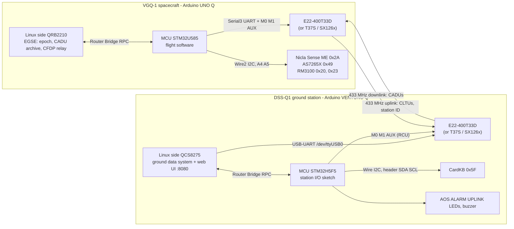
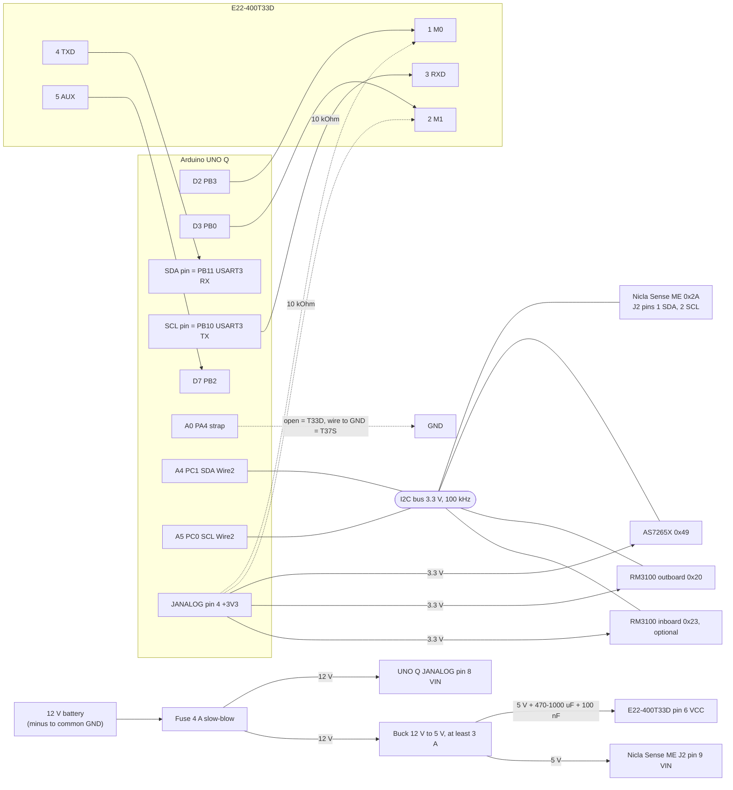
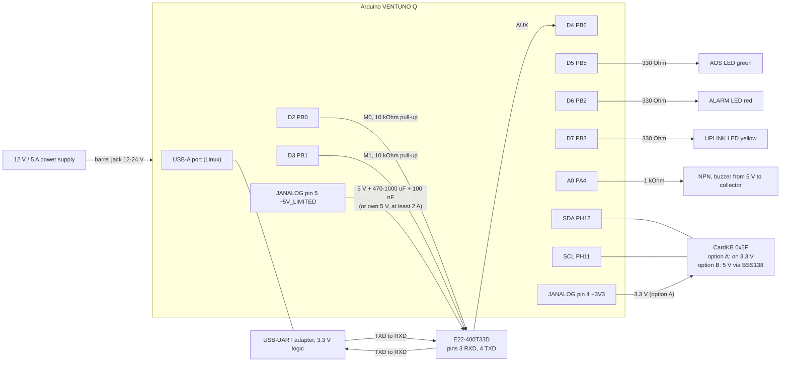

# 03 - Hardware Integration (pins, wiring, power, parts)

This is the wiring reference for both ends of the link:

* **VGQ-1 spacecraft** - Arduino UNO Q (ABX00162), App [`vgq1-spacecraft`](../vgq1-spacecraft/).
* **DSS-Q1 ground station** - Arduino VENTUNO Q (ABX00181), App [`dssq-groundstation`](../dssq-groundstation/).

If you are building the system for the first time, follow
[00_Beginner_Setup_Guide.md](00_Beginner_Setup_Guide.md): it walks through the same wiring
in small steps with a check after each one. This document holds the complete tables.

Every pin in this document matches the code. The code wins if they ever differ:

| End | Pins are defined in |
|---|---|
| Spacecraft | [`vgq1-spacecraft/sketch/src/config.h`](../vgq1-spacecraft/sketch/src/config.h) |
| Ground station MCU | [`dssq-groundstation/sketch/sketch.ino`](../dssq-groundstation/sketch/sketch.ino) (section "pin map") |
| Ground station radio settings | [`dssq-groundstation/python/config/station.toml`](../dssq-groundstation/python/config/station.toml) `[radio]` |

Change a pin in the code and in this document together.

**Sources** (each fact below names its source):

| Short name used below | Document |
|---|---|
| ABX00162 | Arduino UNO Q datasheet (modified 17/06/2026) and the Arduino "UNO Q Power Specifications" tutorial |
| ABX00181 | Arduino VENTUNO Q datasheet (modified 06/10/2026) and the VENTUNO Q user manual |
| ABX00050 | Arduino Nicla Sense ME datasheet (modified 08/10/2026) |
| T33D manual | EBYTE E22-400T33D (V2.1) user manual v1.05 |
| T37S manual | EBYTE E22-xxxT37S user manual v1.5 |
| TBH-02 manual | EBYTE E22/E32-xxxTBH-02 user manual v1.0 |
| AS7265x DS | ams AS7265x datasheet v1-04; SparkFun "Spectral Triad (AS7265x) Hookup Guide" (SEN-15050) |
| RM3100 manual | PNI "RM3100 & RM2100 Sensor Suite User Manual", Doc 1017252 r06 |
| SX1261/2 DS | Semtech SX1261/2 datasheet rev 2.2 |
| CardKB page | M5Stack "CardKB Mini Keyboard Programmable Unit (MEGA328P)", SKU U035 |
| contract N | a section of the project's design contract, the citation tag the code comments use; the tags are indexed in [12_Design_Decisions.md](12_Design_Decisions.md) appendix B (citation tags) |

A value that no source gives and no test has measured is marked **VERIFY on hardware**.
Every such item is listed in section 11 and collected in
[20_Known_Limitations.md](20_Known_Limitations.md); the tests that close them are in
[08_Verification_and_Test.md](08_Verification_and_Test.md).

Notation: "JANALOG pin 9 (A0, PA4)" means header JANALOG, pin 9, Arduino name A0, MCU pin PA4.
The quoted names **"SDA"** and **"SCL"** mean the header pins printed SDA and SCL on the board.

---

## Contents

1. [Configurations at a glance](#1-configurations-at-a-glance)
2. [System overview](#2-system-overview)
3. [Logic levels and buses](#3-logic-levels-and-buses)
4. [Spacecraft (UNO Q) wiring](#4-spacecraft-uno-q-wiring)
5. [Ground station (VENTUNO Q) wiring](#5-ground-station-ventuno-q-wiring)
6. [Power budget and PSU sizing](#6-power-budget-and-psu-sizing)
7. [Bill of materials](#7-bill-of-materials)
8. [Thermal](#8-thermal)
9. [Magnetic cleanliness](#9-magnetic-cleanliness)
10. [Antennas, coax and bench RF](#10-antennas-coax-and-bench-rf)
11. [Hardware items to verify](#11-hardware-items-to-verify)

---

## 1 Configurations at a glance

| Item | Default (no code edit) | Options |
|---|---|---|
| Radio, both ends | EBYTE **E22-400T33D**, 2 W (33 dBm), UART | **E22-400T37S** on the E22-400TBH-02 board, 5 W (37 dBm): spacecraft = jumper on A0 (section 4.5), ground = `station.toml`. **SX126x** module on SPI (reference: EBYTE E22-400M33S): build switch on both ends (section 4.6, 5.3.3) |
| Spacecraft power | Configuration A: 12 V battery on UNO Q VIN + 12 V to 5 V buck for the radio (section 4.2) | Configuration B: board-powered radio from JANALOG pin 5 (section 4.2.2) |
| Ground radio power | Its own 5 V supply, or the VENTUNO Q +5V_LIMITED pin | E22-400T37S: its own 12 V supply |
| Sensors | One I2C bus on UNO Q A4/A5 (`Wire2`) | RM3100 inboard unit optional |
| Keyboard | One M5Stack CardKB on the VENTUNO Q header SDA/SCL (`Wire`) | 3.3 V supply (option A) or 5 V through a level shifter (option B) |

The only Qwiic use is optional: the AS7265X may be plugged into the UNO Q Qwiic socket instead of
A4/A5 (section 4.7, D-13). Nothing else uses a Qwiic connector, on either board.

---

## 2 System overview



The radio carries one 236-octet CADU per LoRa packet on the downlink. On the uplink each packet
carries one CLTU of at most 90 octets (a 64-octet TC frame), or the ground's plain-text station
identification `DE <callsign> <name>` ([04_Space_Data_Link_ICD.md](04_Space_Data_Link_ICD.md)
sections 3.1, 5.1 and 5.8). Software architecture: [01_System_Design.md](01_System_Design.md).

---

## 3 Logic levels and buses

Everything in this project is **3.3 V logic**. Only power pins carry 5 V or 12 V.

| Part | Logic level | Limits and notes | Source |
|---|---|---|---|
| UNO Q JDIGITAL, JANALOG | 3.3 V | Most JDIGITAL pins are 5 V tolerant as inputs. **D3 (PB0) is TT type: 3.6 V maximum, never 5 V.** A0..A5 are not 5 V tolerant; for A4/A5 used as I2C3 "use pull-ups to 3.3 V only". Absolute maximum on the maker headers 3.6 V | ABX00162 9.6, 9.7; power tutorial "Pin-Level Power Tolerances" |
| VENTUNO Q JDIGITAL, JANALOG | 3.3 V | "Most pins are 5 V-tolerant as inputs in digital mode." A0 and A1 are not 5 V tolerant. A4/A5 have no hardware I2C | ABX00181 9.1, 9.2 |
| E22-400T33D | 3.3 V TTL | "There is a risk of burnout when using the 5V level" | T33D manual 2.2 |
| E22-400T37S | 3.3 V TTL | "Using 5V level may cause burnout risk, so a level conversion circuit is required" | T37S manual 2.2 |
| SX126x module (E22-400M33S) | 3.3 V | SX1262 supply range 1.8-3.7 V; module supply and pin-out: **VERIFY on hardware** against the module datasheet | SX1261/2 DS Table 3-3 |
| AS7265X (SparkFun SEN-15050) | 3.3 V | Supply 2.7-3.6 V on I2C; "3.3V compatible", board pull-ups go to its 3.3 V supply | AS7265x DS Fig. 7; hookup guide |
| RM3100 | 3.3 V | Supply 2.0-3.6 V (3.0 V typical); VIH = 0.7 x DVDD | RM3100 manual Table 3-5 |
| Nicla Sense ME | VDDIO_EXT = 3.3 V | Header I/O is level-translated to VDDIO_EXT; the ARU firmware sets 3.3 V in `BHY2.begin()` | ABX00050 3.1, 6; [`nicla_sense_me_aru.ino`](../nicla_sense_me_aru/nicla_sense_me_aru.ino) |
| CardKB | not published | M5Stack specifies a 5 V supply and does not publish the I2C level or pull-ups: supply it from 3.3 V (option A) or put it behind a BSS138 level shifter (option B) | CardKB page; contract 16.3, 21 |
| USB-UART adapter (ground T33D) | must be 3.3 V | A 5 V adapter can damage the E22 | T33D manual 2.2 |

Buses and serial ports used:

| Board | Bus | Pins | Speed | Devices |
|---|---|---|---|---|
| UNO Q | `Wire2` = I2C3 | JANALOG pin 13 A4 (PC1) SDA, pin 14 A5 (PC0) SCL | 100 kHz (`kI2cClockHz`) | Nicla 0x2A, AS7265X 0x49, RM3100 0x20 and 0x23 |
| UNO Q | `Serial3` = USART3 | "SDA" PB11 = RX, "SCL" PB10 = TX | 9600 8N1 (`kE22UartBaud`) | E22 (UART models) |
| UNO Q | `SPI` = SPI2 | D10..D13 | 2 MHz (`kSpiHz`, drivers/sx126x.cpp) | SX126x option only |
| VENTUNO Q | `Wire` = I2C4 | JDIGITAL pin 17 SDA (PH12), pin 18 SCL (PH11) | 100 kHz | CardKB 0x5F |
| VENTUNO Q | `SPI` = SPI2 | D10..D13 | 2 MHz (RadioLib default, sketch.ino) | SX126x option only |
| VENTUNO Q Linux | USB | USB-A port | 9600 8N1 | E22 through a USB-UART (`/dev/ttyUSB0`) |

Why the UNO Q pins printed "SDA"/"SCL" are a UART here: the D0/D1 UART (`Serial1`) is also
the Zephyr console, so boot messages would be transmitted over the air and a log line could
corrupt a frame (config.h `VGQ_RADIO_ON_SERIAL1`). `Serial3` is routed to PB10/PB11, the pins
printed SDA/SCL. The flight software never calls `Wire.begin()`, because `Wire` (I2C2) shares
PB10/PB11 (config.h).

On the VENTUNO Q, wire the CardKB **by the SDA and SCL silkscreen**: Arduino's user manual
calls them D20/D21, while the ArduinoCore-zephyr variant lists the two GPIO numbers the other
way round; the I2C4 peripheral fixes the roles (sketch.ino header; ABX00181 9.2).

---

## 4 Spacecraft (UNO Q) wiring

### 4.1 Pin map (UNO Q, ABX00162)

| Header pin | Arduino name | MCU pin | Function in this project | Direction | Code symbol |
|---|---|---|---|---|---|
| JDIGITAL 3 | D2 | PB3 | E22 M0 | out | `PIN_E22_M0` |
| JDIGITAL 4 | D3 | PB0 | E22 M1 (**3.6 V max**) | out | `PIN_E22_M1` |
| JDIGITAL 8 | D7 | PB2 | E22 AUX (LOW = busy) | in, pull-up | `PIN_E22_AUX` |
| JDIGITAL 17 | D20, printed "SDA" | PB11 | USART3 RX, from E22 TXD | in | `RADIO_SERIAL` = `Serial3` |
| JDIGITAL 18 | D21, printed "SCL" | PB10 | USART3 TX, to E22 RXD | out | `RADIO_SERIAL` |
| JANALOG 9 | A0 / D14 | PA4 | Radio-model strap: jumper to GND = E22-400T37S, open = E22-400T33D | in, internal pull-up | `PIN_RADIO_MODEL_STRAP` = 14 |
| JANALOG 13 | A4 / D18 | PC1 | Sensor I2C SDA (`Wire2`) | open drain | `SENSOR_WIRE`, `kPinSensorSda` = 18 |
| JANALOG 14 | A5 / D19 | PC0 | Sensor I2C SCL (`Wire2`) | open drain | `kPinSensorScl` = 19 |
| JANALOG 4 | +3V3 OUT | - | 3.3 V for AS7265X, RM3100s, M0/M1 pull-ups | power out | - |
| JANALOG 5 | +5V USB VBUS | - | Configuration B only: E22-400T33D VCC | power, pass-through of USB-C VBUS | - |
| JANALOG 6, 7 | GND | - | Common ground | - | - |
| JANALOG 8 | VIN | - | Configuration A: 12 V input (7-24 V) | power in | - |
| JDIGITAL 15 | GND | - | Common ground | - | - |
| USB-C | - | - | App Lab connection; power in configuration B | - | - |
| On board | 13 x 8 LED matrix | - | Spacecraft status lights ([06_Displays.md](06_Displays.md)) | - | `fsw/status_display.*` |

SX126x build only (section 4.6): D4, D5, D6, D8, D9, D10, D11, D12, D13.
Not used: D0/D1 (Zephyr console), JSPI. The Qwiic connector (`Wire1` = I2C4, PD12/PD13) is
used only when the AS7265X is plugged in there (section 4.7).

**Hardware watchdog: nothing to wire.** The flight software arms the STM32U585's own independent
watchdog (IWDG) at the end of `setup()` (config.h `VGQ_IWDG` = 1, `kIwdgTimeoutMs` = 40000 ms):
no pin, jumper or external part is involved. What it means during bring-up:

* A loop pass that hangs for 40 s resets the MCU; the next boot reports `reset_cause` 3
  WATCHDOG (HK, EVR 0x0001) and comes up in SAFE mode.
* A missing or miswired radio or instrument is not expected to trip it: the slowest documented
  pass, an E22 configuration attempt on a dead module, takes about 4 s, far below 40 s
  ([01_System_Design.md](01_System_Design.md) section 9.4).
* Uploading from App Lab resets the MCU first, so re-flashing works as usual. The watchdog is
  frozen while a debugger halts the core; `VGQ_IWDG` 0 switches it off for bench debugging
  only.
* It has not yet been provoked on the hardware: test T-FD-09, record WDG in
  [21_Test_Records.md](21_Test_Records.md) (docs/20 L-38). The station sketch has no watchdog.

### 4.2 Power

The UNO Q accepts 5 V on USB-C (the board requests a 5 V / 3 A contract; "Use a supply and
cable rated for 5 V at 3 A"), 7-24 V on VIN, or 5 V on the JANALOG 5 V pin (ABX00162 3.1).
USB-C VBUS and the output of the VIN buck are diode-OR'd onto 5V_SYS through Schottky diodes;
Arduino measured 0.35 V forward drop at 1 A, 0.37 V at 1.5 A and 0.39 V at 2 A (ABX00162 3.1).
Arduino warns that a supply that current-limits during peaks can reset the board.

The radio is never powered from a 3.3 V pin.

#### 4.2.1 Configuration A - external supply (default, recommended)

| From | To | Notes |
|---|---|---|
| 12 V battery or bench supply (+) | 4 A slow-blow fuse | as close to the battery as possible |
| Fuse | UNO Q JANALOG pin 8 (VIN) | 7-24 V input (ABX00162 3.2) |
| Fuse | 12 V to 5 V buck converter input, rated >= 3 A | contract 1.3 |
| Buck 5 V output | E22-400T33D pin 6 VCC | 3.3-5.5 V, >= 4.7 V for full power (T33D manual 2.2) |
| Buck 5 V output | Nicla Sense ME J2 pin 9 VIN | 3.5-5.5 V (ABX00050 3.1) |
| UNO Q JANALOG pin 4 (+3V3 OUT) | AS7265X 3.3V pin, RM3100 VDD, 10 kOhm M0/M1 pull-ups | 3.3 V loads only |
| Battery (-) | UNO Q GND, buck GND, E22 GND, Nicla GND, sensor GNDs | **one common ground** |

Fit **470-1000 uF low-ESR electrolytic + 100 nF ceramic** directly at the E22 VCC/GND pins
(contract 15) and use short, thick supply wires: the E22-400T33D draws 1.0 A typical,
1.2 A maximum while transmitting at 33 dBm (T33D manual 2.2). EBYTE asks for more than 30 %
margin in the module's power supply design (T33D manual ch. 10).

The USB-C cable to the PC may stay connected while VIN is powered: both inputs are diode-OR'd.

#### 4.2.2 Configuration B - board-powered radio (supported, owner's test configuration)

UNO Q JANALOG pin 5 is "+5V USB VBUS, 5 V supply (pass-through), power only" (ABX00162 9.7):
it is the USB-C VBUS net (5V_USB_VBUS), **not** the 5V_SYS diode-OR output. It carries 5 V
only when the board is powered through USB-C (contract 16.2). So:

| Step | Detail |
|---|---|
| 1 | Power the UNO Q **through USB-C** from a regulated 5 V supply rated **>= 5 A** (contract 16.2; this document recommends >= 6 A, see section 6.4), e.g. a 12 V to 5 V buck with a USB-C lead. |
| 2 | Take the E22-400T33D VCC from **JANALOG pin 5**, GND from JANALOG pin 6 or 7. |
| 3 | **Do not** power the UNO Q from VIN in this configuration (pin 5 may then be unpowered). |
| 4 | Fit 470-1000 uF low-ESR + 100 nF at the module, short thick wires (contract 15). |
| 5 | Measure pin 5 at the module **during a long transmission**: it must stay >= 4.7 V for full power (T33D manual 2.2). This is test **T-HW-07** ([08_Verification_and_Test.md](08_Verification_and_Test.md)); record it in [21_Test_Records.md](21_Test_Records.md) record PWR. |

Consequence to know: in configuration B the radio current also flows through the USB-C cable
and connector. With the board's own 3 A design budget plus 1.2 A for the radio the cable can
carry up to about 4.5 A (section 6.4), more than a standard 3 A USB-C cable is rated for.
Use a short cable rated for 5 A. **VERIFY on hardware** (T-HW-07).

Brown-out protection in the software: if the MCU restarts with reset cause BROWNOUT, the radio
starts at power code `kBrownoutPowerCode` = 2 (27 dBm on the T33D, VERIFY T-RF-07) and EVR
0x0608 says "brownout reset: TX power derated (code N) - check radio supply"; the ground shows
a YELLOW alarm. Restore full power with `TXPWR 0` once the supply is fixed (config.h,
`radio_boot_power_code()` in drivers/radio.h).

#### 4.2.3 E22-400T37S supply (5 W option)

The E22-400T37S on its E22-400TBH-02 board takes **4.5-15 V** on the DC jack or the green
screw terminal; the terminal is disabled while a plug is in the DC jack (TBH-02 manual 2.2).
Give it **its own fused 12 V branch** (2 A fuse) from the battery, or its own 12 V supply:

| Supply voltage | TX current (min / typ / max) | EBYTE supply rule | Source |
|---|---|---|---|
| 12 V | 0.9 / 1.1 / 1.3 A | supply of at least 1.5 A | T37S manual 2.2 |
| 5 V | 2.9 / 3.1 / 3.3 A | supply of at least 3.5 A | T37S manual 2.2 |

Use 12 V: at 5 V the module draws three times the current ("the lower the voltage, the
greater the supply current", T37S manual 2.2). Never take its supply from a board header:
UNO Q JANALOG pin 5 only passes USB VBUS, VENTUNO Q VIN (JANALOG pin 8) has a 1.1 A PTC fuse
and VENTUNO Q +5V_LIMITED is limited to 2.8 A (ABX00181 9.1, 9.3).

### 4.3 Radio: E22-400T33D (default)

The module has seven 2.54 mm pins (T33D manual ch. 3) and an SMA antenna socket.

| E22-400T33D pin | Direction | UNO Q | Notes |
|---|---|---|---|
| 1 M0 | UNO Q to E22 | D2 (PB3), JDIGITAL 3 | + 10 kOhm pull-up to 3.3 V (JANALOG pin 4) |
| 2 M1 | UNO Q to E22 | D3 (PB0), JDIGITAL 4 | + 10 kOhm pull-up to **3.3 V only** (D3 is not 5 V tolerant) |
| 3 RXD | UNO Q to E22 | "SCL" (PB10, USART3 TX), JDIGITAL 18 | UART, 9600 8N1 |
| 4 TXD | E22 to UNO Q | "SDA" (PB11, USART3 RX), JDIGITAL 17 | UART |
| 5 AUX | E22 to UNO Q | D7 (PB2), JDIGITAL 8 | LOW while the module is busy |
| 6 VCC | power | 5 V: buck (configuration A) or JANALOG pin 5 (configuration B) | + 470-1000 uF + 100 nF at the pins |
| 7 GND | power | GND | common ground |

Why the pull-ups: EBYTE describes M0/M1 as "very weak pull-up ... can not be suspended". With
10 kOhm to 3.3 V the module rests in mode 3 (deep sleep, M1 = M0 = 1) while the MCU boots and
its pins float, so the PA can never key by accident (config.h). Mode table (T33D manual 6.1):
M1 M0 = 0 0 normal, 0 1 WOR, 1 0 configuration (always 9600 8N1), 1 1 deep sleep.

The flight software writes the complete register set into the module at every boot (volatile
C2 write) and reads it back to verify it; nothing has to be configured by hand on the
spacecraft module (`E22Radio::configure()` in drivers/e22.cpp).

### 4.4 Radio: E22-400T37S on the E22-400TBH-02 board (5 W option)

The TBH-02 board (TBH-02 manual 2.2) has a 20-pin header in two rows, a CH340X USB-UART on a
USB-C socket, an SMA socket, a DC jack and a green screw terminal.

```
 top row    11 3.3V  12 GND  13 SWCLK  14 SWDIO  15 NC  16 NC  17 NC  18 485-EN  19 STATE  20 GND
 bottom row  1 GND    2 GND   3 RESET   4 AUX     5 TXD  6 RXD  7 M1  8 GND     9 GND     10 M0
                                                                [cap 7-8]       [cap 9-10]
 near USB-C: [RXD cap] [TXD cap]  - connect the CH340X USB-UART to the module
 cap fitted = pin held at GND (0), cap removed = pulled up (1).  Mode 0 = both mode caps fitted.
```

On the **spacecraft**, remove **all four caps** (M0, M1, RXD, TXD) and wire:

| TBH-02 header pin | Direction | UNO Q | Notes |
|---|---|---|---|
| 10 M0 | UNO Q to E22 | D2 (PB3) | + 10 kOhm pull-up to 3.3 V |
| 7 M1 | UNO Q to E22 | D3 (PB0) | + 10 kOhm pull-up to 3.3 V only |
| 6 RXD | UNO Q to E22 | "SCL" (PB10, USART3 TX) | |
| 5 TXD | E22 to UNO Q | "SDA" (PB11, USART3 RX) | |
| 4 AUX | E22 to UNO Q | D7 (PB2) | |
| 1 GND (or 2, 8, 9, 12, 20) | - | GND | common ground |
| 3 RESET, 11 3.3V, 13-19 | - | not connected | EBYTE: "No need to care, hovering treatment" for 11-17 |
| DC jack / green terminal | power | own fused 12 V branch | 4.5-15 V (section 4.2.3) |

The RXD/TXD caps must be removed on the spacecraft because they connect the board's CH340X to
the same module pins the UNO Q drives (config.h). Then fit the model strap (section 4.5).

### 4.5 Radio-model strap: selecting the 5 W module without a code edit

One flight binary serves both E22 models (contract 33). At boot the flight software reads
**JANALOG pin 9 (A0, PA4)** with the MCU's internal pull-up, five times 1 ms apart, and takes
the majority (config.h `kStrapSamples` = 5, `kStrapSettleUs` = 1000):

| A0 | Model used | Effect |
|---|---|---|
| open | the build's `VGQ_RADIO` (default E22-400T33D) | power codes 0..3 = 33 / 30 / 27 / 24 dBm (codes 1..3 VERIFY T-RF-07) |
| jumper wire to GND | **E22-400T37S** | power codes ignored (always 37 dBm), REG1 = 0x24, abnormal-status reports FF FF FF 01..04 decoded |

* Use a plain wire from JANALOG pin 9 (A0) to a GND pin (JANALOG pin 6 or 7, or JDIGITAL 15).
  **Never connect A0 to 5 V or VIN**: A0 is not 5 V tolerant, absolute maximum about 3.6 V
  (ABX00162 9.7).
* The strap is read **once at boot**: power-cycle the UNO Q after changing it.
* The strap exists on the spacecraft (UNO Q) only. On the VENTUNO Q, A0 drives the buzzer
  (section 5.1): never fit a strap there; the ground's model is set in `station.toml`
  `[radio] model` ("E22-400T37S" or "auto").
* Check: EVR 0x0308 at boot, e.g. `radio model E22-400T37S (strap to GND, 5/5 low; build
  E22-400T33D)`, and the RF packet field `radio_model` (shown on the ground). A split reading
  (some reads LOW, some HIGH: a loose jumper) is reported as a WARN and decided by majority
  (`Flight::report_radio_model()`). Test T-HW-09 ([08_Verification_and_Test.md](08_Verification_and_Test.md)).
* PA4 is assigned to DAC1 in the board device tree, but the Zephyr DAC driver only enables the
  output on `analogWrite()`, which this software never calls; `pinMode()` makes it a GPIO input
  (config.h comment).
* Both models keep the flight transmit duty at or below 50 % (`kMaxTxDutyPermille` = 500).
* The SX126x option is a different wiring and stays a build switch; the strap never turns an
  SX126x build into a UART one (`e22_strap_model()`).
* 5 W at 433 MHz needs a licence that allows it ([09_Regulatory_and_Safety.md](09_Regulatory_and_Safety.md)).

### 4.6 SX126x option on SPI (reference module EBYTE E22-400M33S)

Selected at build time on both ends: flight `config.h` `#define VGQ_RADIO VGQ_RADIO_SX126X`
(and `VGQ_SX126X_CHIP` 1268 or 1262); station `sketch.ino` `#define DSSQ_RADIO_SX126X 1`
(and `DSSQ_SX_CHIP`); `station.toml` `[radio] model = "SX126x"`. RadioLib 7.8.1 is bundled in
each App ([22_Bundled_Libraries.md](22_Bundled_Libraries.md)).

| Signal | UNO Q pin (config.h) | VENTUNO Q pin (sketch.ino) |
|---|---|---|
| SCK | D13 (PB13) | D13 (PB13) |
| MISO | D12 (PB14) | D12 (PB14) |
| MOSI | D11 (PB15) | D11 (PB15) |
| NSS | D10 (PB9) `PIN_SX_NSS` | D10 (PB12) `PIN_SX_NSS` |
| BUSY | D4 (PA12) `PIN_SX_BUSY` | D8 (PB4) `PIN_SX_BUSY` |
| DIO1 | D5 (PA11) `PIN_SX_DIO1` | D9 (PB7) `PIN_SX_DIO1` (polled) |
| NRST | D6 (PB1) `PIN_SX_NRST` | A1 (PA5) `PIN_SX_NRST` |
| RXEN | D8 (PB4) `PIN_SX_RXEN` | A2 (PE12) `PIN_SX_RXEN` |
| TXEN | D9 (PB8) `PIN_SX_TXEN` | A3 (PE13) `PIN_SX_TXEN` |
| VCC, GND | module supply, common ground | module supply, common ground |

On the ground the SX126x pins do not collide with the lamps (D5-D7), the buzzer (A0) or the
CardKB bus (sketch.ino header). Module settings that depend on the module and must be
**verified on hardware** against its datasheet: TCXO supply on DIO3 `kSxTcxoV` = 1.8 V,
`kSxDio2RfSwitch` = false (RXEN/TXEN drive the RF switch), PA gain `kSxPaGainDb` = 11 dB
(T-RF-07), current limit `kSxOcpMa` = 140 mA (an SX1262 value), and the module's supply
voltage and current (not part of this project's references; budget it like the T33D until
measured). Both ends need a TCXO for bandwidths below 62.5 kHz (contract 14).

### 4.7 Sensor bus (`Wire2` on A4/A5, 3.3 V, 100 kHz)

One I2C bus, one controller (the UNO Q), every device at its own address, so nothing
clashes and no multiplexer is needed (config.h):

| Device | Address | Strap | Required? |
|---|---|---|---|
| RM3100 outboard (boom tip) | 0x20 | SA1 = 0, SA0 = 0 | yes (science magnetometer) |
| RM3100 inboard (mid-boom) | 0x23 | SA1 = 1, SA0 = 1 | optional, auto-detected and re-probed |
| Nicla Sense ME (ARU firmware) | 0x2A | fixed in the firmware | yes (attitude, environment) |
| AS7265X Spectral Triad | 0x49 | fixed | yes (spectrometer) |

RM3100 address = 0x20 + (SA1 x 2 + SA0) (drivers/sensors.h). Do not use 0x21 or 0x22.

#### 4.7.1 Per-device wiring

**Nicla Sense ME** (flash the ARU firmware first, see [00_Beginner_Setup_Guide.md](00_Beginner_Setup_Guide.md) part 4):

| Nicla J2 pin (ABX00050 6.2) | Connect to |
|---|---|
| 1 SDA | UNO Q A4 (JANALOG 13) |
| 2 SCL | UNO Q A5 (JANALOG 14) |
| 6 GND | GND |
| 9 VIN | 5 V (3.5-5.5 V): the buck in configuration A, JANALOG pin 5 in configuration B |
| 7 VDDIO_EXT | **leave unconnected** (the firmware generates 3.3 V) |

**AS7265X** (SparkFun SEN-15050), either on its four solder pins to A4/A5 (table below) or with a
Qwiic cable from one of its Qwiic sockets to the UNO Q Qwiic socket (after the table). The flight
software looks for it on A4/A5 first, then on the Qwiic socket, at boot and at every re-probe,
and names the bus in EVR 0x0706 (`... on A4/A5` or `... on Qwiic`). On A4/A5:

| AS7265X pin | Connect to | Notes |
|---|---|---|
| 3.3V | UNO Q +3V3 OUT (JANALOG 4) | 3.3 V only: its pull-ups go to this supply |
| GND | GND | |
| SDA | A4 | |
| SCL | A5 | |
| INT | **leave unconnected** | first-generation "Moonlight" ICs have !INT and !RST-ADDR swapped; the driver polls DATA_RDY (`kPinSpecInt` = -1, contract 19) |

Leave the front "I2C" jumper closed (it carries the SDA/SCL pull-ups to 3.3 V) and JP2 on the
back open (closing it switches the board to UART/AT commands) (contract 19).

On the Qwiic socket instead: one Qwiic cable, nothing else (it carries 3.3 V, GND, SDA and SCL);
the same jumper settings, the board's pull-ups then serve the Qwiic bus. Two consequences:
the A4/A5 bus loses the pull-ups the AS7265X provided, so with an RM3100 or the Nicla Sense ME on
A4/A5 fit 4.7 kOhm from A4 and from A5 to 3.3 V (section 4.7.2, check 1); and the lamp current
(section 10) then comes from the Qwiic socket's 3.3 V (**VERIFY** on the bench: a lamp
measurement must not reset the board). The board needs no
programming: its firmware is in an on-board EEPROM read at power-on (hookup guide).

**RM3100** (outboard 0x20; the optional inboard unit 0x23 is identical except the address straps).
The names below are the MagI2C chip pins (RM3100 manual Table 4-1); breakouts print their own
names, usually the same signal names. Check your breakout's silkscreen (**VERIFY** for your
breakout):

| Signal (MagI2C chip pin) | Outboard 0x20 | Inboard 0x23 |
|---|---|---|
| AVDD / DVDD (4, 14, 26) | 3.3 V (JANALOG 4) | 3.3 V |
| AVSS / DVSS (5, 19) | GND | GND |
| SDA = MOSI (1) | A4 | A4 |
| SCL = SCLK (27) | A5 | A5 |
| I2CEN (22) | 3.3 V (HIGH = I2C) | 3.3 V |
| SA0 = SSN (3) | GND | 3.3 V |
| SA1 = MISO (28) | GND | 3.3 V |
| DRDY (23) | not connected (polled over I2C) | not connected |

#### 4.7.2 Pull-ups and cable

* Every pull-up on this bus goes to **3.3 V** (ABX00162 9.7: A4/A5 "use pull-ups to 3.3 V only").
  Never power a breakout from 5 V if its pull-ups go to its own supply (contract 16.1).
* Aim for **one** effective set of pull-ups of about 2-5 kOhm. The AS7265X board provides one set
  (I2C jumper closed) while it is on A4/A5; on the Qwiic socket it does not. If other breakouts
  add their own, open their pull-up jumpers first.
* Why that range: in standard mode (100 kHz) the I2C specification needs
  Rp >= (VDD - 0.4 V) / 3 mA = 0.97 kOhm at 3.3 V, and Rp <= 1000 ns / (0.8473 x Cb), i.e. about
  5.9 kOhm for 200 pF of bus capacitance (NXP UM10204, section 7.1).
* Check 1 (power off): resistance from A4 to 3.3 V and from A5 to 3.3 V reads roughly
  1-5 kOhm. Open circuit = no pull-up anywhere (fit 4.7 kOhm to 3.3 V on each line).
* Check 2 (power on, bus idle): A4 and A5 read 3.2-3.3 V.
* Boom cable: at most about 1 m at 100 kHz; twist SDA with a GND wire and SCL with a GND wire;
  keep it away from the radio supply wires (section 9). **VERIFY on hardware** for your cable
  (record MAG in [21_Test_Records.md](21_Test_Records.md) notes any I2C errors: HK `i2c_errors`).
* Recovery is built in: a device that holds SDA low is freed by up to 9 SCL pulses and a STOP,
  then the controller is re-initialised (drivers/i2c_bus.h, FDIR I2C_BUS, EVR 0x0605 / 0x060A).

### 4.8 Spacecraft wiring diagram (configuration A, E22-400T33D)



---

## 5 Ground station (VENTUNO Q) wiring

### 5.1 Pin map (VENTUNO Q MCU, ABX00181)

| Header pin | Arduino name | MCU pin | Function | Direction | Code symbol (sketch.ino) |
|---|---|---|---|---|---|
| JDIGITAL 3 | D2 | PB0 | Radio Control Unit: E22 M0 | out | `PIN_RCU_M0` |
| JDIGITAL 4 | D3 | PB1 | RCU: E22 M1 | out | `PIN_RCU_M1` |
| JDIGITAL 5 | D4 | PB6 | RCU: E22 AUX | in, pull-up | `PIN_RCU_AUX` |
| JDIGITAL 6 | D5 | PB5 | AOS lamp (green) | out | `PIN_LED_AOS` |
| JDIGITAL 7 | D6 | PB2 | ALARM lamp (red) | out | `PIN_LED_ALARM` |
| JDIGITAL 8 | D7 | PB3 | UPLINK lamp (yellow) | out | `PIN_LED_UPLINK` |
| JANALOG 9 | A0 | PA4 | Buzzer driver (NPN base) | out | `PIN_BUZZER` |
| JDIGITAL 17 | SDA | PH12 | CardKB SDA (`Wire` = I2C4) | open drain | `CARDKB_ADDR` 0x5F |
| JDIGITAL 18 | SCL | PH11 | CardKB SCL | open drain | |
| JANALOG 4 | +3V3 OUT | - | +3V3_LIMITED: CardKB option A, level-shifter LV, pull-ups | power out | - |
| JANALOG 5 | +5V USB | - | +5V_LIMITED (4.75-5.25 V, 2.8 A limit): buzzer, CardKB option B, board-powered E22-400T33D | power out | - |
| JANALOG 6, 7 / JDIGITAL 15 | GND | - | Common ground | - | - |
| USB-A | - | - | Linux: E22 USB-UART (`[radio] port`, usually `/dev/ttyUSB0`) | - | - |

SX126x build only: the pins of section 4.6. Not used: the Qwiic connector (`Wire1` = I2C3,
PC9/PA8), A4/A5, D0/D1.

### 5.2 Power

| Input | Range | Notes | Source |
|---|---|---|---|
| Barrel jack 5.5 x 2.1 mm | **12-24 V**, up to 5 A | Arduino recommends a supply of 60 W or more for heavy workloads, e.g. 12 V / 5 A or 24 V / 3 A | ABX00181 3.1, 3.2 |
| Screw terminal | 7-24 V, up to 10 A | at 7 V mind the cable drop: the board will not start below 7 V | ABX00181 3.1, 3.2 |
| USB-C PD | 9 / 15 / 20 V profiles, up to 3 A | a plain 5 V USB charger will not power the board | ABX00181 3.1, 3.2 |

Keep the board's fan running ("Make sure the fan remains operational during sustained
high-performance workloads", ABX00181 12.1). Sizing: section 6.5.

### 5.3 Ground radio

#### 5.3.1 E22-400T33D (default): USB-UART adapter + Radio Control Unit

The module's UART reaches Linux through a **3.3 V-logic USB-UART adapter**; the VENTUNO Q MCU
drives M0/M1 and reads AUX (the "Radio Control Unit", RCU), so the ground data system can
switch the module between NORMAL, WOR, CONFIG and SLEEP itself (dssq/radio/e22.py, radioctl.py).

| E22-400T33D pin | Connect to | Notes |
|---|---|---|
| 1 M0 | VENTUNO Q D2 (PB0) | + 10 kOhm pull-up to 3.3 V recommended; **no pull-down** |
| 2 M1 | VENTUNO Q D3 (PB1) | + 10 kOhm pull-up to 3.3 V recommended |
| 3 RXD | adapter TXD | 3.3 V logic only |
| 4 TXD | adapter RXD | |
| 5 AUX | VENTUNO Q D4 (PB6) | |
| 6 VCC | 5 V: its own 5 V supply rated >= 2 A (contract 1.3), or VENTUNO Q JANALOG pin 5 (+5V_LIMITED, contract 15) | + 470-1000 uF + 100 nF at the pins |
| 7 GND | adapter GND **and** VENTUNO Q GND | common ground |

Do not power the module from the adapter's VCC pin or a USB port: it draws up to 1.2 A when
transmitting (T33D manual 2.2).

Until `setup()` drives M0/M1 LOW (NORMAL), the pull-ups hold the module in deep sleep
(sketch.ino pin map comment). Without the RCU (`[gds] rcu = false` in station.toml) tie M0 and
M1 to GND (normal mode; EBYTE: "if not used, it can be grounded").

**One-time configuration of the ground module** (the GDS verifies but never rewrites the full
register set): the factory default has the RSSI byte and the ambient-noise register disabled
(T33D manual 7.2, 7.3), and the ground needs both (`[radio] rssi_byte = true`,
`rssi_noise = true`). Write `station.toml`'s settings into the module once, **before** wiring
the RCU, with the module in configuration mode (M1 = 3.3 V, M0 = GND):
`python3 -m dssq.radio.e22 --port /dev/ttyUSB0 --write --config <station.toml>`
(run from `dssq-groundstation/python`; the step-by-step version is in
[00_Beginner_Setup_Guide.md](00_Beginner_Setup_Guide.md) part 9.2). At every start the GDS reads
the configuration back and reports `ground E22-400T33D: ch 23 (433.125 MHz) rate 2.4k ... -
matches station.toml` or `MISMATCH [...]` (dssq/gds.py `_run_job`).

#### 5.3.2 E22-400T37S on the E22-400TBH-02 board

The board's own CH340X is the USB-UART: plug the board's USB-C into a VENTUNO Q USB-A port.

| Item | Setting |
|---|---|
| RXD / TXD caps | **keep fitted** (they connect the CH340X to the module) |
| M0 / M1 caps | remove them when the RCU is wired; otherwise keep both fitted (mode 0) and set `[gds] rcu = false` |
| Header 10 M0 | VENTUNO Q D2, + 10 kOhm to 3.3 V |
| Header 7 M1 | VENTUNO Q D3, + 10 kOhm to 3.3 V |
| Header 4 AUX | VENTUNO Q D4 |
| Header 8 GND | VENTUNO Q GND |
| Power | its own 12 V supply, >= 1.5 A, 2 A fuse (T37S manual 2.2) |
| station.toml | `[radio] model = "E22-400T37S"` and `fault_log = true` (the station's abnormal-status log; dssq/radio/e22.py `regs_from_cfg`) |

The one-time register write works the same way, with only the M1 cap removed
(configuration mode, TBH-02 manual ch. 3).

#### 5.3.3 SX126x option

Wiring in section 4.6 (VENTUNO Q column). The station sketch then talks to the module itself
and hands packets to Linux through the Router Bridge; no USB-UART and no RCU are used.

### 5.4 Station I/O: lamps, buzzer, CardKB

| Item | Wiring | Behaviour (sketch.ino; details in [06_Displays.md](06_Displays.md)) |
|---|---|---|
| AOS lamp, green LED | D5 to 330 Ohm to LED anode, cathode to GND | lit = signal acquired |
| ALARM lamp, red LED | D6, same | RED alarm 4 Hz blink; beacon INTERESTING / IMPORTANT / URGENT 1 / 2 / 3 Hz; YELLOW alarm steady; **5 Hz blink with AOS dark = no status from the GDS for 5 s** |
| UPLINK lamp, yellow LED | D7, same | lit while commands are outstanding |
| Buzzer, 5 V active type | A0 to 1 kOhm to NPN base (2N2222A or BC547B); buzzer + to 5 V (JANALOG 5), buzzer - to collector; emitter to GND. With a magnetic (electromagnetic) buzzer add a 1N4148 across it, cathode to +5 V | 400 ms tone on entering RED or at LOS; 2 / 3 chirps when the beacon rises to IMPORTANT / URGENT |

With 330 Ohm and 3.3 V outputs each LED draws a few mA (about 4 mA for a 2.0 V red LED).

**CardKB** (exactly one; M5Stack SKU U035 or its successor CardKB v1.1). Its Grove
(HY2.0-4P) socket carries, by M5Stack's colour code, black GND, red 5 V, yellow SDA, white SCL
(CardKB page). Adapter cables differ: **confirm against the CardKB's own connector print**.

| Option | Wiring | When |
|---|---|---|
| A (try first, no extra parts) | CardKB GND to GND, CardKB "5V" to **3.3 V** (JANALOG 4), SDA to header **SDA**, SCL to header **SCL** | nothing can be over-voltaged; it may not run reliably below its rated 5 V |
| B | CardKB on 5 V (JANALOG 5) through a **BSS138 bidirectional level shifter**: LV = 3.3 V, HV = 5 V; LV1/LV2 to header SDA/SCL, HV1/HV2 to CardKB SDA/SCL; common GND | if keys are erratic or the CardKB is not detected with option A |

The VENTUNO Q header I2C pins (PH11/PH12) carry the CardKB only. Whether the CardKB or the
VENTUNO Q has pull-ups on this bus is not published: if the CardKB is not detected with option A,
measure SDA/SCL to 3.3 V (power off) and fit 4.7 kOhm pull-ups to 3.3 V if they read open.
**VERIFY on hardware.** Level-shifter modules of the BSS138 type normally carry 10 kOhm pull-ups
on both sides.

Detection: the sketch polls 0x5F every 20 ms (`kKeyScanMs`) and reports presence in its hello
line every 5 s; the dashboard shows it (COMMANDING tab, Station I/O). `KEYTEST` + Enter echoes
raw key codes; Enter = 0x0D or 0x0A, Backspace = 0x08 or 0x7F, ESC = 0x1B are accepted, so both
CardKB versions work (contract 21).

### 5.5 Ground station wiring diagram (E22-400T33D)



---

## 6 Power budget and PSU sizing

### 6.1 Load data

| Load | Rail | Current | Source |
|---|---|---|---|
| UNO Q board | 5 V | up to 3 A (design budget: "Use a supply and cable rated for 5 V at 3 A"); real consumption not published: **VERIFY on hardware** (record PWR) | ABX00162 3.1 |
| VENTUNO Q board | 12 V in | measured by Arduino at 12 V: booting 7.07 W average / 17.9 W peak; "Hello World on MPU" 7.52 W average / 13.3 W peak (used here as the stand-in for the ground data system, VERIFY) | ABX00181 3.4.1 |
| E22-400T33D TX at 33 dBm | 5 V | 0.85 min / 1.0 typ / 1.2 max A ("instantaneous") | T33D manual 2.2 |
| E22-400T33D RX | 5 V | 11 / 13 / 15 mA; sleep 2 uA | T33D manual 2.2 |
| E22-400T37S TX at 37 dBm | 12 V | 0.9 / 1.1 / 1.3 A (at 5 V: 2.9 / 3.1 / 3.3 A) | T37S manual 2.2 |
| E22-400T37S RX | 12 V | 43 mA typical; sleep 2 uA | T37S manual 2.2 |
| Nicla Sense ME | 5 V VIN | not specified for this firmware (Arduino lists 2.5 mA for BLE advertising with 1 Hz sensor polling); budget **0.1 A, estimate, VERIFY** | ABX00050 7.1 |
| AS7265X logic | 3.3 V | 5 mA maximum per device, 3 devices | AS7265x DS Fig. 7 |
| AS7265X lamps | 3.3 V | at most white 100 mA + IR 50 mA + UV 12.5 mA (firmware limits `kSpecLedMaxCode`), +/-10 %; indicator LED <= 8 mA (+/-30 %). The lamp current is drawn from the board's 3.3 V supply (**VERIFY** on the SparkFun schematic) | AS7265x DS Fig. 7; fsw/spectral.h |
| RM3100 | 3.3 V | 260 uA single-axis average at 24 Hz with cycle count 200; idle 1 uA | RM3100 manual Tables 3-1, 3-5 |
| CardKB | 5 V or 3.3 V | not published; budget 50 mA (estimate) | CardKB page |

Two rules used below:

* DC-DC efficiency is **assumed 85 %** for every converter (no converter is specified by the
  project; use your converter's datasheet value if you have it).
* A battery supplies constant-power loads with **more current as its voltage falls**: size at the
  lowest battery voltage. For a 3S Li-ion pack this document uses 9.0 V (3.0 V per cell; check
  your pack's cut-off).

All sums below are reproduced by short arithmetic; the worst cases are upper bounds, not
predictions. The measured numbers go into record PWR of [21_Test_Records.md](21_Test_Records.md).

### 6.2 Spacecraft, configuration A, E22-400T33D

| Branch | Peak at the load | From 12 V (/0.85) |
|---|---|---|
| UNO Q (15 W design budget) + 3.3 V instruments (205 mA = 0.68 W with every lamp lit) | 15.68 W | 18.44 W |
| Buck: E22-400T33D TX (5 V x 1.2 A = 6.0 W) + Nicla (0.5 W) | 6.5 W | 7.65 W |
| **Total peak** | | **26.1 W = 2.17 A at 12 V, 2.90 A at 9.0 V** |

* Battery or bench supply: **>= 4 A continuous** (2.90 A x 1.3 margin = 3.77 A).
* Fuse: **4 A slow-blow** in the 12 V line (contract 1.3).
* Buck for the radio: **>= 3 A at 5 V** (contract 1.3): 1.2 A + 0.1 A, more than 30 % margin.
* Upper-bound average at the flight's highest transmit duty (50 %, `kMaxTxDutyPermille`), lamps
  off: 21.9 W (1.97 A at 11.1 V). The real figure is dominated by the UNO Q's own
  consumption, which only a measurement gives.
* EBYTE: "Power and current have a non-linear relationship ... The current does not decrease
  proportionally as the power decreases" (T33D manual 7.2): a lower power code saves less
  current than the dB suggest.

### 6.3 Spacecraft with the E22-400T37S (5 W)

| Branch | Peak |
|---|---|
| UNO Q branch (as 6.2) | 18.44 W = 1.54 A at 12 V |
| Nicla buck (0.5 W / 0.85) | 0.05 A at 12 V |
| E22-400T37S, own fused branch | 1.3 A at 12 V (15.6 W), maximum |
| **Total at 12 V** | **2.89 A** |
| At 9.0 V (UNO Q and Nicla scale with voltage; the T37S is only specified at 5 V and 12 V) | about 3.4 A + the T37S increase at lower voltage (**VERIFY on hardware**) |

* Battery: **>= 5 A continuous**. T37S branch: 2 A fuse, supply able to deliver >= 1.5 A
  (T37S manual 2.2). Main branch: 4 A fuse as in 6.2.
* The T37S reports under-voltage below 4.5 V and over-voltage above 15 V (FF FF FF 01 / 02,
  T37S manual 5.7): a 4S LiFePO4 pack (14.6 V when full) is close to the 15 V limit.

### 6.4 Spacecraft, configuration B (board-powered E22-400T33D)

| Load on the 5 V supply | Current |
|---|---|
| UNO Q design budget | 3.0 A |
| 3.3 V instruments through the board (0.68 W / 0.85 / 5 V) | 0.16 A |
| E22-400T33D TX (JANALOG pin 5) | 1.2 A |
| Nicla Sense ME (if fed from pin 5) | 0.1 A |
| **Total** | **4.46 A** (22.3 W) |

* Supply: **>= 5 A** is the contract minimum; with EBYTE's 30 % margin the figure is 5.8 A, so
  **a 6 A supply** is recommended. The 12 V to 5 V converter feeding it is then a 30 W part.
* Voltage drop budget: the radio needs >= 4.7 V; from a 5.0 V supply that leaves 0.3 V for
  the cable, the connector and the board's VBUS path at 4.46 A, i.e. about 67 mOhm round trip.
  Short, thick wiring and a 5 A-rated USB-C cable. Measure (T-HW-07).

### 6.5 Ground station

| Load | Peak | From 12 V |
|---|---|---|
| VENTUNO Q (boot peak, ABX00181 3.4.1) | 17.9 W | 17.9 W |
| E22-400T33D TX from +5V_LIMITED (6.0 W / 0.85) | 6.0 W | 7.06 W |
| CardKB, buzzer, USB-UART (estimates 0.25 + 0.15 + 0.1 W, / 0.85) and lamps | 0.54 W | 0.63 W |
| **Total peak** | | **25.6 W = 2.13 A at 12 V** (2.77 A with 30 % margin) |

* On paper a 12 V / 3 A supply covers the station; follow Arduino's recommendation of
  **12 V / 5 A (60 W)** on the barrel jack for margin (ABX00181 3.1).
* The ground transmitter is used only for commands and its station identification: an uplink
  CLTU of at most 90 octets keeps the E22 busy for about 0.5 s at 2.4 kbit/s (483 ms by the
  `e22_airtime_ms()` model in drivers/radio.cpp); the identification text is shorter.
* E22-400T37S on the ground: its own 12 V supply >= 1.5 A (section 4.2.3), never from the
  board.
* Board-powered ground T33D: +5V_LIMITED is limited to 2.8 A and specified 4.75-5.25 V
  (ABX00181 3.2, 9.3), enough for the 1.2 A peak (contract 25.3).

### 6.6 Battery sizing (spacecraft)

Run time t = usable energy / average input power. Example with the upper-bound figures of 6.2:

| Pack | Energy | Usable (80 %) | At the 26.1 W peak | At the 21.9 W upper-bound average |
|---|---|---|---|---|
| 3S Li-ion 5 Ah (11.1 V nominal) | 55.5 Wh | 44.4 Wh | 1.7 h | 2.0 h |
| 4S LiFePO4 6 Ah (12.8 V nominal) | 76.8 Wh | 61.4 Wh | 2.4 h | 2.8 h |

Replace the 21.9 W with the average you measure (record PWR) for a real prediction. Use a pack
with a protection board (BMS) rated for the peak current, and never charge or heat lithium
cells inside the spacecraft structure ([09_Regulatory_and_Safety.md](09_Regulatory_and_Safety.md)).

### 6.7 Fuses and wiring

| Line | Fuse | Wire (general practice for short runs) |
|---|---|---|
| Spacecraft 12 V main | 4 A slow-blow | 0.75 mm2 (AWG 18) |
| E22-400T37S branch | 2 A slow-blow | 0.75 mm2 (AWG 18) |
| 5 V to the E22 (either model) | - (protected upstream) | 0.75 mm2, as short as possible |
| Signals | - | jumper wire / 0.14-0.25 mm2 |

Put the fuse at the battery end. Check polarity with a meter before every first power-up:
EBYTE warns that reverse polarity damages the modules permanently (T33D, T37S manuals ch. 10).

---

## 7 Bill of materials

Quantities are for **one spacecraft and one ground station**. Part numbers are the ones this
project was designed and documented against. Prices are given only where a supplier page was
captured for this project; they are approximate and change, so check the supplier. Generic
parts are given by value and rating; the "e.g." part is one example, not a requirement.

### 7.1 Spacecraft (VGQ-1)

| # | Qty | Part | Manufacturer / part number | Notes | Approx. price |
|---|---|---|---|---|---|
| S1 | 1 | Arduino UNO Q | Arduino **ABX00162** | flight computer | - |
| S2 | 1 | Arduino Nicla Sense ME | Arduino **ABX00050** | attitude reference unit, environment | - |
| S3 | 1 | SparkFun Triad Spectroscopy Sensor | SparkFun **SEN-15050** (AS72651/2/3) | spectrometer, wired by its solder pins | USD 69.95 (SparkFun hookup-guide page) |
| S4 | 1 (+1 optional) | RM3100 magnetometer | PNI **RM3100** (MagI2C + 3 coils) on a breakout exposing SA0, SA1, I2CEN | outboard 0x20, inboard 0x23; breakout part number: **VERIFY** with your supplier | - |
| S5 | 1 | LoRa UART module 2 W | EBYTE **E22-400T33D** (V2.1) | default radio | - |
| S6 | 1 | 433 MHz antenna, SMA | e.g. EBYTE **TX433-JK-20** (3.0 dBi, 210 mm) or **TX433-JZ-5** (2.0 dBi, 52 mm) | recommended by EBYTE (T33D manual 14.1) | - |
| S7 | 1 | 12 V battery | e.g. 3S Li-ion pack with BMS, >= 4 A continuous (>= 5 A with the T37S) | or a 12 V bench supply for the bench phase | - |
| S8 | 1 | Buck converter 12 V to 5 V | >= 3 A output (configuration A); >= 6 A for configuration B | e.g. Pololu D36V28F5 (3 A class) / D36V50F5 (5 A class): **VERIFY** the ratings in the current datasheet | - |
| S9 | 1 | Inline fuse holder + fuse | 4 A slow-blow (+ 2 A for the T37S branch) | | - |
| S10 | 2 | Resistor 10 kOhm, 0.25 W | generic | E22 M0/M1 pull-ups | - |
| S11 | 1 | Capacitor 470-1000 uF, >= 10 V, low ESR | e.g. Panasonic FR series | at the E22 VCC | - |
| S12 | 1 | Capacitor 100 nF ceramic | generic | at the E22 VCC | - |
| S13 | 2 (4) | Resistor 4.7 kOhm | generic | I2C pull-ups, only if the bus has none (section 4.7.2) | - |
| S14 | 1 | Boom, non-magnetic | wood, GRP (fibreglass), aluminium or plastic tube, about 0.5-1 m; nylon or brass screws | carries the RM3100(s) | - |
| S15 | 1 | 4-core cable, about 1 m | twisted pairs SDA+GND, SCL+GND | boom harness | - |
| S16 | - | Jumper wires, header pins, heat-shrink, perfboard | generic | | - |
| S17 | 1 | USB-C cable | rated 3 A (5 A for configuration B) | App Lab, power in configuration B | - |
| S18 | 1 | Micro-USB cable | generic | flashing the Nicla Sense ME (USB J7) | - |

### 7.2 Ground station (DSS-Q1)

| # | Qty | Part | Manufacturer / part number | Notes | Approx. price |
|---|---|---|---|---|---|
| G1 | 1 | Arduino VENTUNO Q | Arduino **ABX00181** | ground computer (16 GB RAM, 64 GB eMMC) | - |
| G2 | 1 | Power supply 12 V / 5 A, 5.5 x 2.1 mm barrel | generic, 60 W | Arduino's recommendation (ABX00181 3.1) | - |
| G3 | 1 | LoRa UART module 2 W | EBYTE **E22-400T33D** | ground radio | - |
| G4 | 1 | USB-UART adapter, **3.3 V logic** | e.g. SparkFun **DEV-14050** (CH340G, 3.3 V by default) or FTDI **TTL-232R-3V3** cable | E22 to Linux | USD 9.25 for DEV-14050 (SparkFun hookup-guide page) |
| G5 | 1 | 5 V supply >= 2 A | generic | only if the E22 is not board-powered | - |
| G6 | 1 | Ground antenna | e.g. EBYTE **TX433-XPH-300** (6.0 dBi suction-cup, 300 cm feeder) or a 430-440 MHz Yagi with a published gain | enter the real gain in `station.toml` | - |
| G7 | 1 | CardKB | M5Stack **U035** (EOL) or its successor **Unit CardKB v1.1** | command keyboard | USD 8.50 for U035 (M5Stack page, EOL) |
| G8 | 1 | Grove (HY2.0-4P) to female jumper adapter cable | generic | CardKB to header pins | - |
| G9 | 1 | BSS138 bidirectional level shifter | e.g. SparkFun **BOB-12009** or Adafruit **757** | CardKB option B only | - |
| G10 | 3 | LED 3 or 5 mm: green, red, yellow | generic | AOS, ALARM, UPLINK | - |
| G11 | 3 | Resistor 330 Ohm | generic | LED series resistors | - |
| G12 | 1 | Active buzzer 5 V | generic | alarm sound | - |
| G13 | 1 | NPN transistor | 2N2222A or BC547B | buzzer driver | - |
| G14 | 1 | Resistor 1 kOhm | generic | NPN base | - |
| G15 | 1 | Diode 1N4148 | generic | only for a magnetic buzzer | - |
| G16 | 2 | Resistor 10 kOhm | generic | E22 M0/M1 pull-ups | - |
| G17 | 1 + 1 | Capacitors 470-1000 uF low ESR + 100 nF | generic | at the E22 VCC | - |

### 7.3 Bench RF test set

| # | Qty | Part | Rating | Notes |
|---|---|---|---|---|
| B1 | 2 | SMA fixed attenuator 30 dB, 50 Ohm | **>= 5 W** (>= 10 W for the T37S) | one next to EACH radio: each end transmits into the attenuator nearest to it |
| B2 | 1 | SMA fixed attenuator 40 dB, 50 Ohm | any power rating | middle of the chain |
| B3 | 2 | Short SMA cables, SMA barrels | 50 Ohm | |
| B4 | 1 | 50 Ohm dummy load, SMA | >= 5 W (>= 10 W for the T37S) | to power a radio alone |
| B5 | 1 | Digital multimeter | | every check in the guide |
| B6 | optional | DC clamp meter or inline power meter, RF power meter | | records PWR and TXP of [21_Test_Records.md](21_Test_Records.md) |

### 7.4 Options

| Option | Part | Qty | Notes |
|---|---|---|---|
| 5 W radio | EBYTE **E22-400T37S** on **E22-400TBH-02** | 1 per end | + 12 V >= 1.5 A supply and 2 A fuse per module, a jumper wire for A0 (spacecraft), a 5 W licence |
| Long-range radio | EBYTE **E22-400M33S** (SX1268, SPI) | 1 per end | TCXO, RF-switch and supply details: **VERIFY** with the module datasheet |

---

## 8 Thermal

| Part | Operating range | Thermal behaviour | Source |
|---|---|---|---|
| UNO Q | -10 to +60 C ambient | "operating near the limits can reduce available output current" | ABX00162 3.2 |
| VENTUNO Q | -10 to +60 C ambient | active cooling (fan) for sustained load | ABX00181 3.2, 12.1 |
| E22-400T33D | -40 to +85 C | no temperature report | T33D manual 2.2 |
| E22-400T37S | -40 to +85 C | stops transmitting above 120 C module temperature and reports FF FF FF 03 | T37S manual 2.2, 5.7 |
| E22-400TBH-02 board | -40 to +85 C | | TBH-02 manual 1.2 |
| Nicla Sense ME | -40 to +85 C | | ABX00050 3.1 |
| AS7265X | -40 to +85 C | die temperature +/-8.5 C accuracy; spectral drift with temperature | AS7265x DS Fig. 7 |
| RM3100 | -40 to +85 C | offset drift with temperature (see record TMP) | RM3100 manual |

The system's operating range is therefore set by the two boards: **-10 to +60 C ambient**.

Heat in the radios (estimate: DC input minus RF output, from the datasheet currents):

| Module | DC in while transmitting (typ.) | RF out | Heat while transmitting | Average at 50 % duty |
|---|---|---|---|---|
| E22-400T33D at 5 V | 5.0 W (1.0 A) | 2.0 W (33 dBm) | about 3.0 W | about 1.5 W |
| E22-400T37S at 12 V | 13.2 W (1.1 A) | 5.0 W (37 dBm) | about 8.2 W | about 4.1 W |

What the software does:

* Transmit duty is never above 50 % (`kMaxTxDutyPermille` = 500, the frame period is at least
  twice the radio busy time, `frame_period_ms()` in fsw/datalink.cpp). RF `tx_duty` is the
  busy time averaged over whole transmission cycles of the last 300 s at most (`TxDutyMeter`,
  fsw/datalink.h); the ground shows it YELLOW at >= 55 % and RED at >= 70 % (dssq/dictionary.py
  limits).
* E22-400T37S over-temperature: EVR 0x0313, FDIR PA_OVERTEMP, transmitter OFF for 300 s
  (`kPaCooldownS`), SAFE mode, EVR 0x0604; while the flag stays set the frame period is doubled
  (fsw/flight.cpp `on_radio_fault()`).
* Spacecraft bus temperature (Nicla Sense ME BME688, HK `bus_temp`): YELLOW at >= 60 C (and
  <= 0 C), RED at >= 75 C (and <= -20 C) (dictionary limits); FDIR AVI_OVERTEMP is set at
  >= 75 C (`kBusTempRedC`) and cleared below 70 C.

Mounting advice: give the T37S free air or a small heat sink on its shield (the module has a
heat-dissipation pad matrix underneath, T37S manual 1.2); keep the radio away from the
Nicla Sense ME, whose BME688 is the bus thermometer; never enclose the VENTUNO Q fan.
The temperature test template is record TMP in [21_Test_Records.md](21_Test_Records.md).

---

## 9 Magnetic cleanliness

The RM3100 resolves very small fields: 15 nT noise at cycle count 200, a linear range of
+/-200 uT and a measurement range of +/-800 uT (Earth's field is about 50 uT) (RM3100 manual
Table 3-1, 4.2.2). Anything that makes or bends a magnetic field near it shows up in the data.

How big the disturbances are (Biot-Savart for a long straight wire, B = 2e-7 x I / r tesla):

| Single wire carrying 1.2 A (E22 transmit current) at | Field |
|---|---|
| 0.1 m | 2400 nT |
| 0.3 m | 800 nT |
| 0.5 m | 480 nT |
| 1.0 m | 240 nT |

A twisted supply pair (+ and - wound together) cancels most of this; a dipole source (a
magnetised screw, a relay, a speaker) falls off as 1 / distance^3 (RM3100 manual 4.2.2).

Rules:

1. Mount the RM3100(s) on a **non-magnetic boom** (wood, GRP, aluminium, plastic), the
   outboard unit at the tip, the optional inboard unit at about mid-boom. Enter the two
   distances in `station.toml` `[science] r_outboard_m` / `r_inboard_m`: with two units the
   ground separates the spacecraft's own field (falling as 1/r^3) from the ambient field.
2. Keep ferrous parts, magnets (buzzers, speakers, motors), relays, batteries (steel cans) and
   tantalum capacitors away from the sensor coils (RM3100 manual 4.2.2, 4.2.3). Use nylon or
   brass fasteners near the sensors.
3. **Twist every current-carrying pair** (battery leads, 12 V, 5 V to the radio) and route them
   away from the boom.
4. The flight software samples the RM3100s only in **PA-off windows** and with the AS7265X
   lamps dark: MAG packet `flags` b0 = a sample was taken while the PA was keyed, b4 = an
   AS7265X lamp was lit during a sample (fsw/tlm_packets.h `MagFlag`). Both should stay 0.
5. Calibrate in the final configuration: the MAGCAL procedure starts with `PKTRATE MAG 1`
   ([07_Operations_Procedures.md](07_Operations_Procedures.md)); record the result in record MAG
   of [21_Test_Records.md](21_Test_Records.md).
6. The built-in self-test (`MAGBIST`, also run at boot) checks the three sensor oscillators;
   the result is in HK `mag_bist` and EVR 0x0910 (outboard) / 0x0911 (inboard).

---

## 10 Antennas, coax and bench RF

* **Never transmit without an antenna or a 50 Ohm load.** EBYTE: "The module must be connected
  to a 50 ohm impedance antenna when sending. No-load transmission may cause permanent damage
  to the module" (T37S manual ch. 3).
* Connectors: E22-400T33D SMA (T33D manual 2.2); E22-400T37S module IPEX/stamp hole, SMA on the
  TBH-02 board (T37S manual 2.2, TBH-02 manual 2.1).
* Mount antennas exposed and preferably vertical; never inside a metal case; use a
  good-quality extension cable to bring the antenna outside an enclosure (T33D manual ch. 10).
  Use the same polarisation (both vertical) at both ends.
* Antenna gain: use measured or datasheet figures. EBYTE's recommended 433 MHz antennas are
  2.0-6.0 dBi (T33D manual 14.1). A small whip is about 2 dBi (`station.toml`
  `[spacecraft] antenna_gain_dbi = 2.15`); a "35 dBi" claim on a small 433 MHz antenna is not
  physical ([FAQ.md](FAQ.md)).
* Coax loss and connector loss subtract directly from the link margin. Enter your feeder loss in
  `station.toml` `[station] rx_line_loss_db` (default 1.0 dB) and `[spacecraft]
  tx_line_loss_db` (0.5 dB). Use short, low-loss cable; take the loss figure from the cable
  datasheet at 433 MHz or from the RSSI calibration T-RF-02.
* **Receiver input limit**: the SX1262 inside the E22 modules is rated for an RF input of at
  most +10 dBm (absolute maximum) and 0 dBm in operation (SX1261/2 DS Tables 3-2, 3-3); EBYTE
  gives 10 dBm "blocking power" for the modules (T33D, T37S manuals 2.1). Two radios next to
  each other exceed that.

Bench separation (free space, FSPL = 20 log10(d_km) + 20 log10(433.125) + 32.45 dB,
tools/link_budget.py; 2 dBi antennas at both ends):

| Antenna separation | Path loss | Received, T33D (33 dBm) | Received, T37S (37 dBm) | Verdict |
|---|---|---|---|---|
| 1 m | 25.2 dB | +11.8 dBm | +15.8 dBm | **damage risk** |
| 3 m | 34.7 dB | +2.3 dBm | +6.3 dBm | above the 0 dBm operating limit |
| 10 m | 45.2 dB | -8.2 dBm | -4.2 dBm | minimum separation |
| 100 m | 65.2 dB | -28.2 dBm | -24.2 dBm | comfortable |

(Close to the antennas these free-space figures are only indicative.)

**Coax bench set (best)**: spacecraft SMA - 30 dB (>= 5 W) - 40 dB - 30 dB (>= 5 W) - ground SMA.
100 dB in total: the ground receives about 33 - 100 = -67 dBm from a T33D (-63 dBm from a T37S),
and the spacecraft receives the uplink at the same level. Each 30 dB attenuator must take the
full power of the radio next to it, because **both** ends transmit (for the T37S use >= 10 W
parts). Coax also keeps the bench test off the air.

---

## 11 Hardware items to verify

These are open until a test on the real hardware closes them (procedures in
[08_Verification_and_Test.md](08_Verification_and_Test.md), records in
[21_Test_Records.md](21_Test_Records.md), register in [20_Known_Limitations.md](20_Known_Limitations.md)).

| Item | Why it is open | Test / record |
|---|---|---|
| UNO Q real power consumption | Arduino publishes the 5 V / 3 A design budget only | T-HW-01, T-FLD-03, record PWR |
| Nicla Sense ME current with the ARU firmware | datasheet covers other workloads | T-FLD-03, record PWR |
| AS7265X lamp current path (3.3 V rail) and the UNO Q 3.3 V rail under full lamp load (>= 3.1 V) | SparkFun schematic not in the project references; UNO Q 3.3 V header current limit not published | T-HW-01, record PWR |
| Configuration B: E22 VCC >= 4.7 V at JANALOG pin 5 during long transmissions; USB-C cable current | contract 15 / 16.2 | T-HW-07, record PWR |
| E22-400T33D power codes 1..3 (30 / 27 / 24 dBm assumed) | the v1.05 REG1 table was copied from the T30D | T-RF-07, record TXP |
| E22-400T37S current below 12 V (3S pack at 9-11 V) | manual gives 5 V and 12 V only | T-HW-01, record PWR |
| SX126x module: TCXO voltage, RF-switch wiring, PA gain, current limit, supply | module datasheet not in the project references | T-RF-07, bring-up |
| RM3100 breakout pin names and pull-ups | breakout not specified | section 4.7 checks |
| I2C boom cable length at 100 kHz | depends on the cable capacitance | HK `i2c_errors`, record MAG |
| CardKB at 3.3 V (option A); pull-ups on the VENTUNO Q header I2C | not published by M5Stack / Arduino | T-GS-04, COMMANDING tab Station I/O |
| Buck converter examples (section 7.1 S8) | ratings to be checked in the current datasheet | - |
| Hardware watchdog (IWDG) resets a hung loop after about 40 s | not yet provoked on the hardware; the real LSI frequency sets the exact timeout (docs/20 L-38) | T-FD-09, record WDG |
