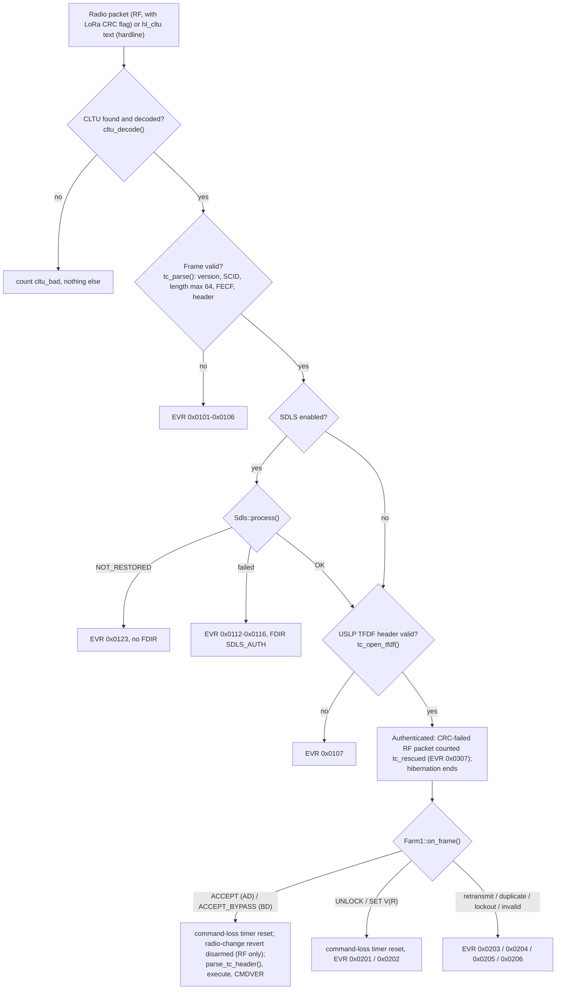
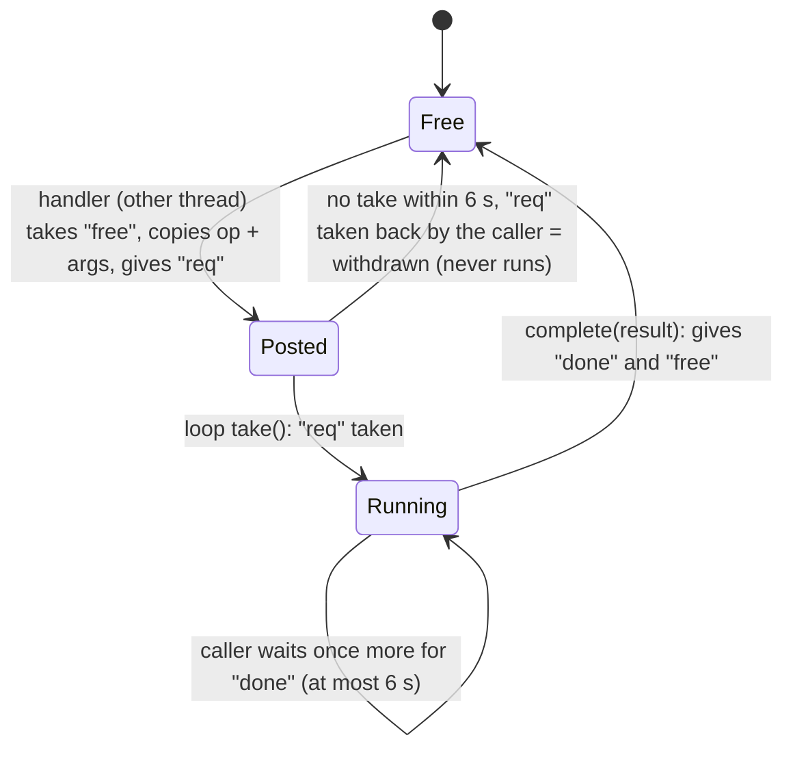

# 04 - Space Data Link Interface Control Document (ICD)

This document defines every octet that crosses the radio link between VGQ-1 and DSS-Q1, and
every call between the microcontroller and the Linux computer on each board. Both ends are
written independently (flight C++, ground Python) and are cross-checked bit for bit by the
automated tests (section 10).

| Applies to | Code |
|---|---|
| Flight protocol core | [vgq1-spacecraft/sketch/src/ccsds](../vgq1-spacecraft/sketch/src/ccsds) (TM, USLP, TC, SDLS, CFDP, RS, CRC, randomizer) |
| Flight data link and executive | [fsw/datalink.h](../vgq1-spacecraft/sketch/src/fsw/datalink.h), [fsw/flight.cpp](../vgq1-spacecraft/sketch/src/fsw/flight.cpp), [fsw/rpc_mailbox.h](../vgq1-spacecraft/sketch/src/fsw/rpc_mailbox.h), [drivers/radio.h](../vgq1-spacecraft/sketch/src/drivers/radio.h) |
| Spacecraft Linux side (EGSE) | [vgq1-spacecraft/python/main.py](../vgq1-spacecraft/python/main.py), [cfdp_tx.py](../vgq1-spacecraft/python/cfdp_tx.py) |
| Ground link layer | [dssq/ccsds](../dssq-groundstation/python/dssq/ccsds), [framesync.py](../dssq-groundstation/python/dssq/framesync.py), [fop.py](../dssq-groundstation/python/dssq/fop.py), [link.py](../dssq-groundstation/python/dssq/link.py), [gds.py](../dssq-groundstation/python/dssq/gds.py), [radio/](../dssq-groundstation/python/dssq/radio) |
| Station microcontroller | [dssq-groundstation/sketch/sketch.ino](../dssq-groundstation/sketch/sketch.ino) |

Related documents: packet fields, commands and EVR texts are in
[05_Telemetry_and_Command_Dictionary.md](05_Telemetry_and_Command_Dictionary.md) (generated from
the code); the radios and their timing in [02_Link_Budget_and_RF_Analysis.md](02_Link_Budget_and_RF_Analysis.md);
diagrams of the architecture, data flow and COP-1 state machines in
[01_System_Design.md](01_System_Design.md); keys and threats in
[17_Security_Model.md](17_Security_Model.md).

---

## 1 Scope and conventions

* **Octet** = 8 bits. Multi-octet fields are big-endian.
* **Bit numbering** is the CCSDS one: bit 0 is the most significant bit of the first octet.
  Field tables list fields in transmission order with their width in bits.
* Sizes are in octets unless stated. "Hex" means two upper- or lower-case hexadecimal
  characters per octet (the RPC text format).
* Each rule names its code symbol and, where it implements a standard, the CCSDS document.
* **Code wins**: where this ICD, the contract or the Phase B specification disagreed with the
  code during writing, the code was taken and the difference is noted in the text.

In plain words, the link has five layers. A measurement becomes a **Space Packet**; packets
travel in fixed-size **Transfer Frames** on numbered **virtual channels**; **SDLS** encrypts
and seals each frame; **channel coding** (Reed-Solomon, randomizer, sync marker) protects it
against noise; the **radio** carries one coded frame per LoRa packet. Commands go the other
way inside **TC frames** and **CLTUs**, controlled by the **COP-1** retransmission protocol.
Files travel as **CFDP** units inside packets.

---

## 2 Managed parameters

| Parameter | Value | Code | Standard |
|---|---|---|---|
| Spacecraft ID (SCID) | 0x0A7 in the 10-bit TM / TC field; 0x00A7 in the 16-bit USLP field. Private, **not** registered with SANA | `ccsds::kSpacecraftId`; ground `ccsds.SPACECRAFT_ID` | 132.0-B-3, 232.0-B-4, 732.1-B-2 |
| Attached sync marker | 0x1ACFFC1D (32 bits) | `kAsm` | 131.0-B-5 |
| Channel code | RS(255,223), E = 16, interleave I = 1, dual-basis symbols, field generator x^8 + x^7 + x^2 + x + 1 (0x187), code generator roots alpha^(11 j), j = 112..143; shortened by 23 octets of virtual fill to (232,200) | [reed_solomon.h](../vgq1-spacecraft/sketch/src/ccsds/reed_solomon.h), `kRsVirtualFill` | 131.0-B-5 section 4 |
| Pseudo-randomizer | h(x) = x^8 + x^7 + x^5 + x^3 + 1, all-ones seed, 255-bit period, first octets FF 48 0E C0 9A; applied to the codeblock, never to the ASM | [randomizer.h](../vgq1-spacecraft/sketch/src/ccsds/randomizer.h) | 131.0-B-5 section 10 |
| CADU | 4 + 232 = **236** octets = one radio packet | `kCaduLen` | 131.0-B-5 |
| Transfer frame length | **200** octets, TM and USLP alike | `kTmFrameLen` | 132.0-B-3, 732.1-B-2 |
| Frame Error Control | CRC-16/CCITT-FALSE: polynomial 0x1021, preset 0xFFFF, no reflection, no final XOR, check value 0x29B1 | [crc16.h](../vgq1-spacecraft/sketch/src/ccsds/crc16.h) | 132.0-B-3 4.1.6, 232.0-B-4 4.1.4 |
| Downlink framing | TM (default) or USLP, a build choice; the ground detects it per frame | config.h `VGQ_DOWNLINK_FRAMING`; station.toml `[link] tm_framing = "auto"` | |
| Uplink framing | TC (default) or USLP; the spacecraft accepts both | station.toml `[link] tc_framing` | 232.0-B-4, 732.1-B-2 |
| Virtual channels | 0 RT-ENG, 1 RT-SCI, 2 PLAYBACK, 3 FILE; OID: VC 7 (TM) / VCID 63 (USLP) | `ccsds::Vc`, `kUslpVcidOid` | |
| Space packets | version 0, CUC secondary header on every TM packet, idle APID 0x7FF | `kSpSecHdrLen`, `kApidIdle` | 133.0-B-2 |
| Time code | CUC, implicit P-field 0x2E (agency epoch, 4 coarse + 2 fine octets) | `kCucPField` | 301.0-B-4 |
| TC frame | at most **64** octets | `kTcMaxFrameLen` | mission limit |
| CLTU | start EB 90, BCH(63,56) codeblocks, fill 0x55, tail C5 C5 C5 C5 C5 C5 C5 79 | `kCltuStart`, `kCltuTail`; ground `ccsds/tc.py FILL` | 231.0-B-4 |
| FARM-1 window | 10 | `Farm1(window = 10)` | 232.1-B-2 |
| FOP-1 | window 5, T1 45 s minimum, transmission limit 3, verification timeout 300 s minimum | station.toml `[commanding]` | 232.1-B-2 |
| SDLS | TC: AE (default), AUTH or NONE; TM: AE (default) or NONE | config.h `VGQ_SDLS_TC`, `VGQ_SDLS_TM`; station.toml `[sdls]` | 355.0-B-2 |
| SDLS SPIs | 0 TM null SA, 1 TC AUTH (`VGQ_SDLS_SPI`, station.toml `spi = 1`), 2 TC AE, 3 TM AE | [sdls.h](../vgq1-spacecraft/sketch/src/ccsds/sdls.h) `kSdlsSpi*` | 355.0-B-2 |
| CFDP | class 1, entities 0x01 VGQ-1 and 0x02 DSS-Q1 | [cfdp.h](../vgq1-spacecraft/sketch/src/ccsds/cfdp.h) | 727.0-B-5 |
| Callsign | spacecraft `VGQ_CALLSIGN` (OID text, EVR 0x0002); ground `[station] callsign` (uplink identification, 5.8); both default "N0CALL": set yours | config.h; station.toml | licence |

---

## 3 Physical layer and radio transport

### 3.1 One CADU per radio packet

Every downlink radio packet carries exactly one 236-octet CADU. The E22's sub-packet length
is 240 octets (REG1 bits 7..6 = 00, `kE22MaxPacket`), so a CADU never splits; an SX126x packet
holds up to 255 octets (`kSxMaxPayload`). Every uplink radio packet carries one CLTU of at most
90 octets (section 5.1), or the ground's plain-text station identification (section 5.8).
Radios, rates and air time: [02](02_Link_Budget_and_RF_Analysis.md) section 2.

The link is **half duplex**: the spacecraft listens between its own transmissions and the
ground transmits in the quiet window after a received frame (section 8.3). The exceptions are
the `WAKE` transmission to a hibernating spacecraft (section 8.2) and the station
identification during a loss of signal or when it is about to be overdue (more than two frames
lost), which go out when needed because no window comes.

### 3.2 E22 UART transport (models E22-400T33D and E22-400T37S)

| Item | Rule | Code |
|---|---|---|
| UART | 9600 bit/s 8N1 in every mode (configuration mode accepts only 9600 8N1, manuals 7.1) | `kE22UartBaud`; station.toml `uart_code = 3` |
| Mode pins | M0 / M1 select normal, WOR, configuration, sleep; AUX low = module busy | config.h `PIN_E22_M0`, `PIN_E22_M1`, `PIN_E22_AUX` |
| Registers (written volatile with `C2` at every boot, then read back with `C1`, 00H to 06H compared) | 00H ADDH, 01H ADDL (address 0x0000), 02H NETID (0x00); 03H REG0 = UART 011 (9600) / parity 00 (8N1) / air-rate code; 04H REG1 = sub-packet 00 (240) / bit 5 ambient-noise RSSI on / bit 2 abnormal-status log (T37S only) / power code (T37S: 00, REG1 = 0x24); 05H channel; 06H REG3 = bit 7 RSSI octet appended / bit 4 LBT / bits 2..0 WOR cycle; 07H-08H CRYPT = 0 | [drivers/radio.cpp](../vgq1-spacecraft/sketch/src/drivers/radio.cpp) `e22_build_regs()`, `e22_regs_match()` (T33D REG1 bits 4..2 reserved, not compared); EVR 0x0306 |
| Received packet | `[payload][RSSI octet]`; dBm = -(256 - RSSI) | `E22StreamParser::classify()` |
| End of a received burst | 40 ms of UART silence | `kE22RxGapMs` |
| Ambient-noise query | send `C0 C1 C2 C3 00 02`, reply `C1 00 02 <noise> <RSSI of the last packet>` within 300 ms; dBm = -(256 - value) | `kE22NoiseTimeoutMs` |
| `FF FF FF` alone | the module's "wrong format" reply to a command; counted | `cmd_rejects_` |
| `FF FF FF 01..04` (T37S, REG1 bit 2) | under-voltage, over-voltage, over-temperature, other abnormal status (T37S manual 5.7) | FDIR, [01](01_System_Design.md) section 6 |
| Talk-over guard | no transmission within 100 ms of a received octet | `kE22RxQuietMs` |
| Transmission done | AUX must fall within 200 ms of the UART write; done when AUX is high again **and** the modelled busy time has passed; time-out 30 s | `E22TxTracker`, `kE22AuxEdgeMs`, `kE22AuxTimeoutMs` |
| Flight receive buffers | 300-octet accumulation buffer; packets up to 256 octets | `kE22RxBufLen`, `RxPacket::kMaxLen` |

The station E22 sits on a USB-UART at 9600 bit/s; the ground reads `[CADU 236][RSSI 1]`
per packet, 0.246875 s of UART time per CADU (`gds.py E22_UART_CADU_S`).

### 3.3 SX126x SPI transport (build option)

The SX126x chip delivers whole packets with RSSI, SNR, frequency error and a CRC flag. On the
station the MCU forwards each packet with the `rf_rx` notification (section 9.7). A packet
whose LoRa CRC failed is still forwarded when it is exactly one 236-octet CADU (RS rescue,
[02](02_Link_Budget_and_RF_Analysis.md) section 11.3). On the spacecraft every uplink packet is
handed to the CLTU decoder with its CRC flag; BCH, FECF and SDLS decide (section 5.7).

### 3.4 Ground frame synchronisation

[framesync.py](../dssq-groundstation/python/dssq/framesync.py) `FrameSynchronizer`:

| State | Rule |
|---|---|
| SEARCH | find the ASM with at most 2 bit errors (`SEARCH_TOL`) |
| LOCK | the next ASM must sit exactly one unit later (237 octets with the E22 RSSI octet, 236 without), at most 4 bit errors (`LOCK_TOL`) |
| FLYWHEEL | up to 3 consecutive misses tolerated (`flywheel = 3`), then SEARCH |
| Stale data | a partial buffer older than 3 s is dropped (`stale_s`) |

Inside the stream it also recognises the noise replies and the T37S abnormal-status reports.
Each codeblock is de-randomised, RS-decoded (Berlekamp-Massey, Chien, Forney), FECF-checked,
and then parsed.

---

## 4 Downlink (spacecraft to ground)

### 4.1 CADU

```
| ASM 1A CF FC 1D (4) | randomised codeblock (232) = Transfer Frame (200) + RS check symbols (32) |
```

Order of encoding on the spacecraft: frame complete (CLCW and FECF written after SDLS
protection), RS encode with 23 octets of virtual zero fill, randomise the 232 octets, prepend
the ASM ([fsw/datalink.h](../vgq1-spacecraft/sketch/src/fsw/datalink.h) `Downlink::next_cadu()`).

### 4.2 TM Transfer Frame (VGQ_DOWNLINK_FRAMING = 0, default)

| Field | Bits | Value |
|---|---|---|
| Transfer Frame Version Number | 2 | 00 |
| Spacecraft ID | 10 | 0x0A7 |
| Virtual Channel ID | 3 | 0..3 data, 7 OID |
| OCF flag | 1 | 1 (CLCW in every frame) |
| Master Channel Frame Count | 8 | +1 per frame |
| Virtual Channel Frame Count | 8 | +1 per frame of this VC |
| Secondary header flag | 1 | 0 |
| Synchronisation flag | 1 | 0 |
| Packet order flag | 1 | 0 |
| Segment length ID | 2 | 11 |
| First Header Pointer | 11 | offset of the first packet header in the data field; 0x7FF none starts here; 0x7FE OID frame |
| Data field | 188 octets | packets (clear); with SDLS see 4.7 |
| OCF | 32 | CLCW (4.5) |
| FECF | 16 | CRC-16 over the 198 octets before it |

Source: [ccsds/tm.cpp](../vgq1-spacecraft/sketch/src/ccsds/tm.cpp) `TmFramer::header()`,
`trailer()`; [ccsds_types.h](../vgq1-spacecraft/sketch/src/ccsds/ccsds_types.h). Packets span
frames of the same VC; a data field is always completely filled, padded with an idle packet
when the VC holds less than a frame (4.8).

### 4.3 USLP TM frame (VGQ_DOWNLINK_FRAMING = 1)

| Part | Field (bits) | Value |
|---|---|---|
| TFPH (8 octets) | TFVN (4) | 1100 |
| | SCID (16) | 0x00A7 |
| | source-or-destination (1) | 0 (the SCID is the source) |
| | VCID (6) | 0..3 data, 63 OID |
| | MAP ID (4) | 0 |
| | end of frame primary header (1) | 0 (full header) |
| | frame length - 1 (16) | 199 |
| | bypass / sequence control (1), PCC (1), spare (2) | 0, 0, 00 |
| | OCF flag (1) | 1 |
| | VCF count length (3) | 1 |
| | VCF count (8) | +1 per frame of this VCID |
| SDLS header (optional) | | 14 octets with AE (4.7) |
| TFDF header (3 octets) | construction rule (3) | 000 (packets spanning fixed-length zones) |
| | UPID (5) | 0 Space Packets; 31 idle data (OID) |
| | First Header Pointer (16) | offset in the TFDZ; 0xFFFF none |
| TFDZ | | 183 octets clear, 153 with AE |
| SDLS trailer (optional) | | 16-octet tag |
| OCF | 32 | CLCW |
| FECF | 16 | CRC-16 |

Source: [ccsds/uslp.h](../vgq1-spacecraft/sketch/src/ccsds/uslp.h), `uslp_put_header()`,
`TmFramer::uslp_header()`. USLP has no master-channel counter; the flight keeps its MCFC
internally (HK `mcfc`). The TFDF header lies inside the SDLS-protected region.

### 4.4 Only-Idle-Data (OID) frames

When no data VC has anything to send, or SDLS TM is still waiting for its epoch, the
spacecraft sends an OID frame: TM VC 7 with FHP 0x7FE, or USLP VCID 63 with UPID 31 and
FHP 0xFFFF. Its data field repeats the clear-text identification `"DE <callsign> VGQ-1 "`
(at most 32 characters, `kIdleTextMax`; [fsw/datalink.h](../vgq1-spacecraft/sketch/src/fsw/datalink.h)
`format_idle_text()`), without a callsign 0x55 fill. OID frames are **never** encrypted and
always carry the current CLCW, so the ground keeps lock and commanding status even when there
is no data. The ground extracts the text (`ccsds/uslp.py ident_text()`).

### 4.5 CLCW (Operational Control Field)

| Bits | Field | Value |
|---|---|---|
| 0 | Control word type | 0 |
| 1-2 | CLCW version | 00 |
| 3-5 | Status field | 000 |
| 6-7 | COP in effect | 01 (COP-1) |
| 8-13 | VCID | 0 |
| 14-15 | spare | 00 |
| 16 | No RF Available | 0 (never set) |
| 17 | No Bit Lock | 1 after 5 min without a decodable CLTU, cleared by the next one (`kNoBitLockMs`) |
| 18 | Lockout | FARM-1 lockout |
| 19 | Wait | 0 (never set: this FARM-1 has no S2 WAIT state in use, 6.1) |
| 20 | Retransmit | FARM-1 retransmit request |
| 21-22 | FARM-B counter | 2-bit count of bypass frames |
| 23 | spare | 0 |
| 24-31 | Report value | V(R), the next expected N(S) |

Source: [ccsds/tm.cpp](../vgq1-spacecraft/sketch/src/ccsds/tm.cpp) `Clcw::pack()`,
[ccsds/tc.cpp](../vgq1-spacecraft/sketch/src/ccsds/tc.cpp) `Farm1::fill_clcw()`;
232.0-B-4 4.2 and 232.1-B-2. The ground uses the CLCW only from frames that passed every check
(a data frame that fails SDLS is not trusted, 4.7).

### 4.6 Virtual channels and frame selection

| VC | Name | Packets | Recorded in the SSR |
|---|---|---|---|
| 0 | RT-ENG | HK, RF, EVR, CMDVER, TIMECORR, RFSCAN | yes |
| 1 | RT-SCI | MAG, ATT, SPEC, ENV, SPECBURST | yes |
| 2 | PLAYBACK | recorder contents, oldest first | - |
| 3 | FILE | one CFDP PDU per packet (APID 0x030) | no |
| 7 / 63 | OID | identification text | - |

Rules ([fsw/datalink.h](../vgq1-spacecraft/sketch/src/fsw/datalink.h) `Downlink`):

1. Exactly one CADU per frame period. Data VCs are served only while SDLS TM is ready (or
   off).
2. Order VC0, VC1, VC2, VC3, else OID. Exception (anti-starvation): VC1 goes first when it
   holds more than 500 octets (`kSciPriorityBacklog`) and the previous data frame was VC0.
3. Each VC has a 1024-octet buffer with up to 64 packet starts (`VcStream::kBufLen`,
   `kMaxStarts`). A routine packet may fill it only to 768 octets; the last 256 octets
   (`kVcReserveOctets`) are kept for priority packets: EVRs of severity 2 or more, CMDVER and
   EVR 0x0120 to 0x0122. A refused packet is counted (`overflows`).
4. If SDLS refuses to protect a frame (a backstop that should never trigger), the VC and the
   frame counters are rolled back and an OID frame is sent instead (`refused()`).
5. Hibernation beacon: at most 2 frames carry the VC0 backlog plus the beacon HK
   (`prepare_beacon()`, `kBeaconMaxFrames`).

The frame period (mode factor x radio busy time, at least 1.5 s, at most 50 % duty) is
defined in [01_System_Design.md](01_System_Design.md) section 5.2.

### 4.7 SDLS on the downlink (TM)

Service AE: AES-256-GCM, 12-octet IV, 16-octet tag
([ccsds/sdls.h](../vgq1-spacecraft/sketch/src/ccsds/sdls.h) `SdlsTm`, ground
`ccsds/sdls.py SdlsTmReceiver`).

| Frame layout | Octets |
|---|---|
| TM + AE | header 6 / security header 14 (SPI 2 + IV 12) / data 158 / tag 16 / OCF 4 / FECF 2 |
| USLP + AE | TFPH 8 / security header 14 / TFDF 156 (header 3 + TFDZ 153) / tag 16 / OCF 4 / FECF 2 |
| Null SA (fallback) | same geometry, SPI 0, IV and tag all zero, data in clear |

* **Key**: K_tm = HMAC-SHA-256(master key, "VGQ1-SDLS-TM-AE"). The master key is the 256-bit
  key from `tools/gen_sdls_key.py` ([17_Security_Model.md](17_Security_Model.md)).
* **IV** (12 octets) = direction 'TM' (0x544D) | epoch (16 bits) | 0x00000000 | sn (32 bits).
  **AAD** = frame primary header || security header. The tag covers the data field (TM) or
  the TFDF (USLP); OCF and FECF are outside it.
* **Epoch** = the SCLK partition the EGSE gives at every MCU boot (section 9.2 `set_partition`);
  sn restarts at 1 in each epoch. An epoch of 0, or lower than the current one, is refused
  (EVR 0x0122); the same value again is a no-op. When sn reaches 0xFFFFFFFF the frames wait
  for a new epoch.
* **Flight TM states** (HK `sdls_tm_state`, sc_status `tm_state`): 0 OFF (no AE), 1 PROTECTED,
  2 WAIT_EPOCH (data VCs held, only OID frames go out), 3 UNPROTECTED (no epoch after 120 s,
  `kSdlsEpochWaitS`: data frames go out under the null SA, EVR 0x0121). EVR 0x0120 = epoch
  accepted, downlink protected.
* **Ground**: verdicts OK, UNPROTECTED (null SA, accepted when `[sdls] accept_null = true`,
  the default), NONE, BAD_LENGTH, BAD_SPI, BAD_IV, BAD_MAC, REPLAY. (epoch, sn) must be
  greater, in that order, than the last accepted pair; the state is persisted. A REPLAY with
  a lower epoch and a valid tag is counted as `epoch_regressed` (RED alarm). Three
  consecutive BAD_SPI / BAD_IV data frames raise "service mismatch" (`gds.py MISMATCH_FRAMES`).
  A frame that fails is dropped, never decoded, and never moves the replay state. A change of
  SDLS status on a VC is a packet-stream discontinuity, so null-SA octets never join a
  protected packet. The ground directive `SDLS RESETREPLAY` (hazardous) resets the replay state.

### 4.8 Space packets

| Field | Bits | Value |
|---|---|---|
| Version | 3 | 000 |
| Type | 1 | 0 telemetry |
| Secondary header flag | 1 | 1 (TM); 0 for idle packets |
| APID | 11 | table below |
| Sequence flags | 2 | 11 (unsegmented) |
| Sequence count | 14 | per APID, +1 per packet |
| Packet data length | 16 | octets after the primary header - 1 |
| Secondary header | 48 | CUC time: coarse 32 bits (s) + fine 16 bits (2^-16 s) |
| User data | | [05](05_Telemetry_and_Command_Dictionary.md) |

| APID | Packet | VC | Packet size (octets, 12-octet headers included) |
|---|---|---|---|
| 0x010 | HK | 0 | 90 |
| 0x011 | RF | 0 | 61 |
| 0x012 | EVR | 0 | 15 to 95 (severity, event ID, text <= 80 characters) |
| 0x013 | CMDVER | 0 | 20 |
| 0x014 | TIMECORR | 0 | 22 |
| 0x015 | RFSCAN | 0 | 16 to 100 |
| 0x020 | MAG | 1 | 58 |
| 0x021 | ATT | 1 | 49 |
| 0x022 | SPEC | 1 | 141 |
| 0x023 | ENV | 1 | 36 |
| 0x024 | SPECBURST | 1 | up to 136 (Rice-compressed, CCSDS 121.0-B-3) |
| 0x030 | CFDP | 3 | up to 158 (never recorded) |
| 0x0C0 | TC (uplink) | - | 7 to 26 |
| 0x7FF | idle | any | at least 7, data 0x55, no secondary header |

Sources: [fsw/tlm_packets.h](../vgq1-spacecraft/sketch/src/fsw/tlm_packets.h) `Apid`, `k*Len`,
`kMaxPayload` = 146 (largest user data; 12 + 146 = 158 octets fits one TM + AE data field,
static assertion in [fsw/datalink.h](../vgq1-spacecraft/sketch/src/fsw/datalink.h));
[ccsds/tm.cpp](../vgq1-spacecraft/sketch/src/ccsds/tm.cpp) `build_tm_packet()`,
`build_idle_packet()`. Values not available are sent as -128, 0x7FFF, 0xFFFF, 0x7FFFFFFF or
0xFFFFFFFF depending on the field type (`kNaI8` ... `kNaU32`).

### 4.9 Time code and time correlation

SCLK = seconds since the MCU booted, in CUC format with the implicit P-field 0x2E. The SCLK
**partition** (the EGSE boot counter, also the SDLS TM epoch, HK `sclk_partition`) makes it
unambiguous across reboots ([fsw/sclk.h](../vgq1-spacecraft/sketch/src/fsw/sclk.h)).

TIMECORR (APID 0x014, 10 octets of user data; `TimeCorrPacket`):

| Field | Octets | Meaning |
|---|---|---|
| ref_mcfc | 1 | the reference frame: TM its MCFC; USLP the VCF count of a VC0 frame |
| sclk_coarse, sclk_fine | 4 + 2 | SCLK when the PA was keyed for the reference frame |
| air_rate_code | 1 | rate code in use |
| ref_airtime_ms | 2 | measured busy time of the reference frame |

The ground computes SCET(reference) = ERT at the end of reception - UART time (E22
0.246875 s, SX126x 0) - ref_airtime - OWLT - `[radio] radio_latency_s` and fits SCLK to SCET
by least squares per partition ([gds.py](../dssq-groundstation/python/dssq/gds.py)
`_time_correlate()`). `radio_latency_s` is a station calibration constant (**VERIFY** T-TM-04).

### 4.10 Command verification (CMDVER)

| Field | Octets | Meaning |
|---|---|---|
| tc_seq | 1 | N(S) of the AD frame that carried the command (0 otherwise) |
| opcode | 1 | |
| stage | 1 | bits 1..0: 2 executed, 3 failed; bits 7..6: source 0 AD frame, 1 BD frame or hardline, 2 stored sequence |
| error_code | 1 | 0 OK, 1 unknown opcode, 2 bad length, 3 bad argument, 5 hardware, 6 bad magic, 7 busy (4 is retired) |
| ground_tag | 4 | echoed PING tag (round-trip time) |

Source: [fsw/tlm_packets.h](../vgq1-spacecraft/sketch/src/fsw/tlm_packets.h) `CmdVerPacket`,
`CmdSource`; [fsw/commands.h](../vgq1-spacecraft/sketch/src/fsw/commands.h) `CmdError`. The
source sits outside tc_seq because every N(S) value 0..255 is valid (interface decision I1).

---

## 5 Uplink (ground to spacecraft)

### 5.1 CLTU

```
| EB 90 | codeblock 1 | ... | codeblock n | C5 C5 C5 C5 C5 C5 C5 79 |
  codeblock = 7 information octets + 1 octet (7 BCH parity bits, complemented, + filler bit 0)
```

* BCH(63,56), generator g(x) = x^7 + x^6 + x^2 + 1; the last codeblock is filled with 0x55.
  The spacecraft decodes in single-error-correction mode; the tail is recognised as the
  designed uncorrectable codeblock ([ccsds/tc.h](../vgq1-spacecraft/sketch/src/ccsds/tc.h)
  `cltu_decode()`, ground `ccsds/tc.py build_cltu()`).
* Size = 2 + 8 x ceil(frame / 7) + 8 octets. A 64-octet frame gives a **90-octet** CLTU.
* The decoder finds a CLTU anywhere in the received packet. Its work buffer holds 96 octets
  (`kTcWorkMin`): the information octets of 13 codeblocks (91), more than the 10 codeblocks
  (70 octets) of a 64-octet frame and the 12 of the longest hardline CLTU (110 octets,
  section 9.2).

### 5.2 TC Transfer Frame (232.0-B-4, `tc_framing = "TC"`, default)

| Field | Bits | Value |
|---|---|---|
| Version | 2 | 00 |
| Bypass flag | 1 | 0 Type-A (sequence controlled), 1 Type-B |
| Control command flag | 1 | 0 data, 1 control |
| spare | 2 | 00 |
| SCID | 10 | 0x0A7 |
| VCID | 6 | 0 (the flight does not check it and runs one FARM-1) |
| Frame length - 1 | 10 | total octets - 1 (at most 63) |
| Frame sequence number N(S) | 8 | V(S) for AD frames, 0 for BD / BC |
| [SDLS security header] | | 5.4 |
| Data field | | one TC packet (AD, BD) or one COP-1 directive (BC) |
| [SDLS trailer] | | 5.4 |
| FECF | 16 | CRC-16 |

Frame types: AD = bypass 0, control 0; BD = 1, 0; BC = 1, 1. The combination bypass 0 /
control 1 is refused (TC_BAD_HEADER). COP-1 directives: **Unlock** = `00`; **Set V(R)** =
`82 00 <V(R)>` ([ccsds/tc.cpp](../vgq1-spacecraft/sketch/src/ccsds/tc.cpp) `Farm1::on_frame()`,
ground `bc_unlock()`, `bc_set_vr()`).

### 5.3 USLP TC frame (732.1-B-2, `tc_framing = "USLP"`)

* TFPH 7 octets as in 4.3, with source-or-destination = 1 (destination), frame length of the
  actual frame, OCF flag 0, plus **one VCF count octet on AD frames = N(S)** (BD and BC: no
  count). Bypass flag 0 = AD, 1 = BD / BC; the PCC flag = 1 exactly for COP-1 directives.
* TFDF header, 1 octet: construction rule 111 (no segmentation) | UPID 0 (Space Packet) or 1
  (COP-1 directive, exactly when PCC = 1).
* With SDLS the security header follows the TFPH and the TFDF header is inside the protected
  region; the AAD is the TFPH including the VCF count octet.
* An OCF, if a sender includes one, is skipped.
* Refusals: a truncated TFPH, the source flag, an AD frame without a 1-octet count or with
  PCC = 1 give TC_BAD_HEADER; a rule other than 111 or a UPID that does not match PCC gives
  TC_BAD_TFDF ([ccsds/tc.h](../vgq1-spacecraft/sketch/src/ccsds/tc.h) `TcParseResult`).

### 5.4 SDLS on the uplink (TC)

| Service | Layout after the frame header | Overhead | Key |
|---|---|---|---|
| AUTH (SPI 1) | SPI 2 / SN 4 / data / MAC 16 / FECF | 22 octets + FECF | the master key |
| AE (SPI 2) | SPI 2 / IV 12 / ciphertext / tag 16 / [OCF] / FECF | 30 octets + FECF | K_tc = HMAC-SHA-256(master, "VGQ1-SDLS-TC-AE") |
| NONE | data / FECF | 0 | none |

* AUTH: MAC = HMAC-SHA-256(key, primary header || security header || data), first 16 octets.
* AE: IV = 'TC' (0x5443) | epoch 0x0000 | 0x00000000 | SN (32 bits); AAD = primary header ||
  security header.
* One shared, persistent SN; the ground gives **every** transmission, including COP-1
  retransmissions, a fresh SN. The ground SN file is written atomically under a file lock and
  never lowered. If it is unreadable, or missing for a key in use with TC AUTH or AE (the GDS
  with or without an archive; the hardline tool `dssq.cltu` then refuses), the uplink is
  BLOCKED until an HK reports the spacecraft's `sdls_last_sn` - from an AE-protected frame, or
  any HK when the station's TM service is NONE, and never one made within 120 s of a flight
  boot that reports 0 (`SDLS_SN_RESTORE_WAIT_S`, `boot_hk()`). The SN then continues at max(file, time floor), the time
  floor being 4 numbers per second of station clock since 2026-01-01T00:00:00Z
  (`sn_time_floor()`; about 98 million in October 2026), which lies above every number the key
  can have used whatever the HK reports. An unprotected report above the floor is refused
  (ERROR, the uplink stays held); a protected report above the floor, or a station clock
  before 2026, gets `sdls_last_sn` + 1 000 000 (`SDLS_SN_RESYNC_GAP`) with a WARNING; a target
  above 4 227 858 432 (`SDLS_SN_RELEASE_MAX` = 2^32 - 2^26) is refused and the uplink stays
  held (`ccsds/sdls.py SdlsSender.observe_spacecraft_sn()`;
  [17_Security_Model.md](17_Security_Model.md) section 7.6).
* **Flight check order** ([ccsds/sdls.cpp](../vgq1-spacecraft/sketch/src/ccsds/sdls.cpp)
  `Sdls::process()`):
  * AUTH: length (at least 1 data octet) -> SPI -> MAC -> replay (SN must exceed the last
    accepted) -> restore hold.
  * AE: length -> SPI -> IV fields ('TC', epoch 0, zero field) -> tag -> replay -> restore
    hold -> decrypt (tag checked again; the buffer changes only for an authentic, fresh frame).
  * The replay check comes after the MAC / tag, so a forged frame can never move the window.
* Results: 0 OK, 1 DISABLED, 2 BAD_LENGTH, 3 BAD_SPI, 4 REPLAY, 5 BAD_MAC, 6 BAD_IV,
  7 NOT_RESTORED (`Sdls::Result`). Codes 2 to 6 raise EVR 0x0112 to 0x0116 (0x0110 + code,
  ERROR) and FDIR SDLS_AUTH. NOT_RESTORED (authentic, but the EGSE has not yet restored the SN
  after a boot) raises EVR 0x0123 (WARN) without FDIR; the hold ends with `set_sdls_sn` or
  after 120 s (`kSdlsSnWaitS`, EVR 0x0124).

### 5.5 TC packet

| Field | Bits | Value |
|---|---|---|
| Version | 3 | 000 |
| Type | 1 | 1 (telecommand) |
| Secondary header flag | 1 | 0 |
| APID | 11 | 0x0C0 |
| Sequence flags | 2 | 11 |
| Sequence count | 14 | ground counter |
| Packet data length | 16 | user data octets - 1, must match the packet exactly |
| User data | | opcode (1) + arguments ([05](05_Telemetry_and_Command_Dictionary.md)) |

Source: [fsw/commands.cpp](../vgq1-spacecraft/sketch/src/fsw/commands.cpp) `parse_tc_header()`.
The longest user data is 20 octets (SEQLOAD and MAGCAL: opcode + 19), so the longest TC packet
is 26 octets.

### 5.6 Frame lengths and the 64-octet limit

Frame length = header + SDLS + [6-octet packet header] + user data + FECF 2
([dssq/fop.py](../dssq-groundstation/python/dssq/fop.py) `frame_length()`). Examples for NOOP
(user data 1), SPECCFG (6) and SEQLOAD (20):

| Framing | SDLS | AD frame NOOP / SPECCFG / SEQLOAD | BD frame NOOP / SPECCFG / SEQLOAD |
|---|---|---|---|
| TC | NONE | 14 / 19 / 33 | 14 / 19 / 33 |
| TC | AUTH | 36 / 41 / 55 | 36 / 41 / 55 |
| TC | AE | 44 / 49 / 63 | 44 / 49 / 63 |
| USLP | NONE | 18 / 23 / 37 | 17 / 22 / 36 |
| USLP | AUTH | 40 / 45 / 59 | 39 / 44 / 58 |
| USLP | AE | 48 / 53 / **67** | 47 / 52 / **66** |

BC directives (Unlock / Set V(R)): TC 8 / 10, 30 / 32, 38 / 40 octets; USLP 11 / 13, 33 / 35,
41 / 43 octets (NONE, AUTH, AE).

Under USLP + AE, SEQLOAD and MAGCAL exceed 64 octets; the largest packet that fits a USLP + AE
AD frame is 23 octets (27 with TC + AE). The ground refuses such a command before queuing it
with "frame N > 64 octets with USLP/AE: use [link] tc_framing = "TC"" (`frame_size_error()`,
contract finding C-08).

### 5.7 Acceptance chain on the spacecraft



Sources: [fsw/datalink.h](../vgq1-spacecraft/sketch/src/fsw/datalink.h) `tc_accept()`,
[fsw/flight.cpp](../vgq1-spacecraft/sketch/src/fsw/flight.cpp) `process_tc()`. Parse results
1..7 (TOO_SHORT, BAD_VERSION, BAD_SCID, BAD_LENGTH, BAD_FECF, BAD_HEADER, BAD_TFDF) map to EVR
0x0101..0x0107. After a frame passes SDLS the spacecraft notifies its new SN to the EGSE
(`sdls_sn`), which persists it. A hardline frame never disarms a radio-change revert: only an
RF frame proves the ground followed the change.

### 5.8 Station identification packets on the uplink

Besides CLTUs the ground transmits its amateur station identification: the plain-ASCII text
`"DE <callsign> <name>"` (`[station] callsign`, default "N0CALL", upper-cased; `[station] name`
reduced to at most 16 characters of letters, digits, '-', '_' and '.'; default
"DE N0CALL DSS-Q1"), as one radio packet through the same path as a CLTU: an E22 transparent
packet, or `rf_tx` on the SX126x station ([gds.py](../dssq-groundstation/python/dssq/gds.py)
`ident_text()`, `StationIdent`, `_identify()`). When it is sent: [01](01_System_Design.md)
section 3.4.1.

Every octet is below 0x80, so the text never contains the CLTU start sequence EB 90. On the
spacecraft such a packet ends at the first step of 5.7: `cltu_decode()` finds no CLTU
(TcStage NO_CLTU), the flight increments RF `cltu_bad` and drops it, with no EVR, no FDIR flag,
no SDLS or FARM-1 state change. If an E22 burst carries a CLTU and the text together, the CLTU
is found and accepted and the text is ignored (host test `test_station_id.cpp`; ground
`tests/test_station_id.py`). The text contains no command and is never encrypted.

---

## 6 COP-1

Diagrams of both state machines and the command life cycle: [01_System_Design.md](01_System_Design.md)
section 8. The precise rules:

### 6.1 FARM-1 (spacecraft)

[ccsds/tc.cpp](../vgq1-spacecraft/sketch/src/ccsds/tc.cpp) `Farm1::on_frame()`, window W = 10:

| Frame | Condition | Verdict | Effect |
|---|---|---|---|
| AD | lockout | DISCARD_LOCKOUT | none |
| AD | N(S) = V(R) | ACCEPT | V(R) + 1, Retransmit cleared |
| AD | N(S) - V(R) = 1..4 (positive window) | DISCARD_RETRANSMIT | Retransmit set (a frame was lost) |
| AD | V(R) - N(S) = 1..5 (negative window) | DISCARD_NEG_WINDOW | duplicate, ignored |
| AD | anything else | DISCARD_LOCKOUT | Lockout set |
| BD | always | ACCEPT_BYPASS | FARM-B counter + 1 |
| BC Unlock | always | CONTROL_UNLOCK | Lockout, Wait, Retransmit cleared; FARM-B + 1 |
| BC Set V(R) | not in lockout | CONTROL_SET_VR | V(R) set, Retransmit and Wait cleared; FARM-B + 1 |
| BC Set V(R) | in lockout | CONTROL_SET_VR | ignored (FARM-B + 1) |
| BC other | | CONTROL_INVALID | FARM-B + 1 |

States: S1 OPEN, S3 LOCKOUT; S2 WAIT is never entered (the Wait flag stays 0). The FARM-B
counter has 2 bits. Every frame type is accepted in every state except AD in lockout.

### 6.2 FOP-1 (ground)

[dssq/fop.py](../dssq-groundstation/python/dssq/fop.py) `Fop1`:

* V(S) is initialised from the CLCW report value N(R). A CLCW acknowledges the AD frames with
  NN(R) <= N(S) < N(R) (modulo 256), where NN(R) is the previous valid N(R).
* An N(R) outside NN(R)..V(S) (a spacecraft reboot, or a Set V(R) from another station)
  acknowledges nothing, raises an alert and suspends AD service.
* Go-back-N retransmission when the CLCW Retransmit flag is set or T1 expires. T1 = max(45 s,
  2 P), verification timeout max(300 s, 4 P), P the longest expected frame period
  ([02](02_Link_Budget_and_RF_Analysis.md) section 7.3).
* Transmission limit (3) reached: the whole Sent Queue is purged (SUSPENDED), AD service is
  suspended, V(S) is re-taken from the next CLCW; the operator decides.
* Lockout in the CLCW: AD service waits for the operator's `UNLOCK`.
* BD and BC frames are confirmed by FARM-B counter increments (the k-th bypass frame since the
  last CLCW needs an advance of at least k); a Set V(R) additionally needs the reported V(R)
  between the commanded value and V(S), an Unlock a CLCW without Lockout. Submitting a
  directive purges the Sent Queue; no AD frame goes out while a directive waits.
* Window: at most 5 unacknowledged AD frames; at most 2 CLTUs per uplink window, bypass first,
  and only while they fit the window's air-time budget (8.3): `next_cltus(..., fits=)` asks
  before each BD, retransmitted or new AD frame; a frame that does not fit is not built (no SDLS
  sequence number spent) and goes in a later window.
* Nothing is radiated while the SDLS SN is blocked (5.4): new commands are refused
  ("TC uplink BLOCKED: ...", `gds.py` `_uplink_check()`), commands already queued wait.
* Life cycle: QUEUED -> RADIATED(n) -> ACCEPTED (FARM, via CLCW) -> EXECUTED / FAILED
  (CMDVER), or TIMEOUT / SUSPENDED. At most 500 records are kept (`MAX_RECORDS`); only final
  ones are dropped.
* CMDVER matching: source 0 by N(S) + opcode; source 1 to the oldest open BD record with that
  opcode; source 2 (stored sequence) never touches COP-1.

### 6.3 Known limits

* The 2-bit FARM-B counter wraps after 4 bypass frames: more than 3 unconfirmed bypass frames
  between two CLCWs are ambiguous (the FOP sends at most 2 per window).
* A hardline BD command and an RF BD command with the same opcode cannot be told apart in
  CMDVER.
* AD service waits for a directive's confirmation, which can take one frame period or more on
  slow profiles.

---

## 7 CFDP (727.0-B-5, class 1, unacknowledged)

### 7.1 PDU header (10 octets)

| Field | Bits | Value |
|---|---|---|
| Version | 3 | 001 |
| PDU type | 1 | 0 file directive, 1 file data |
| Direction | 1 | 0 (toward the receiver) |
| Transmission mode | 1 | 1 (unacknowledged) |
| CRC flag | 1 | 0 |
| Large-file flag | 1 | 0 (32-bit offsets and sizes) |
| PDU data field length | 16 | octets after the header |
| Segmentation control | 1 | 0 |
| Entity-ID length - 1 | 3 | 000 (1 octet) |
| Segment metadata flag | 1 | 0 |
| Sequence-number length - 1 | 3 | 011 (4 octets) |
| Source entity ID | 8 | 0x01 VGQ-1 (MCU and EGSE alike) |
| Transaction sequence number | 32 | 7.3 |
| Destination entity ID | 8 | 0x02 DSS-Q1 |

Source: [ccsds/cfdp.h](../vgq1-spacecraft/sketch/src/ccsds/cfdp.h), `cfdp_put_header()`.

### 7.2 PDUs

| PDU | Layout | Size |
|---|---|---|
| Metadata (directive 0x07) | reserved 1 / closure requested 0 / reserved 2 / checksum type 4 = 0 (modular) / file size 32 / source name LV / destination name LV (same name); no TLVs | 18 + names, at most 146 (`kCfdpMetadataMaxLen`) |
| File Data | offset 32 / data | flight 128 data octets -> 142 (`kCfdpFileDataMaxLen`); relay 96 -> 110 (`kCfdpRelayMaxPduLen`) |
| EOF (directive 0x04) | condition code 4 / spare 4 / file checksum 32 / file size 32 / fault-location TLV `06 01 <entity>` only when the condition is not 0 | 20, or 23 with the TLV |

Condition codes used: 0 no error, 4 filestore rejection (the source stopped delivering
octets), 15 cancel request received (`CFDPCANCEL`). Modular checksum: the file as big-endian
4-octet words aligned on offset 0 (a short last word zero-padded), summed modulo 2^32.

Each PDU travels as the user data of one Space Packet, APID 0x030, on VC 3. The 142-octet File
Data PDU in a 154-octet packet fits one TM + AE data field (158); with USLP + AE (153) it spans
two frames.

> **VERIFY** (contract C-18): contract section 7 said the EOF carries no TLVs; the code
> appends the fault-location TLV for a non-zero condition. The standard's text could not be
> retrieved; layouts were cross-checked against two independent implementations (spacepackets
> 0.32.0, cfdp-py 0.7.0). Check against the standard's EOF table whether the TLV is required;
> the ground accepts the EOF with or without it.

### 7.3 Transactions

| Rule | Value | Code |
|---|---|---|
| MCU transfers (`CFDPPUT 0`: the SSR contents) | sequence number = (partition & 0x7FFF) << 16 \| n, n = 1..0xFFFE | `cfdp_make_seq()` |
| EGSE files relayed through the MCU (`CFDPPUT 1`: EGSE event log; `2`: latest CADU archive) | the same number with bit 31 set (0x80000000) | `kCfdpEgseSeqFlag` |
| No partition yet (epoch 0) | `CFDPPUT` refused, BUSY, EVR 0x0A06 | `Flight::cmd_cfdp_put()` |
| File names | characters [A-Za-z0-9._-], 1 to 64, not starting with '.'; relayed names at most 46; SSR export named `ssr_p<partition>_<sclk>.bin` | `kCfdpMaxNameLen`, `kCfdpRelayMaxNameLen` |
| Pacing | a PDU is built only while VC3 backlog + 12 + 146 <= 320 octets: VC3 never holds more than two packets | `kCfdpVc3BacklogMax` |
| SSR export | pauses recording while it runs | `ssr_.begin_export()` |
| HK / status | `cfdp_state` 0 idle, 1 sending SSR, 2 relaying an EGSE file; progress in permille | `kCfdpHk*` |
| EVRs | 0x0A00 to 0x0A06 | [05](05_Telemetry_and_Command_Dictionary.md) |

### 7.4 Relay of EGSE files

1. `CFDPPUT 1|2 max_kib` (ground) -> the MCU authorises one transaction (`RelayGate`
   NONE -> REQUESTED) and notifies `cfdp_req` = `"<source>,<seq>,<max_kib>"` (at most 18
   characters).
2. The EGSE builds the PDUs ([cfdp_tx.py](../vgq1-spacecraft/python/cfdp_tx.py)) and offers
   them one at a time with `cfdp_pdu(hex)`: 1 queued, 0 busy (retry the same PDU), -1 refused
   (abandon).
3. The MCU admits only PDUs of the authorised transaction (REQUESTED -> ACTIVE); the admitted
   EOF ends it (-> NONE, EVR 0x0A05).
4. `CFDPCANCEL` -> CANCELLING and the `cfdp_cancel` notification `"<seq>"`; only the EOF (cancel)
   is admitted then.
5. Time-outs: no start or no cancel completion within 30 s (`kRelayStartTimeoutMs`, EVR
   0x0A04); a relay silent for 600 s is over (`kCfdpRelayTimeoutMs`). After an MCU reboot the
   gate is NONE and any running relay is refused.

### 7.5 Ground receiver

[dssq/ccsds/cfdp.py](../dssq-groundstation/python/dssq/ccsds/cfdp.py), station.toml `[cfdp]`:
outcomes COMPLETE, INCOMPLETE (written as `.partial` with a `.json` gap list),
CHECKSUM_FAILURE, CANCELLED, ABANDONED (no PDU for `inactivity_s` = 600 s). Late File Data is
accepted for `check_s` = 60 s after an EOF with gaps; files up to `max_file_mib` = 64 MiB; an
existing file is never overwritten. Files land in `<archive_dir>/files`
([18_Data_Products.md](18_Data_Products.md)).

---

## 8 Link-layer procedures

### 8.1 Coordinated rate or channel change

1. The ground directive `LINKRATE code` or `LINKCHAN ch` (hazardous, confirmation required)
   radiates `AIRRATE code revert_s` or `CHANNEL ch revert_s`, revert_s = `[linkmgr] revert_s`
   (default 180 s, range 60 to 3600 s, checked by the flight `parse_user_data()`).
2. The spacecraft executes (CMDVER), sends **two more frames on the old setting**
   (`cfg_change_after_frames_ = 2`, EVR 0x0211 / 0x0212), switches, and arms the revert timer.
3. The ground retunes its radio after the next frame or 1.5 frame periods, then sends `NOOP`
   on the new setting.
4. A valid RF TC on the new setting disarms the revert (EVR 0x0210). Without it the spacecraft
   reverts by itself after revert_s (EVR 0x0602, FDIR RATE_REVERT); the ground also reverts
   when no frame arrives within revert_s + 30 s + 2 P. The link always heals.

Sources: [fsw/flight.cpp](../vgq1-spacecraft/sketch/src/fsw/flight.cpp) `OP_AIRRATE`,
`OP_CHANNEL`, `apply_radio_config()`; [gds.py](../dssq-groundstation/python/dssq/gds.py)
`_link_change_tick()`.

### 8.2 Hibernation and wake

`HIBERNATE beacon_s` makes the spacecraft receive duty-cycled and send one HK beacon every
beacon_s ([01](01_System_Design.md) section 5.3). E22: the module becomes a WOR receiver with
cycle code 3 = (3 + 1) x 500 ms = 2 s (`enter_hibernate()`; manual REG3). SX126x: duty-cycled
receive that detects the 32-symbol wake-up preamble (`kSxWakePreambleSym`). The ground
directive `WAKE` radiates the frame `BD MODE SAFE` as an E22 WOR transmitter with the same
cycle code (`radioctl.py wor_transmit()`) or with the SX126x wake-up preamble (`rf_wake`). Any
authenticated uplink frame ends hibernation (5.7).

### 8.3 Uplink window

The ground radiates CLTUs right after it has received a CADU: the spacecraft has just
finished transmitting and listens until its next frame, at least one busy time of quiet by
construction (frame period >= 2 x busy). Everything a window radiates must fit its air-time
budget: the shortest quiet window of any mode, max(2 x busy, 1.5 s) - busy, less 0.2 s; each
ground packet costs its busy time + 0.05 s, + 5 CAD symbols on the SX126x with
`cad_before_tx` (`UplinkWindowPlan`, `_window_budget_s()`, `_tx_cost_s()`). The budget counts
elapsed time: the window's transmissions start no earlier than the frame's ERT + 0.1 s
(`WINDOW_REACTION_S`), the current time (a frame handled late) and the end of the previous
window's transmissions (frames handled in one batch), and must end by ERT + 0.1 s + budget; a
frame whose quiet window has passed books nothing. All of this runs on one monotonic time base
(`SteadyClock`): the frame's ERT is taken as now - max(0, wall clock - ERT stamp), so a
wall-clock step between the stamp and the window moves nothing, and the busy deadline is the
plan's start + the air time it used. Windows open at most once per 1.4 s of frame ERT
(`WINDOW_MIN_SPACING_S`; the flight's frames are at least 1.5 s apart): a frame received sooner
after the previous window - genuine, replayed or forged - gets no window. With at most 4 TC
frames per window this bounds the SDLS TC numbers the station uses (the time floor of
[17](17_Security_Model.md) section 7.6). The station identification (5.8)
is booked first when it is due, or would become due once the window transmits, and is sent
after the window's CLTUs; then external interop TC frames (at most 2) and FOP-1 CLTUs (at most
2, bypass first, `fop.next_cltus(..., fits=)`) go while they fit, and the rest wait for a later
window. A `WAKE` and the identification sent from the housekeeping (during LOS, or when no
window has carried it in time) wait until the window's planned transmissions are over
(`_uplink_busy_until`, on the same monotonic clock, which ignores a wall clock stepped back); a
`WAKE` also runs at most once per 10 s (`WAKE_MIN_INTERVAL_S`). An ambient-noise query (E22 query,
or `rf_noise` on the SX126x station) is made only in a window in which nothing was transmitted,
at most every `noise_poll_s` (default 20 s) ([gds.py](../dssq-groundstation/python/dssq/gds.py)
`_uplink_window()`). Air times and what one window carries per radio setting:
[02](02_Link_Budget_and_RF_Analysis.md) section 7.2.

### 8.4 Radio health reports

E22-400T37S abnormal-status reports `FF FF FF 01..04` (section 3.2) become FDIR flags
(LOW_BUS_V, PA_OVERTEMP, RADIO_FAULT), EVRs and, for over-temperature, a 300 s transmitter
cool-down (`kPaCooldownS`). SX126x faults are reported as RadioFault codes 16..19 in HK
`radio_fault`. The ground logs its own radio's reports as RADIO events.

---

## 9 MCU-Linux RPC contract (Arduino Router Bridge)

### 9.1 Common rules

* Each board's MCU talks to its Linux side through arduino-router, MessagePack-RPC over a UART
  (UNO Q: LPUART1 at 115200 baud with a 1024-octet TX ring, Phase B PB-0.4). Library:
  Arduino_RouterBridge 0.4.3, bundled with a patch ([22_Bundled_Libraries.md](22_Bundled_Libraries.md)).
* Every Linux -> MCU method (calls, and the station's `fp_line` notification) is registered
  with `provide_safe()`. With the patched library the handlers run on the sketch's loop thread
  (from `__loopHook`, between `loop()` passes); a mailbox keeps that true with the stock
  library as well (9.5).
* MCU -> Linux traffic is **notifications only**: neither MCU loop calls `Bridge.call` (it has
  no timeout).
* **The 480-character rule** (PB-4): every notification argument stays at or below 480
  characters, and a call's text argument fits the MCU's 256-octet inbound RPC buffer together
  with its MessagePack envelope (hence 220 hex characters for `hl_cltu` / `cfdp_pdu` and 224
  for `rf_tx`).
* **Never wait for the UART**: a notification is sent only when the router UART has room for
  payload + 32 (framing and method name) + 16 (reserve for an RPC response) octets
  (`notify_room()`, `kNotifyMargin`, `kRpcResponseReserve`); otherwise it waits for a later
  pass. At most one large notification (`tm_cadu`, `sc_status`, `sc_status_x`) per pass.
* Notifications longer than 256 octets through the router (`tm_cadu`) are **VERIFY**
  T-HW-10 / T-TM-01.

### 9.2 UNO Q: EGSE (Linux) -> flight MCU calls

| Call | Argument | Answer | Rule |
|---|---|---|---|
| `set_partition` | int, 1..65534 | bool | the SCLK partition = SDLS TM epoch; refused (false, EVR 0x0122) when 0, above 65534 or lower than the current epoch; the same value again is accepted without change (`egse_set_partition()`) |
| `set_sdls_sn` | int32 (two's complement of the u32 SN) | bool true | restores the TC anti-replay counter after an MCU boot; ends the restore hold (`egse_set_sdls_sn()`) |
| `hl_cltu` | hex, 2..220 characters (at most 110 octets) | bool | hardline (umbilical) CLTU, processed exactly like an RF one with hardline = true (`egse_hardline_cltu()`) |
| `cfdp_pdu` | hex, 20..220 characters (10..110 octets) | int 1 queued / 0 busy / -1 refused | relay PDU (7.4); busy when VC3 lacks room or SDLS TM waits for its epoch (`egse_cfdp_pdu()`) |

Registration: [sketch.ino](../vgq1-spacecraft/sketch/sketch.ino) `setup()`. The EGSE calls
each with a 5 s timeout (`CALL_TIMEOUT_S`).

### 9.3 UNO Q: flight MCU -> EGSE notifications

| Notification | Argument | Size and rate | Source |
|---|---|---|---|
| `sc_boot` | int reset cause (0 power-on, 1 pin, 2 software, 3 watchdog, 4 brown-out, 255 unknown) | once per boot | `flush_notifications()` |
| `tm_cadu` | the CADU as hex | 472 characters; one pending copy, a further one is dropped and counted (`cadu_nd`) | `send_cadu()`, `queue_cadu_copy()` |
| `sc_status` | JSON object, 22 keys | at most 307 characters, every 1 s | `format_sc_status()` |
| `sc_status_x` | JSON object, 29 keys | at most 444 characters, every 5 s | `format_sc_status_x()` |
| `sc_evr` | "0x%04X SEV text" (SEV = DIAG, INFO, WARN, ERROR, FATAL; text <= 80 characters) | at most 93 characters; at most 2 per pass and 8 per s (`kEvrNotifyMaxPerPass`, `kEvrNotifyMaxPerS`); dropped ones counted (`evr_nd`) | `evr()` |
| `sdls_sn` | int (the last accepted TC SN as int32) | after each SDLS-accepted frame (the latest value is enough) | |
| `cfdp_req` | `"<source>,<seq>,<max_kib>"` | at most 18 characters | 7.4 |
| `cfdp_cancel` | `"<seq>"` decimal | at most 10 characters | 7.4 |

The status lengths are the worst cases the host test `egse_status` prints and asserts
("sc_status worst case 307 characters", "sc_status_x worst case 444 characters", re-run on the
final tree); both use a 481-octet buffer (`kEgseStatusCap`). The EGSE accepts status texts up to
1024 characters (`STATUS_MAX_CHARS`, whose comment quotes the same 307 / 444).

> Code wins: Phase B PB-4.1 states 294 / 409 characters; the current code's worst cases are
> 307 / 444 characters, still below 480.

### 9.4 Status keys

| Notification | Keys in order |
|---|---|
| `sc_status` | mode, sclk, part, epoch, tm_state, tm_sn, frames, oid, mcfc, period_ms, busy_ms, duty_pct, model, fr, ch, code, pwr, lbt, tx, inhibit, hib, beacon |
| `sc_status_x` | sclk, ul_rssi, ul_snr_cdb, noise, farm, vr, acc, rej, fdir, sns, vc0, vc1, vc2, vc3, ssr_pm, bus_c, rf_fault, tc_svc, tm_svc, cfdp, cfdp_seq, cfdp_pm, seq, tc_rescued, evr_nd, cadu_nd, emit_ref, relay_ref, stretch |

Formatting ([fsw/tlm_packets.cpp](../vgq1-spacecraft/sketch/src/fsw/tlm_packets.cpp)): decimals
are printed from integer tenths (no floating-point printf); `duty_pct` is clamped to
0..100.0; `bus_c` to -999.0..999.0 with NaN as -999.0; a 16-bit "not available" value prints
as 32767. Meanings: the EGSE console board in [main.py](../vgq1-spacecraft/python/main.py)
(`TM_STATES`, `FARM_STATES`, `CFDP_STATES`, `BEACON_LEVELS`).

### 9.5 Mailbox semantics (flight and station)

The stock Arduino_RouterBridge 0.4.3 runs `provide_safe` handlers on its own "bridge" thread
too, preempting `loop()` on a 500-octet stack (finding C50,
[fsw/rpc_mailbox.h](../vgq1-spacecraft/sketch/src/fsw/rpc_mailbox.h) header). The bundled
patched library confines them to the loop thread; the mailbox stays as defence in depth:

* A handler that runs on the loop thread (`on_loop_thread()`) executes directly.
* Otherwise it copies its arguments into the single slot (op, int argument, up to 220
  characters of text), signals `req`, and waits on `done` for at most 6 s (`kRpcWaitMs`,
  longer than the EGSE's 5 s call timeout and the longest loop pass).
* The loop takes the request at the top of `loop()` and between long phases (3 times per
  pass, `service_rpc()`), runs the real handler on its own stack, and calls `complete()`.
* A request the loop never took is **withdrawn** and never executed later; a request already
  taken is completed, and the slot stays owned until `complete()` frees it.



The host test `rpc_mailbox` exercises the protocol with real threads (std::thread semaphores,
`VGQ_HOST_BUILD`). The station sketch uses the same pattern with a 1500 ms wait (shorter than
the 2 s client timeout of `radio/sx126x.py`), 2500 ms for `rcu_mode` (shorter than the 3 s
`RCU_TIMEOUT_S`) and 226 characters of text ([sketch.ino](../dssq-groundstation/sketch/sketch.ino)
`kRpcWaitMs`, `kRpcRcuWaitMs`, `kRpcTextMax`); a request the loop cannot start in time
returns the call's "not done" value.

### 9.6 EGSE rules (nonce safety)

[vgq1-spacecraft/python/main.py](../vgq1-spacecraft/python/main.py):

* Every `sc_boot` gets a **new** epoch, persisted in `data/boot_count.txt` **before** the call.
  A value that got no definite answer is **retired** and never offered again: a new value
  follows once an `sc_status` shows the MCU lacks it, after a back-off of 1 s doubling to 60 s
  (`EPOCH_RETRY_MAX_S`). Reason: an unanswered call may still have been applied, and one
  epoch reaching two boots would reuse AES-GCM nonces.
* An explicit refusal (false) is not retried with the same value; a new one follows after
  2.5 s (`REFUSAL_WAIT_S`); after 3 refusals in a row (`MAX_REFUSALS`) negotiation stops with
  an error.
* `set_sdls_sn` restores `data/sdls_last_sn.txt` (0 on a fresh install); `sdls_sn`
  notifications update it. Unanswered calls retry after 0.5 s doubling to 8 s (`backoff_s()`).
* `hl_cltu`: an unconfirmed call is not re-sent; the queue pauses 2 s (`HARDLINE_PAUSE_S`).

> Code wins: Phase B PB-6.3 rule 3 (retry the same epoch value) is superseded by the Phase C
> behaviour above (retire the value), which the interleaving tests showed to be necessary.

### 9.7 VENTUNO Q: GDS (Linux) <-> station MCU

[sketch.ino](../dssq-groundstation/sketch/sketch.ino) header; Python side
[display/frontpanel.py](../dssq-groundstation/python/dssq/display/frontpanel.py),
[radio/sx126x.py](../dssq-groundstation/python/dssq/radio/sx126x.py),
[radioctl.py](../dssq-groundstation/python/dssq/radioctl.py).

| Name | Kind | Argument | Answer ("not done" value) |
|---|---|---|---|
| `fp_line` | notification from Linux, handled by a `provide_safe` handler | "S\|aos\|alarm\|uplink\|beacon" (beacon -1..3) or `"Q\|<confirm id or -1>"`, at most 60 characters (`frontpanel.py LINE_MAX`) | none |
| `rcu_mode` | call | E22 mode 0..3 (normal, WOR, configuration, sleep) | 1 AUX ready, 0 not (0) |
| `fp_in` | notification | `"K\|<typed text>"`, `"CMD\|<text>"`, `"CONFIRM\|<id>"`, `"H\|<fw>\|<rcu>\|<kb>"` (hello every 5 s) | |
| `rf_tx` (SX126x build) | call | hex, at most 224 characters (112 octets: station `kRfTxMaxOctets`, ground `RF_TX_MAX_OCTETS`) | 1 queued, 0 queue full, -1 rejected, -2 radio down (0) |
| `rf_wake` | call | as `rf_tx`, sent with the 32-symbol wake-up preamble | as `rf_tx` |
| `rf_cfg` | call | channel, code, power, flags b0 CAD before TX, b1 Rx boosted gain (-1 = keep) | 1 applied, 2 queued (applied when the radio is idle; the ground counts it as success), -1 out of range; -2 = the loop did not take the request within its 1.5 s wait, nothing changed (retry) |
| `rf_foff` | call | int Hz, \|hz\| <= 50000 | 1 applied, -1 out of range, -2 radio down or a fault during the call: not applied (-2) |
| `rf_noise` | call | none | median instantaneous RSSI of 8 readings in 0.1 dBm; -32768 n/a |
| `rf_cad` | call | none | 1 started (result as a `C\|` event), 0 busy, -2 radio down (0) |
| `rf_rx` | notification | hex payload, RSSI 0.1 dBm, SNR 0.01 dB, frequency error Hz, crc_ok | one per packet. The payload is a CRC-good packet of at most 236 octets (472 hex characters), or, with crc_ok 0, exactly one 236-octet CADU (RS rescue); anything else arrives as "". The ground refuses a longer payload (`RF_RX_MAX_OCTETS` = 236 = `CADU_OCTETS`, station `kCaduOctets`) |
| `rf_evt` | notification | "S\|..." status line every 5 s and after each configuration change (20 fields + chip ID + TCXO mV, longest about 190 characters), "C\|detected\|ms" CAD result, "T\|ok\|ms\|octets" transmission finished (octets bounded by the 112-octet TX slot), "E\|code\|text" fault or recovery | |

The station queues at most 4 uplink packets (`kTxSlots`). The Router Bridge lets one Linux
client provide a given method name: the GDS registers `fp_in`, `rf_rx` and `rf_evt` on the
front panel's client, or the SX126x backend opens a client of its own when the front panel is
off ([radio/sx126x.py](../dssq-groundstation/python/dssq/radio/sx126x.py) module text). CAD limits: [02](02_Link_Budget_and_RF_Analysis.md) sections 2.5 and 11.1.

---

## 10 Interoperability and verification

### 10.1 Interop outputs

station.toml `[interop]`: `tm_frames_udp` sends every good transfer frame and `tm_packets_udp`
every packet as UDP datagrams (for example to YAMCS or OpenC3); `tc_frames_udp_listen`
accepts TC frames from an external mission control system, which the GDS checks (header and
FECF), re-frames with its own SDLS and radiates in the next uplink window (at most 2 per
window, and only what fits the window's air-time budget, 8.3; a frame that does not fit waits
for a later window without spending an SDLS sequence number). All are off by default.

**Security:** the UDP TC interface has no authentication and its frames bypass the hazardous-command
confirmation. It therefore listens on the **loopback interface only**: `"127.x.y.z:port"`
(127.0.0.0/8) or `"[::1]:port"`. Host names (also `localhost`), `0.0.0.0`, `[::]` and LAN
addresses are refused at start-up with an error, and the GDS checks again before it opens the
socket ([dssq/config.py](../dssq-groundstation/python/dssq/config.py) `parse_udp_listen()`; test
`tests/test_radio.py::test_udp_tc_listener_is_loopback_only`). Run the external MCS on the
station host; see [17_Security_Model.md](17_Security_Model.md).

### 10.2 How this ICD is verified

| Layer | Test | What it proves |
|---|---|---|
| Flight encoder vs ground decoder | [tools/host_test](../tools/host_test) writes vectors; [tests/test_cross_check.py](../tests/test_cross_check.py) decodes them | bit-exact CADUs in every framing / SDLS combination, CLTU and BCH, SDLS AUTH / AE, integration streams, the command table, refused frames, the uplink round trip (ground-built CLTUs through the flight `tc_accept()`) |
| Ground units | [tests/test_uslp.py](../tests/test_uslp.py), [test_tc.py](../tests/test_tc.py), [test_fop.py](../tests/test_fop.py), [test_sdls.py](../tests/test_sdls.py), [test_cfdp.py](../tests/test_cfdp.py) | each protocol against its standard's rules and edge cases |
| Flight units | `test_integration.cpp`, `test_uslp.cpp`, `test_crypto.cpp`, `test_cfdp.cpp` in [tools/host_test](../tools/host_test) | framing, crypto vectors, CFDP against the independent ground receiver, the mailbox (`rpc_mailbox`) and status sizes (`egse_status`) |
| On hardware | [08_Verification_and_Test.md](08_Verification_and_Test.md) (T-TM, T-TC, T-HW tests) | real radios, the router UART, timing |

---

## 11 Open items (VERIFY) owned by this document

| Item | Test |
|---|---|
| Notifications longer than 256 octets through arduino-router (`tm_cadu` 472 characters) | T-HW-10, T-TM-01 |
| `radio_latency_s` station calibration for time correlation | T-TM-04 |
| CFDP EOF fault-location TLV required or only permitted (C-18) | check against 727.0-B-5 |
| Router UART facts (LPUART1, 115200 baud, 1024-octet TX ring) taken from PB-0.4, not re-checked in the core source | T-HW-10 |
| E22 real air time per code (the busy model uses a factor 1.3) | T-RF-03 |
