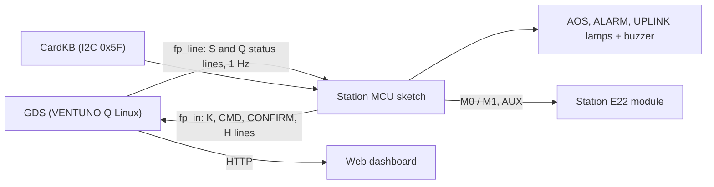

# 06 - Displays: station lamps, buzzer, CardKB console, LED matrix, status boards

This document describes every display of the mission **except** the web dashboard: the
station's three lamps and buzzer, the CardKB keyboard console and the Radio Control Unit on
the VENTUNO Q MCU (the station "front panel"), the GDS status line in the process log, the
spacecraft's 13 x 8 LED matrix and the spacecraft EGSE status board.

**The web dashboard is the station's main display.** Every tab, panel and number of it is
explained in [13_Web_UI_Reference.md](13_Web_UI_Reference.md). The lamps and the buzzer
repeat the few things an operator must notice without looking at a screen; the CardKB lets
an operator command from the station table.

Related documents: [03_Hardware_Integration.md](03_Hardware_Integration.md) (pin maps and
wiring), [07_Operations_Procedures.md](07_Operations_Procedures.md),
[14_Troubleshooting_and_Event_Response.md](14_Troubleshooting_and_Event_Response.md),
[15_Configuration_Reference.md](15_Configuration_Reference.md) (`[gds] frontpanel`, `rcu`).

Sources (the code is the authority): the station sketch
[sketch.ino](../dssq-groundstation/sketch/sketch.ino), the Linux side
[frontpanel.py](../dssq-groundstation/python/dssq/display/frontpanel.py) and
[gds.py](../dssq-groundstation/python/dssq/gds.py) (`panel_status()`, `_compute_alarm()`),
the spacecraft's [status_display.cpp](../vgq1-spacecraft/sketch/src/fsw/status_display.cpp)
and the EGSE [main.py](../vgq1-spacecraft/python/main.py) (`render_board()`).

## Contents

1. [Overview](#1-overview)
2. [Station lamps and buzzer](#2-station-lamps-and-buzzer)
3. [CardKB console](#3-cardkb-console)
4. [Radio Control Unit](#4-radio-control-unit)
5. [How the station MCU and the GDS talk](#5-how-the-station-mcu-and-the-gds-talk)
6. [GDS status line](#6-gds-status-line)
7. [Spacecraft LED matrix](#7-spacecraft-led-matrix)
8. [Spacecraft EGSE status board](#8-spacecraft-egse-status-board)
9. [Checks and items to verify on hardware](#9-checks-and-items-to-verify-on-hardware)

---

## 1 Overview

| Display | Where | Driven by | Shows |
|---|---|---|---|
| Web dashboard | any browser on the LAN, port 8080 | GDS on the VENTUNO Q Linux side | everything ([13_Web_UI_Reference.md](13_Web_UI_Reference.md)) |
| AOS / ALARM / UPLINK lamps, buzzer | station table | VENTUNO Q MCU (station sketch) | signal, alarm level and spacecraft beacon, commands in flight |
| CardKB keyboard | station table, header I2C bus | VENTUNO Q MCU | command entry and confirmation; the typed line appears on the dashboard |
| GDS status line | process log (terminal, journal or App Lab log) | GDS | one summary line every 10 s |
| 13 x 8 LED matrix | on the UNO Q (spacecraft) | flight software (MCU) | transmitter, receiver, COP-1, queues, recorder, instruments, mode, beacon, fault protection |
| EGSE status board | App Lab console of the spacecraft App | EGSE (UNO Q Linux side) | the spacecraft's status in text, every 10 s |



---

## 2 Station lamps and buzzer

**Wiring** (sketch constants, VENTUNO Q JDIGITAL / JANALOG headers; details and the
suggested colours in [03_Hardware_Integration.md](03_Hardware_Integration.md)):

| Output | Pin | Drive |
|---|---|---|
| AOS lamp | D5 | LED through a 330 Ω resistor |
| ALARM lamp | D6 | LED through a 330 Ω resistor |
| UPLINK lamp | D7 | LED through a 330 Ω resistor |
| Buzzer | A0 | through an NPN transistor; the pin is switched on and off (no tone generation), so the buzzer must be an active (self-oscillating) type |

The GDS sends the lamp state once a second (section 5). The MCU derives every blink pattern
from its own clock, so the patterns stay regular even when a status line arrives late.

### 2.1 What each lamp means

| Lamp | Off | On | Blinking |
|---|---|---|---|
| AOS | no signal (LOS), or the GDS link is down | frames are arriving (AOS) | - |
| ALARM | alarm NONE and beacon NOMINAL | YELLOW alarm (steady) | see the priority table below |
| UPLINK | nothing to send | commands are queued or sent and not yet acknowledged by the spacecraft (COP-1 FOP: sent, bypass or queued frames) | - |

**ALARM lamp priority** (highest first; `alarm_led()` in the sketch):

| Condition | Pattern | Meaning; what to do |
|---|---|---|
| GDS link down (no status line for 5 s) | 5 Hz blink (100 ms on, 100 ms off), AOS and UPLINK dark, buzzer silent | the MCU hears nothing from the GDS: the GDS is not running, still starting, or the Router Bridge is down. Open the dashboard; if it does not load, restart the App (or the host service) |
| alarm RED | 4 Hz blink (125 ms on, 125 ms off) | at least one RED reason: read `alarm_reasons` in the dashboard header or OVERVIEW ([13_Web_UI_Reference.md](13_Web_UI_Reference.md) section 15) |
| beacon INTERESTING | 1 Hz blink | the spacecraft has something interesting (a science event, a completed sequence) |
| beacon IMPORTANT | 2 Hz blink | a WARN-or-worse EVR or a lost instrument since the last contact (the alarm is YELLOW at the same time) |
| beacon URGENT | 3 Hz blink | in practice shown as the 4 Hz RED blink: an URGENT beacon is also a RED alarm reason |
| alarm YELLOW | steady on | at least one YELLOW reason |
| none of these | off | all well |

The beacon patterns (1 / 2 / 3 Hz) take precedence over a steady YELLOW, so a spacecraft that
asks for attention is never hidden behind a station warning. A beacon level the MCU has not
received (no HK yet, or `-1` in the status line) shows no beacon pattern.

### 2.2 Buzzer

| Sound | When |
|---|---|
| one 400 ms tone | the alarm turns RED (from NONE or YELLOW), or the signal is lost (AOS -> LOS) |
| 2 short chirps (100 ms on, 100 ms off) | the spacecraft beacon rises to IMPORTANT |
| 3 short chirps | the beacon rises to URGENT |

The chirps sound once per rise (a level that stays high does not repeat them); a falling
level is silent. When the GDS link goes down the buzzer stops at once and nothing stale sounds
when it returns.

### 2.3 Reading the lamps during operations

| Lamps | Typical situation |
|---|---|
| AOS on, ALARM off, UPLINK off | a quiet pass: frames arriving, nothing wrong, nothing to send |
| AOS on, UPLINK on | commands in flight; UPLINK goes off when the spacecraft has acknowledged them (CLCW) |
| AOS off, ALARM 4 Hz, one beep | LOS after a pass (RED alarm "LOS") - expected at the end of a pass, unexpected in the middle of one |
| AOS off, ALARM off | waiting for the first pass of this GDS run (no LOS alarm before the first AOS), or the spacecraft hibernates as commanded |
| ALARM 2 Hz with two chirps | the spacecraft beacon went IMPORTANT: read its EVRs (SPACECRAFT tab) and acknowledge with a command |
| ALARM 4 Hz right after a spacecraft boot | expected: every boot starts with an URGENT beacon until the ground sends `MODE` ([13_Web_UI_Reference.md](13_Web_UI_Reference.md) section 7.7) |
| ALARM 5 Hz, AOS and UPLINK dark | the GDS is not talking to the MCU |

---

## 3 CardKB console

One M5Stack CardKB keyboard on the VENTUNO Q header I2C bus `Wire` (SDA D20 / PH12, SCL
D21 / PH11 per the Arduino VENTUNO Q user manual; wire by the SDA / SCL silkscreen), address
0x5F, scanned at 50 Hz. Supply 3.3 V, or 5 V through a BSS138 bidirectional level shifter
(M5Stack specifies 5 V for the CardKB v1.1 and does not publish its I2C levels). The Qwiic
socket is not used. With `[gds] frontpanel = true` the GDS accepts its input.

### 3.1 Keys

| Key | Action |
|---|---|
| printable character | appended to the input line (up to 63 characters), converted to upper case; the line appears live on the dashboard (COMMANDING, Station I/O "Typing on the CardKB") |
| Backspace / Delete | deletes the last character |
| Enter | sends the line to the GDS as a command (`CMD\|<line>`), exactly as if typed in the dashboard's command entry: the same dictionary checks, the same COP-1 queue; the command source is recorded as "cardkb" |
| Enter on an empty line | CONFIRMs the newest hazardous command or directive waiting for confirmation (`CONFIRM\|<id>`) |
| ESC | clears the line and forgets the pending confirmation on the keyboard (the GDS keeps it; it expires after 120 s or is cancelled on the dashboard) |
| `KEYTEST` + Enter | key-test mode: every raw key code is echoed to the dashboard ("key code 0x.."); `KEYTEST` + Enter again, or ESC, leaves it. Nothing typed in key-test mode is sent or confirmed |

Everything the GDS accepts from the dashboard can be typed: commands (`MODE CRUISE`), COP-1
directives (`UNLOCK`), ground directives (`GSCAN`, `LINKRATE 4`) and `HELP <mnemonic>` (the
help goes to the dashboard console). The result of each command appears on the dashboard
(console, command history); the keyboard itself has no display.

### 3.2 Hazardous commands and the second operator

A hazardous command typed on the CardKB waits for confirmation like one from the web: the
GDS sends its id to the MCU (`Q|<id>`), and an empty Enter confirms it. With
`[commanding] require_two_person_for_hazardous = true` the second operator must also press
2nd-OP AUTH in the web dashboard: there is no second keyboard and no AUTH key.

Security note: the CardKB needs no web token. Anyone with physical access to the station
table can command; protect the station room accordingly
([17_Security_Model.md](17_Security_Model.md)).

### 3.3 If keys do nothing or produce wrong characters

1. Check the dashboard's Station I/O panel: "CardKB (header Wire, 0x5F)" must say present.
2. Type `KEYTEST` and Enter, press the keys in question and read the codes on the dashboard.
   CardKB key codes differ between firmware revisions; adjust the `KEY_*` constants of the
   sketch (Enter is 0x0D or 0x0A, Backspace 0x08, Delete 0x7F, ESC 0x1B) and rebuild.
3. A keyboard that is not detected at all: check SDA / SCL (not swapped), the supply and the
   level shifter.

---

## 4 Radio Control Unit

For the E22 UART station radio the MCU drives the module's mode pins and reads AUX
(`[gds] rcu = true`, the module's M0 / M1 jumpers removed):

| Signal | Pin | Use |
|---|---|---|
| M0 | D2 | mode bit 0 |
| M1 | D3 | mode bit 1 |
| AUX | D4 | module ready (high); the MCU waits up to 1 s after a mode change |

Modes 0..3 = NORMAL, WOR, CONFIG, SLEEP (E22 manuals). The GDS needs the RCU for the ground
directives `GSCAN`, `WAKE`, `LINKRATE`, `LINKCHAN` and `RADIO` and for the register read-back
at start-up; without it they are refused with "needs the Radio Control Unit". The dashboard
shows it as "Radio Control Unit: active" (RECEIVER, radio configuration) and "present" (Station
I/O). With the SX126x option the MCU owns the radio itself over SPI and there is no RCU
([13_Web_UI_Reference.md](13_Web_UI_Reference.md) section 4.13).

---

## 5 How the station MCU and the GDS talk

Both run on the VENTUNO Q and talk through the Arduino Router Bridge (MessagePack-RPC).

| Direction | Line | Meaning |
|---|---|---|
| GDS -> MCU, once a second | `S\|<aos>\|<alarm>\|<uplink>\|<beacon>` | aos 1 = AOS, 0 = LOS; alarm 0 NONE, 1 YELLOW, 2 RED; uplink 1 = commands queued or in flight; beacon -1 (unknown, no HK yet) or 0..3 |
| GDS -> MCU, once a second | `Q\|<id>` | the newest command waiting for CONFIRM, -1 = none |
| MCU -> GDS | `K\|<text>` | the line being typed (and key-test messages) |
| MCU -> GDS | `CMD\|<text>` | a command line (Enter) |
| MCU -> GDS | `CONFIRM\|<id>` | an empty Enter with a pending confirmation |
| MCU -> GDS, every 5 s | `H\|<fw>\|<rcu 0/1>\|<kb 0/1>` | hello: firmware text, RCU present, CardKB present |

Rules: an alarm value outside 0..2 is treated as RED (worst case). A 4-field S line (an older
GDS) means "beacon unknown". The MCU treats 5 s without any status line as "GDS link down"
(section 2.1). The GDS shows the MCU as connected while a hello arrived within the last 12 s
(dashboard Station I/O panel: `station_io.connected`, `station_io.last_status_line`,
`station_io.beacon_sent`; [13_Web_UI_Reference.md](13_Web_UI_Reference.md) section 13.8).

Example: during a quiet pass the GDS sends `S|1|0|0|0` and `Q|-1`; after a HIBERNATE was
typed (hazardous), `Q|7` until it is confirmed or expires.


**SX126x build only** (sketch built with `DSSQ_RADIO_SX126X = 1`): the same Router Bridge
link also carries the station radio itself
([sx126x.py](../dssq-groundstation/python/dssq/radio/sx126x.py); dashboard view in
[13_Web_UI_Reference.md](13_Web_UI_Reference.md) section 4.13):

| Direction | Service | Content and bounds |
|---|---|---|
| GDS -> MCU | `rf_tx(hex)`, `rf_wake(hex)` | one uplink frame of at most 112 octets (the request must fit the MCU's 256-octet RPC buffer; a CLTU of a 64-octet TC frame is 90 octets), queued in 4 slots; `rf_wake` adds the 32-symbol wake-up preamble. Result 1 queued, 0 queue full, -1 rejected, -2 radio down |
| GDS -> MCU | `rf_cfg(ch, code, pwr, flags)` | 1 applied, 2 queued (accepted: applied when the radio is idle), -1 out of range, -2 MCU busy (nothing changed, retry) |
| GDS -> MCU | `rf_foff(hz)`, `rf_noise()`, `rf_cad()` | AFC offset (\|hz\| <= 50000); noise floor (median of 8 instantaneous RSSI samples, 0.1 dBm); an operator channel-activity check |
| MCU -> GDS | `rf_rx(hex, rssi, snr, ferr, crc_ok)` | one received packet: a CRC-good payload of at most 236 octets (one CADU), or with `crc_ok` 0 exactly one 236-octet CADU for the RS rescue (472 hex characters, within the 480-character notification limit); RSSI 0.1 dBm, SNR 0.01 dB, raw frequency error Hz |
| MCU -> GDS | `rf_evt(line)` | `S\|...` status every 5 s and after each configuration change; `C\|detected\|ms` CAD result; `T\|ok\|ms\|octets` an uplink transmission finished (octets at most 112, the TX slot); `E\|code\|text` fault or recovery |

---

## 6 GDS status line

Every `[gds] console_interval_s` (default 10 s) the GDS writes one line to its process log
(the terminal in host mode, the journal under systemd, the App Lab log for the App):

```
STATUS AOS sync=LOCK RSSI=-113.0 dBm noise=-119 dBm SNRest=6.0 dB frames=344 lost=15 RScorr=482 alarm=NONE
```

AOS / LOS, synchronizer state (PACKET for the SX126x), the newest RSSI, noise floor, SNR
est. (RSSI - noise), frames received and lost, RS symbols corrected and the alarm level. It
is meant for a quick look over SSH; the dashboard has the full picture.

---

## 7 Spacecraft LED matrix

The UNO Q's built-in 13 x 8 LED matrix shows the spacecraft's state on the bench, updated
4 times a second; "blink" means 1 Hz (0.5 s on, 0.5 s off). Brightness levels 0..7.

| Row | Shows | Detail |
|---|---|---|
| 0 | TX | all 13 columns at full brightness while the transmitter is keyed |
| 1 | RX | all columns lit for 0.5 s after an uplink packet arrives |
| 2 | COP-1 | dim (level 1) while the FARM is not in lockout; blinking at full brightness in LOCKOUT (HK `farm_state` 3) |
| 3 | VC0 backlog | bar, columns = ceil(13 x backlog / 1024 octets): the real-time engineering queue |
| 4 | VC1 backlog | bar, the real-time science queue |
| 5 | recorder | bar, SSR fill (HK `ssr_fill`), 13 columns = 100 % |
| 6 | instruments | one column per HK `sensor_health` bit 0..9 (Nicla Sense ME and its sensors, AS7265X, RM3100 outboard, RM3100 inboard); lit = working |
| 7, columns 0-4 | mode | one lit column: BOOT, SAFE, CRUISE, ENCOUNTER, TEST |
| 7, columns 5-7 | beacon | one column per level: INTERESTING lights column 5, IMPORTANT 5-6, URGENT 5-7 blinking |
| 7, columns 8-12 | fault protection | blinking while any HK `fdir_flags` flag other than TX_INHIBIT and HIBERNATE is set |

Example: a spacecraft just booted shows row 7 column 1 (SAFE), columns 5-7 blinking (URGENT
until the first `MODE`), row 6 with 10 lit columns (all instruments, inboard RM3100 fitted)
and row 0 flashing with every frame.

---

## 8 Spacecraft EGSE status board

The spacecraft App's Linux side (the EGSE) prints a board to the App Lab console every 10 s
from the MCU's status notifications (`sc_status` every second, `sc_status_x` every 5 s) and
its own counters; the same data are logged as JSON lines in `data/sc_status_YYYYMMDD.jsonl`.

| Line | Content |
|---|---|
| MODE | flight mode, SCLK partition / seconds, beacon level, sequence state, age of the two status notifications |
| RADIO | model, channel and frequency, rate code, power code, LBT / CAD, framing |
| TX | on / off, INHIBITED, HIBERNATING, frames (idle frames), MCFC, frame period, busy time, duty cycle |
| UPLINK | uplink RSSI, SNR (SX126x), noise floor, FARM state and V(R), commands accepted / rejected, uplinks rescued after a LoRa CRC error |
| FDIR | fault-protection and instrument bit masks (hex), bus temperature, radio fault code, VC0..VC3 backlogs, SSR fill |
| SDLS | TC and TM services, TM state, epoch and sequence number, cadence stretch factor |
| CFDP | sender state, sequence number, progress, relay state, relay refusals by the MCU |
| EGSE | epoch issued, CADUs archived (per VC), EVRs logged |
| NOT FORWARDED | EVRs and CADUs the MCU could not forward, packets refused, EGSE inbox drops (should all be 0) |

The board is the bench view of the transmitter side; the ground sees the same quantities in
HK and RF telemetry ([13_Web_UI_Reference.md](13_Web_UI_Reference.md) sections 7.3 and 7.4).

---

## 9 Checks and items to verify on hardware

Lamp and keyboard check after assembly (numbered, each step checkable):

1. Power the VENTUNO Q with the App stopped: after 5 s the ALARM lamp blinks at 5 Hz (GDS
   link down), AOS and UPLINK stay dark. This also proves the ALARM LED and its resistor.
2. Start the App: within a few seconds of the GDS start the 5 Hz blink stops. With no
   spacecraft the lamps stay dark, or ALARM is steady when a YELLOW reason applies (for
   example "TC uplink BLOCKED" on a first start, until an HK sent at least 120 s after the
   spacecraft booted (SDLS-protected, or any HK at a station with `tm_service = "NONE"`); read the
   reasons in the dashboard header).
3. Dashboard COMMANDING, Station I/O: MCU link CONNECTED, CardKB present, Radio Control Unit
   present (E22 build).
4. Type `NOOP` on the CardKB: the dashboard shows "> NOOP_" while typing; Enter queues the
   command (console "#n NOOP: QUEUED") and the UPLINK lamp lights until it is acknowledged.
5. `KEYTEST`, Enter, press Enter, Backspace, ESC: the codes appear on the dashboard; ESC
   leaves key-test mode.
6. With the spacecraft running: AOS lights with the first frames; switching the spacecraft
   off gives LOS after the LOS timeout, one 400 ms tone and the 4 Hz RED blink.

VERIFY on hardware (listed for [20_Known_Limitations.md](20_Known_Limitations.md)): the CardKB
key codes of the keyboard in use (step 5), the CardKB's I2C levels at 5 V (use the level
shifter), the buzzer type (active buzzer required) and loudness, and the lamp visibility in the
station's lighting.
