# 13 - Ground Station Web UI Reference

This is the operator's reference for the DSS-Q1 web dashboard: the page the ground data
system (GDS) serves on the Arduino VENTUNO Q for the VGQ-1 mission. It explains every tab,
every panel and every number on it: what the number means, which snapshot key carries it,
where it comes from (a radio reading, a telemetry field, a counter or a formula), how often
it changes, what values to expect from this hardware, and what to do when a value looks
wrong.

How to use this document:

* New to the dashboard: read [section 1](#1-how-the-dashboard-works) (where the numbers come
  from, the badges, the number formats and the statistics), then
  [section 2](#2-header-bar-and-beacon-banner) (the header bar), then the tab you need.
* Running a range test: follow [section 17](#17-reading-the-receiver-tab-during-a-range-test).
* Something is red or yellow: [section 15](#15-alarm-logic) lists every alarm reason, and
  [14_Troubleshooting_and_Event_Response.md](14_Troubleshooting_and_Event_Response.md) gives
  the cause and the operator response for every event and alarm.
* Connecting a monitoring system: [section 16](#16-machine-interfaces-metrics-and-the-json-api).

Related documents: [02_Link_Budget_and_RF_Analysis.md](02_Link_Budget_and_RF_Analysis.md)
(sensitivities, link budgets, range), [04_Space_Data_Link_ICD.md](04_Space_Data_Link_ICD.md)
(frames, packets, SDLS, COP-1, CFDP), [05_Telemetry_and_Command_Dictionary.md](05_Telemetry_and_Command_Dictionary.md)
(every packet field and command, generated from the dictionary),
[06_Displays.md](06_Displays.md) (station lamps, buzzer, CardKB console, spacecraft LED
matrix), [07_Operations_Procedures.md](07_Operations_Procedures.md),
[08_Verification_and_Test.md](08_Verification_and_Test.md) (the T-RF-xx tests named below),
[15_Configuration_Reference.md](15_Configuration_Reference.md) (every `station.toml` key),
[17_Security_Model.md](17_Security_Model.md), [18_Data_Products.md](18_Data_Products.md)
(archive, `rx_stats`, CSV export, TDM, XTCE), [19_Glossary.md](19_Glossary.md).

**Where the facts come from.** Every key, formula, threshold and label below was checked
against the final code:
[gds.py](../dssq-groundstation/python/dssq/gds.py) (`GroundStation.snapshot()`,
`science_snapshot()`, `panel_status()`, `_compute_alarm()`),
[rxstats.py](../dssq-groundstation/python/dssq/rxstats.py),
[link.py](../dssq-groundstation/python/dssq/link.py),
[linkmgr.py](../dssq-groundstation/python/dssq/linkmgr.py),
[datalog.py](../dssq-groundstation/python/dssq/datalog.py),
[export.py](../dssq-groundstation/python/dssq/export.py),
[web.py](../dssq-groundstation/python/dssq/display/web.py),
[dashboard.html](../dssq-groundstation/python/dssq/display/dashboard.html),
[dictionary.py](../dssq-groundstation/python/dssq/dictionary.py),
[spectral.py](../dssq-groundstation/python/dssq/spectral.py) and
[magcal.py](../dssq-groundstation/python/dssq/magcal.py), plus the flight packet builder
[flight.cpp](../vgq1-spacecraft/sketch/src/fsw/flight.cpp) for the meaning of telemetry
fields. Where an older document disagrees with the code, the code wins.

**About the example values.** Unless a section says otherwise, the example numbers were
produced by the GDS running against its built-in software spacecraft
(`python -m dssq.gds --sim`, and the same `GroundStation` with the simulator on a virtual
clock): an E22-400T33D link at air-rate code 2 (2.4 kbit/s) and an SX126x link at LoRa
profile 1 (SF12, 62.5 kHz), with a configured distance of 2 km. They show how the numbers
relate to each other; they are not hardware measurements, and a rerun gives somewhat
different numbers (the simulated channel fades and loses frames at random). Where a later
code change altered a value (station identification, RF `tx_duty`, `last_airtime`,
`cltu_bad`), the text says so and quotes a rerun with the final code. The simulator's RF channel is
synthetic: the RSSI hovers around -112 dBm (E22) or -125 dBm (SX126x) and the noise floor
around -118 dBm whatever distance is configured, which is why its "excess loss" comes out
near 67 dB. On real hardware every value marked "VERIFY on hardware" still needs the test
named in [08_Verification_and_Test.md](08_Verification_and_Test.md).

**Screenshots** in [img/](img/) were taken from the simulator (E22 at air-rate code 7,
62.5 kbit/s, with a demonstration command load). A few panels showed paths of the test
machine; those were replaced with neutral placeholders such as `<archive>/files`.

**Drift protection.** [tests/test_docs.py](../tests/test_docs.py) builds real snapshots
(GDS plus simulator, E22 and SX126x) and fails when a snapshot key is missing from this
document, or when a key path written here does not exist in the snapshot.

## Contents

1. [How the dashboard works](#1-how-the-dashboard-works)
2. [Header bar and beacon banner](#2-header-bar-and-beacon-banner)
3. [OVERVIEW tab](#3-overview-tab)
4. [RECEIVER tab](#4-receiver-tab)
5. [LINK & SECURITY tab](#5-link--security-tab)
6. [FRAMES & PACKETS tab](#6-frames--packets-tab)
7. [SPACECRAFT tab](#7-spacecraft-tab)
8. [SPECTROMETER tab](#8-spectrometer-tab)
9. [SCIENCE tab](#9-science-tab)
10. [MAGCAL tab](#10-magcal-tab)
11. [SEQUENCES tab](#11-sequences-tab)
12. [FILES tab](#12-files-tab)
13. [COMMANDING tab](#13-commanding-tab)
14. [Health, events and logs](#14-health-events-and-logs)
15. [Alarm logic](#15-alarm-logic)
16. [Machine interfaces: /metrics and the JSON API](#16-machine-interfaces-metrics-and-the-json-api)
17. [Reading the RECEIVER tab during a range test](#17-reading-the-receiver-tab-during-a-range-test)
18. [Snapshot key index](#18-snapshot-key-index)

---

## 1 How the dashboard works

### 1.1 The path of a number

In plain words: the station radio hands every received packet to the GDS, together with its
signal strength (and, for the SX126x, its signal-to-noise ratio and frequency error). The
GDS finds the frame in it, repairs bit errors with the Reed-Solomon code, checks the frame,
opens the encryption, takes the telemetry packets out, decodes them into named values and
updates its statistics. All of that lives in one state object inside the GDS. Once a second
the web page asks for a copy of that state (the **snapshot**) and redraws the tab you are
looking at. The page never computes link quantities itself: it formats what the GDS sends.

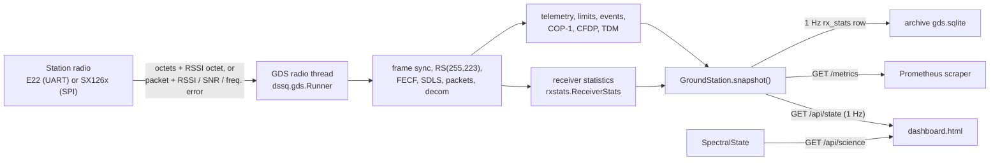

The GDS main loop (`Runner.step()` in [gds.py](../dssq-groundstation/python/dssq/gds.py))
runs ten stages in order: register, radio_read, ingest, packets, outbox, jobs, afc, tdm,
housekeeping, console. Each stage is an error boundary: an unexpected failure is counted in
`health.stage_errors`, logged at most once a minute and the loop carries on
([section 14](#14-health-events-and-logs)).

Every number is one of four kinds, and the page says which:

| Kind | Meaning | Example |
|---|---|---|
| measured | read from the radio, the decoder, a counter or a telemetry field | packet RSSI, RS symbols corrected, HK `bus_temp` |
| derived ("est.") | computed from measurements with a stated assumption | SNR est. = RSSI - noise, link margin est., C/N0 est. |
| computed / datasheet / estimated | from a formula or a datasheet, no measurement | free-space path loss, receiver sensitivity |
| configured | typed into `station.toml` | antenna gains, line losses, distance |

A value the GDS does not have is sent as JSON `null` and shown as **—**. Nothing is ever
invented to fill a gap.

### 1.2 Opening the dashboard

| Item | Fact | Source |
|---|---|---|
| URL | `http://<board address>:8080/` | [app.yaml](../dssq-groundstation/app.yaml) `ports: [8080]`; host mode: `[gds] http_host` / `http_port` |
| Bind address | the App's rules (App Lab, and host mode with `python -m dssq.gds --app-data <App>/data`): all interfaces (`0.0.0.0`, override with `DSSQ_HTTP_HOST`); a stand-alone `--config` file: `[gds] http_host` (default `127.0.0.1`) | `resolve_app_paths()` in [config.py](../dssq-groundstation/python/dssq/config.py), `station.toml` |
| Reading | anyone who can reach the port can read every tab | [web.py](../dssq-groundstation/python/dssq/display/web.py) |
| Commanding | every POST needs the `X-DSSQ-Token` header equal to `[gds] http_token`; with the App's rules an empty token is read from, or created once in, `<App>/data/http_token` (mode 0600). A LAN-bound server without a token refuses every POST: the page is read-only | web.py `_check_token` |
| Token entry | the **TOKEN** button in the header (or the prompt after the first refused POST) keeps the token for this browser session only (`sessionStorage`); "TOKEN ✓" means one is set | dashboard.html `setToken` |
| Second operator | with `[commanding] require_two_person_for_hazardous = true`, a hazardous command also needs **2nd-OP AUTH**; with `[commanding] auth_token` set, AUTH also needs the `X-DSSQ-Auth` secret (asked every time, never stored) | gds.py `confirm`, web.py `_check_auth` |
| DNS names | a LAN server answers only IP literals, single-label names, `<name>.local` and `[gds] http_allowed_hosts` (DNS-rebinding guard) | web.py `host_allowed` |

Security details (CSP, request limits, CSRF and DNS-rebinding defences) are in
[17_Security_Model.md](17_Security_Model.md).

### 1.3 How often things change

**What the page polls** (dashboard.html):

| Request | When | Used by |
|---|---|---|
| `GET /api/state` | every 1 s (the next poll starts 1 s after the previous answer; one request at a time) | every tab and the header |
| `GET /api/science` | every 1 s while SPECTROMETER or SCIENCE is visible, every 10 s otherwise | SPECTROMETER, SCIENCE (boom radii) |
| `GET /api/files`, `/api/tdm`, `/api/exports` | when the FILES tab is shown and the lists are older than 5 s | FILES |
| `GET /api/dictionary` | once at start (retried every 5 s until it loads) | enumeration names, command help, builders |

The header shows "GDS LINK DOWN (n s)" in red when no `/api/state` answer arrived for more
than 5 s.

**What drives each value** (the source, not the page):

| Driver | Values | Rate |
|---|---|---|
| every received radio unit (E22 CADU, SX126x packet, also ones that fail to decode) | packet RSSI, SX126x SNR and frequency error, histograms, CRC counters | once per frame period |
| every frame that passes RS and the frame check (FECF) | frame counters, FER, inter-arrival time, the 300-frame chart series | once per frame period |
| a noise-floor reading | noise floor, SNR est. | at most once per `[radio] noise_poll_s` (default 20 s), requested after a received frame when no command is waiting to go up |
| GDS housekeeping | LOS detection, alarm, data-logger row, AFC timers | 1 Hz |
| link manager | its recommendation | every `[linkmgr] period_s` (default 60 s) |
| spacecraft telemetry packets | everything decoded from HK, RF, MAG, ... | the flight cadence below |

The spacecraft sends one frame per **frame period**. The flight software sets it
(`frame_period_ms()` in [datalink.cpp](../vgq1-spacecraft/sketch/src/fsw/datalink.cpp)) to
the largest of: busy time x mode factor (BOOT and SAFE 4.0, CRUISE 2.5, ENCOUNTER and TEST
2.0), busy time / 0.5 (the 50 % transmitter duty limit), 1.5 s, and the FPERIOD command
value; it doubles while the PA over-temperature flag is set. The busy time per frame is
UART transfer plus estimated air time for the E22 and the exact LoRa air time for the
SX126x (`link.busy_s()`):

| Radio and rate | Busy time per frame | Frame period SAFE / CRUISE / ENCOUNTER, TEST |
|---|---|---|
| E22 code 0-2 (2.4 kbit/s) | 1.267 s (245 ms UART + 1022 ms air) | 5.07 / 3.17 / 2.53 s |
| E22 code 3 (4.8 kbit/s) | 0.756 s | 3.02 / 1.89 / 1.51 s |
| E22 code 4 (9.6 kbit/s) | 0.500 s | 2.00 / 1.50 / 1.50 s |
| E22 code 5-7 (19.2-62.5 kbit/s) | 0.372 / 0.308 / 0.284 s | 1.50 s (floor) |
| SX126x profile 0 (SF12, 31.25 kHz) | 34.636 s | 138.5 / 86.6 / 69.3 s |
| SX126x profile 1 (SF12, 62.5 kHz) | 17.318 s | 69.3 / 43.3 / 34.6 s |
| SX126x profile 2 (SF12, 125 kHz) | 8.659 s | 34.6 / 21.6 / 17.3 s |
| SX126x profile 3 (SF11, 125 kHz) | 4.740 s | 19.0 / 11.9 / 9.5 s |
| SX126x profile 4 (SF10, 125 kHz) | 2.165 s | 8.7 / 5.4 / 4.3 s |
| SX126x profile 5 (SF9, 125 kHz) | 1.185 s | 4.7 / 3.0 / 2.4 s |
| SX126x profile 6 (SF8, 125 kHz) | 0.665 s | 2.7 / 1.7 / 1.5 s |
| SX126x profile 7 (SF7, 125 kHz) | 0.373 s | 1.5 s (floor) |

Telemetry packets are generated at the flight's per-mode cadence (`kModeCadence`, seconds,
0 = off) and stretched on board when the link cannot carry them; `PKTRATE` overrides one
packet type:

| Mode | HK | RF | TIMECORR | MAG | ATT | SPEC | ENV |
|---|---|---|---|---|---|---|---|
| BOOT | 10 | 10 | off | off | off | off | off |
| SAFE | 30 | 60 | 300 | off | off | off | off |
| CRUISE | 60 | 60 | 300 | 30 | 60 | 300 | 120 |
| ENCOUNTER | 20 | 30 | 120 | 4 | 8 | 30 | 30 |
| TEST | 10 | 10 | 60 | 4 | 8 | 30 | 30 |

So a value decoded from HK changes at most every 10-60 s, while the RECEIVER values move
with every frame.

### 1.4 Measured, estimated, computed: the badges and labels

Small coloured badges and words in labels tell you how far to trust a number.

| Badge or label | Colour | Meaning | Where it appears |
|---|---|---|---|
| **measured** | green | read from a radio, decoder or counter; for a sensitivity: a value from test T-RF-03 in `[radio.sensitivity_measured]` | link budget "measured" column; sensitivity source |
| **datasheet** | blue | taken from a manufacturer datasheet | sensitivity (T33D -128 dBm, T37S -126 dBm at 2.4 kbit/s; SX126x where Semtech Table 3-8 lists the profile); T37S TX power (37 dBm on every code) |
| **computed** | blue in the link budget, amber as a sensitivity source | a formula on configured or datasheet inputs, no measurement: free-space loss, thermal noise, the SX126x sensitivity -174 + 10 log10(BW) + NF + SNRmin | link budget, sensitivity source, LoRa air time |
| **estimated** | amber | an extrapolation from a datasheet value: E22 sensitivity above 2.4 kbit/s, E22 air time, SX126x sensitivity without boosted gain | sensitivity source, air-time source |
| **configured** | grey | typed into `station.toml` | antenna gains, line losses, distance |
| **est.** | amber | a derived quantity resting on an assumption | EIRP, excess loss, link margin, range at sensitivity, SNR est. |
| **VERIFY T-RF-07** | amber | the transmitter power for this code has not been measured yet (E22-400T33D codes 1-3 and every SX126x code; the T37S is "datasheet") | link budget, radio configuration |
| "est." in a label | - | the same as the badge: "SNR est. (RSSI - noise)", "N0 est." | RECEIVER |
| "approximate (18-band)" | - | spectrometer radiometry and colorimetry built from 18 filter bands | SPECTROMETER |
| "heuristic" | - | rule-based judgement (light-source class, fluorescence, burst transients) | SPECTROMETER |
| "proxy" | - | an index evaluated on the nearest available bands (WBI, PRI) | SPECTROMETER |
| "informational" | - | shown for insight, not for decisions (die-temperature drift) | SPECTROMETER |
| **MISMATCH** | red | the spacecraft reports a different radio model, or the station SX126x sketch was built for another chip / TCXO | RECEIVER radio configuration, SX126x MCU |

Telemetry limits colour the value cell: yellow background for YELLOW, red for RED
([section 7.2](#72-limits-and-how-they-are-checked)). Text colours: green = good, amber =
needs attention, red = bad, grey = not applicable.

### 1.5 Display conventions

The page formats numbers with a few helpers in dashboard.html; the table says which one
each kind of value uses.

| Kind of value | Shown as | Example | Rule (dashboard.html) |
|---|---|---|---|
| dB and dBm statistics (window means, SEM, percentiles) | 4 decimals | -111.9213 dBm | `fx(v, 4)` |
| single readings (RSSI, noise, margin) | 4 decimals plus the hardware resolution | -113.0000 dBm (resolution 1.0 dB) | `fu(v, 4)` |
| frequencies, frequency errors, Doppler | 1 decimal, Hz | 433125000.0 Hz, 469.0 Hz | `fu(v, 1, "Hz")` |
| frequency in MHz | 6 decimals | 433.125000 MHz | RF now |
| range rate | 3 decimals, m/s | -1161.447 m/s | Doppler panel |
| rates and percentages | 2 decimals | 22.00 bit/s, 79.94 % | `fpct()`, `fx(v, 2)` |
| FER, BER, SER, CER, packet error rate | scientific, 3 significant digits | 4.18e-2 | `fsci()` = `toExponential(2)` |
| spectral values (µW/cm²) | 4 significant digits | 40.07 | `fsig(v, 4)` |
| counts | whole numbers with thousands separators | 81,803 | `fint()` |
| telemetry fields (SPACECRAFT) | the decimals of the field's scale (0.01 -> 2, 0.1 -> 1, 0.001 -> 3); integers as integers | 32.42 degC | `tlmTable()` |
| times | UTC, ISO 8601 to the second | 2027-01-15T08:00:02Z | `iso()` |
| times in logs | time of day, UTC | 20:52:19Z | `tod()` |
| durations | seconds below 1 min, else d h m s | 5.4 s, 20m 28s | `dur()` |
| "ago" | time since the value's timestamp | 1m 9s ago | `ago()` |
| file sizes (CFDP, TDM, exports) | binary units | 4.2 KiB | `size()` |
| archive sizes (data logger) | SI units, as `archive_max_gb` / `archive_min_free_mb` | 13.2 GB | `sizeSI()` |
| one-way light time | µs, ms or s with 3 decimals | 6.671 µs | `owlt()` |
| booleans | yes / no | yes | `fyn()` |
| no value | — | — | null, missing, NaN or infinite |

**Resolution of a single reading** (what one reading can resolve, not its accuracy):

| Reading | Resolution | Source |
|---|---|---|
| E22 packet RSSI and noise register | 1 dB | E22 manuals: dBm = -(256 - register); `rxstats.E22_RSSI_RESOLUTION_DB` |
| SX126x packet RSSI | 0.5 dB | SX1261/2 datasheet GetPacketStatus: RssiPkt / 2; `rxstats.SX126X_RSSI_RESOLUTION_DB` |
| SX126x packet SNR | 0.25 dB | SnrPkt / 4 |
| SX126x noise floor | 0.1 dB | median of 8 instantaneous RSSI samples, sent in 0.1 dBm (`rf_noise`) |
| SX126x frequency error | 1 Hz (whole Hz from the station MCU) | `rf_rx` freq_err_hz |

The absolute accuracy of every RSSI and noise value is set by the station calibration
`[radio] rssi_cal_offset_db`, which test T-RF-02 determines
([08_Verification_and_Test.md](08_Verification_and_Test.md)). Until that test is done,
treat absolute dBm values as uncalibrated (VERIFY on hardware); differences between two
readings of the same radio are still meaningful.

### 1.6 The statistics windows explained

The RECEIVER tab keeps eight measured quantities in three windows and summarises each
window with eleven statistics (`rx.windows`, computed by `rxstats.Window.stats()`).

**The windows.**

| Window | Key | What it holds | Cap |
|---|---|---|---|
| 1 min | `rx.windows.1m` | samples of the last 60 s | 20,000 samples |
| 10 min | `rx.windows.10m` | samples of the last 600 s | 20,000 samples |
| pass | `rx.windows.pass` | samples since the current pass began (AOS); emptied at every AOS except for the AOS frame's own samples | 20,000 samples; then the oldest are dropped and the window reports `truncated` = true ("pass (truncated)") |

Old samples leave the 1 min and 10 min windows when a new sample arrives and whenever the
snapshot is built, so a window empties itself during LOS. The inter-pass gap is never
counted as an inter-arrival time.

**The statistics** (n samples x1 ... xn, sorted s1 <= ... <= sn):

| Column | Key | Formula | What it tells you |
|---|---|---|---|
| n | `n` | number of samples | how much the other columns are worth; with n = 1 there is no spread |
| mean | `mean` | (1/n) Σ xi | the typical level |
| ± SEM | `sem` | s / √n, with s = √(Σ (xi - mean)² / (n - 1)) the sample standard deviation | how well the mean is known (needs n >= 2) |
| σ | `std` | √(Σ (xi - mean)² / n), the population standard deviation | how much single readings scatter (fading, noise) |
| min | `min` | s1 | the worst (lowest) reading |
| p10 | `p10` | the 10th percentile, linear interpolation at k = 0.10 (n - 1) between neighbouring sorted samples | the level the signal stayed above 90 % of the time |
| p50 | `p50` | the median, k = 0.50 (n - 1) | the middle reading, robust to outliers |
| p90 | `p90` | the 90th percentile, k = 0.90 (n - 1) | the level exceeded only 10 % of the time |
| max | `max` | sn | the best (highest) reading |
| last | `last` | xn in arrival order | the newest reading |
| fade p90-p10 | `fade_depth` | p90 - p10 | the depth of fading: how far the signal swings |

**Worked example.** Five RSSI readings -112, -110, -113, -111, -114 dBm (computed with the
GDS's own `Window` class): n = 5, mean = -112.0000; deviations 0, +2, -1, +1, -2, so
Σ d² = 10; σ = √(10/5) = 1.4142 dB; s = √(10/4) = 1.5811 dB; SEM = 1.5811 / √5 = 0.7071 dB;
sorted -114, -113, -112, -111, -110: p10 at k = 0.4 gives -114 + 0.4 x 1 = -113.6000,
p50 = -112.0000, p90 at k = 3.6 gives -111 + 0.6 x 1 = -110.4000; fade depth = 3.2000 dB;
last = -114.0000.

**Why four decimals?** A single E22 RSSI reading is a whole dB, so four decimals are not a
claim of accuracy. They are there so that window means can be compared with each other and
with their SEM: a 10-minute mean of 178 one-dB readings, -111.9213 ± 0.2144 dBm, is known to
about ±0.43 dB (two SEM) relative to other readings of the same radio, and rounding it to
-112 would hide changes of a few tenths of a dB between windows or passes. The absolute
accuracy is a separate matter: it is limited by the calibration offset (T-RF-02), not by
the decimals.

**How to read SEM.** Two means differ significantly when their difference is larger than
about 2√(SEM1² + SEM2²). SEM assumes independent readings; slow fading makes neighbouring
frames correlated, so treat SEM as a lower bound on the uncertainty of the mean. Look at σ
and the fade depth to see how much single readings move.

### 1.7 Snapshot keys and the notation in this document

`/api/state` returns one JSON object (`GroundStation.snapshot()`, schema 3) with 37
top-level keys; `/api/science` returns the spectrometer analytics separately
(`science_snapshot()`). This document writes a value's location as a dotted path from the
root: `rx.rf.rssi_dbm` is `snapshot["rx"]["rf"]["rssi_dbm"]`. Paths that start with
`spectral`, `spectral_history`, `spectral_burst`, `spectral_skymap`, `spectral_library`,
`cfg` or `led_limits` are in `/api/science`. A part in angle brackets is a placeholder for a
name that varies: `vc.<vc>.frames` (one entry per virtual channel), `apids.<packet>.count`,
`tlm.<packet>.values.<field>`, `rx.windows.<window>.<metric>.<stat>`. `[]` after a part
means "each element of this list": `cfdp.transactions[].progress`.

| Top-level key | What it holds | Section |
|---|---|---|
| `schema` | snapshot schema version (3) | [13.7](#137-gds-health-panel) |
| `version` | GDS software version (`dssq.__version__`, 3.0.0) | [13.7](#137-gds-health-panel) |
| `utc` | station time when the snapshot was built (UNIX s) | [2](#2-header-bar-and-beacon-banner) |
| `station` | station name, `[station] name` | [2](#2-header-bar-and-beacon-banner) |
| `spacecraft` | spacecraft name, `[spacecraft] name` | [2](#2-header-bar-and-beacon-banner) |
| `uptime_s` | seconds since the GDS started | [13.7](#137-gds-health-panel) |
| `mode` | GDS run mode: `host`, `applab` or `sim` | [2](#2-header-bar-and-beacon-banner) |
| `alarm` | NONE, YELLOW or RED | [15](#15-alarm-logic) |
| `alarm_reasons` | every reason, RED first | [15](#15-alarm-logic) |
| `alarm_red_count` | how many of `alarm_reasons` are RED | [15](#15-alarm-logic) |
| `beacon` | spacecraft beacon level and history | [2](#2-header-bar-and-beacon-banner), [7.7](#77-beacon) |
| `rx` | receiver statistics engine (RF, windows, budget, decoder, frames ...) | [4](#4-receiver-tab) |
| `radio` | station radio configuration, model checks, jobs | [4.6](#46-radio-configuration) |
| `link` | framing, SDLS, OID identification, station identification | [5](#5-link--security-tab) |
| `sync` | frame synchronizer state and counters | [4.9](#49-frame-synchronizer) |
| `vc` | per-virtual-channel counters | [6.2](#62-virtual-channels) |
| `apids` | per-APID packet statistics | [6.3](#63-packets-by-apid) |
| `tlm` | latest decoded real-time packet of each type | [7](#7-spacecraft-tab), [9](#9-science-tab) |
| `decoded` | enumerations and bit masks of HK / RF / MAG as names | [7](#7-spacecraft-tab) |
| `time` | SCLK correlation | [5.8](#58-time-correlation) |
| `cop` | COP-1 FOP-1 sender state and recent commands | [5.5](#55-cop-1-fop) |
| `cfdp` | CFDP class-1 receiver and onboard sender state | [12.1](#121-cfdp-transactions) |
| `tdm` | CCSDS Tracking Data Message recorder | [12.4](#124-tracking-data-messages-and-xtce) |
| `sequence` | stored-sequence state, checked file, uplink | [11](#11-sequences-tab) |
| `magcal` | magnetometer calibration collectors and fits | [10](#10-magcal-tab) |
| `health` | GDS stage errors, archive write errors | [14](#14-health-events-and-logs) |
| `logger` | receiver data logger: rows, space, retention | [12.5](#125-receiver-data-logger) |
| `linkmgr` | adaptive link manager | [4.16](#416-link-manager-and-pass-events) |
| `pending_confirm` | commands waiting for CONFIRM / AUTH | [13.2](#132-pending-confirmations) |
| `evrs` | the last 40 spacecraft event reports | [7.10](#710-spacecraft-evrs) |
| `events` | the last 80 ground events | [14](#14-health-events-and-logs) |
| `anomalies` | the last 20 statistical outliers | [7.11](#711-anomaly-detector) |
| `console` | the last 30 console lines | [13.4](#134-console) |
| `station_io` | station I/O MCU (CardKB, annunciators) | [13.8](#138-station-io-panel) |
| `cmd_stages` | names of the CMDVER stages (for the page) | [7.9](#79-other-packets-cmdver-timecorr-rfscan) |
| `cmd_errors` | names of the command error codes | [7.9](#79-other-packets-cmdver-timecorr-rfscan) |
| `cmd_sources` | names of the CMDVER command sources | [7.9](#79-other-packets-cmdver-timecorr-rfscan) |

`/api/science` top-level keys: `spectral`, `spectral_history`, `spectral_burst`,
`spectral_skymap`, `spectral_library`, `cfg` (the `[science]` table) and `led_limits`
([section 8](#8-spectrometer-tab)).

---

## 2 Header bar and beacon banner

The header is visible on every tab. It answers four questions at a glance: do we hear the
spacecraft, is anything wrong, how good is the link, and is the uplink working. It is built
by `renderHeader()` from `/api/state`.

```
+------------------------------------------------------------------------------------------+
| BEACON URGENT since ... (only when the beacon level is 1..3)                               |
+------------------------------------------------------------------------------------------+
| DSS-Q1 GROUND STATION  S/C VGQ-1  [AOS] [LOCK] [ALARM NONE]  MODE CRUISE  UTC ...          |
| RSSI-1m ...  SNR ...  MARGIN ...  FER ...  FRAMES ...  SCLK ...  COP-1 ...  SDLS TM ...    |
| FRAMING ...                                              GDS 3.0.0 applab   [TOKEN]       |
+------------------------------------------------------------------------------------------+
| OVERVIEW  RECEIVER  LINK & SECURITY  FRAMES & PACKETS  SPACECRAFT  ...  COMMANDING         |
| [pending confirmation strip: #id text, CONFIRM, 2nd-OP AUTH, CANCEL]                       |
+------------------------------------------------------------------------------------------+
```

| Shown as | Key | Format and colours | Meaning; what to do |
|---|---|---|---|
| DSS-Q1 GROUND STATION | `station` | text + " GROUND STATION" | station name from `[station] name` |
| S/C VGQ-1 | `spacecraft` | text | spacecraft name from `[spacecraft] name` |
| AOS / LOS pill | `rx.state.los`, `rx.state.hibernating` | green **AOS** (tooltip: pass duration); red **LOS** (tooltip: time since the last frame); amber **LOS (hibernating)** | AOS = frames are arriving. LOS = no valid frame for longer than the LOS timeout ([4.18](#418-receiver-state)). LOS while the spacecraft hibernates is expected and shown amber. Unexpected LOS: [section 17](#17-reading-the-receiver-tab-during-a-range-test) and docs/14 "LOS" |
| SYNC pill | `sync.state` | green LOCK or PACKET, amber FLYWHEEL, red SEARCH | frame synchronizer state ([4.9](#49-frame-synchronizer)); PACKET is the SX126x (one CADU per LoRa packet, no byte-stream search) |
| ALARM pill | `alarm`, tooltip `alarm_reasons` | green NONE, amber YELLOW, red RED | the station alarm ([section 15](#15-alarm-logic)); hover to read every reason |
| MODE | `decoded.mode` | text | the **spacecraft** flight-software mode from HK `fsw_mode`: BOOT, SAFE, CRUISE, ENCOUNTER, TEST. (The GDS run mode is at the right end.) |
| UTC | `utc` | ISO 8601 | the station clock when the snapshot was built; check it against a reference clock: SCET, TDM and latency depend on it (NTP) |
| RSSI 1-min mean | `rx.windows.1m.rssi.mean`, `.sem` | "-110.6923 ± 0.4985 dBm", 4 decimals | mean packet RSSI of the last minute with its standard error ([1.6](#16-the-statistics-windows-explained)) |
| SNR | `rx.rf.packet.snr_db`, else `rx.rf.snr_est_db` | SX126x: measured SNR, 2 decimals, "dB"; E22: "dB est." (RSSI - noise); **—** during LOS | the newest frame's signal-to-noise ratio; during LOS the last value is history, not the link, so it is hidden here (the RECEIVER tab keeps it with its time) |
| MARGIN | `rx.rf.margin_est_db` | 2 decimals, dB; **—** during LOS | newest RSSI minus the receiver sensitivity ([4.2](#42-rf-now)) |
| FER | `rx.frames.fer` | scientific | frame error rate since the GDS started ([4.11](#411-frames)) |
| FRAMES | `rx.frames.ok`, `rx.frames.lost` | "344 / lost 15" | frames received and frames missing (master-channel counter gaps) |
| SCLK | `time.partition`, `time.sclk_estimate_s` | "1/1224" | spacecraft clock: partition (boot counter) / estimated SCLK seconds now ([5.8](#58-time-correlation)) |
| COP-1 | `cop.vs`, `cop.nr`, `cop.lockout`, `cop.uplink_blocked`, `cop.suspended`, `cop.outstanding` | "V(S)=4 N(R)=4 OK out=1" | uplink protocol state: next frame number to send, the spacecraft's next expected number, and LOCKOUT / BLOCKED / SUSPENDED / OK ([5.5](#55-cop-1-fop)) |
| SDLS TM | `link.sdls.spacecraft_tm_state`, `link.sdls.tm_service` | "PROTECTED (AE)" | downlink security: the spacecraft's TM state from HK and the ground's TM service ([5.2](#52-sdls)) |
| FRAMING | `link.tm_framing_seen` | "TM TM 344 / USLP 0" | format of the last frame, then the count of TM and USLP frames seen |
| GDS 3.0.0 applab | `version`, `mode` | grey; red "GDS LINK DOWN (n s)" when no answer for > 5 s; amber "connecting…" before the first answer | the GDS software version and run mode (`host`, `applab`, `sim`). LINK DOWN: the browser cannot reach the GDS (network, App stopped) |
| TOKEN | (browser) | "TOKEN" or "TOKEN ✓" | the commanding token kept for this browser session ([1.2](#12-opening-the-dashboard)) |
| display error line | (browser) | red text under the tabs | a rendering failure in the page ("data shown may be incomplete"); reload the page and report it |

**Beacon banner** (`beacon`): a full-width band above the header when the spacecraft's
beacon level (HK `beacon_level`, [7.7](#77-beacon)) is above NOMINAL: blue for INTERESTING,
amber for IMPORTANT, red and flashing for URGENT. Text: "BEACON <`beacon.name`> since
<`beacon.since`>", then "SPACECRAFT HIBERNATING" when `beacon.hibernating` is true, then
"last beacon HK <time since `beacon.t`> ago". The level is the spacecraft's own judgement
of how urgently it needs attention (Deep Space 1 Beacon Monitor concept, `BeaconMonitor`
in [autonomy.cpp](../vgq1-spacecraft/sketch/src/fsw/autonomy.cpp)); on board it only rises
until the spacecraft accepts a command. That ground contact acknowledges the events (EVRs,
lost sensors, brownout, SSR drops, completed sequences) and re-evaluates the standing
conditions: a SAFE entered by fault protection or a sequence stopped by fault protection
keeps the level URGENT until it is resolved (for example by `MODE CRUISE`). What to do: open
the SPACECRAFT tab, read the EVRs and the fault-protection flags, act on them, then send a
command (NOOP is enough when nothing else is needed) to acknowledge.

**Pending-confirmation strip** (`pending_confirm`): one line per command waiting for
confirmation, on every tab ([13.2](#132-pending-confirmations)).

---

## 3 OVERVIEW tab

**What it is for.** The first tab you look at: one row of tiles summarising the link, the
spacecraft and the uplink, two charts of the signal, the spacecraft summary, the alarm
reasons, the newest events and the status of the newest commands. If everything here is
green, the other tabs can wait.

```
+--------+--------+--------+--------+--------+--------+--------+--------+
| Signal | RSSI   | SNR    | Margin | Frames | Thru-  | RS     | S/C    |   (tiles wrap
| AOS    | 1-min  | est.   | est.   |        | put    | decoder| mode   |    to the width
+--------+--------+--------+--------+--------+--------+--------+--------+    of the window)
| Bus    | SDLS   | Uplink | CFDP   |
| temp   | TM     |        | onboard|
+------------------------+------------------------+------------------------+
| Received power chart   | Signal-to-noise chart  | Spacecraft summary     |
+------------------------+------------------------+------------------------+
| Alarm reasons          | Latest events          | Command status         |
+------------------------+------------------------+------------------------+
```

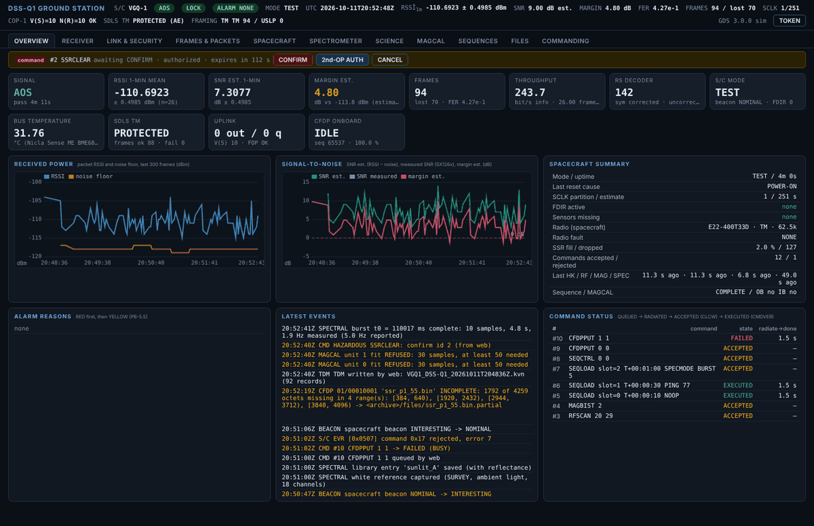

### 3.1 Tiles

| Tile | Big value (key) | Small line | Colour | Meaning; if abnormal |
|---|---|---|---|---|
| Signal | AOS / LOS (`rx.state.los`) | "pass 4m 11s" (`rx.state.pass_duration_s`) or "since frame 2m 5s" (`rx.state.since_last_frame_s`) | green AOS, red LOS | are frames arriving; LOS: [17](#17-reading-the-receiver-tab-during-a-range-test) step 1 |
| RSSI 1-min mean | `rx.windows.1m.rssi.mean`, 4 dp | "± SEM dBm (n=...)"; tooltip: last RSSI and its resolution | - | signal strength, averaged ([4.2](#42-rf-now)) |
| SNR est. 1-min | `rx.windows.1m.snr_est.mean`, 4 dp | "dB ± SEM", plus "meas x.xx" with an SX126x (`rx.rf.packet.snr_db`) | - | RSSI minus noise floor, averaged |
| Margin est. | `rx.rf.margin_est_db`, 2 dp | "dB vs <sensitivity> dBm (<source>)"; during LOS "LOS · last x dB, t ago" | red < 3 dB, amber 3-6 dB, green >= 6 dB | how far above the decode threshold the newest frame was; below 3 dB frames start to drop |
| Frames | `rx.frames.ok` | "lost n · FER x" | - | frames received, lost, frame error rate |
| Throughput | `rx.frames.info_rate_bps`, 1 dp | "bit/s info · n frames/min" | - | useful telemetry bits per second over the last 60 s ([4.11](#411-frames)) |
| RS decoder | `rx.decoder.symbols_corrected` | "sym corrected · uncorrectable n" | amber when any codeblock was uncorrectable | how hard the error correction works ([4.10](#410-decoder)) |
| S/C mode | `decoded.mode` | "beacon <name> · FDIR <number of active flags>" | - | spacecraft mode, beacon level and active fault-protection flags |
| Bus temperature | `tlm.HK.values.bus_temp`, 2 dp | "°C (Nicla Sense ME BME688)" | amber on a YELLOW or RED limit | spacecraft bus temperature ([7.3](#73-housekeeping-hk-all-43-fields)) |
| SDLS TM | `link.sdls.spacecraft_tm_state` | "frames ok n · fail n" (`link.sdls.tm_frames_ok`, `link.sdls.tm_auth_fail`) | - | downlink security state ([5.2](#52-sdls)) |
| Uplink | "n out / n q" (`cop.outstanding`, `cop.queued`) | "V(S) n · FOP OK / LOCKOUT / BLOCKED" | red on LOCKOUT or BLOCKED | commands in flight and waiting ([5.5](#55-cop-1-fop)) |
| CFDP onboard | `cfdp.onboard.state_name` | "seq n · progress %" | - | the spacecraft's file sender ([12.1](#121-cfdp-transactions)) |

### 3.2 Charts

| Chart | Series (keys) | Window | Notes |
|---|---|---|---|
| Received power | RSSI (`rx.series.rssi`), noise floor (`rx.series.noise`), against `rx.series.t` | the last 300 frames | dBm; a frame's RSSI is drawn only when it belongs to that frame; the noise line holds the latest reading |
| Signal-to-noise | SNR est. (`rx.series.snr_est`), SNR measured (`rx.series.snr_meas`, SX126x), margin est. (`rx.series.margin`) | the last 300 frames | dB; dashed red line at 0 dB. Hover any chart to read the values of one frame |

### 3.3 Spacecraft summary

| Row | Keys | Meaning |
|---|---|---|
| Mode / uptime | `decoded.mode`, `tlm.HK.values.uptime_s` | flight mode and time since the MCU booted |
| Last reset cause | `decoded.reset_cause` | POWER-ON, PIN, SOFTWARE, WATCHDOG, BROWNOUT, UNKNOWN (BROWNOUT raises a YELLOW alarm) |
| SCLK partition / estimate | `tlm.HK.values.sclk_partition`, `time.sclk_estimate_s` | boot counter and estimated SCLK now |
| FDIR active | `decoded.fdir` | names of the set fault-protection flags; amber when any |
| Sensors missing | `decoded.sensors_missing` | instruments the spacecraft reports as not working; amber when any |
| Radio (spacecraft) | `decoded.radio_model`, `decoded.framing`, `decoded.rate_label` | from the RF packet |
| Radio fault | `decoded.radio_fault` | last radio fault; red when not NONE |
| SSR fill / dropped | `tlm.HK.values.ssr_fill`, `tlm.HK.values.ssr_dropped` | solid-state recorder |
| Commands accepted / rejected | `tlm.HK.values.cmd_accepted`, `tlm.HK.values.cmd_rejected` | onboard command counters |
| Last HK / RF / MAG / SPEC | `tlm.<packet>.ert` | how long ago each packet type last arrived |
| Sequence / MAGCAL | `decoded.seq_state`, `decoded.magcal` | stored-sequence state; onboard calibration active outboard / inboard |

### 3.4 Alarm reasons, latest events, command status

* **Alarm reasons** (`alarm_reasons`, `alarm_red_count`): RED reasons first in red, then
  YELLOW in amber; "none" when the alarm is NONE ([section 15](#15-alarm-logic)).
* **Latest events** (`events`): the newest 16 ground events, newest first, coloured by
  level (WARN amber, ERROR red) ([section 14](#14-health-events-and-logs)).
* **Command status** (`cop.recent`): the newest 8 commands: number, text, state and
  radiate-to-done time ([13.3](#133-command-history)). States go QUEUED -> RADIATED ->
  ACCEPTED (the CLCW shows the spacecraft's FARM took the frame) -> EXECUTED or FAILED
  (CMDVER); TIMEOUT and SUSPENDED are failures of the uplink protocol.

---

## 4 RECEIVER tab

### 4.1 What the tab is for

The RECEIVER tab is the station's receiver laboratory. It shows every quantity the ground
radio measures (signal strength, noise, signal-to-noise ratio, frequency error), what the
GDS derives from them (margin, C/N0, Eb/N0, Doppler), how hard the decoder works (Reed-Solomon
corrections, lost frames) and how the measured link compares with the free-space link
budget. Look at it when you set up the station, during every range test
([section 17](#17-reading-the-receiver-tab-during-a-range-test)), when the margin tile turns
amber or red, and when frames go missing.

Two radio families behave differently here:

* **E22 UART modules** (E22-400T33D default, E22-400T37S): the module reports a whole-dB
  RSSI per packet and, on request, a whole-dB ambient-noise register. It does not report
  SNR or frequency error, so SNR, C/N0 and Eb/N0 are **estimates** from RSSI minus noise,
  and every frequency-error, AFC and Doppler field shows "—".
* **SX126x** (SPI, RadioLib; reference module E22-400M33S): the station MCU reports for
  every packet the RSSI (0.5 dB steps), the measured SNR (0.25 dB) and the LoRa
  frequency-error estimate, and measures the noise floor as the median of 8 instantaneous
  RSSI samples. SNR, C/N0 and Eb/N0 are then based on the **measured** SNR, and the AFC,
  frequency-offset state and Doppler are live.

Layout (three columns on a wide screen; panels reflow on a narrow one):

```
+-----------------------------+-----------------------------+
| RF now (every rx.rf scalar) | Link budget (design vs       |
|                             | measured, downlink + uplink) |
+-----------------------------+-----------------------------+-----------------------------+
| Receiver statistics: 8 metrics x 3 windows (1 min, 10 min, pass) x 11 statistics         |
+-----------------------------+-----------------------------+-----------------------------+
| Packet RSSI and noise chart | SNR and margin chart        | Frequency error chart       |
| Frequency-error gauge       | Radio configuration         | AFC (+ last 20 AFC events)  |
| Doppler and range rate      | Frame synchronizer          | Decoder                     |
| Frames (+ VC / format)      | Packets per APID            | SX126x station MCU          |
| Serial / radio link         | Two-way link                | Link manager & pass events  |
| RSSI distribution           | SNR distribution            | Frequency-error distribution|
| RS corrections / codeblock  | ASM bit errors / frame      | RF survey                   |
+-----------------------------+-----------------------------+-----------------------------+
```

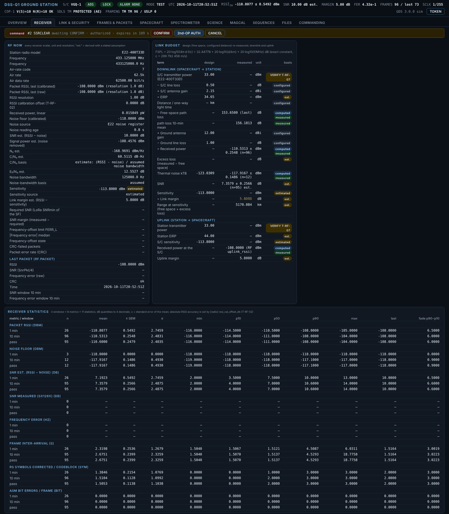

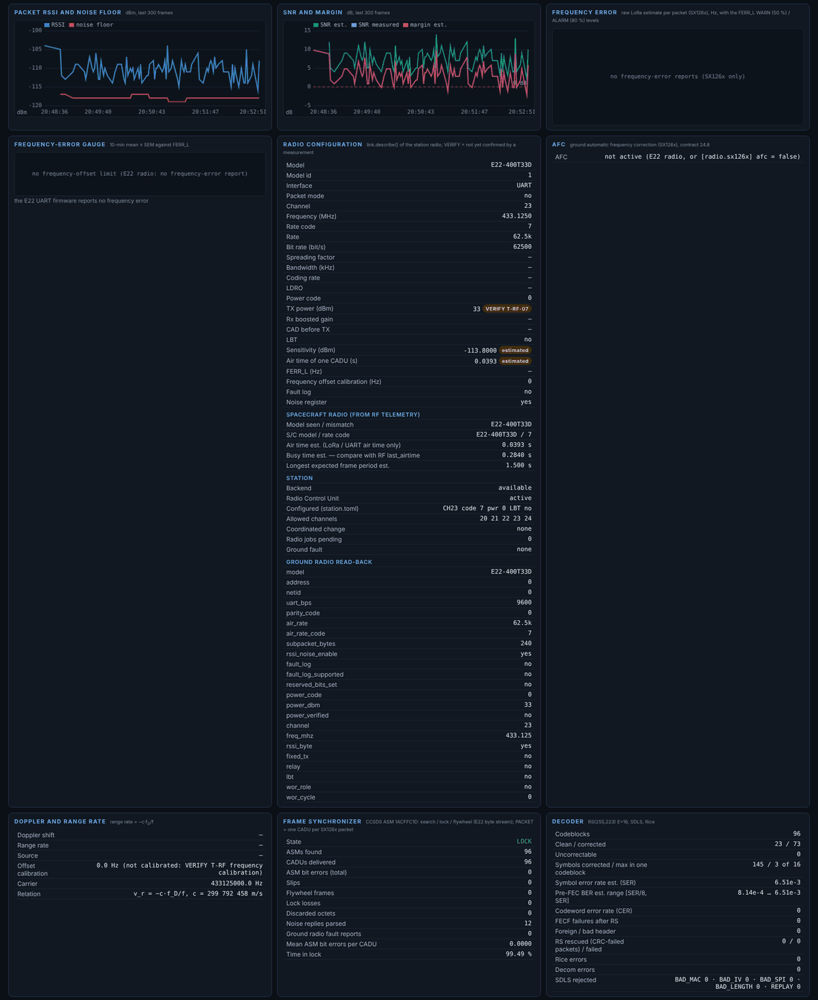

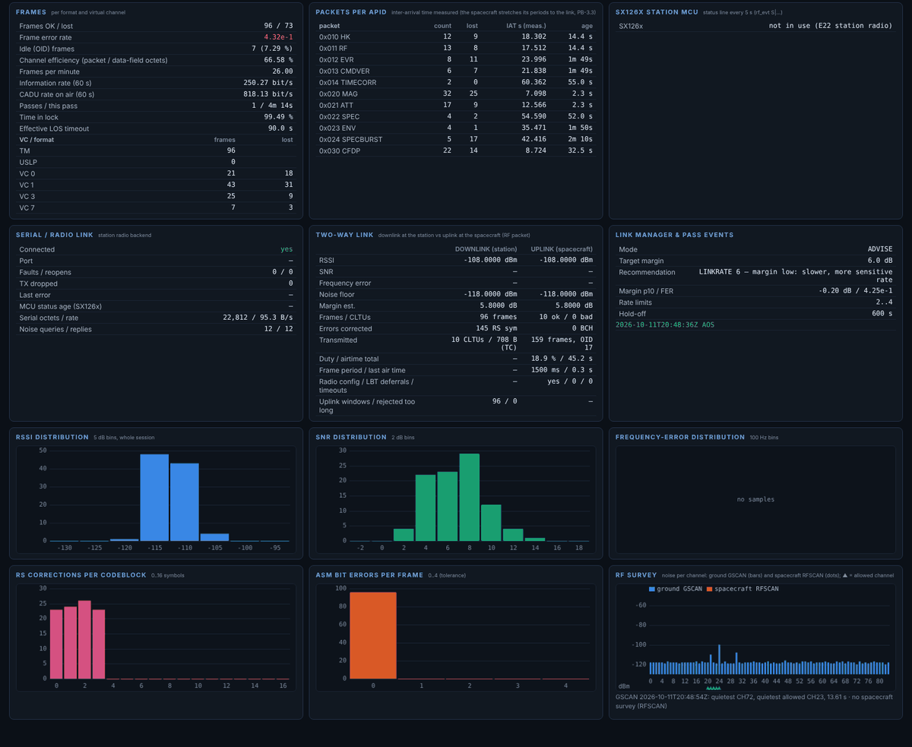

### 4.2 RF now

The "RF now" panel lists every scalar of `rx.rf` (built by `ReceiverStats.snapshot()` in
[rxstats.py](../dssq-groundstation/python/dssq/rxstats.py)), then the last packet and the
10-minute SNR and frequency-error summaries. The values are those of the **newest
reception**; their statistics over time are in [4.3](#43-receiver-statistics). Each card
below gives: what the panel shows, the snapshot key, unit and display, the exact source,
the formula, how often it changes, what to expect from this hardware, how to read it, what
to do when it is abnormal, related values and a worked example.

#### Station radio model, frequency and air rate

| Shown as | Key | Unit, display | Source and formula | Example |
|---|---|---|---|---|
| Station radio model | `rx.rf.model` | text | `[radio] model`; with `model = "auto"` (or absent) the E22 model the spacecraft reports in its RF packet (`radio_model`), E22-400T33D until then | E22-400T33D |
| Frequency | `rx.rf.freq_mhz` | MHz, 6 decimals | f = 410.125 MHz + CH x 1 MHz, CH = `[radio] channel` (0..83; E22 manuals, REG2) | 433.125000 MHz (CH 23) |
| Frequency | `rx.rf.freq_hz` | Hz, 1 decimal | the same in Hz | 433125000.0 Hz |
| Air-rate code | `rx.rf.air_rate_code` | 0..7 | `[radio] air_rate`, changed by LINKRATE: E22 REG0 air-rate code; SX126x LoRa profile | 2 |
| Air rate | `rx.rf.rate_label` | text | E22 "2.4k" ... "62.5k" (codes 0, 1 and 2 are all 2.4 kbit/s); SX126x "SF12 BW62.5 CR4/5" | 2.4k |
| Air data rate | `rx.rf.air_rate_bps` | bit/s, 2 decimals | E22: the nominal air rate; SX126x: Rb = SF x BW / 2^SF x 4 / (4 + CR) (`LoRaProfile.bit_rate_bps`) | 2400.00; SX126x profile 1: 146.48 |

These change only with the configuration (LINKRATE / LINKCHAN, [4.6](#46-radio-configuration)).
If the frequency or rate differs from the spacecraft's (RF packet `channel`,
`air_rate_code`), the two ends cannot hear each other: see the "model / rate mismatch"
checks in [4.6](#46-radio-configuration).

#### Packet RSSI (calibrated and raw)

| | |
|---|---|
| Shown as | "Packet RSSI, last (calibrated)" and "Packet RSSI, last (raw)", each followed by "(resolution x dB)" |
| Keys | `rx.rf.rssi_dbm` (calibrated), `rx.rf.rssi_raw_dbm` (raw); the same value is `rx.rf.packet.rssi_dbm` |
| Unit, display | dBm, 4 decimals; resolution 1 dB (E22), 0.5 dB (SX126x) |
| Source | E22: the RSSI octet the module appends to each received packet (REG3 bit 7, `[radio] rssi_byte = true`), dBm = -(256 - octet) (`framesync._emit`). SX126x: RssiPkt / 2 from GetPacketStatus, sent by the station MCU in 0.1 dBm in `rf_rx` |
| Formula | RSSI_cal = RSSI_raw + C, with C = `[radio] rssi_cal_offset_db` (shown below) |
| Updates | every received radio unit, also ones that later fail RS, the frame check or the LoRa CRC |
| This hardware | frames decode down to the receiver sensitivity: E22-400T33D -128 dBm and E22-400T37S -126 dBm at 2.4 kbit/s (datasheet), 3 dB less per doubling of the air rate (estimated); SX126x from -124.0 dBm (SF7, datasheet) to -143.1 dBm (SF12 / 31.25 kHz, computed). See "Sensitivity" below |
| Meaning | the power of the newest packet at the radio's antenna port. One reading jumps with fading by several dB; judge the link by the window means and percentiles ([4.3](#43-receiver-statistics)) |
| If abnormal | far below the link budget's predicted received power: check antenna pointing and polarization, cable and connectors, obstructions (the "Excess loss" row, [4.5](#45-link-budget)); no value at all: nothing is being received (header AOS / SYNC); a sudden step at constant geometry: a changed cable, attenuator or calibration offset. Event and alarm responses: [14_Troubleshooting_and_Event_Response.md](14_Troubleshooting_and_Event_Response.md) |
| Related | noise floor, SNR est., link margin est., RSSI distribution, link budget "= Received power" |
| Example | E22 at 2.4k: raw -113 dBm, offset 0.0 dB, so -113.0000 dBm; SX126x profile 1: -126.0000 dBm |

#### RSSI resolution and calibration offset

| | |
|---|---|
| Shown as | "RSSI resolution" and "RSSI calibration offset (T-RF-02)" |
| Keys | `rx.rf.rssi_resolution_db`, `rx.rf.rssi_cal_offset_db` |
| Unit, display | dB; resolution 2 decimals, offset 4 decimals |
| Source | resolution: a constant per radio family (`E22_RSSI_RESOLUTION_DB` = 1.0, `SX126X_RSSI_RESOLUTION_DB` = 0.5); offset: `[radio] rssi_cal_offset_db` (default 0.0) |
| Formula | the offset C is added to every RSSI and noise reading, including the ground RF survey (GSCAN) bars |
| Updates | configuration only |
| This hardware | C comes from test T-RF-02 (a known signal level into the station radio); until it is done the absolute level of every RSSI and noise value is uncalibrated (VERIFY on hardware) |
| Meaning | the resolution is the step of one reading; the offset sets the absolute accuracy |
| If abnormal | an offset of several dB with no test record behind it: correct `station.toml` ([15_Configuration_Reference.md](15_Configuration_Reference.md)) |
| Related | every RSSI and noise value, the link budget's measured column, the TDM `CARRIER_POWER` |
| Example | 1.00 dB / 0.0000 dB (E22, uncalibrated default) |

#### Received power, linear

| | |
|---|---|
| Shown as | "Received power, linear" |
| Key | `rx.rf.rssi_mw` (milliwatts in the snapshot) |
| Unit, display | the page multiplies by 1e9 and shows picowatts with 5 significant digits |
| Formula | P[mW] = 10^(RSSI_cal / 10) |
| Updates | every reception |
| Meaning | the same reading on a linear scale: useful to see that -110 dBm is ten times the power of -120 dBm |
| Example | -113 dBm = 5.0119e-12 mW, shown as "0.0050119 pW"; the screenshot's -108 dBm is "0.015849 pW" |

#### Noise floor, noise source, noise reading age

| | |
|---|---|
| Shown as | "Noise floor (calibrated)", "Noise source", "Noise reading age" |
| Keys | `rx.rf.noise_dbm`, `rx.rf.noise_source`, `rx.rf.noise_age_s` |
| Unit, display | dBm 4 decimals; text; s 1 decimal |
| Source | E22: the ambient-noise register, read with the query C0 C1 C2 C3 (reply C1 00 02 <noise> <last RSSI>), dBm = -(256 - octet); needs `[radio] rssi_noise = true`. SX126x: the station MCU's `rf_noise` RPC, the median of 8 instantaneous RSSI samples (GetRssiInst) in 0.1 dBm. Source text: "E22 noise register" or "SX126x GetRssiInst median of 8" |
| Formula | noise_cal = noise_raw + C (the same calibration offset as the RSSI) |
| Updates | one reading at most every `[radio] noise_poll_s` (default 20 s, minimum 5 s), requested in the quiet window after a received frame when no command is waiting. No frames, no new noise readings: the age grows during LOS |
| This hardware | the physical floor is thermal noise kTB in the receiver bandwidth plus the receiver noise figure. kTB is -123.0 dBm in 125 kHz, -126.0 dBm in 62.5 kHz, -129.1 dBm in 31.25 kHz; with the assumed SX126x noise figure of 6 dB that is about -117.0 / -120.0 / -123.1 dBm (computed). The E22's internal bandwidth and noise figure are not published, so its quiet-site reading must be recorded on site (VERIFY on hardware; [21_Test_Records.md](21_Test_Records.md)). The simulator models -118 dBm |
| Meaning | how much power the receiver hears when the spacecraft is silent. Local interference (switch-mode supplies, computers, other transmitters) raises it and eats margin the link budget does not know about |
| If abnormal | a floor well above your recorded quiet-site value: find the source with a ground RF survey (GSCAN, [4.17](#417-rf-survey)) and move to the quietest allowed channel (LINKCHAN); an age that keeps growing during AOS: noise queries are not answered (E22: `rssi_noise` off, or the RCU / serial link; see "Noise queries / replies" in [4.14](#414-serial-and-radio-link)) |
| Related | SNR est., N0 est., the link budget "Thermal noise kTB" row, the RF survey |
| Example | E22: -119.0000 dBm, "E22 noise register", age 5.4 s; SX126x: -117.4000 dBm, age 37.5 s |

#### SNR est. (RSSI - noise)

| | |
|---|---|
| Shown as | "SNR est. (RSSI − noise)" |
| Key | `rx.rf.snr_est_db` |
| Unit, display | dB, 4 decimals |
| Formula | SNR_est = RSSI_cal - noise_cal, shown only when the noise reading belongs to the same pass as the RSSI: their times differ by no more than the LOS timeout (90 s before the first housekeeping tick); otherwise "—" (an RSSI minus a noise reading taken hours later was never an SNR) |
| Updates | every reception (with the newest noise reading) |
| This hardware | E22: the only SNR there is. LoRa demodulates below the noise, so SNR est. goes negative near the limit: at the datasheet sensitivity of -128 dBm with a floor near -118 dBm it would read about -10 dB. SX126x: compare with the measured SNR, which is the better number |
| Meaning | how far the packet stood above the noise the receiver hears between packets |
| If abnormal | falling SNR est. at constant RSSI: the noise floor rose (interference); "—" during a pass: no fresh noise reading (see the noise age) |
| Related | packet RSSI, noise floor, SNR measured, link margin est. |
| Example | E22: -113 - (-119) = 6.0000 dB; SX126x: -126.0 - (-117.4) = -8.6000 dB (measured SNR of the same packet: -6.25 dB) |

#### Signal power est. (noise removed)

| | |
|---|---|
| Shown as | "Signal power est. (noise removed)" |
| Key | `rx.rf.pr_est_dbm` |
| Unit, display | dBm, 4 decimals |
| Formula | P_r = 10 log10(10^(RSSI_cal/10) - 10^(noise_cal/10)): the RSSI includes the noise power in the bandwidth, so the noise is subtracted on a linear scale. "—" when RSSI <= noise (the difference is not positive) or a value is missing |
| Updates | every reception |
| This hardware | equals RSSI within 0.1 dB when the RSSI is 15 dB or more above the noise; undefined for LoRa packets received below the noise floor |
| Meaning | the carrier power alone; the E22 C/N0 est. is built on it |
| Related | packet RSSI, noise floor, C/N0 est. |
| Example | 10 log10(10^-11.3 - 10^-11.9) = -114.2563 dBm for RSSI -113 and noise -119 dBm; SX126x example: "—" (RSSI -126.0 is below the noise -117.4) |

#### N0 est., noise bandwidth and its basis

| | |
|---|---|
| Shown as | "N₀ est.", "Noise bandwidth", "Noise-bandwidth basis" |
| Keys | `rx.rf.n0_est_dbm_hz`, `rx.rf.noise_bw_hz`, `rx.rf.noise_bw_source` |
| Unit, display | dBm/Hz 4 decimals; Hz 1 decimal; text |
| Formula | N0 = noise_cal - 10 log10(B). B = the LoRa profile bandwidth for the SX126x (basis "profile BW"); `[radio] noise_bw_hz` (default 125000 Hz) for the E22 (basis "assumed": EBYTE does not publish the bandwidth behind each air rate) |
| Updates | with the noise reading; B with the configuration |
| This hardware | thermal limit -174 dBm/Hz plus the receiver noise figure: about -168 dBm/Hz for a 6 dB noise figure |
| Meaning | noise power in 1 Hz, the reference for C/N0 |
| If abnormal | N0 more than about 10 dB above -168 dBm/Hz on a quiet site: interference or a wrong noise bandwidth assumption |
| Example | E22: -119 - 10 log10(125000) = -119 - 50.9691 = -169.9691 dBm/Hz; SX126x profile 1: -117.4 - 47.9588 = -165.3588 dBm/Hz |

#### C/N0 est. and its basis

| | |
|---|---|
| Shown as | "C/N₀ est.", "C/N₀ basis" |
| Keys | `rx.rf.cn0_est_dbhz`, `rx.rf.cn0_source` |
| Unit, display | dB-Hz, 4 decimals; text |
| Formula | SX126x: C/N0 = SNR_meas + 10 log10(B) (basis "measured SNR + 10 log10(profile BW)"); E22: C/N0 = P_r - N0 (basis "estimate: (RSSI - noise) / assumed noise bandwidth") |
| Updates | every reception |
| This hardware | the LoRa demodulator limit SNRmin (Semtech, `LORA_SNR_MIN_DB`) corresponds to C/N0 = SNRmin + 10 log10(B): 25.0 dB-Hz (profile 0), 28.0 (1), 31.0 (2), 33.5 (3), 36.0 (4), 38.5 (5), 41.0 (6), 43.5 dB-Hz (7). More than 6 dB above that is comfortable, 3 to 6 dB marginal, less than 3 dB poor (the dashboard's margin bands). For the E22 there is no published threshold: use the link margin |
| Meaning | carrier power per unit noise density: independent of the bandwidth, so it compares different radio settings |
| If abnormal | E22 "—": RSSI was not above the noise (P_r undefined) |
| Related | SNR, N0 est., Eb/N0 est. |
| Example | E22: -114.2563 - (-169.9691) = 55.7128 dB-Hz; SX126x profile 1: -6.25 + 47.9588 = 41.7088 dB-Hz (13.75 dB above the 27.96 dB-Hz limit) |

#### Eb/N0 est.

| | |
|---|---|
| Shown as | "Eᵦ/N₀ est." |
| Key | `rx.rf.ebn0_est_db` |
| Unit, display | dB, 4 decimals |
| Formula | Eb/N0 = C/N0 - 10 log10(Rb), Rb = the air data rate above (nominal LoRa bit rate for the SX126x) |
| Updates | every reception |
| This hardware | at the LoRa demodulator limit every profile needs about 6.0 to 6.3 dB (SNRmin + 10 log10(B) - 10 log10(Rb)); SF12 profiles 6.30 dB |
| Meaning | energy per bit relative to the noise density: the figure coding textbooks use |
| Related | C/N0 est., air data rate |
| Example | E22: 55.7128 - 10 log10(2400) = 21.9107 dB; SX126x profile 1: 41.7088 - 21.6577 = 20.0509 dB |

#### Sensitivity and its source

| | |
|---|---|
| Shown as | "Sensitivity" (with a source badge) and "Sensitivity source" |
| Keys | `rx.rf.sensitivity_dbm`, `rx.rf.sensitivity_source` |
| Unit, display | dBm, 4 decimals; text and badge |
| Source | `link.sensitivity()` for the station model and rate code. In order of precedence: **measured**: `[radio.sensitivity_measured] "<MODEL>:<code>" = dBm` from test T-RF-03; **datasheet**: E22-400T33D -128 dBm, E22-400T37S -126 dBm at 2.4 kbit/s (codes 0-2), SX126x where Semtech DS rev 2.2 Table 3-8 lists the profile (SF12/125 kHz -137 dBm, SF7/125 kHz -124 dBm); **estimated**: E22 above 2.4 kbit/s, S = S(2.4k) + 10 log10(Rb / 2400), rounded to 0.1 dB; **computed**: SX126x S = -174 + 10 log10(B) + NF + SNRmin(SF), NF = 6 dB (assumed, boosted gain), rounded to 0.1 dB |
| Updates | configuration only (rate code, model) |
| This hardware | E22-400T33D: -128.0 (codes 0-2), -125.0, -122.0, -119.0, -116.0, -113.8 dBm (codes 3-7); E22-400T37S 2 dB less sensitive (-126.0 ... -111.8 dBm); SX126x profiles 0-7: -143.1, -140.0, -137.0, -134.5, -132.0, -129.5, -127.0, -124.0 dBm |
| Meaning | the weakest signal the receiver decodes (the reference for the margin). Only "measured" values are facts about your hardware; the rest are the manufacturer's or the formula's |
| If abnormal | frames failing well above the shown sensitivity: the real sensitivity is worse (interference, a poor module, a wrong noise figure); run T-RF-03 and enter the result |
| Related | link margin est., link manager, the link budget |
| Example | -128.0000 dBm, "datasheet" (E22-400T33D, code 2); -140.0000 dBm, "computed" (SX126x profile 1); the screenshot: -113.8000 dBm, "estimated" (E22 code 7) |

#### Link margin est. (RSSI - sensitivity)

| | |
|---|---|
| Shown as | "Link margin est. (RSSI − sensitivity)"; also the header MARGIN, the OVERVIEW tile and the link budget "= Link margin" (measured) |
| Key | `rx.rf.margin_est_db` |
| Unit, display | dB, 4 decimals (2 in the header and tile) |
| Formula | M = RSSI_cal - S |
| Updates | every reception |
| This hardware | colour bands (dashboard.html): green >= 6 dB, amber 3 to 6 dB, red < 3 dB. The link manager aims for `[linkmgr] target_margin_db` = 6 dB on the 10th-percentile margin of the last 10 minutes ([4.16](#416-link-manager-and-pass-events)) |
| Meaning | how many dB the signal could lose before reaching the decode threshold. Because one reading includes fading, the robust number is the 10-minute p10 of RSSI minus the sensitivity (what the link manager uses) |
| If abnormal | below 3 dB: expect lost frames; slow down (LINKRATE to a lower code), improve antennas, height or feeders, or accept the losses. Negative but frames still arrive: the shown sensitivity is pessimistic (or the RSSI calibration is off) |
| Related | packet RSSI, sensitivity, FER, link manager, range at sensitivity |
| Example | E22: -113 - (-128) = 15.0000 dB; SX126x: -126 - (-140) = 14.0000 dB |

#### Required SNR and SNR margin (SX126x)

| | |
|---|---|
| Shown as | "Required SNR (LoRa SNRmin of the SF)", "SNR margin (measured − required)" |
| Keys | `rx.rf.required_snr_db`, `rx.rf.snr_margin_db` |
| Unit, display | dB, 2 and 4 decimals; "—" for the E22 |
| Formula | required = SNRmin(SF): SF7 -7.5, SF8 -10, SF9 -12.5, SF10 -15, SF11 -17.5, SF12 -20 dB (Semtech, `LORA_SNR_MIN_DB`); SNR margin = SNR_meas - required |
| Updates | every SX126x packet |
| This hardware | a direct demodulator margin, independent of any RSSI calibration. Read it with the same bands as the link margin (>= 6 dB good, 3 to 6 marginal, < 3 poor). The AFC trusts a packet's frequency error only when SNR >= SNRmin + 3 dB |
| Meaning | how much SNR the LoRa demodulator had to spare on the newest packet |
| If abnormal | SNR margin much smaller than the link margin: the noise floor is higher than the sensitivity formula assumes (interference) |
| Example | SX126x profile 1: required -20.00 dB; SNR -6.25 dB gives 13.7500 dB |

#### Frequency-offset limit, error median and state (SX126x)

| | |
|---|---|
| Shown as | "Frequency-offset limit FERR_L", "\|Frequency error\| median", "Frequency-offset state" |
| Keys | `rx.rf.freq_offset_limit_hz`, `rx.rf.freq_offset_abs_median_hz`, `rx.rf.freq_offset_state` |
| Unit, display | Hz 1 decimal; Hz 1 decimal; OK (green), WARN (amber), ALARM (red); "—" for the E22 |
| Source | FERR_L: Semtech DS Table 3-8: ±25 % of the bandwidth, and at SF12 / SF11 / SF10 also ±50 / ±100 / ±200 ppm of the carrier, the tighter applying (`link.lora_max_freq_offset_hz()`). Median: of \|raw frequency error\| over the last 3 packets (`FREQ_STATE_SAMPLES`) |
| Formula | state = ALARM if median > 0.8 FERR_L, WARN if > 0.5 FERR_L, else OK (`link.freq_offset_state()`) |
| Updates | every SX126x packet |
| This hardware | FERR_L at 433.125 MHz: profile 0 7812.5 Hz, profile 1 15625 Hz, profile 2 21656.25 Hz (the 50 ppm limit), profiles 3-7 31250 Hz |
| Meaning | beyond FERR_L the receiver loses sensitivity. With the AFC running the raw error is what remains after the correction, so a growing median means the AFC is not keeping up |
| If abnormal | WARN raises a YELLOW alarm, ALARM a RED one ([15](#15-alarm-logic)): check the AFC state ([4.7](#47-afc)); if the AFC is off or in FAULT, calibrate the static offset ([radio] `freq_offset_cal_hz`, T-RF frequency calibration in docs/08) |
| Related | frequency error (last packet, 10-min window, chart, gauge, histogram), AFC, Doppler |
| Example | SX126x profile 1: limit 15625.0 Hz, median 449.0 Hz (2.9 %), state OK |

#### CRC-failed packets and packet error rate (SX126x)

| | |
|---|---|
| Shown as | "CRC-failed packets", "Packet error rate (CRC)" |
| Keys | `rx.rf.crc_fail_packets`, `rx.rf.packet_error_rate` |
| Unit, display | count; scientific; "—" for the E22 |
| Formula | PER = CRC-failed / (CRC-good + CRC-failed) over every SX126x packet since the GDS started |
| Updates | every SX126x packet |
| This hardware | a CRC-failed packet of exactly one CADU still goes to the Reed-Solomon decoder ("RS rescue", [4.10](#410-decoder)), so a PER of a few per cent need not lose frames. Read it with the FER bands: < 1 % good, 1-10 % marginal, > 10 % bad |
| Meaning | how many LoRa packets arrived damaged |
| Related | RS rescued / rescue failed, FER, SNR margin |
| Example | 3 CRC failures in 57 packets: PER = 3/57 = 5.26e-2; all 3 rescued by RS |

#### Last packet and the 10-minute summaries

| Shown as | Key | Unit, display | Meaning |
|---|---|---|---|
| RSSI | `rx.rf.packet.rssi_dbm` | dBm, 4 decimals | the newest reception's calibrated RSSI |
| SNR (SnrPkt/4) | `rx.rf.packet.snr_db` | dB, 4 decimals | SX126x measured SNR (0.25 dB steps); "—" for the E22 |
| Frequency error (raw) | `rx.rf.packet.freq_err_hz` | Hz, 1 decimal | SX126x LoRa frequency-error estimate, before calibration and AFC sign (`rf_rx` freq_err_hz) |
| CRC | `rx.rf.packet.crc_ok` | ok / FAILED (amber) | the LoRa payload CRC (E22 receptions are "ok") |
| Time | `rx.rf.packet.t` | ISO 8601 | when the reception reached the GDS (ERT) |
| SNR window 10 min | `rx.rf.snr_db` (`mean`, `sem`, `min`, `max`, `n`) | "mean ± SEM dB [min, max] n=" | the measured SNR of the last 10 minutes |
| Frequency error window 10 min | `rx.rf.freq_err_hz` (`mean`, `sem`, `min`, `max`, `n`) | "mean ± SEM Hz [min, max] n=" | the raw frequency error of the last 10 minutes |

Example (SX126x): last packet RSSI -126.0000 dBm, SNR -6.2500 dB, frequency error 469.0 Hz,
CRC ok; SNR window -4.6538 ± 0.4647 dB [-8.0000, -2.7500] n=13; frequency-error window
407.9 ± 9.9 Hz [354.0, 469.0] n=13. The nested blocks `rx.rf.doppler` and `rx.rf.afc` have
their own panels ([4.8](#48-doppler-and-range-rate), [4.7](#47-afc)).

### 4.3 Receiver statistics

**What it shows.** The wide table: eight measured quantities, each in the three windows
(1 min, 10 min, pass), each with the eleven statistics of
[section 1.6](#16-the-statistics-windows-explained). Keys:
`rx.windows.<window>.<metric>.<stat>` with window `1m`, `10m` or `pass`, the metrics below,
and stat one of `n`, `mean`, `sem`, `std`, `min`, `p10`, `p50`, `p90`, `max`, `last`,
`fade_depth` (pass windows also carry `truncated`). A row shows "—" until its window holds
a sample.

| Metric (as shown) | Metric key | Unit, decimals | A sample is added | This hardware; how to read it |
|---|---|---|---|---|
| Packet RSSI (dBm) | `rssi` | dBm, 4 | every reception (calibrated) | the link level. p10 = the level held 90 % of the time; fade depth = p90 - p10 |
| Noise floor (dBm) | `noise` | dBm, 4 | every noise reading (at most one per 20 s) | should be flat; σ above about 1 dB or steps mean changing interference |
| SNR est. (RSSI − noise) (dB) | `snr_est` | dB, 4 | every reception, paired with the newest noise reading of any age | see the SNR est. card; the first frames of a pass can pair with the previous pass's last noise reading |
| SNR measured (SX126x) (dB) | `snr_meas` | dB, 4 | every SX126x packet | compare the mean with the required SNR of the profile |
| Frequency error (Hz) | `freq_err` | Hz, 1 | every SX126x packet (raw) | with AFC: the residual after the correction; σ = frequency jitter |
| Frame inter-arrival (s) | `iat` | s, 4 | every frame after the first of a pass: time since the previous frame | p50 = the spacecraft frame period ([1.3](#13-how-often-things-change)); max or p90 above it = gaps (lost frames, an RF survey, a hibernation beacon) |
| RS symbols corrected / codeblock (sym) | `rs` | symbols, 4 | every correctable codeblock: 0..16 | 0 at good SNR; a mean rising toward 16 means the decoder is near its limit (E = 16 per codeword) |
| ASM bit errors / frame (bit) | `asm` | bits, 4 | every codeblock: 0..4 | bit errors in the 32-bit sync marker, which RS does not protect; accepted up to 2 while searching and 4 in lock |

Example (E22 at 2.4 kbit/s, CRUISE, 10-minute window):

| Metric | n | mean | ± SEM | σ | min | p10 | p50 | p90 | max | last | fade p90-p10 |
|---|---|---|---|---|---|---|---|---|---|---|---|
| Packet RSSI (dBm) | 178 | -111.9213 | 0.2144 | 2.8530 | -120.0000 | -116.0000 | -112.0000 | -108.0000 | -106.0000 | -113.0000 | 8.0000 |
| Noise floor (dBm) | 26 | -118.1154 | 0.1154 | 0.5769 | -119.0000 | -119.0000 | -118.0000 | -117.5000 | -117.0000 | -119.0000 | 1.5000 |
| SNR est. (dB) | 178 | 6.1236 | 0.2167 | 2.8828 | -2.0000 | 2.0000 | 6.0000 | 10.0000 | 13.0000 | 6.0000 | 8.0000 |
| Frame inter-arrival (s) | 178 | 3.3627 | 0.0505 | 0.6714 | 3.2000 | 3.2000 | 3.2200 | 3.2200 | 6.4600 | 3.2000 | 0.0200 |
| RS symbols / codeblock | 178 | 1.3371 | 0.0858 | 1.1411 | 0.0000 | 0.0000 | 1.0000 | 3.0000 | 3.0000 | 0.0000 | 3.0000 |
| ASM bit errors / frame | 178 | 0.0000 | 0.0000 | 0.0000 | 0.0000 | 0.0000 | 0.0000 | 0.0000 | 0.0000 | 0.0000 | 0.0000 |

Reading it: the median inter-arrival time of 3.22 s is close to the CRUISE frame period of
3.17 s at 2.4 kbit/s, the 6.46 s maximum is one lost frame (twice the period), and the RSSI
p10 of -116 dBm is 12 dB above the -128 dBm sensitivity: the 10th-percentile margin the
link manager works with. (The RS corrections are the simulator's injected errors, up to 3
per frame.)

### 4.4 Charts and histograms

| Panel | Keys | What it shows; how to read it |
|---|---|---|
| Packet RSSI and noise floor | `rx.series.t`, `rx.series.rssi`, `rx.series.noise` | the last 300 frames (`SERIES_LEN`), dBm. RSSI tracking the noise line = no margin left |
| SNR and margin | `rx.series.snr_est`, `rx.series.snr_meas`, `rx.series.margin` | the last 300 frames, dB, red dashed line at 0 dB. Margin below 0 dB means frames are decoding below the stated sensitivity |
| Frequency error | `rx.series.freq_err` | raw LoRa estimate per frame, Hz, with dashed WARN (±50 %) and ALARM (±80 %) lines of FERR_L. E22: "no frequency-error reports (SX126x only)" |
| (snapshot only) | `rx.series.rs` | RS symbols corrected in each of the last 300 frames (not charted; the histogram below summarises it) |
| Frequency-error gauge | `rx.windows.10m.freq_err.mean`, `.sem`, `rx.rf.freq_offset_limit_hz` | the 10-minute mean (bar) ± SEM (shaded) on a ±FERR_L scale with OK / WARN / ALARM zones; note line: "10-min mean x Hz ± y Hz of FERR_L z Hz = p % · state S" |
| RSSI distribution | `rx.hist.rssi` (`lo` -150, `step` 5, `bins`) | count of receptions per 5 dB bin since the GDS started ("whole session"); a two-humped shape = two conditions (e.g. antenna moved) |
| SNR distribution | `rx.hist.snr` (`lo` -30, `step` 2) | per 2 dB bin; the measured SNR when the radio gives one, else SNR est. |
| Frequency-error distribution | `rx.hist.freq_err` (±FERR_L, or ±5000 Hz without one; `step` 100) | per 100 Hz bin |
| RS corrections per codeblock | `rx.hist.rs_corrections` | 17 counters: codeblocks that needed 0, 1, ... 16 symbol corrections. Weight moving right = the link is approaching the RS limit |
| ASM bit errors per frame | `rx.hist.asm_bit_errors` | 5 counters: 0..4 bit errors in the sync marker |

Values outside a histogram's range are counted in the end bins. Charts show only the bins
around the data (two empty bins either side); hover a bar or point for its exact value and
time.

### 4.5 Link budget

**What it shows.** The free-space link budget for the configured geometry ("design") next to
what the receiver actually measures ("measured"), for the downlink (spacecraft to station)
and the uplink (station to spacecraft). Key prefix `rx.budget` (`ReceiverStats._budget()`).
The panel's subtitle shows the formula:
FSPL = 20·log10(4π·d·f/c) = 32.44778 + 20·log10(d/km) + 20·log10(f/MHz) dB, with the exact
constant (c = 299 792 458 m/s; 20 log10(4π x 10⁹ / c) = 32.44778, not the rounded 32.44).

Symbols: P_t transmitter power (dBm), G_t / L_t spacecraft antenna gain (dBi) and line loss
(dB), G_r / L_r station antenna gain and line loss, d distance, f carrier frequency, S
receiver sensitivity, N noise floor, RSSI the measured received power.

**Downlink rows**

| Row | Design key | Measured key | Formula, source | Badge |
|---|---|---|---|---|
| S/C transmitter power (model) | `rx.budget.sc_tx_power_dbm_nominal` | - | P_t = `link.power_dbm()` of the spacecraft's model and power code from the RF packet (`tx_power_code`); "—" until an RF packet arrives. T33D 33/30/27/24 dBm, T37S 37 dBm on every code, SX126x 22/17/14/10 dBm drive + 11 dB PA (33/28/25/21 dBm). `rx.budget.sc_model` names the model, `rx.budget.power_verified` is true only for the T37S | datasheet or VERIFY T-RF-07 |
| − S/C line loss | `rx.budget.sc_line_loss_db` | - | `[spacecraft] tx_line_loss_db` (default 0.5 dB) | configured |
| + S/C antenna gain | `rx.budget.sc_antenna_gain_dbi` | - | `[spacecraft] antenna_gain_dbi` (default 2.15 dBi) | configured |
| = EIRP | `rx.budget.sc_eirp_dbm_est` | - | EIRP = P_t + G_t - L_t | est. |
| Distance / one-way light time | `rx.budget.distance_km` | `rx.budget.owlt_s` | `[spacecraft] distance_km`; OWLT = d / c. 0 km gives "—" and no free-space loss | configured |
| − Free-space path loss | `rx.budget.fspl_db` | `rx.budget.measured_path_loss_db_est` (last) | FSPL = 20 log10(4π d f / c) (`rxstats.fspl_db()`, formula text in `rx.budget.fspl_formula`); measured path loss = EIRP + G_r - L_r - RSSI_cal | computed, measured |
| path loss 10-min mean | - | `rx.budget.measured_path_loss_mean10m_db` | EIRP + G_r - L_r - (10-minute RSSI mean) | measured |
| + Ground antenna gain | `rx.budget.ground_gain_dbi` | - | `[station] antenna_gain_dbi` (default 12.0 dBi) | configured |
| − Ground line loss | `rx.budget.ground_line_loss_db` | - | `[station] rx_line_loss_db` (default 1.0 dB) | configured |
| = Received power | `rx.budget.predicted_pr_dbm` | 10-min RSSI mean ± SEM (n) | P_r,pred = EIRP + G_r - L_r - FSPL | computed, measured |
| Excess loss (measured − free space) | - | `rx.budget.excess_loss_db_est` | measured path loss (last) - FSPL; amber above 20 dB | est. |
| Thermal noise kTB (NF assumed) | `rx.budget.thermal_noise_dbm` | 10-min noise mean ± SEM | kTB = -174 + 10 log10(B) dBm (B = noise bandwidth, [4.2](#42-rf-now)); the NF shown for the SX126x is `rx.budget.noise_figure_assumed_db` = 6 dB ("—" for the E22) | computed, measured |
| SNR | `rx.budget.predicted_snr_db` | 10-min measured SNR mean (SX126x) or SNR est. mean | predicted P_r - current noise floor | measured or est. |
| Sensitivity | `rx.budget.sensitivity_dbm` (+ `rx.budget.sensitivity_source`) | - | as in [4.2](#42-rf-now) | source badge |
| = Link margin | `rx.budget.predicted_margin_db` | `rx.rf.margin_est_db` (coloured as in 4.2) | predicted P_r - S; measured RSSI_cal - S | est. |
| Range at sensitivity (free space + excess loss) | - | `rx.budget.range_at_sensitivity_km_est` | the distance at which free space plus the measured excess loss would bring the signal down to S: d_max = (c / 4πf) x 10^((EIRP + G_r - L_r - S - L_excess) / 20) (`rxstats.range_for_loss_m()`). With the measured excess loss this equals d x 10^(M/20); without a measurement (no RSSI yet) the excess loss is taken as 0 (pure free space) | est. |

**Uplink rows** (station to spacecraft; keys under `rx.budget.uplink`)

| Row | Design key | Measured key | Formula, source | Badge |
|---|---|---|---|---|
| Station transmitter power | `rx.budget.uplink.gs_power_dbm` | - | `link.power_dbm()` of the station model, `[radio] power` code and, for the SX126x, `[radio.sx126x] pa_gain_db`; `rx.budget.uplink.gs_power_verified` true only for the T37S | datasheet or VERIFY T-RF-07 |
| Station EIRP | `rx.budget.uplink.gs_eirp_dbm_est` | - | P_gs + G_r - L_r (the station antenna and cable serve both directions) | est. |
| S/C sensitivity | `rx.budget.uplink.sc_sensitivity_dbm` (+ `rx.budget.uplink.sc_sensitivity_source`) | - | `link.sensitivity()` of the spacecraft's model and rate code from the RF packet, with its Rx boosted gain from RF `rf_flags` b0 for the SX126x. Station T-RF-03 measurements are not applied to the spacecraft | source badge |
| Received power at the S/C | `rx.budget.uplink.predicted_pr_dbm` | `rx.budget.uplink.measured_uplink_rssi_dbm` ("(RF uplink_rssi)") | predicted: EIRP_gs + G_t - L_t - FSPL; measured: the RSSI of the last uplink packet as the spacecraft reports it (RF `uplink_rssi`, 1 dB, not calibrated) | computed, measured |
| Uplink margin | `rx.budget.uplink.predicted_margin_db` | `rx.budget.uplink.measured_margin_db` | received power at the spacecraft - spacecraft sensitivity | est. |

**Worked example** (simulator snapshot, E22-400T33D at code 2, configured d = 2 km,
f = 433.125 MHz, all other values the `station.toml` defaults):

1. EIRP = 33.00 + 2.15 - 0.50 = 34.65 dBm (`sc_eirp_dbm_est`).
2. FSPL = 20 log10(4π x 2000 m x 433.125e6 Hz / 299792458 m/s) = 91.2006 dB; check with
   the km/MHz form: 32.44778 + 20 log10(2) + 20 log10(433.125) = 32.4478 + 6.0206 + 52.7322
   = 91.2006 dB.
3. Predicted received power = 34.65 + 12.00 - 1.00 - 91.2006 = -45.5506 dBm.
4. Predicted margin = -45.5506 - (-128) = 82.4494 dB; predicted SNR = -45.5506 - (-119)
   = 73.4494 dB.
5. Measured path loss (last) = 34.65 + 12.00 - 1.00 - (-113) = 158.6500 dB; 10-minute mean
   34.65 + 11.00 - (-111.9213) = 157.5713 dB.
6. Excess loss = 158.6500 - 91.2006 = 67.4494 dB (the simulator's RF ignores the distance:
   a real link with 67 dB excess loss at 2 km would be heavily obstructed).
7. Measured margin = -113 - (-128) = 15.0000 dB; range at sensitivity = 2 km x 10^(15/20)
   = 11.247 km.
8. Thermal noise kTB in the assumed 125 kHz = -174 + 50.9691 = -123.0309 dBm, against a
   measured 10-minute noise mean of -118.1154 dBm.
9. Uplink: station EIRP = 33 + 12 - 1 = 44.00 dBm; predicted received power at the spacecraft
   44.00 + 2.15 - 0.50 - 91.2006 = -45.5506 dBm; spacecraft sensitivity -128 dBm
   ("datasheet"), so the predicted uplink margin is 82.4494 dB; the spacecraft reported
   `uplink_rssi` -113 dBm, so the measured uplink margin is 15.0000 dB.

How to use it: the design column says what physics allows in free space; the measured
column says what you get. A large excess loss on a clear line of sight points at the
station (pointing, polarization, cable, connectors, calibration offset); a small excess
loss and a small margin mean the link is simply too long for this rate: use a slower rate
code. Range figures for each radio setting are tabulated in
[02_Link_Budget_and_RF_Analysis.md](02_Link_Budget_and_RF_Analysis.md).

### 4.6 Radio configuration

**What it shows.** How the station radio is configured (`link.describe()` of the station's
settings), what the spacecraft reports about its own radio, the state of the station radio
hardware and the ground radio's register read-back. Key prefix `radio`.

**Station radio (`link.describe()`)**

| Shown as | Key | Meaning, source | Example (E22 / SX126x) |
|---|---|---|---|
| Model | `radio.model` | station radio model ([4.2](#42-rf-now)) | E22-400T33D / SX126x |
| Model id | `radio.model_id` | the RF-packet code of the model: 1 E22-400T33D, 2 E22-400T37S, 3 SX126x | 1 / 3 |
| (not shown) | `radio.model_auto` | true when `[radio] model` is "auto" or absent: the GDS follows the E22 model the spacecraft reports | false |
| Interface | `radio.interface` | UART (E22 firmware) or SPI (RadioLib on the station MCU) | UART / SPI |
| Packet mode | `radio.packet_mode` | yes = whole packets with per-packet RSSI, SNR and frequency error (SX126x) | no / yes |
| Channel | `radio.channel` | `[radio] channel` (LINKCHAN changes it) | 23 |
| Frequency (MHz) | `radio.freq_mhz` | 410.125 + channel | 433.1250 |
| Rate code | `radio.rate_code` | `[radio] air_rate` (LINKRATE changes it) | 2 / 1 |
| Rate | `radio.rate_label` | as `rx.rf.rate_label` | 2.4k / SF12 BW62.5 CR4/5 |
| Bit rate (bit/s) | `radio.bps` | nominal air data rate, rounded to 3 decimals | 2400 / 146.4840 |
| Spreading factor | `radio.sf` | SX126x only | — / 12 |
| Bandwidth (kHz) | `radio.bw_khz` | SX126x only | — / 62.5000 |
| Coding rate | `radio.cr` | SX126x: 4/5 for every profile | — / 4/5 |
| LDRO | `radio.ldro` | SX126x LowDataRateOptimize, on when the symbol time is >= 16.38 ms (profiles 0-3) | — / yes |
| Power code | `radio.power_code` | `[radio] power` (0..3), the station transmitter | 0 |
| TX power (dBm) | `radio.power_dbm` (+ `radio.power_verified`) | nominal output for the code: T33D 33/30/27/24, T37S 37, SX126x drive + `[radio.sx126x] pa_gain_db`; badge "datasheet" only for the T37S, else "VERIFY T-RF-07" | 33 (VERIFY) |
| Rx boosted gain | `radio.rx_boost` | SX126x `[radio.sx126x] rx_boosted_gain` (register 0x08AC = 0x96); "—" for the E22 | — / yes |
| CAD before TX | `radio.cad` | SX126x `[radio.sx126x] cad_before_tx`: channel-activity detection before every uplink | — / yes |
| LBT | `radio.lbt` | E22 `[radio] lbt` (listen before talk); "—" for the SX126x | no / — |
| Sensitivity (dBm) | `radio.sensitivity_dbm` (+ `radio.sensitivity_source`) | as in [4.2](#42-rf-now) | -128 datasheet / -140 computed (integral values are printed without decimals) |
| Air time of one CADU (s) | `radio.airtime_s` (+ `radio.airtime_source`) | SX126x: exact LoRa time on air of 236 octets (Semtech formula, "computed"); E22: 236 x 8 x 1.3 / Rb ("estimated", the flight's model) | 1.0227 estimated / 17.3179 computed |
| FERR_L (Hz) | `radio.freq_offset_limit_hz` | as `rx.rf.freq_offset_limit_hz` | — / 15625 |
| Frequency offset calibration (Hz) | `radio.freq_offset_cal_hz` | `[radio] freq_offset_cal_hz`: the static crystal offset between the two radios, the AFC's start value | 0 |
| Fault log | `radio.has_fault_log` | the model can report abnormal status (FF FF FF 0x): E22-400T37S only | no |
| Noise register | `radio.has_noise_register` | the model has the E22 ambient-noise query | yes / no |

**Spacecraft radio (from RF telemetry)**

| Shown as | Key | Meaning; if abnormal | Example |
|---|---|---|---|
| Model seen / mismatch | `radio.model_seen`, `radio.model_mismatch` | the model the spacecraft reports (RF `radio_model`); red **MISMATCH** badge and a YELLOW alarm when it differs from the station's: check `[radio] model` ("E22-400T37S" or "auto" for a T37S) and the spacecraft's T37S jumper (UNO Q A0 to GND) or SX126x build | E22-400T33D |
| S/C model / rate code | `radio.sc_model`, `radio.sc_rate_code` | from the RF packet (the station's own until one arrives) | E22-400T33D / 2 |
| Air time est. (LoRa / UART air time only) | `radio.sc_airtime_s` | air time of one CADU for the spacecraft's setting (`link.airtime_s()`) | 1.0227 s |
| Busy time est. — compare with RF last_airtime | `radio.sc_busy_s_est` | the transmitter busy time per frame as the flight computes it (`link.busy_s()`): E22 UART transfer + air time, SX126x LoRa air time rounded up to whole ms. RF `last_airtime` should agree within its 0.1 s truncation | 1.2670 s / 17.3180 s |
| Longest expected frame period est. | `radio.frame_period_max_s_est` | max(4.0 x busy time, 1.5 s): the SAFE-mode period. The GDS uses it for the LOS timeout (3x), the FOP-1 T1 timer (2x) and the command-verification timeout (4x) | 5.068 s / 69.272 s |

**Station**

| Shown as | Key | Meaning; if abnormal |
|---|---|---|
| Backend | `radio.backend_available`, `radio.backend_error` | whether the GDS has a radio backend; "UNAVAILABLE" with the reason (red badge and a RED alarm "radio backend unavailable: ..."): E22 serial port missing (`[radio] port`, permissions), or no Router Bridge for the SX126x |
| Radio Control Unit | `radio.rcu` | E22: the station MCU drives the module's M0 / M1 and reads AUX ("active"); needed for GSCAN, WAKE, LINKRATE, LINKCHAN and the configuration read-back. SX126x: "n/a" |
| Configured (station.toml) | `radio.configured` (`channel`, `air_rate`, `power`, `lbt`) | the values in the configuration file at start-up |
| Allowed channels | `radio.allowed_channels` | `[radio] allowed_channels`: CHANNEL and LINKCHAN outside this list are refused (licence and band plan) |
| Coordinated change | `radio.link_change` (`kind`, `value`, `state`, ...) | a LINKRATE / LINKCHAN in progress: state WAIT_EXEC (the AIRRATE / CHANNEL command is on its way), WAIT_SWITCH (executed on board; the spacecraft switches after 2 more frames), SWITCHED (the ground switched and sent a NOOP; waiting for the first frame on the new setting). "none" otherwise. No frame after the switch within `revert_s` + 30 s + 2 frame periods: the ground switches back (the spacecraft also reverts by itself without uplink) |
| Radio jobs pending | `radio.jobs_pending` | procedures queued for the radio thread (VERIFY, RADIO, GSCAN, WAKE, SETRATE, SETCHAN, NOISE); they run in the quiet window after a frame. WAKE and GSCAN never start on top of the window's own planned transmissions (`TX_QUIET_JOBS`); a WAKE runs at most once per 10 s (`WAKE_MIN_INTERVAL_S`: each takes an SDLS TC number), and with the SX126x station radio it waits while the radio has not yet reported itself back on the station channel after a survey; a GSCAN waits until the station transmitter is idle (the same channel check included). Either wait lasts at most max(60 s, 2 frame periods), then the job is dropped with a WARN and the jobs behind it run |
| Ground fault | `radio.ground_fault` (`code`, `text`, `t`) | E22-400T37S abnormal-status report from the station module (under-voltage < 4.5 V, over-voltage > 15 V, over-temperature > 120 °C), shown for 5 s after the last report; raises a RED alarm "ground radio fault: ..."; the module stops transmitting until the condition clears: check the station supply and cooling |
| Last GSCAN | `radio.last_scan` | the last ground RF survey ([4.17](#417-rf-survey)) |
| SX126x backend | `radio.sx126x` | the SX126x station MCU block ([4.13](#413-sx126x-station-mcu)); null for the E22 |

**Ground radio read-back** (`radio.ground_config`): the station radio's configuration as read
back at start-up (job VERIFY) and with the RADIO directive. E22 (registers 00..06,
`e22.describe()`): `model`, `address`, `netid`, `uart_bps`, `parity_code`, `air_rate`,
`air_rate_code`, `subpacket_bytes`, `rssi_noise_enable`, `fault_log`, `fault_log_supported`,
`reserved_bits_set`, `power_code`, `power_dbm`, `power_verified`, `channel`, `freq_mhz`,
`rssi_byte`, `fixed_tx`, `relay`, `lbt`, `wor_role`, `wor_cycle`. SX126x (from the MCU status,
`Sx126xBridge.get_config()`): `model`, `channel`, `freq_mhz`, `air_rate_code`, `air_rate`,
`power_code`, `lbt` (CAD before TX), `rx_boost`, `rx_boost_verified`, `freq_offset_hz`,
`tcxo_fallback`, `calib_error`, `cfg_pending`, `chip`, `fw`, `state`, `chip_id`, `tcxo_mv`,
`hw_mismatch`. The GDS compares channel, air-rate code, RSSI byte and noise enable with
`station.toml` and logs "matches station.toml" or "MISMATCH [...]" (event source RADIO). A
mismatch means the two ends will not hear each other or the RSSI byte is missing: fix the
module (RADIO directive after a correction) or the configuration.

### 4.7 AFC

**What it is.** Automatic frequency correction for the SX126x option (`AfcLoop` in
[link.py](../dssq-groundstation/python/dssq/link.py)). Two crystals never agree exactly, and a moving spacecraft adds Doppler; a
LoRa receiver loses sensitivity when the offset approaches FERR_L. The AFC measures the
offset from the frequency error of every good packet and re-tunes the station receiver and
transmitter (station MCU RPC `rf_foff(hz)`), so both directions stay centred. Key prefix
`rx.rf.afc` (null for the E22 or with `[radio.sx126x] afc = false`; the panel then says "not
active").

**How it works.** A packet is used when its CRC is good, \|error\| <= BW/2 and its SNR >=
SNRmin + 3 dB, and not within one air time + 0.5 s after a correction was applied. The
estimate of the total received offset is the median of the last 8 values of (correction +
sign x error). When \|estimate - correction\| exceeds the dead band, the correction steps
toward the estimate by at most the slew limit, never beyond the bound. After each step the
next 3 packets check the sign convention of the chip's frequency-error register (a VERIFY
item): if the residual grew by more than half the step, the sign is inverted once (WARN
event); if it grows again the loop goes to FAULT, returns to the static offset and raises a
YELLOW alarm. During LOS the correction is held for 600 s, then returns to the static
offset `[radio] freq_offset_cal_hz`.

| Shown as | Key | Unit | Meaning, formula | Example (SX126x profile 1) |
|---|---|---|---|---|
| Enabled / state | `rx.rf.afc.enabled`, `rx.rf.afc.state` | - | DISABLED, STATIC (no estimate yet: fewer than 3 accepted packets, or reset), TRACK (estimating and stepping; badge "tracking"), CHECK (sign self-check after a step), HOLD (LOS, holding), FAULT (badge "FAULT: AFC RESET after checking") | yes / TRACK |
| Correction applied | `rx.rf.afc.correction_hz` | Hz, 1 decimal | the offset the station is tuned to now (confirmed by `rf_foff` = 1) | 1254.0 Hz |
| Estimate | `rx.rf.afc.estimate_hz` | Hz | median of (correction + sign x error) over the last 8 accepted packets: the total received offset from the channel centre | 1678.0 Hz |
| Residual | `rx.rf.afc.residual_hz` | Hz | estimate - correction | 424.0 Hz |
| Sign | `rx.rf.afc.sign` | +1 / -1 | the believed sign of the chip's frequency-error register (`rx.rf.afc.sign_flips` counts inversions) | 1 |
| Static offset | `rx.rf.afc.static_hz` | Hz | `[radio] freq_offset_cal_hz` clipped to the bound | 0.0 Hz |
| Doppler part | `rx.rf.afc.doppler_hz` | Hz | estimate - static offset | 1678.0 Hz |
| Pending | `rx.rf.afc.pending_hz` | Hz | a correction sent and not yet confirmed (confirmation expected within 10 s) | — |
| Samples | `rx.rf.afc.samples` | count | accepted packets in the median window (max 8) | 8 |
| Limit / bound / slew | `rx.rf.afc.limit_hz`, `rx.rf.afc.bound_hz`, `rx.rf.afc.slew_hz` | Hz | FERR_L; bound = min(0.8 FERR_L, 50000 Hz); slew = 0.25 FERR_L per step | 15625.0 / 12500.0 / 3906.3 Hz (3906.25 rounded) |
| Dead-band / SNR minimum | `rx.rf.afc.deadband_hz`, `rx.rf.afc.snr_min_db` | Hz; dB | dead band = max(50 Hz, 2 % of BW); SNR minimum = SNRmin(SF) + 3 dB | 1250.0 Hz / -17.00 dB |
| Accepted / rejected SNR / invalid | `rx.rf.afc.accepted`, `rx.rf.afc.rejected_snr`, `rx.rf.afc.rejected_invalid` | counts | packets used; refused for low SNR; refused as invalid (CRC failed, error beyond BW/2, no value) | 54 / 0 / 3 |
| Skipped settling / steps / sign flips | `rx.rf.afc.skipped_settling`, `rx.rf.afc.steps`, `rx.rf.afc.sign_flips` | counts | packets ignored right after a change or while a confirmation is pending; corrections applied; sign inversions | 0 / 1 / 0 |
| RPC failures | `rx.rf.afc.rpc_failures` | count | `rf_foff` answered -1 (out of range), -2 (radio down), or no answer (-3, the GDS's code for a bridge failure or time-out); retried after 5 s | 0 |
| AFC events | `rx.rf.afc.events` (`t`, `level`, `text`) | - | the last 20 AFC events, newest first (also in the event log, source AFC) | - |

**Reading it.** In the example the estimate (1678 Hz) is 424 Hz away from the applied
correction (1254 Hz), less than the 1250 Hz dead band, so the loop holds: a residual inside
the dead band is normal. Profile thresholds at 433.125 MHz:

| Profile | FERR_L | Bound | Slew per step | Dead band | SNR minimum |
|---|---|---|---|---|---|
| 0 (SF12, 31.25 kHz) | 7812.5 Hz | 6250 Hz | 1953.125 Hz | 625 Hz | -17.0 dB |
| 1 (SF12, 62.5 kHz) | 15625 Hz | 12500 Hz | 3906.25 Hz | 1250 Hz | -17.0 dB |
| 2 (SF12, 125 kHz) | 21656.25 Hz | 17325 Hz | 5414.0625 Hz | 2500 Hz | -17.0 dB |
| 3 (SF11, 125 kHz) | 31250 Hz | 25000 Hz | 7812.5 Hz | 2500 Hz | -14.5 dB |
| 4 (SF10, 125 kHz) | 31250 Hz | 25000 Hz | 7812.5 Hz | 2500 Hz | -12.0 dB |
| 5 (SF9, 125 kHz) | 31250 Hz | 25000 Hz | 7812.5 Hz | 2500 Hz | -9.5 dB |
| 6 (SF8, 125 kHz) | 31250 Hz | 25000 Hz | 7812.5 Hz | 2500 Hz | -7.0 dB |
| 7 (SF7, 125 kHz) | 31250 Hz | 25000 Hz | 7812.5 Hz | 2500 Hz | -4.5 dB |

**If abnormal.** FAULT: check the station frequency reference (TCXO, `tcxo_fallback` in the
SX126x panel) and the sign convention (docs/08: offset a signal generator by +1 kHz), then
send the ground directive `AFC RESET`. Many "rejected SNR": the link is too weak for
reliable frequency estimates (normal near the limit). RPC failures: the station MCU or the
Router Bridge (SX126x panel). An estimate pinned at the bound produces the WARN event
"beyond the correction bound": the static offset is far off (calibrate it).

### 4.8 Doppler and range rate

**What it shows.** The frequency shift caused by the spacecraft's motion along the line of
sight, and the corresponding range rate. SX126x only (the E22 reports no frequency error,
the panel shows "—"). Key prefix `rx.rf.doppler`.

| Shown as | Key | Unit, display | Formula, source |
|---|---|---|---|
| Doppler shift | `rx.rf.doppler.doppler_hz` | Hz, 1 decimal | f_D = total received offset - `[radio] freq_offset_cal_hz` (`link.doppler()`) |
| Range rate | `rx.rf.doppler.range_rate_m_s` | m/s, 3 decimals | v_r = -c x f_D / f, c = 299 792 458 m/s, f = `rx.rf.freq_hz`; positive = receding |
| Source | `rx.rf.doppler.source` | text | "afc estimate" (AFC enabled with an estimate: the total offset is `rx.rf.afc.estimate_hz`) or "raw frequency error" (total = correction + sign x raw error of the newest packet) |
| Offset calibration | `rx.rf.doppler.offset_cal_hz`, `rx.rf.doppler.calibrated` | Hz | the static crystal offset subtracted; "(not calibrated: VERIFY T-RF frequency calibration)" while `[radio] freq_offset_calibrated` is false |
| Carrier | `rx.rf.freq_hz` | Hz | the channel frequency |
| Relation | - | text | "v_r = −c·f_D/f, c = 299 792 458 m/s" |

**Worked example.** The simulated estimate is 1678 Hz with no calibration (offset 0):
f_D = 1678 Hz and v_r = -299792458 x 1678 / 433125000 = -1161.447 m/s (approaching at
1.16 km/s). The simulator, however, adds a static crystal offset of 1200 Hz; with
`freq_offset_cal_hz = 1200` the same reading gives f_D = 478 Hz and v_r = -330.853 m/s.
Lesson: until the static offset is calibrated, the "Doppler" is mostly the crystal offset.
A ground test with both radios at rest measures exactly that offset (true Doppler 0); enter
it as `freq_offset_cal_hz` and set `freq_offset_calibrated = true` (only then does the TDM
carry `DOPPLER_INSTANTANEOUS`). For scale: 1 Hz at 433.125 MHz is 0.692 m/s.

### 4.9 Frame synchronizer

**What it shows.** The E22 delivers a byte stream (CADU + RSSI octet per packet, plus noise
replies); the synchronizer finds the 32-bit attached sync marker (ASM 1ACFFC1D) in it with
the classic SEARCH -> LOCK -> FLYWHEEL state machine
([framesync.py](../dssq-groundstation/python/dssq/framesync.py)). The SX126x delivers whole
packets, so its state is PACKET and the counters stay 0. Key prefix `sync`.

| Shown as | Key | Meaning | Normal / abnormal |
|---|---|---|---|
| State | `sync.state` | SEARCH (looking for the ASM, <= 2 bit errors accepted), LOCK (ASM found where expected, <= 4 bit errors accepted), FLYWHEEL (expected ASM missing; up to 3 misses tolerated before SEARCH), PACKET (SX126x) | LOCK during a pass; SEARCH between passes is normal |
| ASMs found | `sync.asm_found` | sync markers found | equals CADUs delivered |
| CADUs delivered | `sync.cadus` | CADUs handed to the decoder | grows by 1 per frame |
| ASM bit errors (total) | `sync.asm_bit_errors` | sum of the bit errors in the found markers | 0 or small |
| Slips | `sync.slips` | the ASM was not at the expected position | each slip is a lost or damaged CADU |
| Flywheel frames | `sync.flywheel_frames` | misses tolerated in FLYWHEEL | rising: octets lost on the air or the UART |
| Lock losses | `sync.lock_losses` | fallbacks from LOCK / FLYWHEEL to SEARCH (also a partial CADU older than 3 s is dropped) | a few per pass at the edge of coverage |
| Discarded octets | `sync.discarded_octets` | octets that were not part of any CADU, noise reply or fault report | grows with interference bursts or UART problems |
| Noise replies parsed | `sync.noise_replies` | E22 noise-register replies found in the stream | equals the noise replies in [4.14](#414-serial-and-radio-link) |
| Ground radio fault reports | `sync.radio_fault_reports` | T37S FF FF FF 0x reports in the stream | 0 |
| Mean ASM bit errors per CADU | `sync.asm_bit_errors` / `sync.cadus` | computed on the page, 4 decimals | 0.0000 |
| Time in lock | `rx.state.time_in_lock_pct` | see [4.18](#418-receiver-state) | - |

Example (E22, 14 min): LOCK, 344 ASMs and CADUs, 0 bit errors, 0 slips, 0 flywheel frames,
0 lock losses, 0 discarded octets, 55 noise replies.

### 4.10 Decoder

**What it shows.** What the CCSDS decoder chain did with every received codeblock:
de-randomization, Reed-Solomon RS(255,223) with E = 16 (up to 16 wrong octets per codeword
are corrected; CCSDS 131.0-B), the frame check (FECF), the header checks, SDLS and the
packet decoders. Key prefix `rx.decoder`.

| Shown as | Key | Meaning, formula | Normal; if abnormal |
|---|---|---|---|
| Codeblocks | `rx.decoder.codeblocks` | codeblocks (one per received CADU) | grows by 1 per frame |
| Clean / corrected | `rx.decoder.clean`, `rx.decoder.corrected` | codeblocks needing no correction / needing 1-16 symbol corrections | mostly clean on a strong link |
| Uncorrectable | `rx.decoder.uncorrectable` | more than 16 symbol errors: the frame is lost (amber when not 0; WARN event "RS uncorrectable codeblock(s)", at most once a minute) | rising: the link is at its limit; slow the rate or improve the antennas |
| Symbols corrected / max in one codeblock | `rx.decoder.symbols_corrected`, `rx.decoder.max_corrections` | total symbol (octet) corrections; the most in one codeblock "of 16" | a max close to 16 means frames are close to loss |
| Symbol error rate est. (SER) | `rx.decoder.symbol_error_rate_est` | SER = symbols corrected / (correctable codewords x 232), 232 = the symbols of one shortened codeword (200 frame + 32 parity) | < 1e-3 good; uncorrectable codewords are not included, so SER understates the channel when CER > 0 |
| Pre-FEC BER est. range [SER/8, SER] | `rx.decoder.bit_error_rate_est_range` | a wrong octet has 1 to 8 wrong bits, so BER lies between SER/8 and SER | - |
| Codeword error rate (CER) | `rx.decoder.codeword_error_rate` | uncorrectable / codeblocks | 0 good; > 1e-2 frames are being lost to bit errors |
| FECF failures after RS | `rx.decoder.fecf_fail_after_rs` | RS succeeded but the frame CRC failed (red when not 0) | should be 0: a miscorrection or a framing mismatch |
| Foreign / bad header | `rx.decoder.foreign_or_bad_header` | frames with another spacecraft id, a malformed header, or (SX126x) a LoRa packet that is not one CADU | another station on the channel, or a wrong `[spacecraft] scid` |
| RS rescued (CRC-failed packets) / failed | `rx.decoder.rs_rescued`, `rx.decoder.rs_rescue_failed` | SX126x packets whose LoRa CRC failed but RS still recovered the frame / did not | rescues show the value of the RS code on the SX126x path |
| Rice errors | `rx.decoder.rice_errors` | SPECBURST payloads that failed CCSDS 121.0 decompression (amber; packet dropped) | 0 |
| Decom errors | `rx.decoder.decom_errors` | packets the dictionary could not decode | 0: a flight / ground dictionary mismatch |
| SDLS rejected | `rx.decoder.sdls_rejected` (`BAD_MAC`, `BAD_IV`, `BAD_SPI`, `BAD_LENGTH`, `REPLAY`) | TM frames refused by SDLS, by verdict ([5.3](#53-sdls-tm-rejections)) | 0 |

**Worked example** (E22, 344 codeblocks): 96 clean, 248 corrected, 0 uncorrectable, 482
symbols corrected, at most 3 in one codeblock. SER = 482 / (344 x 232) = 482 / 79808
= 6.04e-3; BER between 7.55e-4 and 6.04e-3; CER = 0 / 344 = 0. (These are the simulator's
injected errors; a real strong link shows mostly clean codeblocks.)

### 4.11 Frames

**What it shows.** Frames that passed RS and the frame check, what was lost, and the
throughput. Key prefix `rx.frames`.

| Shown as | Key | Unit, display | Formula, meaning | Normal; if abnormal |
|---|---|---|---|---|
| Frames OK / lost | `rx.frames.ok`, `rx.frames.lost` | counts | lost = gaps in the master-channel frame count (TM MCFC, mod 256) or, for USLP, in each VC's frame count | - |
| Frame error rate (since start) | `rx.frames.fer` | scientific; green <= 1e-2, amber > 1e-2, red > 1e-1 | FER = lost / (ok + lost) since the GDS started, including the frames the spacecraft sent while out of view (the counter jump at AOS) | the header FER |
| Frame error rate, 10 min (link manager; inter-pass gaps excluded) | `rx.frames.fer_10m` | scientific, same colours | lost / (lost + received) over the last 600 s, without the AOS frame's jump: the in-pass FER the link manager uses | > 10 % makes the link manager recommend a slower rate |
| Idle (OID) frames | `rx.frames.oid_frames`, `rx.frames.idle_frame_pct` | count (%) | frames carrying only the idle / identification data; % = 100 x OID / OK | high when the spacecraft has little to send |
| Channel efficiency (packet / data-field octets) | `rx.frames.channel_efficiency_pct` | % | 100 x octets of real packets delivered / data-field octets of the data-VC frames received | low = frames padded with idle packets |
| Frames per minute | `rx.frames.frames_per_min` | 2 decimals | frames in the last 60 s x 60 / span, span = min(60 s, time since the GDS started) | 60 / frame period |
| Information rate (60 s) | `rx.frames.info_rate_bps` | bit/s, 2 decimals | bits of real (non-idle) packets in the last 60 s / span | the useful telemetry rate |
| CADU rate on air (60 s) | `rx.frames.cadu_rate_bps` | bit/s, 2 decimals | frames in the last 60 s x 1888 bits (236 octets) / span | the gross channel use |
| (VC / format table) | `rx.frames.by_format` (`TM`, `USLP`), `rx.frames.per_vc` (`<vc>`: `frames`, `lost`) | counts | frames per transfer-frame format; frames and frame-count gaps per virtual channel number (0..3 data, 7 TM OID, 63 USLP OID) | - |
| Passes / this pass | `rx.state.passes`, `rx.state.pass_duration_s` | count / duration | [4.18](#418-receiver-state) | - |
| Time in lock | `rx.state.time_in_lock_pct` | % | [4.18](#418-receiver-state) | - |
| Effective LOS timeout | `rx.state.los_timeout_s` | s | [4.18](#418-receiver-state) | - |

**Worked example** (E22 at 2.4 kbit/s, CRUISE, 14 min): 344 OK, 15 lost:
FER = 15 / 359 = 4.18e-2 (the in-pass 10-minute FER 4.30e-2); 275 OID frames = 79.94 %;
17 frames in the last minute = 17.00 frames/min; CADU rate 17 x 1888 / 60 = 534.93 bit/s
of the 2400 bit/s air rate; information rate 22.00 bit/s; channel efficiency 66.98 %.

### 4.12 Packets per APID

A short table of every packet type received: "packet" (APID in hex and name), count, lost
(sequence-count gaps), "IAT s (meas.)" (measured inter-arrival time) and age. Keys
`apids.<packet>.count`, `apids.<packet>.lost`, `apids.<packet>.iat_s`,
`apids.<packet>.age_s`. The full table with latency is on the FRAMES & PACKETS tab
([6.3](#63-packets-by-apid)). The inter-arrival time is measured because the spacecraft
stretches its packet periods to what the link can carry ([1.3](#13-how-often-things-change)).

### 4.13 SX126x station MCU

**What it shows.** With the SX126x option, the VENTUNO Q MCU (station sketch built with
`DSSQ_RADIO_SX126X = 1`) owns the radio and reports a status line every 5 s (`rf_evt S|...`).
The block is `radio.sx126x` (`Sx126xBridge.snapshot()` in
[sx126x.py](../dssq-groundstation/python/dssq/radio/sx126x.py)); "not in use (E22 station
radio)" otherwise. (In simulation the software spacecraft supplies a reduced set of these
fields.)

| Shown as | Field (`radio.sx126x` ...) | Meaning; if abnormal |
|---|---|---|
| Bridge connected | `connected` | the backend has a status line younger than 15 s; "no" = MCU silent or Router Bridge down (also a RED alarm after 30 s, [15](#15-alarm-logic)) |
| Status age | `mcu_age_s` | seconds since the last status line (normally < 5 s) |
| Chip / TCXO (sketch) | `mcu.chip_id`, `mcu.tcxo_mv`, `hw_mismatch` | the chip (1262 / 1268) and TCXO voltage the sketch was compiled for; red "MISMATCH" badge (and a YELLOW alarm) when they differ from `[radio.sx126x] chip` / `tcxo_v`: rebuild the sketch or fix the configuration (editing `station.toml` cannot change a compiled sketch) |
| State | `mcu.state_name` | OFF, RX, CAD, TX, RESET |
| Firmware, Chip | `mcu.fw`, `mcu.chip` | sketch version text, chip name |
| Channel, Rate code, Power code | `mcu.channel`, `mcu.rate_code`, `mcu.power_code` | the configuration in effect on the MCU |
| rx_ok, rx_crc, rx_hdr | `mcu.rx_ok`, `mcu.rx_crc_err`, `mcu.rx_hdr_err` | packets received with good CRC, with a CRC error, with a header error (counted since the MCU booted) |
| tx_ok, tx_fail | `mcu.tx_ok`, `mcu.tx_fail` | uplink transmissions completed / timed out |
| cad_busy, cad_forced | `mcu.cad_busy`, `mcu.cad_forced` | CAD found the channel busy before an uplink (random back-off) / transmitted anyway after the channel stayed busy for 2 s |
| faults, resets | `mcu.faults`, `mcu.resets` | radio faults (BUSY stuck, SPI error, ...) / radio resets; each fault resets and reconfigures the radio |
| TX queue | `mcu.txq` | uplink frames queued on the MCU (0..4) |
| MCU uptime (s) | `mcu.uptime_s` | seconds since the MCU booted (wraps after 49.7 days) |
| RF offset in effect (Hz) | `mcu.freq_offset_hz` | the AFC offset the radio uses; the backend re-sends the wanted offset if it differs |
| rx_gain_reg (0x08AC) | `mcu.rx_gain_reg` (+ `mcu.rx_boost_verified`) | register read back: 0x96 = Rx boosted gain verified (green badge); "not verified" (amber) costs about 4 dB of sensitivity (Semtech Table 3-8 at SF12 / 125 kHz) |
| other status flags | `mcu.cad_before_tx`, `mcu.rx_boost`, `mcu.tcxo_fallback`, `mcu.cfg_pending`, `mcu.calib_error` | CAD enabled; boosted gain requested; the TCXO did not start and RadioLib fell back to the crystal (VERIFY the module); a configuration change waits for the radio to be idle; a calibration error bit was seen since the last radio initialisation |
| backend counters | `stats` (`rx_packets`, `rx_crc_fail`, `rx_rejected`, `rx_overflow`, `evt_rejected`, `tx_sent`, `tx_busy`, `tx_rejected`, `tx_dropped`, `tx_done`, `tx_failed`, `call_errors`, `e22_queries_ignored`, `mcu_reboots`, `config_pushes`, `foff_set`, `foff_failed`, `foff_resyncs`) | the Linux side of the link: packets accepted, malformed notifications, queue overflows, uplink handling, Router Bridge call failures, MCU reboots detected, configuration and frequency-offset pushes |
| TX backlog / RX queue | `tx_backlog`, `rx_queue` | frames waiting to be handed to the MCU / packets waiting for the GDS |
| (snapshot only) | `tx_hold` | the TX gate (not shown in the RECEIVER table; read it in `/api/state`): null normally. After a survey (`GSCAN`) a text "station radio not yet reported back on CH<n> after a survey (uplinks held)": the TX gate hands nothing to the MCU (uplinks wait in the backlog, `WAKE` waits) until a status line shows the station channel with no change pending, so nothing is radiated on a surveyed channel. Normally it clears with the next status line; it stays after a failed return until the re-sent configuration is applied (ERROR `ground RF survey: the station radio did not return to CH<n> ...`, [14](14_Troubleshooting_and_Event_Response.md) section 4.3) |
| Last CAD, Last TX | `last_cad`, `last_tx` | the result of the last operator CAD and the last finished transmission |

### 4.14 Serial and radio link

**What it shows.** The health of the connection between the GDS and the station radio. Keys
`rx.radio_link` (from the radio backend) and `rx.serial` (from the byte stream).

| Shown as | Key | Meaning; if abnormal |
|---|---|---|
| Connected | `rx.radio_link.connected` | green yes / red no. E22: the serial port is open; SX126x: the MCU status is fresh. Down for more than 30 s raises a RED alarm "ground radio link down for n s"; connect / loss events (source RADIO) |
| Port | `rx.radio_link.port` | E22 serial device, e.g. /dev/ttyUSB0 (`[radio] port`) |
| Faults / reopens | `rx.radio_link.faults`, `rx.radio_link.reopens` | E22 link errors seen / successful reopens after a fault (the backend retries by itself; the GDS reopens the port every 10 s while it is missing) |
| TX dropped | `rx.radio_link.tx_dropped` | octets not sent while the port was down (COP-1 retransmits lost commands) |
| Last error | `rx.radio_link.last_error`, `rx.radio_link.error` | the last OS error text (with a hint: no such device, permission denied: group dialout, port busy, ...) / why no backend exists |
| MCU status age (SX126x) | `rx.radio_link.mcu_age_s` | seconds since the SX126x MCU's last status line |
| Serial octets / rate | `rx.serial.octets`, `rx.serial.octets_per_s` | octets received from the E22 since start / per second over the last 10 s (a pass at 2.4 kbit/s brings about 237 octets per frame period) |
| Noise queries / replies | `rx.serial.noise_queries`, `rx.serial.noise_replies` | noise readings requested / received. More queries than replies: the module ignores the query (`rssi_noise` disabled in its registers) or replies are lost |

### 4.15 Two-way link

**What it shows.** The downlink as the station sees it next to the uplink as the spacecraft
sees it. The spacecraft column comes from the newest real-time RF packet, kept as
`rx.two_way` (every RF field, [7.4](#74-telecom-rf-all-24-fields), plus
`rx.two_way.uplink_margin_db_est`); the station's transmit counters are `rx.uplink`.

| Row | DOWNLINK (station) | UPLINK (spacecraft) | How to read it |
|---|---|---|---|
| RSSI | `rx.rf.rssi_dbm` | `rx.two_way.uplink_rssi` | similar powers both ways mean a balanced link (the station and the spacecraft usually have different powers and antennas) |
| SNR | `rx.rf.packet.snr_db` | `rx.two_way.uplink_snr` | SX126x only |
| Frequency error | `rx.rf.packet.freq_err_hz` | `rx.two_way.uplink_freq_err` | SX126x only; with AFC the spacecraft should see a small error because the station transmits on its corrected frequency |
| Noise floor | `rx.rf.noise_dbm` | `rx.two_way.sc_noise_floor` | the noise each receiver hears |
| Margin est. | `rx.rf.margin_est_db` | `rx.two_way.uplink_margin_db_est` | uplink margin = uplink RSSI - spacecraft sensitivity ([4.5](#45-link-budget)) |
| Frames / CLTUs | `rx.frames.ok` frames | `rx.two_way.cltu_ok` ok / `rx.two_way.cltu_bad` bad | CLTUs decoded and rejected on board |
| Errors corrected | `rx.decoder.symbols_corrected` RS symbols | `rx.two_way.bch_corrected` BCH codeblocks | error-correction workload on each side |
| Transmitted | `rx.uplink.cltus` CLTUs / `rx.uplink.octets` octets (`rx.uplink.framing`) | `rx.two_way.frames_sent` frames, OID `rx.two_way.oid_frames_sent` | what each side sent |
| Duty / airtime total | - | `rx.two_way.tx_duty` % / `rx.two_way.tx_airtime_ms_total` s | spacecraft transmitter use ([7.4](#74-telecom-rf-all-24-fields)) |
| Frame period / last air time | - | `rx.two_way.frame_period_ms` / `rx.two_way.last_airtime` | "≥ 65.535 s (saturated)" and "≥ 25.5 s (saturated; busy est. ...)" when a field is at its limit |
| Radio config / LBT deferrals / timeouts | - | `rx.two_way.radio_cfg_ok` / `rx.two_way.lbt_busy` / `rx.two_way.radio_timeouts` | configuration verified on board, transmissions deferred by LBT / CAD, transmitter time-outs |
| Uplink windows / rejected too long | `rx.uplink.windows` / `rx.uplink.rejected_too_long` | - | uplink windows = quiet windows after received frames in which the station may transmit (one per frame); rejected = commands refused because their frame would exceed 64 octets |

`rx.uplink.last_t` is the time of the last CLTU sent (LINK & SECURITY "Last uplink"). The
uplink is only ever sent in the quiet window right after a received frame (the spacecraft
listens after each transmission), so no downlink means no uplink.

### 4.16 Link manager and pass events

**What it shows.** The adaptive link manager ([linkmgr.py](../dssq-groundstation/python/dssq/linkmgr.py))
watches the margin and the FER and recommends (ADVISE) or performs (AUTO) a rate change.
Keys `linkmgr` and `rx.events`.

| Shown as | Key | Meaning |
|---|---|---|
| Mode | `linkmgr.mode` | OFF, ADVISE (recommendation only, default) or AUTO (executes it with the coordinated LINKRATE procedure; needs the station radio control path); set with the directive `LINKMGR OFF\|ADVISE\|AUTO` |
| Target margin | `linkmgr.target_margin_db` | `[linkmgr] target_margin_db` (default 6 dB) |
| Recommendation | `linkmgr.recommendation` (`action`; `value` and `why` when there is a proposal or a reason to give) | NONE or "LINKRATE n", with the reason; null before the first evaluation |
| Margin p10 / FER | `linkmgr.recommendation.margin_p10_db`, `linkmgr.recommendation.fer` | the inputs of the last evaluation: 10th-percentile RSSI of the last 10 minutes minus the sensitivity (rounded to 0.1 dB), and the 10-minute FER without the inter-pass gaps |
| (snapshot) | `target_db`, `rate_code`, `power_code`, `model` in `linkmgr.recommendation` | the target, the station's rate code, the spacecraft's TX power code (RF `tx_power_code`) and the model used for that evaluation |
| Rate limits | `linkmgr.rate_limits` | [lowest, highest] code the manager may choose: E22 from code 2 (0 and 1 are aliases of 2.4 kbit/s), SX126x from profile 0, up to `[linkmgr] max_rate` (default 4) |
| Hold-off | `linkmgr.holdoff_s` | minimum time between two AUTO changes (default 600 s) |
| (snapshot) | `linkmgr.model` | the model whose sensitivities the manager uses |

Rules (every `[linkmgr] period_s`, default 60 s; at least 10 RSSI samples in 10 minutes,
else "insufficient data"): margin p10 < target - 3 dB, or FER > 10 %: one code slower
(more sensitive), or at the slowest usable code "improve the antennas, height or
feeders"; margin p10 > target + 9 dB and FER < 1 %: one code faster, if the margin
predicted at the faster code (its sensitivity difference) stays >= target + 3 dB. The rate
is the only lever: power changes are left to the operator (TXPWR).

Example: margin p10 12.0 dB (E22: p10 -116 dBm - (-128)), FER 4.30e-2, target 6 dB: no
action (12 < 6 + 9 = 15, and FER < 10 %).

**Pass events** (`rx.events`, each `t`, `event`): the last 20 AOS / LOS transitions (green
AOS, amber LOS), newest first.

### 4.17 RF survey

**What it shows.** Ambient noise per channel, from the ground (directive `GSCAN [first
last]`, bars) and from the spacecraft (command `RFSCAN first last`, dots), with ▲ under every
allowed channel. Use it to choose the quietest allowed channel before a pass (then
`LINKCHAN`).

| Item | Key | Meaning |
|---|---|---|
| ground bars | `radio.last_scan` (`t`, `first`, `noise`, `quietest`, `quietest_allowed`, `duration_s`, `home`, `home_restored`, `calibrated`) | noise per channel in dBm from `first`, calibrated with `rssi_cal_offset_db`; quietest channel overall and among the allowed ones; the scan takes the radio off the operational channel for `duration_s` (the station is deaf meanwhile) and returns to `home`, the station's operational channel (including a change the MCU has only queued); `home_restored` false: the return failed 3 times (`SURVEY_RESTORE_TRIES`) and an ERROR event is raised. An SX126x station then re-sends its configuration every 5 s until the MCU accepts it, and every uplink is held meanwhile, reported as `tx_hold` in the `radio.sx126x` snapshot block ([4.13](#413-sx126x-station-mcu)); the ERROR reads "ground RF survey: the station radio did not return to CH<n> - it may be receiving on a surveyed channel; every uplink is held (radio.sx126x.tx_hold) until the MCU reports CH<n> again, and the station configuration is re-sent until the MCU accepts it" (E22: "... - it may be receiving and transmitting on a surveyed channel; check it with RADIO"). `home_restored` describes the survey only: it stays false after the station has repaired itself, until the next survey |
| spacecraft dots | `tlm.RFSCAN.values` (`first_ch`, `count`, `duration_ms`, `noise`) | the spacecraft's survey (downlink paused while it runs); whole-dB noise per channel |
| note line | - | "GSCAN <time>: quietest CHn, quietest allowed CHm, d s · RFSCAN CHa..CHb in t ms" |

Example (simulator): GSCAN CH20-24 in 0.9 s: -119, -109, -117, -118, -100 dBm; quietest
CH20 (allowed). RFSCAN CH20..CH29 in 2500 ms: -118, -109, -117, -118, -99, -117, -118, -117,
-117, -118 dBm. CH24 is 18 dB noisier than CH20: a channel to avoid.

### 4.18 Receiver state

Key prefix `rx.state`; `rx.now` is the time the receiver block was built.

| Item | Key | Meaning, formula |
|---|---|---|
| LOS | `rx.state.los` | true until the first good frame, and again when no frame passed RS + FECF for longer than the LOS timeout |
| AOS time | `rx.state.aos_t` | when the current (or last) pass began: the first good frame after LOS |
| Passes | `rx.state.passes` | AOS count since the GDS started |
| Pass duration | `rx.state.pass_duration_s` | now - AOS time during AOS, else "—" |
| Since last frame | `rx.state.since_last_frame_s` | now - time of the last good frame |
| Time in lock | `rx.state.time_in_lock_pct` | 100 x time spent in AOS / time since the GDS started ("lock" here means the AOS state, not the synchronizer's LOCK) |
| Effective LOS timeout | `rx.state.los_timeout_s` | max(`[gds] los_timeout_s` (default 90 s), 3 x the longest expected frame period): 90 s for every E22 rate and SX126x profiles 3-7, 103.9 s for profile 2, 207.8 s for profile 1, 415.6 s for profile 0 |
| Hibernating | `rx.state.hibernating` | the spacecraft hibernates (HK `fdir_flags` b14), or a HIBERNATE was radiated within the last 7200 s and no later HK contradicts it: LOS is then expected and logged as "LOS (hibernating)" without a RED alarm, unless no beacon arrives for more than 7200 s |

---

## 5 LINK & SECURITY tab

**What it is for.** Everything about the data link layer above the radio: which frame
formats are in use, whether the encryption and authentication (SDLS) work both ways, the
spacecraft's identification text, the uplink protocol (COP-1), the uplink counters and the
spacecraft clock correlation. Look at it when commands are not getting through, when SDLS
rejects appear, after a key change, and before trusting any time stamp.

```
+-----------------------------+-----------------------------+-----------------------------+
| Framing                     | SDLS (TC and TM columns)    | SDLS TM rejections          |
| OID identification          | COP-1 FOP                   | CLCW                        |
| Uplink                      | Time correlation            |                             |
+-----------------------------+-----------------------------+-----------------------------+
```

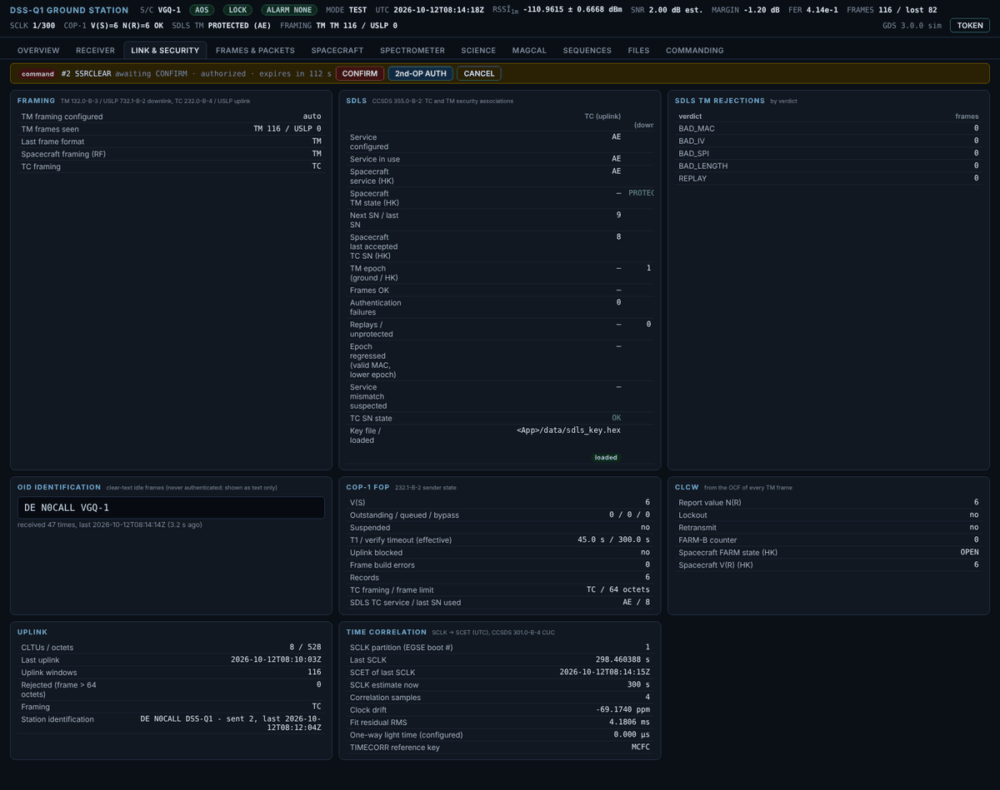

### 5.1 Framing

| Shown as | Key | Meaning | Example |
|---|---|---|---|
| TM framing configured | `link.tm_framing_cfg` | `[link] tm_framing`: "auto" (accept TM or USLP per frame), "TM" (CCSDS 132.0-B-3) or "USLP" (732.1-B-2) | auto |
| TM frames seen | `link.tm_framing_seen.TM`, `link.tm_framing_seen.USLP` | frames of each format that passed RS and the frame check | TM 344 / USLP 0 |
| Last frame format | `link.tm_framing_seen.last` | format of the newest frame | TM |
| Spacecraft framing (RF) | `decoded.framing` | what the spacecraft says it sends (RF `framing`) | TM |
| TC framing | `link.tc_framing` | `[link] tc_framing`: "TC" (232.0-B-4) or "USLP" for the uplink | TC |

If the configured format is "TM" or "USLP" and the spacecraft sends the other, every frame is
refused (counted under "Foreign / bad header", [4.10](#410-decoder)); "auto" avoids that.

### 5.2 SDLS

**What it shows.** CCSDS 355.0-B-2 Space Data Link Security in both directions: AE =
AES-256-GCM (encrypted and authenticated; TC SPI 2, TM SPI 3), AUTH = HMAC-SHA-256 truncated
to 128 bits (commands only, SPI 1), NONE. Keys `link.sdls` (`sdls.link_snapshot()` plus the
GDS's checks) and HK fields.

| Shown as | TC (uplink) key | TM (downlink) key | Meaning; if abnormal |
|---|---|---|---|
| Service configured | `link.sdls.tc_service_configured` | `link.sdls.tm_service_configured` | `[sdls] tc_service` / `tm_service` |
| Service in use | `link.sdls.tc_service` | `link.sdls.tm_service` | the configured service, or NONE when the key file is missing or unreadable (WARN event, YELLOW alarm "SDLS key file not found: ...") |
| Spacecraft service (HK) | `decoded.sdls_tc_service` | `decoded.sdls_tm_service` | what the flight build uses (HK `sdls_tc_service`, `sdls_tm_service`); must match the ground |
| Spacecraft TM state (HK) | - | `link.sdls.spacecraft_tm_state` | OFF, PROTECTED (green), WAITING FOR EPOCH, UNPROTECTED (null SA) (amber) - HK `sdls_tm_state` ([7.3](#73-housekeeping-hk-all-43-fields)) |
| Next SN / last SN | `link.sdls.tc_next_sn` | `link.sdls.tm_last_sn` | TC: the sequence number the next uplink frame will use (persisted in `<archive>/sdls_sn.txt` before the frame leaves); TM: the frame counter of the last accepted protected downlink frame |
| Spacecraft last accepted TC SN (HK) | `tlm.HK.values.sdls_last_sn` | - | the spacecraft's anti-replay state; the ground's next SN must stay above it |
| TM epoch (ground / HK) | - | `link.sdls.tm_epoch` / `tlm.HK.values.sdls_tm_epoch` | the epoch (spacecraft SCLK partition = EGSE boot counter) of the last accepted protected frame, and the one the spacecraft uses |
| Frames OK | - | `link.sdls.tm_frames_ok` | protected TM frames accepted |
| Authentication failures | `tlm.HK.values.sdls_auth_fail` | `link.sdls.tm_auth_fail` | TC frames the spacecraft rejected / TM frames the ground rejected for BAD_LENGTH, BAD_SPI, BAD_IV or BAD_MAC (amber when not 0) |
| Replays / unprotected | - | `link.sdls.tm_replay` / `link.sdls.tm_unprotected` | TM frames refused as replays; null-SA frames accepted (`[sdls] accept_null`) and flagged UNPROTECTED: the spacecraft sends these when it had no boot epoch for 120 s, rather than risk reusing a nonce |
| Epoch regressed (valid MAC, lower epoch) | - | `link.sdls.tm_epoch_regressed` | a correctly authenticated frame with a lower epoch than already seen: a replayed recording or an EGSE boot-counter regression, i.e. possible GCM nonce reuse. Red; RED alarm for 24 h and an ERROR event: investigate; generate a new key if the counter regressed ([17_Security_Model.md](17_Security_Model.md)) |
| Service mismatch suspected | - | `link.sdls.mismatch_suspected` | 3 consecutive data frames rejected as BAD_SPI / BAD_IV: the spacecraft probably runs SDLS TM NONE; compare `[sdls] tm_service` with the flight `VGQ_SDLS_TM` (amber, YELLOW alarm) |
| TC SN state | `link.sdls.tc_sn_state` | - | "OK" or "BLOCKED: <reason>" (red). BLOCKED only while the uplink is really held, i.e. with a key and TC AUTH or AE; without a key or with TC NONE no number is used and it always reads "OK", whatever the SN file holds. Two causes: the SN file `<archive>/sdls_sn.txt` is corrupt, or it is missing at start-up, with or without an archive (the first start with a new key, a new archive folder, another station, a restored backup: the numbers already spent with this key are unknown; under AE the number is the GCM nonce; WARN event at start). Either way the uplink waits until a real-time HK reports `sdls_last_sn` - in an SDLS-protected frame, or any HK when the station's TM service is NONE - that the spacecraft made at least 120 s after its boot (earlier HKs are ignored without an event), and then continues by itself on the time floor, 4 numbers per second since 2026-01-01 (about 98 million in October 2026), above every number the key can have used (WARN event "SDLS TC sequence number re-synchronised to <n> (the time floor: 4 per second since 2026-01-01; sdls_last_sn <m>) from ...: TC uplink released"). Only a report above the floor or a station clock before 2026 gives `sdls_last_sn` + 1 000 000, with a WARNING in the same event. A target above 4 227 858 432 is refused (ERROR "SDLS TC counter NOT re-synchronised ...": generate a new key). YELLOW alarm "TC uplink BLOCKED: ..." meanwhile. Never edit the file to a lower number ([17_Security_Model.md](17_Security_Model.md) section 7.6) |
| Key file / loaded | `link.sdls.key_file`, `link.sdls.key_loaded` | - | the 256-bit master key file (App Lab: `<App>/data/sdls_key.hex`); green "loaded" or amber "NOT LOADED" |

Example (simulator): AE / AE in use and on board; spacecraft TM state PROTECTED; TC next SN
6, spacecraft last accepted SN 5; TM epoch 1 / 1, last SN 73, 69 frames OK; 0 failures, 0
replays, 0 unprotected; not regressed; no mismatch; TC SN state OK; key loaded. The ground
directive `SDLS RESETREPLAY` (two-step confirmation) forgets the TM (epoch, sn) window, for
example after the EGSE boot counter was lost.

Regulatory note: encryption is generally not permitted on amateur frequencies; use AUTH or
NONE there ([09_Regulatory_and_Safety.md](09_Regulatory_and_Safety.md)).

### 5.3 SDLS TM rejections

One row per verdict, `rx.decoder.sdls_rejected.<verdict>` (amber when not 0). A rejected
frame is dropped, never decoded, and its CLCW is not used.

| Verdict | Key | Cause | What to do |
|---|---|---|---|
| BAD_MAC | `rx.decoder.sdls_rejected.BAD_MAC` | the GCM tag did not verify: a different key, a corrupted frame that passed RS and the FECF, or a forgery | check that both ends were built / configured from the same key ([17_Security_Model.md](17_Security_Model.md)) |
| BAD_IV | `rx.decoder.sdls_rejected.BAD_IV` | the IV is malformed (direction not 'TM', reserved octets not zero, epoch 0) or a null-SA frame carries a non-zero IV | a spacecraft sending without SDLS, or a damaged frame |
| BAD_SPI | `rx.decoder.sdls_rejected.BAD_SPI` | the SPI is neither 3 (TM AE) nor 0 (null SA, when accepted) | the spacecraft runs another TM service (see "Service mismatch suspected") |
| BAD_LENGTH | `rx.decoder.sdls_rejected.BAD_LENGTH` | the frame is too short for the 14-octet security header, data and 16-octet tag | framing or geometry mismatch |
| REPLAY | `rx.decoder.sdls_rejected.REPLAY` | (epoch, sn) not newer than the last accepted | a replayed or duplicated frame; after a lost EGSE boot counter, `SDLS RESETREPLAY` |

Any reject in the last 60 s raises the YELLOW alarm "n SDLS TM rejects in the last 60 s";
each verdict also logs a WARN event at most every 10 s (source SDLS).

### 5.4 OID identification

| Item | Key | Meaning |
|---|---|---|
| ident text | `link.ident.text` | the clear-text identification the spacecraft puts in its idle (OID) frames, "DE <callsign> VGQ-1" with the flight's `VGQ_CALLSIGN` from `config.h` (default N0CALL, set it to your callsign); the ground station identifies separately ([5.9](#59-station-identification)) |
| meta line | `link.ident.count`, `link.ident.t` | "received n times, last <time> (<ago>)" |

OID frames are never authenticated: the text is shown as text only (never interpreted) and
proves nothing about who sent it.

### 5.5 COP-1 FOP

**What it shows.** The ground half of the CCSDS 232.1-B-2 uplink protocol (FOP-1,
[fop.py](../dssq-groundstation/python/dssq/fop.py)): sequence-controlled (AD) frames are
numbered, kept until the spacecraft's CLCW acknowledges them, and retransmitted when needed.
Key prefix `cop`.

| Shown as | Key | Meaning; normal / abnormal |
|---|---|---|
| V(S) | `cop.vs` | the number the next AD frame will carry (0..255); "—" until the first CLCW initialises it |
| Outstanding / queued / bypass | `cop.outstanding`, `cop.queued`, `cop.pending_bypass` | AD frames sent and not yet acknowledged (at most `[commanding] window`, default 5) / commands waiting / BD (bypass) and BC (directive) frames waiting |
| Suspended | `cop.suspended` | amber "yes": the FOP stopped, for example after `[commanding] tx_limit` (default 3) transmissions of a frame; unacknowledged frames are purged (SUSPENDED) |
| T1 / verify timeout (effective) | `cop.t1_s`, `cop.verify_timeout_s` | retransmission timer = max(`[commanding] t1_s` (45 s), 2 x the longest expected frame period); verification timeout = max(`verify_timeout_s` (300 s), 4 x that period). Example SX126x profile 1: T1 138.5 s, verification 277.1 s -> 300 s |
| Uplink blocked | `cop.uplink_blocked` | red "yes": the SDLS TC sequence number is blocked ([5.2](#52-sdls)); nothing is sent |
| Frame build errors | `cop.build_errors` | frames that could not be built (e.g. SDLS state); should be 0 |
| Records | `cop.records` | command records held (up to 500) |
| TC framing / frame limit | `cop.tc_framing`, `cop.frame_limit` | TC or USLP; 64 octets (a longer command is refused before it is queued) |
| SDLS TC service / last SN used | `cop.sdls_service`, `cop.sdls_sn` | the TC service in use and the **last** sequence number used (the next one is `link.sdls.tc_next_sn` = this + 1, in the SDLS panel) |
| (snapshot) | `cop.nr`, `cop.lockout`, `cop.retransmit`, `cop.farm_b` | from the newest CLCW ([5.6](#56-clcw)) |
| (snapshot) | `cop.recent` | the last 12 command records ([13.3](#133-command-history)) |

### 5.6 CLCW

The Command Link Control Word in the operational control field of every downlink frame (TM
and USLP) is the spacecraft FARM-1's report on the uplink. The CLCW of a frame that failed
SDLS is ignored (a forged frame must not drive COP-1).

| Shown as | Key | Meaning; if abnormal |
|---|---|---|
| Report value N(R) | `cop.nr` | the next AD frame number the spacecraft expects; equals V(S) when every frame is acknowledged |
| Lockout | `cop.lockout` | red "yes": the FARM received an AD frame outside its window and refuses AD frames; the FOP sends COP-1 Unlock (or use the `UNLOCK` directive) |
| Retransmit | `cop.retransmit` | amber "yes": the FARM missed a frame; the FOP retransmits from N(R) |
| FARM-B counter | `cop.farm_b` | 2-bit counter of accepted bypass (BD / BC) frames; the FOP confirms bypass frames by its increments |
| Spacecraft FARM state (HK) | `decoded.farm_state` | OPEN, WAIT, LOCKOUT (HK `farm_state`) |
| Spacecraft V(R) (HK) | `tlm.HK.values.farm_vr` | the FARM's V(R) from HK (compare with N(R)) |

### 5.7 Uplink

| Shown as | Key | Meaning |
|---|---|---|
| CLTUs / octets | `rx.uplink.cltus`, `rx.uplink.octets` | CLTUs radiated and their octets since the GDS started |
| Last uplink | `rx.uplink.last_t` | time of the last CLTU |
| Uplink windows | `rx.uplink.windows` | quiet windows after received frames (one per frame) |
| Rejected (frame > 64 octets) | `rx.uplink.rejected_too_long` | commands refused because their TC frame would exceed 64 octets with the configured framing and SDLS (use `[link] tc_framing = "TC"`) |
| Framing | `rx.uplink.framing` | TC or USLP |
| Station identification | `link.station_id.text`, `link.station_id.count`, `link.station_id.last_t` | "DE <callsign> <name> - sent n, last <time>": the ground transmitter's own amateur identification, how often it was radiated and when last ([5.9](#59-station-identification)) |

### 5.8 Time correlation

**What it shows.** How the GDS turns spacecraft clock (SCLK) readings into UTC (SCET,
spacecraft event time), CCSDS 301.0-B-4 CUC time codes
([timecode.py](../dssq-groundstation/python/dssq/ccsds/timecode.py)). The spacecraft sends a
TIMECORR packet with the SCLK at which it keyed its transmitter for a reference frame; the
GDS knows when that frame arrived (ERT) and works back:
SCET_ref = ERT_end - t_UART - t_air - OWLT - `[radio] radio_latency_s`, where t_UART is the
E22's 9600-baud transfer of the CADU and its RSSI octet (237 x 10 / 9600 = 0.2469 s; 0 for
the SX126x), t_air the reference frame's busy time from TIMECORR and OWLT = d / c. A
least-squares line SCET = a + b x SCLK over the last 64 samples of the current partition
gives the correlation. Key prefix `time`.

| Shown as | Key | Unit, display | Meaning |
|---|---|---|---|
| SCLK partition (EGSE boot #) | `time.partition` | integer | HK `sclk_partition`: the EGSE boot counter; a new partition restarts the fit |
| Last SCLK | `time.last_sclk` | s, 6 decimals | the SCLK of the newest real-time packet |
| SCET of last SCLK | `time.scet_of_last_sclk` | ISO 8601 | a + b x last SCLK |
| SCLK estimate now | `time.sclk_estimate_s` | s | last SCLK + (now - its ERT), as an integer: used for absolute-time sequence entries |
| Correlation samples | `time.corr_samples` | count | TIMECORR samples in the fit (max 64) |
| Clock drift | `time.drift_ppm` | ppm, 4 decimals | (b - 1) x 10⁶; "—" with fewer than 2 samples |
| Fit residual RMS | `time.residual_rms_ms` | ms, 4 decimals | RMS of the residuals of the fit; "—" with fewer than 3 samples (a line through two points always fits) |
| One-way light time (configured) | `time.owlt_s` | µs / ms / s | `[spacecraft] distance_km` / c |
| TIMECORR reference key | `time.timecorr_key` | text | "MCFC" (TM) or "VC0 VCF count" (USLP): which frame counter identifies the reference frame |

Example (simulator, 2 km): partition 1, last SCLK 1218.899918 s, 4 samples, drift 0.0003
ppm, residual RMS 0.0024 ms, OWLT 6.671 µs, key MCFC, SCLK estimate 1224 s. On hardware the
drift is the UNO Q clock's error and the residual shows the latency jitter of the radio
path; both are VERIFY on hardware (test T-TM-04 sets `radio_latency_s`). A wrong station
clock (no NTP) shifts every SCET; the TDM recorder refuses records outside the years
2000..2100 and counts them in `health.tdm_rejected`.

### 5.9 Station identification

**What it is.** Amateur rules require a transmitting station to identify itself in plain
language at short intervals and at the end of a communication (for example US 47 CFR
97.119(a): at least every 10 minutes and at the end; ITU Radio Regulations No. 25.9). The
spacecraft identifies in its idle frames ([5.4](#54-oid-identification)); the GROUND
transmitter identifies with this text, which the GDS radiates through the same radio path as
the CLTUs (an E22 transparent packet or an SX126x LoRa packet; `StationIdent` in
[gds.py](../dssq-groundstation/python/dssq/gds.py)). Regulatory background:
[09_Regulatory_and_Safety.md](09_Regulatory_and_Safety.md). Key `link.station_id`; the
LINK & SECURITY Uplink table shows it as the row "Station identification".

| Key | Unit, display | Meaning, source |
|---|---|---|
| `link.station_id.callsign` | text | `[station] callsign` in `station.toml`, upper-cased and checked at start-up (default `N0CALL`, a placeholder that is not a licensed callsign: a WARN event, source IDENT, at every start until you set yours) |
| `link.station_id.text` | text | the identification sent: "DE <callsign> <name>", with `[station] name` reduced to ASCII letters, digits, "-", "_" and "." (at most 16 characters). Printable ASCII only, so it can never contain the CLTU start sequence EB 90 |
| `link.station_id.count` | count | identifications radiated since the GDS started |
| `link.station_id.last_t` | UNIX s, shown as UTC | when the last one was radiated ("—" before the first) |
| `link.station_id.last_reason` | text | "periodic" or "end" (rules below); null before the first |
| `link.station_id.pending_since` | UNIX s | the first uplink transmission not yet covered by an identification; null when every transmission is covered |

**When it is sent** (decided at the start of every uplink window: when it is due, or would
become due once the window transmits, its air time is booked first in the window plan and the
window's CLTUs get what is left, [02_Link_Budget_and_RF_Analysis.md](02_Link_Budget_and_RF_Analysis.md)
section 7.2; it is radiated right after that window's data. While the downlink is lost the
housekeeping sends it, once the last window's planned transmissions are over, because no
window comes then; it does the same when the periodic identification is about to be overdue,
rule 5):

1. Every CLTU radiated (commands, COP-1 directives, external TC frames) and every `WAKE`
   transmission makes the uplink "uncovered" (`pending_since` set).
2. **periodic**: uncovered, and no identification yet in this run or the last one is at least
   600 s minus an early margin old. The margin is max(60 s, 3 x the frame period), at most
   600 s: the period is the longest expected one, or the spacecraft's reported RF
   `frame_period_ms` when that is longer (`_ident_margins()`). An identification can only go
   out in an uplink window, and this margin leaves a window for it even when two downlink frames
   are lost. So the first command of a run is followed by an identification in the same
   window, then one at least every 10 minutes while commanding continues; at the slow SX126x
   profiles more often (profile 0: about every 184 to 323 s).
3. **end**: uncovered, and the uplink has been idle for max(120 s, the FOP T1 timer
   `cop.t1_s`): the closing identification of the session.
4. When the GDS shuts down with the uplink uncovered, with an identification still waiting
   in the outbox, or with one still last in the SX126x bridge's backlog, it sends that closing
   identification (reason "end" when uncovered) as the first shutdown step, before the radio
   closes; anything else left in the outbox is not radiated (`Runner.close()`). An
   identification still last in the backlog is flushed, not repeated
   (`Sx126xBridge.queued_last()`); one with uplinks queued behind it covers none of them, so
   a new one goes after them. It counts as sent only once the radio took it: with the SX126x
   station radio the GDS waits at most 0.6 s (`IDENT_FLUSH_S`) for the station MCU to accept
   it and the uplinks before it, else it logs ERROR IDENT "closing identification NOT
   radiated: the station MCU did not take it within 0.6 s (TX queue full or radio down)". A
   station clock that steps back counts as "the interval is over" (identify rather than miss
   one).
5. **Overdue**: uncovered, and no window has carried the identification 600 s - 2 s - its own
   air time after the last one (more than two frames lost, or a fade shorter than the LOS
   timeout): the housekeeping sends it without a window (`_id_overdue()`), so the 10 minutes
   hold. Sent outside a window it may collide with one downlink frame
   ([20_Known_Limitations.md](20_Known_Limitations.md) L-28).

**On the spacecraft.** The text holds no CLTU start sequence, so the flight's CLTU search finds
nothing: it adds 1 to RF `cltu_bad` and drops the packet, with no EVR, no fault-protection and
no FARM-1 effect ([7.4](#74-telecom-rf-all-24-fields)). Identifications are not counted in
`rx.uplink.cltus` or `rx.uplink.octets`.

**Events.** Each identification logs an INFO event, source IDENT: "station identification
(periodic): DE N0CALL DSS-Q1". It is logged when the identification is queued in the outbox;
with the SX126x station radio it may still wait in the bridge's backlog (station MCU TX queue
full, or uplinks held after a survey: `tx_hold`, [4.13](#413-sx126x-station-mcu)). The
closing identification at shutdown logs no INFO event; an ERROR IDENT says when it was not
handed to the MCU (rule 4).

**Normal values and what to do.**

* After a command session: `count` grew by one at the first command, by about one per 10
  minutes of further commanding (more often at the slow SX126x profiles, rule 2), and by one
  closing identification about 2 minutes after the last uplink; `pending_since` is null
  between sessions.
* `callsign` N0CALL: set your licensed callsign in `[station] callsign` (and the flight's
  `VGQ_CALLSIGN`, which the spacecraft sends in `link.ident.text`) before transmitting
  ([15_Configuration_Reference.md](15_Configuration_Reference.md)).
* `count` stays 0 although commands were radiated, or `pending_since` stays set for much more
  than 10 minutes: the radio path is not transmitting (RECEIVER, serial and radio link,
  [4.14](#414-serial-and-radio-link)).
* RF `cltu_bad` rising faster than `count`: uplink packets damaged by noise or interference,
  not identifications.

Example (simulator rerun with the final code, E22, commands NOOP, MODE CRUISE, PING 42,
RFSCAN 20 29): text "DE N0CALL DSS-Q1", count 2: "periodic" in the window of the first
command, "end" 122 s after the last command (the uplink idle for more than 120 s); the
spacecraft's RF `cltu_bad` reads 2 and `cltu_ok` 4.

---

## 6 FRAMES & PACKETS tab

**What it is for.** The bookkeeping of the CCSDS layers: how many frames arrived on each
virtual channel and how many were lost, how many packets of each type arrived, their
sequence gaps, sizes, inter-arrival times and latency. Look at it when telemetry of one
kind is missing or late, and to see what the downlink is carrying.

```
+-------------------------------------------------------------------------------------+
| Virtual channels (VC0 RT-ENG, VC1 RT-SCI, VC2 PLAYBACK, VC3 FILE (CFDP), OID)        |
+-------------------------------------------------------------------------------------+
| Packets by APID (one row per packet type, with latency statistics)                  |
+---------------------------+---------------------------+---------------------------+
| Frames by format and VC   | Time correlation          | CLCW / COP-1              |
+---------------------------+---------------------------+---------------------------+
```

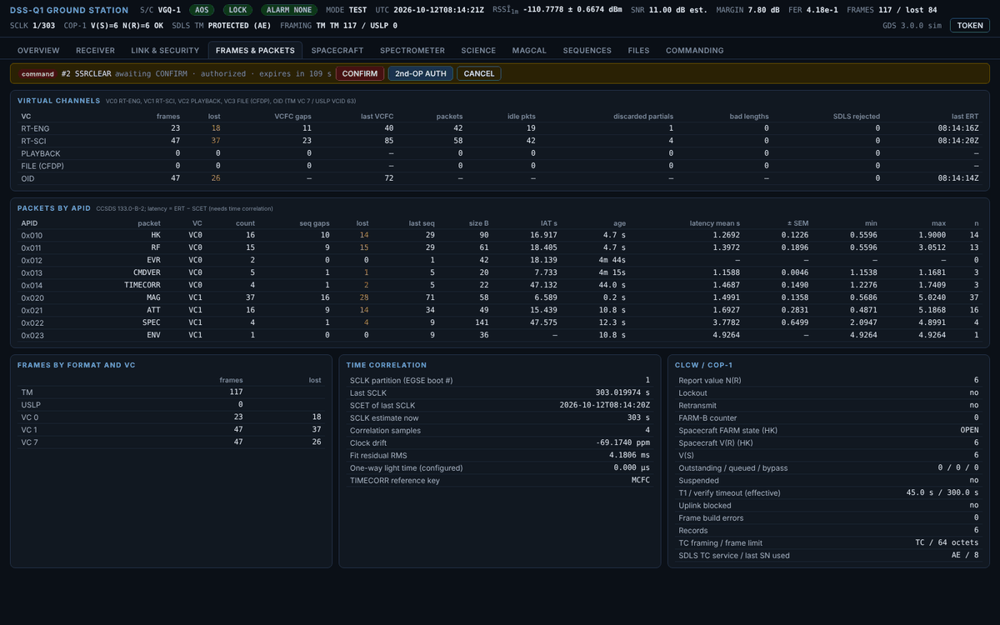

### 6.1 Virtual channels and APIDs in one paragraph

The spacecraft multiplexes four data virtual channels into one downlink: VC0 real-time
engineering (HK, RF, EVR, CMDVER, TIMECORR, RFSCAN), VC1 real-time science (MAG, ATT, SPEC,
ENV, SPECBURST), VC2 playback of the solid-state recorder (any APID, not real time), VC3 file
delivery (CFDP). Idle frames carry the identification text on VC 7 (TM) or VCID 63 (USLP).
Priority on board: VC0 > VC1 > VC2 > VC3 > OID. Packets are CCSDS 133.0-B-2 Space Packets;
the APID names the packet type ([05_Telemetry_and_Command_Dictionary.md](05_Telemetry_and_Command_Dictionary.md)).

### 6.2 Virtual channels

Rows "RT-ENG" (VC0), "RT-SCI" (VC1), "PLAYBACK" (VC2), "FILE (CFDP)" (VC3) and "OID"; keys
`vc.<vc>.<counter>` with these names.

| Column | Key | Meaning; if abnormal |
|---|---|---|
| frames | `vc.<vc>.frames` | frames of this VC that passed RS and the frame check (including ones SDLS then rejected) |
| lost | `vc.<vc>.lost` | gaps in this VC's frame count (VCFC, mod 256) as the receiver counts them (amber when not 0) |
| VCFC gaps | `vc.<vc>.vcfc_gaps` | discontinuities the packet extractor saw (each drops a partial packet) |
| last VCFC | `vc.<vc>.last_vcfc` | frame count of the newest frame |
| packets | `vc.<vc>.packets` | real (non-idle) packets extracted |
| idle pkts | `vc.<vc>.idle_packets` | idle packets (fill) |
| discarded partials | `vc.<vc>.discarded_partials` | partial packets dropped at a discontinuity (lost frame, SDLS status change, header mismatch) |
| bad lengths | `vc.<vc>.bad_length` | corrupt packet headers (sync lost until the next first-header pointer); should be 0 |
| SDLS rejected | `vc.<vc>.sdls_rejected` | frames of this VC refused by SDLS (amber when not 0) |
| last ERT | `vc.<vc>.last_ert` | time of day of the newest frame |
| (snapshot) | `vc.<vc>.lost_frames`, `vc.<vc>.fhp_mismatches`, `vc.<vc>.sdls_discontinuities` | the extractor's own lost-frame count; first-header pointers that disagreed with the buffered packet; changes of the SDLS status between frames of the VC (a forged null-SA frame can never join a protected packet) |

The OID row has only frames, lost (frame-count gaps of VC 7 or VCID 63), last VCFC, SDLS
rejected and last ERT. Example (simulator, 14 min): RT-ENG 32 frames, 1 lost, 56 packets,
26 idle packets; RT-SCI 37 frames, 2 lost, 63 packets, 1 discarded partial; OID 275 frames,
11 lost.

### 6.3 Packets by APID

One row per packet type received; keys `apids.<packet>.<field>` where `<packet>` is the
packet name (HK, RF, EVR, CMDVER, TIMECORR, RFSCAN, MAG, ATT, SPEC, ENV, SPECBURST, CFDP).
Statistics count real-time packets; VC2 playback copies are counted but do not move the
sequence, inter-arrival or latency figures.

| Column | Key | Unit, display | Meaning, formula; if abnormal |
|---|---|---|---|
| APID | `apids.<packet>.apid` | hex | the 11-bit application id |
| packet | (name) | text | packet name from the dictionary |
| VC | `apids.<packet>.vcid` | VCn | the virtual channel it last arrived on |
| count | `apids.<packet>.count` | count | packets received |
| seq gaps | `apids.<packet>.seq_gaps` | count | discontinuities of the 14-bit packet sequence count |
| lost | `apids.<packet>.lost` | count (amber) | packets missing: the sum of the gap sizes. Lost packets usually come from lost frames |
| last seq | `apids.<packet>.last_seq` | integer | sequence count of the newest real-time packet |
| size B | `apids.<packet>.size` | octets | packet length (HK 90, RF 61, MAG 58, ATT 49, SPEC 141, ENV 36, TIMECORR 22, CMDVER 20) |
| IAT s | `apids.<packet>.iat_s` | s, 3 decimals | measured inter-arrival time, smoothed: iat <- iat + 0.2 (dt - iat). Compare with the cadence table in [1.3](#13-how-often-things-change): larger means the spacecraft stretched the period for the link, or packets were lost |
| age | `apids.<packet>.age_s` | duration | time since the newest packet of this type |
| latency mean s, ± SEM, min, max, n | `apids.<packet>.latency` (`mean`, `sem`, `min`, `max`, `n`, ...) | s, 4 decimals | ERT - SCET over the last 600 s (needs time correlation): how long packets waited on board before reaching the ground. Grows with VC backlog and slow rates |

Example (simulator, E22 2.4 kbit/s, CRUISE): HK 23 packets, 1 lost, IAT 59.28 s (cadence
60 s), latency 2.58 ± 0.31 s (n = 9); MAG 34 packets, IAT 30.43 s (cadence 30 s), latency
5.14 s; SPEC latency 9.16 s.

### 6.4 Frames by format and VC, time correlation, CLCW / COP-1

* **Frames by format and VC**: `rx.frames.by_format` and `rx.frames.per_vc`, as in
  [4.11](#411-frames).
* **Time correlation**: the same rows as [5.8](#58-time-correlation).
* **CLCW / COP-1**: the rows of [5.6](#56-clcw) followed by those of [5.5](#55-cop-1-fop).

---

## 7 SPACECRAFT tab

**What it is for.** Everything the spacecraft says about itself: every field of the
housekeeping (HK) and telecom (RF) packets with its decoded meaning and limit state, the
fault-protection flags, the instrument health bits, the beacon history, the onboard
sequencer, magnetometer and file-transfer state, the latest command-verification,
time-correlation and RF-survey packets, the spacecraft's own event reports (EVRs) and the
ground's statistical anomaly detector. Look at it after every AOS (did anything happen
while the spacecraft was out of view?), whenever the beacon banner or an alarm reason names
a telemetry field, and before commanding.

```
+-----------------------------+-----------------------------+-----------------------------+
| Housekeeping (HK, 43 fields | Telecom (RF, 24 fields      | Fault protection (16 bits)  |
|  + ERT / SCET / SCLK)       |  + ERT / SCET / SCLK)       | Sensors (10 bits)           |
+-----------------------------+-----------------------------+-----------------------------+
| Beacon (step chart + the    | Onboard state (sequence,    | Other packets (CMDVER,      |
|  last 12 changes)           |  BIST, MAGCAL, CFDP, flags) |  TIMECORR, RFSCAN)          |
+-----------------------------+-----------------------------+-----------------------------+
| Spacecraft EVRs (newest     | Anomaly detector            |                             |
|  first)                     |                             |                             |
+-----------------------------+-----------------------------+-----------------------------+
```

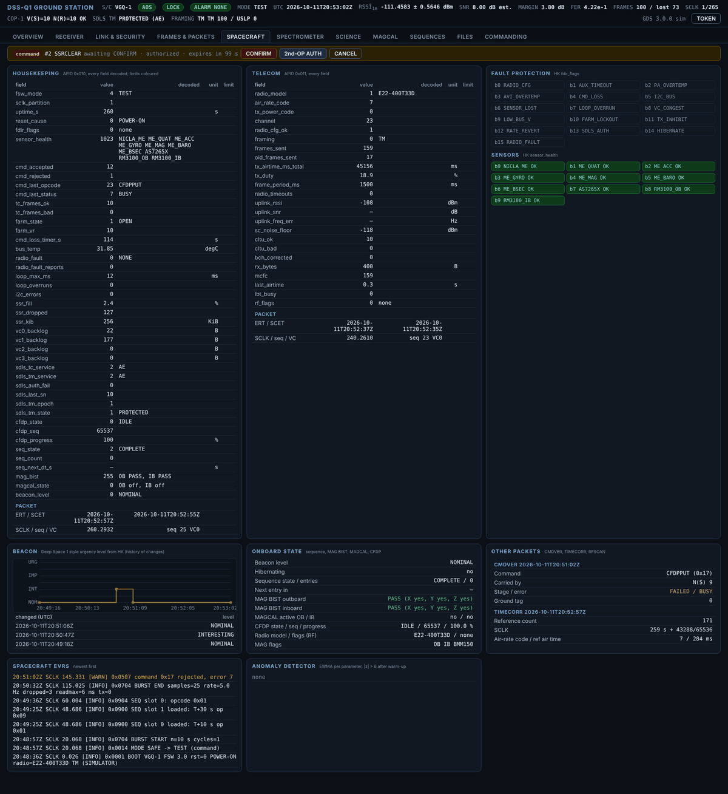

### 7.1 Reading a telemetry table

The HK and RF panels (`tlmTable()` in dashboard.html) list every field of the newest
**real-time** packet of that type in dictionary order; playback copies (VC2) never replace
it. Key prefix `tlm.<packet>` (`tlm.HK`, `tlm.RF`; the science packets are on the SCIENCE
tab, [section 9](#9-science-tab)).

| Column or row | Key | Meaning |
|---|---|---|
| field | dictionary name | hover for the description and the limits "(red lo, yellow lo, yellow hi, red hi)" |
| value | `tlm.<packet>.values.<field>` | engineering value = raw x scale: integers as integers, scaled values with the decimals of the scale (0.01 -> 2, 0.1 -> 1); "—" = the flight sent its not-available value |
| decoded | - | enumeration name (MODES, RESET_CAUSES, ...), names of the set bits, the command mnemonic (`cmd_last_opcode`), the BIST verdict (`mag_bist`), OB / IB on / off (`magcal_state`) |
| unit | `tlm.<packet>.units.<field>` | dictionary unit |
| limit | `tlm.<packet>.limits.<field>` | YELLOW or RED (the value cell is coloured too) when out of limits; empty when OK or when the field has no limits ([7.2](#72-limits-and-how-they-are-checked)) |
| ERT / SCET | `tlm.<packet>.ert`, `tlm.<packet>.scet` | earth-received time of the packet; spacecraft event time from the SCLK correlation ([5.8](#58-time-correlation)), "—" before the first correlation |
| SCLK / seq / VC | `tlm.<packet>.sclk`, `tlm.<packet>.seq`, `tlm.<packet>.vcid` | the packet's SCLK time stamp (s), its 14-bit sequence count and its virtual channel; `tlm.<packet>.apid` is the APID |

**Not available versus saturated.** Most fields have a not-available value the flight sends
when it has no reading (i8 -128, i16 0x7FFF, u16 0xFFFF, i32 0x7FFFFFFF, u32 0xFFFFFFFF);
the GDS turns it into `null` and the page shows "—". Counters, timers and bit masks have no
such value (dictionary `NO_NA`): every raw value is a reading, so 65535 in a saturating u16
counter means "at least 65535", never "missing". The tables below say which counters
saturate and which wrap around to 0.

**Update rate.** A field changes only when a new packet of its type arrives. Default
periods ([1.3](#13-how-often-things-change)): HK 30 s (SAFE), 60 s (CRUISE), 20 s
(ENCOUNTER), 10 s (TEST); RF 60 / 60 / 30 / 10 s. On a slow link the flight stretches all
periodic packets so that together they use at most 75 % of the downlink capacity
(`plan_downlink_load()` in [datalink.cpp](../vgq1-spacecraft/sketch/src/fsw/datalink.cpp)),
and `PKTRATE` overrides one type; the measured period is `apids.HK.iat_s`, the age
`apids.HK.age_s` ([6.3](#63-packets-by-apid)). While the spacecraft hibernates it sends one
beacon HK every `beacon_s` (the HIBERNATE argument) and records everything else.

### 7.2 Limits and how they are checked

The dictionary gives a field up to four limits (red low, yellow low, yellow high, red high).
`dictionary.checked_limits()` decides:

1. RED when value <= red low or value >= red high;
2. otherwise YELLOW when value <= yellow low or value >= yellow high;
3. otherwise OK. A value **equal** to a limit is out of limits; a missing value is OK.

Each real-time packet is checked when it arrives and the state stays until the next packet
of that type. Every change of state logs an event (source LIMITS, for example
"HK.vc1_backlog = 736 YELLOW" at WARN, the return to OK at INFO), and every field out of
limits adds an alarm reason such as "HK.vc1_backlog YELLOW limit" ([15](#15-alarm-logic)).
Playback copies are checked for the archive only.

| Packet.field | Red low | Yellow low | Yellow high | Red high | Reason for the values |
|---|---|---|---|---|---|
| HK.`bus_temp` (°C) | -20 | 0 | 60 | 75 | 75 °C is also the flight's own avionics over-temperature threshold (`kBusTempRedC`, FDIR AVI_OVERTEMP); the others are ground engineering limits (VERIFY against the board ratings) |
| HK.`radio_fault` (code) | - | - | 0.5 | 2.5 | any fault is YELLOW (T37S under- or over-voltage, codes 1, 2); over-temperature (3, 4) and every SX126x fault (16-19) are RED |
| HK.`loop_max_ms` (ms) | - | - | 600 | 1000 | a pass of a second or more misses the flight's 1 Hz tasks |
| HK.`ssr_fill` (%) | - | - | 80 | 95 | at 100 % the recorder overwrites its oldest packets |
| HK.`vc0_backlog`, HK.`vc1_backlog` (octets) | - | - | 600 | 900 | routine packets may fill a 1024-octet VC buffer up to 768 octets; FDIR VC_CONGEST sets above 640 |
| HK.`sdls_auth_fail` (count) | - | - | 1 | 10 | one rejected command frame deserves a look; ten point at a key mismatch or an attack |
| HK.`sdls_tm_state` (code) | - | - | 1.5 | - | WAITING FOR EPOCH (2) and UNPROTECTED (3) are YELLOW |
| HK.`beacon_level` (code) | - | - | 1.5 | 2.5 | IMPORTANT is YELLOW, URGENT RED (in addition to the "beacon" alarm reasons of [15](#15-alarm-logic)) |
| RF.`radio_cfg_ok` (flag) | 0 | - | - | - | 0 = the radio configuration is not verified |
| RF.`tx_duty` (%) | - | - | 55 | 70 | the flight limits itself to 50 % (`kMaxTxDutyPermille`) and reports the duty over whole transmission cycles ([7.4](#74-telecom-rf-all-24-fields)), so a reading above 50 % is a real excess |

The other packets (CMDVER, TIMECORR, MAG, ATT, SPEC, ENV) carry no limits.

### 7.3 Housekeeping (HK): all 43 fields

APID 0x010, 78 octets of user data (a 90-octet packet), VC0, built by `Flight::gen_hk()` in
[flight.cpp](../vgq1-spacecraft/sketch/src/fsw/flight.cpp) with the layout `HkPacket` of
[tlm_packets.h](../vgq1-spacecraft/sketch/src/fsw/tlm_packets.h). Key of a field:
`tlm.HK.values.<field>`; its limit state `tlm.HK.limits.<field>`; the decoded names are also
in `decoded` ([7.8](#78-onboard-state-and-the-decoded-block)). "(o, t)" after a name gives
the octet offset and the type. Every field updates with each HK packet (7.1) unless the row
says otherwise. Examples: "E22 sim" is the E22-400T33D simulator run (2.4 kbit/s, CRUISE,
14 min), "SX sim" the SX126x run (profile 1, CRUISE, 40 min). Radio-specific behaviour
(E22-400T33D, E22-400T37S, SX126x) is stated where it exists; elsewhere the field means the
same on every radio. Operator responses to every event and alarm are in
[14_Troubleshooting_and_Event_Response.md](14_Troubleshooting_and_Event_Response.md).

**Mode, clock and resets**

| Field (o, t) | Unit, display | Source and formula | Normal; limits | Meaning; if abnormal; related | E22 sim / SX sim |
|---|---|---|---|---|---|
| `fsw_mode` (0, u8) | enumeration, decoded | the flight mode: 0 BOOT, 1 SAFE, 2 CRUISE, 3 ENCOUNTER, 4 TEST (`MODES`); set by `MODE`, by fault protection and at boot | SAFE after every boot and after a fault-protection response, then the mode the ground commanded. BOOT is never seen in a packet (the boot sequence sets SAFE before the first HK) | sets the packet cadence and the frame-period factor (SAFE 4.0, CRUISE 2.5, ENCOUNTER and TEST 2.0). Unexpected SAFE: the EVR "MODE x -> SAFE (<why>)" names the cause; fix it, then `MODE <mode>`. Related: header MODE (`decoded.mode`), `fdir_flags`, beacon | 2 CRUISE / 2 CRUISE |
| `sclk_partition` (1, u16) | integer | the SCLK partition = the EGSE boot counter, a new persisted value (1..65534) the Linux EGSE issues at every MCU boot, at EGSE start and whenever the MCU reports epoch 0; also the SDLS TM epoch. 0 = none yet | >= 1, constant between reboots | SCLK restarts at 0 at every boot, so (partition, SCLK) names a moment uniquely; a new partition restarts the ground's time correlation. 0 for longer than 120 s: the EGSE does not answer and the TM goes out unprotected (`sdls_tm_state` 3). Related: `sdls_tm_epoch`, `time.partition`, header SCLK | 1 / 1 |
| `uptime_s` (3, u32) | s | `sclk_.seconds()`: whole SCLK seconds since the MCU booted | grows by the HK period from packet to packet | the spacecraft clock. A drop = a reboot: check `reset_cause` and the BOOT EVR 0x0001. Related: `time.last_sclk`, `time.sclk_estimate_s` | 1158 / 2143 |
| `reset_cause` (7, u8) | enumeration | the MCU reset flags at boot (`classify_reset_cause()` in [autonomy.h](../vgq1-spacecraft/sketch/src/fsw/autonomy.h)): watchdog -> 3 WATCHDOG; software -> 2 SOFTWARE (REBOOT); brown-out with the warm-boot marker -> 4 BROWNOUT, without it -> 0 POWER-ON; reset pin -> 1 PIN; none of these -> 255 UNKNOWN | POWER-ON after switch-on, SOFTWARE after `REBOOT` | WATCHDOG: the independent hardware watchdog (IWDG, about 40 s, `kIwdgTimeoutMs`, on unless the build sets `VGQ_IWDG` 0) restarted the MCU because the flight loop stopped running; report it with the EVRs before the reset (the recorder is lost with the reset, the EGSE keeps its CADU archive). BROWNOUT: the supply sagged, usually at a transmit peak; the flight restarts at power code 2 (`kBrownoutPowerCode`, EVR 0x0608), the beacon is URGENT and the GDS shows YELLOW "spacecraft reset cause BROWNOUT (check the radio supply)": fix the supply ([03_Hardware_Integration.md](03_Hardware_Integration.md)) before `TXPWR 0` | 0 POWER-ON / 0 |

**Fault protection and instruments** (bit by bit in [7.5](#75-fault-protection-flags) and [7.6](#76-sensors))

| Field (o, t) | Unit, display | Source and formula | Normal; limits | Meaning; if abnormal; related | E22 sim / SX sim |
|---|---|---|---|---|---|
| `fdir_flags` (8, u16) | bit mask, decoded flag names | the 16 fault-protection flags | 0; HIBERNATE (b14) while hibernating, TX_INHIBIT (b11) after `TXINHIBIT` | any flag except HIBERNATE and TX_INHIBIT raises the YELLOW alarm "FDIR <names>". CMD_LOSS, LOOP_OVERRUN, RATE_REVERT and SDLS_AUTH stay set until `RSTCNT` (or a reboot) acknowledges them. Related: `decoded.fdir`, the Fault protection panel, EVRs 0x06xx | 0 / 0 |
| `sensor_health` (10, u16) | bit mask, decoded names of the healthy instruments | 10 instrument bits, set at boot for every instrument found and updated at run time | 1023 (0x3FF) with everything fitted and working; 511 (0x1FF) without the optional inboard RM3100 | a clear bit = instrument not working or not fitted; the loss of an enabled instrument makes the beacon IMPORTANT. Related: `decoded.sensors_ok`, `decoded.sensors_missing`, FDIR SENSOR_LOST, `i2c_errors` | 1023 / 1023 |

**Commanding and COP-1**

| Field (o, t) | Unit, display | Source and formula | Normal; limits | Meaning; if abnormal; related | E22 sim / SX sim |
|---|---|---|---|---|---|
| `cmd_accepted` (12, u16) | count, wraps at 65536 | commands executed with result OK, from the ground (AD or BD frames) or from the stored sequence; 0 at boot and after `RSTCNT` | +1 per executed command | every EXECUTED in the command history adds one. Related: `cmd_rejected`, CMDVER, `cop.recent` | 4 / 2 |
| `cmd_rejected` (14, u16) | count, wraps | commands refused (unknown opcode, bad length, bad argument, bad magic, hardware error, BUSY) | 0 | each one also sends CMDVER FAILED with its error code and EVR 0x05xx "command 0x.. rejected, error n". Rising without ground commands: the stored sequence is failing. Related: `cmd_last_status` | 0 / 0 |
| `cmd_last_opcode` (16, u8) | opcode, decoded mnemonic | the last command executed or rejected (0 when its packet header could not be parsed) | the last command sent | Related: `cmd_last_status`, `tlm.CMDVER.values.opcode` | 19 RFSCAN / 2 MODE |
| `cmd_last_status` (17, u8) | enumeration `CMD_ERRORS` | the result of that command: 0 OK, 1 UNKNOWN_OPCODE, 2 BAD_LENGTH, 3 BAD_ARGUMENT, 5 HARDWARE, 6 BAD_MAGIC, 7 BUSY | 0 OK | BUSY means "resource in use, retry later" (for example `RFSCAN` while a survey runs, `PLAYBACK` during an SSR export); the others: read the CMDVER and the EVR | 0 / 0 |
| `tc_frames_ok` (18, u16) | count, wraps | TC frames that passed the frame checks, SDLS and the data-field checks (counted before FARM-1, so COP-1 control frames count too); 0 after `RSTCNT` | +1 per uplink frame | `cltu_ok` = `tc_frames_ok` + `tc_frames_bad` (modulo 65536). Related: `rx.uplink.cltus` (what the ground sent) | 4 / 2 |
| `tc_frames_bad` (20, u16) | count, wraps | TC frames rejected: malformed or foreign header, frame error, SDLS rejection (including "anti-replay counter not restored by the EGSE yet", EVR 0x0123), bad data field | 0 | rising: read the EVRs 0x01xx; with `sdls_auth_fail` rising too it is SDLS. Related: `sdls_auth_fail`, `cltu_bad` | 0 / 0 |
| `farm_state` (22, u8) | enumeration | FARM-1 state (CCSDS 232.1-B-2): 1 OPEN, 2 WAIT, 3 LOCKOUT | OPEN | LOCKOUT: an AD frame outside the FARM window arrived; AD frames are refused until a COP-1 Unlock (the FOP sends it; the `UNLOCK` directive does it by hand); FDIR FARM_LOCKOUT is set and the beacon goes URGENT. Related: `cop.lockout` (from the CLCW) | 1 OPEN / 1 |
| `farm_vr` (23, u8) | 0..255 | FARM-1 V(R), the N(S) the spacecraft expects next | equals `cop.nr` and, with nothing outstanding, `cop.vs` | behind V(S) for long: uplink frames are being lost (the FOP retransmits); `SETVR <n>` resynchronises | 4 / 2 |
| `cmd_loss_timer_s` (24, u32) | s | seconds since the last valid TC: an accepted AD or BD frame, a COP-1 Unlock or Set V(R) (and the `CMDLOSS` command restarts it); saturating | grows between contacts, a few seconds after a command | command-loss fault protection fires when it exceeds the `CMDLOSS` setting (default 86400 s = 24 h, `kDefaultCmdLossS`; 0 disables): SAFE, default radio rate and channel, out of hibernation (FDIR CMD_LOSS, EVR 0x0601). Plan contacts well inside it | 826 / 1980 |

**Temperature and radio faults**

| Field (o, t) | Unit, display | Source and formula | Normal; limits | Meaning; if abnormal; related | E22 sim / SX sim |
|---|---|---|---|---|---|
| `bus_temp` (28, i16, x0.01) | °C, 2 decimals | BME688 temperature on the Nicla Sense ME (the spacecraft bus), from its environment page; "—" without a fresh reading (Nicla lost or disabled) | RED <= -20 or >= 75 °C, YELLOW <= 0 or >= 60 °C. Bench: room temperature plus the boards' self-heating (VERIFY on hardware); the simulator models 31 °C + 4 °C x duty | >= 75 °C also sets FDIR AVI_OVERTEMP (cleared below 70 °C). Rising with the transmitter duty: heat from the PA; lower the duty (`FPERIOD`, a slower mode) or the power (`TXPWR`). Related: OVERVIEW tile, ENV `t` (the same sensor), `tx_duty` | 32.42 / 32.26 |
| `radio_fault` (30, u8) | code, decoded `RADIO_FAULTS` | the last radio fault. 1-4: E22-400T37S abnormal status (1 UNDER-VOLTAGE, 2 OVER-VOLTAGE, 3 OVER-TEMPERATURE, 4 OVER-VOLTAGE+OVER-TEMPERATURE; the module repeats FF FF FF 0x every 500 ms while it lasts and disables its RF output), cleared 3 s after the reports stop. 16-19: SX126x driver faults (BUSY STUCK, SPI/COMMAND ERROR, REINIT FAILED, NO IRQ), cleared when the driver has recovered the radio. 0 NONE | 0. Always 0 with the E22-400T33D (no abnormal-status report). YELLOW >= 0.5, RED >= 2.5 | T37S over-temperature: the flight silences the transmitter for 300 s, goes SAFE and doubles the frame period while the flag stays (FDIR PA_OVERTEMP, TX_INHIBIT): check cooling and duty. Under-voltage: check the supply under transmit load. SX126x: repeated faults point at the wiring (BUSY, DIO1, SPI). Related: `radio_fault_reports`, FDIR b0 / b2 / b9 / b15, `decoded.radio_fault`; the station's own T37S fault is `radio.ground_fault` ([4.6](#46-radio-configuration)) | 0 / 0 |
| `radio_fault_reports` (31, u16) | count, saturating | T37S abnormal-status reports plus SX126x fault events since boot | 0 | a T37S episode adds about two reports per second while it lasts | 0 / 0 |

**Flight computer**

| Field (o, t) | Unit, display | Source and formula | Normal; limits | Meaning; if abnormal; related | E22 sim / SX sim |
|---|---|---|---|---|---|
| `loop_max_ms` (33, u16) | ms | the longest flight-loop pass since the previous HK (reset after each HK, so the window is one HK period) | YELLOW >= 600 ms, RED >= 1000 ms. Typical hardware value: VERIFY on hardware; the simulator reports a constant 12 ms | the loop polls the radio, the sensors and the 1 Hz tasks; long passes delay all of them and add jitter to the time correlation. Spikes with sensor activity point at the I2C bus; persistent: report with the EVRs. Related: `loop_overruns`, `i2c_errors` | 12 / 12 |
| `loop_overruns` (35, u16) | count, saturating | loop passes longer than 250 ms (`kLoopOverrunMs`) since boot or `RSTCNT` | 0 | any overrun sets FDIR LOOP_OVERRUN, which stays until `RSTCNT` (it clears the counter and the flag) or a reboot | 0 / 0 |
| `i2c_errors` (37, u16) | count, saturating | I2C transaction errors on the sensor bus (Wire2, header A4 / A5) since boot | 0 or slowly rising | more than 10 in a row set FDIR I2C_BUS: bus clear and re-initialisation at most every 10 s (EVR 0x0605), flag cleared after 10 s without an error (EVR 0x0609). Steady growth: a marginal connector, pull-ups or boom cable length (the bus runs at 100 kHz). Related: `sensor_health` | 0 / 0 |

**Recorder and downlink queues**

| Field (o, t) | Unit, display | Source and formula | Normal; limits | Meaning; if abnormal; related | E22 sim / SX sim |
|---|---|---|---|---|---|
| `ssr_fill` (39, u16, x0.1) | %, 1 decimal | solid-state recorder fill (permille / 10) | YELLOW >= 80 %, RED >= 95 %. 256 KiB hold about 12 h of CRUISE telemetry | every packet except CFDP PDUs is recorded; when full, the oldest packets are overwritten like an endless tape (counted in `ssr_dropped`; the beacon goes URGENT). Before it fills: play it back (`PLAYBACK 1`, VC2) or export it as a file (`CFDPPUT 0 <max_kib>`), then `SSRCLEAR` (hazardous). Related: `ssr_dropped`, `vc2_backlog`, `cfdp_state` | 2.8 / 5.0 |
| `ssr_dropped` (41, u16) | count, saturating | packets overwritten in the full recorder + packets not recorded while an export paused recording | 0 | rising: recorded data were lost (only the overwrites raise the beacon) | 0 / 0 |
| `ssr_kib` (43, u16) | KiB | recorder size allocated at boot: the largest power of two from 16 to 256 KiB that leaves 32 KiB of heap free (`kSsrMaxBytes`, `kSsrMinBytes`, `kHeapReserveBytes`); 4 when even 16 KiB failed (static fallback). EVR 0x0003 reports it too | 256 | smaller: heap pressure at boot (a bigger sketch): the recorder covers less time (VERIFY on hardware after firmware changes) | 256 / 256 |
| `vc0_backlog` (45, u16) | octets | octets of real-time engineering packets waiting for a frame (VC0) | YELLOW >= 600, RED >= 900. Fast E22 rates: near 0; SX126x SF11 / SF12: several hundred is normal | backlog / data octets per frame (TM with SDLS AE 158, TM without SDLS 188, USLP with AE 153) x frame period = the wait of a new packet. Routine packets may fill a VC up to 768 of its 1024 octets (the rest is kept for CMDVER and the beacon HK); above 640 octets on VC0 or VC1 FDIR VC_CONGEST is set, below 300 on both it clears. Related: `apids.<packet>.latency`, `frame_period_ms` | 0 / 553 |
| `vc1_backlog` (47, u16) | octets | real-time science queue (VC1) | as VC0 | while VC_CONGEST is set, new science packets are only recorded (play them back later). SX sim: 736 octets = YELLOW; at 158 octets per frame and one frame every 43.3 s it takes about 5 frames, 3.4 min, to drain, longer because VC0 goes first. Remedy: fewer science packets (`PKTRATE`), a faster profile, or accept the latency | 0 / 736 (YELLOW) |
| `vc2_backlog` (49, u16) | octets | playback queue (VC2) | 0 except during `PLAYBACK` | the recorder replay waiting for frames; VC2 goes after VC0 and VC1 | 0 / 0 |
| `vc3_backlog` (51, u16) | octets | file-delivery queue (VC3, CFDP) | 0, at most about 320 during a CFDP transfer | the flight builds a PDU only while VC3 has room for one more packet (`kCfdpVc3BacklogMax` = 320) | 0 / 0 |

**Security (SDLS)** (the ground's side is in [5.2](#52-sdls))

| Field (o, t) | Unit, display | Source and formula | Normal; limits | Meaning; if abnormal; related | E22 sim / SX sim |
|---|---|---|---|---|---|
| `sdls_tc_service` (53, u8) | enumeration | uplink service of the flight build: 0 NONE, 1 AUTH, 2 AE (`VGQ_SDLS_TC`; NONE without the generated key header) | equals `[sdls] tc_service` | different from the ground: every command is refused. Related: `link.sdls.tc_service` | 2 AE / 2 AE |
| `sdls_tm_service` (54, u8) | enumeration | downlink service: 0 NONE, 2 AE (`VGQ_SDLS_TM`) | equals `[sdls] tm_service` | different: TM rejected as BAD_SPI / BAD_IV, "service mismatch suspected" | 2 AE / 2 AE |
| `sdls_auth_fail` (55, u16) | count, saturating | TC frames the spacecraft rejected in SDLS (bad MAC, replayed or old sequence number, bad SPI or length) | 0; YELLOW >= 1, RED >= 10 | also sets FDIR SDLS_AUTH (until `RSTCNT` or a reboot). Causes: the two ends hold different keys, the ground's SN went backwards (restored `sdls_sn.txt`), or someone else is transmitting ([17_Security_Model.md](17_Security_Model.md)) | 0 / 0 |
| `sdls_last_sn` (57, u32) | integer | the last TC sequence number the spacecraft accepted (anti-replay state, restored by the EGSE after every boot) | `link.sdls.tc_next_sn` - 1 after the last command | the ground's next SN must stay above it; the GDS raises its own counter to it when an SDLS-protected HK reports a higher value; its report ends a held uplink ("TC SN state BLOCKED", [5.2](#52-sdls); any HK when the station's TM service is NONE, never one made within 120 s of a flight boot), which then continues on the time floor, not above this value | 5 / 2 |
| `sdls_tm_epoch` (61, u16) | integer | the TM epoch the spacecraft encrypts with (= `sclk_partition`); 0 = none yet | equals `sclk_partition` and `link.sdls.tm_epoch` | a GCM nonce is (epoch, frame counter): a new epoch per boot keeps nonces unique | 1 / 1 |
| `sdls_tm_state` (63, u8) | enumeration | 0 OFF, 1 PROTECTED, 2 WAITING FOR EPOCH, 3 UNPROTECTED (null SA) | PROTECTED (with AE); YELLOW >= 1.5 | WAITING: protected frames are held until the EGSE supplies an epoch; after 120 s without one they go out unprotected and flagged (UNPROTECTED, EVR 0x0121): check the EGSE on the UNO Q. Related: `link.sdls.spacecraft_tm_state`, header SDLS TM | 1 PROTECTED / 1 |

**File transfer and stored sequence**

| Field (o, t) | Unit, display | Source and formula | Normal; limits | Meaning; if abnormal; related | E22 sim / SX sim |
|---|---|---|---|---|---|
| `cfdp_state` (64, u8) | enumeration | onboard CFDP sender: 0 IDLE, 1 SENDING SSR (`CFDPPUT 0`), 2 RELAYING EGSE FILE (`CFDPPUT 1` event log, `CFDPPUT 2` CADU archive) | IDLE | a transfer that stays in a sending state without progress: VC3 starved (check `vc3_backlog`, the link) or the EGSE relay stalled (given up after 30 s without a start, EVR 0x0A04); `CFDPCANCEL` ends it. Related: `cfdp.onboard.state_name`, [12.1](#121-cfdp-transactions) | 0 IDLE / 0 |
| `cfdp_seq` (65, u32) | integer | the current or last transaction sequence number; 0 = none since boot | matches the ground's transaction | Related: `cfdp.onboard.seq`, `cfdp.transactions[].seq` | 0 / 0 |
| `cfdp_progress` (69, u16, x0.1) | %, 1 decimal | progress of that transaction (permille / 10); when IDLE, the last transaction's final value | 0 to 100 | stops below 100: the transfer was cancelled or interrupted. Related: `cfdp.onboard.progress_pct` | 0.0 / 0.0 |
| `seq_state` (71, u8) | enumeration | stored-sequence state: 0 IDLE/EMPTY, 1 ARMED, 2 COMPLETE, 3 STOPPED_BY_FDIR | IDLE, ARMED while a loaded sequence runs, COMPLETE afterwards (beacon INTERESTING) | STOPPED_BY_FDIR: fault protection (SAFE) stopped it; the beacon stays URGENT until it is resolved ([11](#11-sequences-tab)). Related: `sequence.onboard.state_name` | 0 IDLE/EMPTY / 0 |
| `seq_count` (72, u8) | count | entries still pending in the 32-slot table | as loaded, falling as entries execute | the table is RAM only: empty after every boot (EVR 0x0004) | 0 / 0 |
| `seq_next_dt_s` (73, u16) | s; "—" | seconds until the next entry is due; 0 = due now or late; saturates at 65534; not available when the sequence is not armed or nothing is pending | counts down while ARMED | Related: `sequence.onboard.next_dt_s`, SEQUENCES tab | — / — |

**Magnetometer and beacon**

| Field (o, t) | Unit, display | Source and formula | Normal; limits | Meaning; if abnormal; related | E22 sim / SX sim |
|---|---|---|---|---|---|
| `mag_bist` (75, u8) | bit mask, decoded "OB PASS, IB PASS" | RM3100 built-in self-test (`mag_bist_hk()`): b0..b2 outboard X / Y / Z OK, b3 outboard tested, b4..b6 inboard X / Y / Z OK, b7 inboard tested. Run at boot for every fitted unit and by `MAGBIST <unit>` | 255 (0xFF) with both units fitted and passing; 15 (0x0F) with only the outboard unit | FAIL on an axis: the sensor coil or its drive is broken (VERIFY with a second BIST; [10](#10-magcal-tab)). "not run": unit absent or no BIST yet. Related: `decoded.mag_bist`, `magcal.bist` | 0 not run / 0 (the simulator does not run a boot BIST) |
| `magcal_state` (76, u8) | bit mask, decoded "OB on/off, IB on/off" | b0 outboard calibration active, b1 inboard active (loaded with `MAGCAL`; identity + zero offsets clears it) | as commanded | the MAG packet always stays raw; an active calibration is applied on board to the TRIAD attitude only. Related: `magcal.onboard`, [10](#10-magcal-tab) | 0 / 0 |
| `beacon_level` (77, u8) | enumeration | the spacecraft's urgency level 0 NOMINAL, 1 INTERESTING, 2 IMPORTANT, 3 URGENT ([7.7](#77-beacon)) | NOMINAL; URGENT after every boot until the first `MODE`. YELLOW >= 1.5, RED >= 2.5 | Related: `beacon.level`, the beacon banner, the station ALARM lamp ([06_Displays.md](06_Displays.md)) | 0 / 0 |

### 7.4 Telecom (RF): all 24 fields

APID 0x011, 49 octets of user data (61-octet packet), VC0, built by `Flight::gen_rf()`
(layout `RfPacket`). Key `tlm.RF.values.<field>`; the newest real-time RF packet is also
kept as `rx.two_way` and shown in the RECEIVER two-way panel ([4.15](#415-two-way-link)).
Default period: 60 s in SAFE and CRUISE, 30 s in ENCOUNTER, 10 s in TEST.

**Radio identity and configuration**

| Field (o, t) | Unit, display | Source and formula | Normal | Meaning; if abnormal; related | E22 sim / SX sim |
|---|---|---|---|---|---|
| `radio_model` (0, u8) | enumeration | the flight's radio: 1 E22-400T33D, 2 E22-400T37S (selected at boot by a jumper from the UNO Q's A0 to GND), 3 SX126x (build option) | equals the station's `radio.model` | different: YELLOW alarm "radio model mismatch" and a red MISMATCH badge; with `[radio] model = "auto"` the GDS follows an E22 model by itself ([4.6](#46-radio-configuration)). Related: `decoded.radio_model`, `radio.model_seen` | 1 E22-400T33D / 3 SX126x |
| `air_rate_code` (1, u8) | 0..7 | E22 REG0 air-rate code (0-2 2.4k, 3 4.8k, 4 9.6k, 5 19.2k, 6 38.4k, 7 62.5k) or SX126x LoRa profile; changed by `AIRRATE` (`LINKRATE` on the ground) | equals `rx.rf.air_rate_code` | different: the two ends cannot hear each other; the flight reverts an unconfirmed change by itself. Related: `decoded.rate_label`, `decoded.air_rate_bps` | 2 / 1 |
| `tx_power_code` (2, u8) | 0..3 | transmitter power code (`TXPWR`): E22-400T33D 33 / 30 / 27 / 24 dBm (VERIFY T-RF-07), E22-400T37S 37 dBm for every code, SX126x 22 / 17 / 14 / 10 dBm drive + about 11 dB PA (VERIFY T-RF-07) | 0; 2 after a BROWNOUT reset | feeds the link budget's transmitter power (`rx.budget.sc_tx_power_dbm_nominal`) | 0 / 0 |
| `channel` (3, u8) | 0..83 | f = 410.125 + CH MHz (`CHANNEL`, `LINKCHAN` on the ground) | equals the station's `radio.channel` (23 = 433.125 MHz by default) | different: no link; the flight reverts an unconfirmed change by itself. Related: `rx.rf.freq_mhz` | 23 / 23 |
| `radio_cfg_ok` (4, u8) | 0 / 1 | 1 when the flight verified the radio configuration (E22 register read-back; SX126x driver configured) | 1; RED at 0 | 0 also sets FDIR RADIO_CFG; the flight tries again at every reconfiguration (a `TXPWR` or `RADIOOPT` triggers one). A spacecraft you still hear with 0 runs on unverified settings: read the EVRs 0x03xx and plan a `REBOOT` if it persists | 1 / 1 |
| `framing` (5, u8) | enumeration | downlink frames: 0 TM (132.0-B-3), 1 USLP (732.1-B-2) (`VGQ_DOWNLINK_FRAMING`) | matches what the GDS sees (`link.tm_framing_seen.last`) | Related: `decoded.framing`, [5.1](#51-framing) | 0 TM / 0 TM |
| `rf_flags` (48, u8) | bit mask, decoded | b0 RX_BOOST: SX126x Rx boosted gain verified (register 0x08AC = 0x96); b1 LBT: LBT (E22) or CAD (SX126x) before every transmission (`RADIOOPT`) | E22: 0; SX126x: 1 (boosted gain on, CAD off by default) | SX126x without b0: about 4 dB less uplink sensitivity (Semtech DS Table 3-8); the uplink budget uses it. Related: `decoded.rf_flags`, `rx.budget.uplink.sc_sensitivity_dbm` | 0 none / 1 RX_BOOST |

**Transmitter use**

| Field (o, t) | Unit, display | Source and formula | Normal; limits | Meaning; if abnormal; related | E22 sim / SX sim |
|---|---|---|---|---|---|
| `frames_sent` (6, u32) | count | CADUs transmitted since boot (data and idle) | +1 per frame period | Related: `mcfc`, `rx.frames.ok` (frames the ground received); (frames_sent - received) during a pass = frames lost on the way | 337 / 49 |
| `oid_frames_sent` (10, u32) | count | idle (OID) frames among them | high share when there is little to send | Related: `rx.frames.oid_frames` | 269 / 0 |
| `tx_airtime_ms_total` (14, u32) | ms | sum of the busy time of every transmission since boot (wraps after 49.7 days of transmitting) | grows by the busy time per frame | tx_airtime_ms_total / frames_sent = mean busy time per frame: 426979 / 337 = 1267 ms (E22 2.4k), 848582 / 49 = 17318 ms (SX126x profile 1) | 426979 / 848582 |
| `tx_duty` (18, u16, x0.1) | %, 1 decimal | transmitter duty averaged over whole transmission cycles (launch to next launch) of the last 16 cycles launched within 300 s: Σ busy / Σ cycle length; the cycle still open counts with max(elapsed, the spacing in force: the frame period, or the period owed to the last frame before a radio reconfiguration), truncated to 0.1 % (`fsw/datalink.h` `TxDutyMeter`, `launch_spacing_ms()`) | at most 50 % by design (the frame period is never shorter than busy / 0.5, also across a rate change); YELLOW >= 55, RED >= 70 | true duty = busy time / frame period: E22 2.4k CRUISE 1.267 / 3.167 = 40.0 %; SX126x SF12 profile 1 ENCOUNTER 50.0 %, profile 0 SAFE 25.0 % - no window artefact at any profile. It decays towards 0 while the transmitter is silent (`TXINHIBIT`, hibernation). Related: `bus_temp`, `frame_period_ms` | flight arithmetic for these periods: 1267 x 1000 / 3167 -> 40.0 and 17318 x 1000 / 43295 -> 39.9 (permille truncated); a simulator rerun with the final code read 39.3 / 39.8, because the simulator launches frames on its 0.25 s step |
| `frame_period_ms` (20, u16) | ms; saturates at 65535 | the frame period in force: max(busy x mode factor (x2 with PA over-temperature), busy / 0.5, 1500 ms, the `FPERIOD` value), with busy = the measured busy time of the last frame (`frame_period_ms()` in datalink.cpp) | the table in [1.3](#13-how-often-things-change); 65535 = "≥ 65.535 s (saturated)" (SX126x profiles 0 and 1 in SAFE, profile 0 in CRUISE) | longer than the table: `FPERIOD` in force, PA over-temperature, or a longer measured busy time (LBT / CAD deferrals). Related: `rx.windows.10m.iat.p50` (the measured period), `radio.frame_period_max_s_est` | 3167 / 43295 |
| `last_airtime` (45, u8, x0.1) | s, 1 decimal; saturates at 25.5 | busy time of the last transmission, truncated to 0.1 s; 0 at boot and after a radio reconfiguration until the next transmission has ended (flight and simulator alike) | E22: 2.4k 1.2 s, 62.5k 0.2 s; SX126x profile 1 17.3 s, profile 0 shows 25.5 (saturated, true 34.6 s) | compare with `radio.sc_busy_s_est` (the page shows "≥ 25.5 s (saturated; busy est. ...)"). The simulator truncates like the flight (1.2 s at E22 2.4k) | 1.2 / 17.3 |
| `radio_timeouts` (22, u16) | count, saturating | transmissions that timed out (E22 AUX did not report completion; SX126x TX timeout); 0 after `RSTCNT` | 0 | each one sets FDIR AUX_TIMEOUT (cleared by the next good transmission) and EVR 0x0301 "radio TX timeout": suspect the TX path (AUX wiring, supply, the module) | 0 / 0 |
| `lbt_busy` (46, u16) | count | transmissions deferred because LBT (E22) or CAD (SX126x) found the channel busy | 0 (LBT / CAD off by default) | rising: someone else uses the channel; the deferrals lengthen the busy time and the frame period. Survey with `RFSCAN` / `GSCAN`, move with `LINKCHAN` | 0 / 0 |
| `mcfc` (44, u8) | 0..255 | the next TM master-channel frame count (kept in USLP mode too) | frames_sent mod 256 (337 mod 256 = 81) | Related: the ground's frame-count tracking ([4.11](#411-frames)) | 81 / 49 |

**Receiver: the uplink as the spacecraft hears it**

| Field (o, t) | Unit, display | Source and formula | Normal | Meaning; if abnormal; related | E22 sim / SX sim |
|---|---|---|---|---|---|
| `uplink_rssi` (24, i16) | dBm, whole dB; "—" before the first uplink | RSSI of the last uplink packet (E22: the module's RSSI octet; SX126x: packet status); not calibrated | with equal powers and one antenna per end, close to the downlink RSSI (the path is reciprocal) | uplink margin est. = uplink_rssi - spacecraft sensitivity (`rx.two_way.uplink_margin_db_est`, [4.5](#45-link-budget)). A gap of more than about 6 dB to the downlink at equal power: one receiver (its calibration, local noise) or a one-way fault (cable, switch) | -113 / -121 |
| `uplink_snr` (26, i16, x0.01) | dB, 2 decimals | SX126x SNR of the last uplink packet (0.25 dB steps); E22: "—" | above the LoRa SNRmin of the profile (-20 dB at SF12) | SNR margin of the uplink = uplink_snr - SNRmin | — / -4.00 |
| `uplink_freq_err` (28, i32) | Hz | SX126x raw frequency error of the last uplink packet; E22: "—" | small when the station's AFC works (the station transmits on its corrected frequency) | a large value with AFC enabled: the AFC is off or wrong ([4.7](#47-afc)) | — / -1200 |
| `sc_noise_floor` (32, i16) | dBm, whole dB | one ambient-noise sample every 15 s or more while quiet (not within 300 ms of a transmission, not hibernating): E22 noise register, SX126x one instantaneous RSSI reading | close to the station's floor at a quiet site | high: interference at the spacecraft; compare with an `RFSCAN` | -118 / -118 |
| `cltu_ok` (34, u16) | count, wraps | CLTUs decoded since boot or `RSTCNT` | = `tc_frames_ok` + `tc_frames_bad`; follows `rx.uplink.cltus` | fewer than the ground sent: uplink packets lost before decoding (range, collisions) | 4 / 2 |
| `cltu_bad` (36, u16) | count, wraps | received packets without a decodable CLTU, including the station's own plain-text identification (`link.station_id`), which the flight counts here and ignores | 0, +1 per station identification heard (about every 10 min while commanding, and after the last uplink) | rising faster than `link.station_id.count`: noise bursts or a framing mismatch on the uplink | 2 / 1 (rerun with the final code: the station identifications heard, [5.9](#59-station-identification)) |
| `bch_corrected` (38, u16) | count, saturating | CLTU BCH(63,56) codeblocks in which one bit error was corrected (CCSDS 231.0-B) | 0 on a strong uplink | rising: the uplink is close to its limit (each codeblock corrects one bit) | 0 / 0 |
| `rx_bytes` (40, u32) | octets | octets the radio delivered to the flight computer | grows with every uplink | Related: `rx.uplink.octets` | 160 / 80 |

### 7.5 Fault-protection flags

The Fault protection panel shows the 16 bits of HK `fdir_flags` (`FDIR_BITS`), lit with
"SET" when set. Responses run only while the matching bit of the `FDIRMASK` mask is set
(default 0xFFFF, all enabled). "URGENT" = the flag's rise raises the beacon to URGENT
(`kBeaconUrgentFdir`). Every flag except HIBERNATE and TX_INHIBIT raises the ground YELLOW
alarm "FDIR <names>".

| Bit | Name | Set when | Flight response | Cleared when | URGENT |
|---|---|---|---|---|---|
| b0 | RADIO_CFG | the radio configuration failed verification (boot, reconfiguration, hibernation switch) or an SX126x radio fault occurred | the driver retries at the next reconfiguration | a configuration verifies | yes |
| b1 | AUX_TIMEOUT | a transmission timed out (EVR 0x0301) | - | the next good transmission | yes |
| b2 | PA_OVERTEMP | the E22-400T37S reports over-temperature | transmitter off 300 s (TX_INHIBIT), SAFE, frame period doubled while set (EVR 0x0604) | 3 s after the reports stop | yes |
| b3 | AVI_OVERTEMP | `bus_temp` >= 75 °C | flag only | below 70 °C, or no temperature any more | yes |
| b4 | CMD_LOSS | no valid TC for the `CMDLOSS` time (default 24 h) | SAFE, default rate and channel, out of hibernation (EVR 0x0601) | `RSTCNT` or a reboot | yes |
| b5 | I2C_BUS | more than 10 consecutive I2C errors | bus clear + re-initialisation, at most every 10 s (EVR 0x0605) | 10 s without an I2C error (EVR 0x0609) | yes |
| b6 | SENSOR_LOST | the Nicla Sense ME stopped responding (more than 5 failed reads, EVR 0x0606) | re-probe with back-off | it responds again (EVR 0x0607) | no (IMPORTANT through the instrument loss) |
| b7 | LOOP_OVERRUN | a loop pass took more than 250 ms | flag only | `RSTCNT` or a reboot | no |
| b8 | VC_CONGEST | VC0 or VC1 backlog > 640 octets | science (VC1) packets are recorded only | both backlogs < 300 octets | no |
| b9 | LOW_BUS_V | the E22-400T37S reports under-voltage | flag only | with the T37S fault (3 s after the reports stop) | yes |
| b10 | FARM_LOCKOUT | FARM-1 is in LOCKOUT | waits for COP-1 Unlock | the FARM leaves LOCKOUT | yes |
| b11 | TX_INHIBIT | `TXINHIBIT` or the PA cool-down silenced the transmitter | no transmissions | the timer expires (EVR 0x0603) | no |
| b12 | RATE_REVERT | an `AIRRATE` / `CHANNEL` change was not confirmed by an uplink within `revert_s`; the old setting is restored (EVR 0x0602) | revert | `RSTCNT` or a reboot | no |
| b13 | SDLS_AUTH | a TC frame failed SDLS (EVR 0x011x) | frame refused | `RSTCNT` or a reboot | no |
| b14 | HIBERNATE | the spacecraft hibernates (informational) | beacon HK only | `WAKE`, a `MODE`, an authenticated uplink, command loss | no |
| b15 | RADIO_FAULT | the E22-400T37S reports any abnormal status | module output off (by the module) | 3 s after the reports stop | yes |

What to do: the EVR next to the flag gives the reason; the response table for every EVR is
in [14_Troubleshooting_and_Event_Response.md](14_Troubleshooting_and_Event_Response.md).
The four event-latched flags (CMD_LOSS, LOOP_OVERRUN, RATE_REVERT, SDLS_AUTH) stay set, and
so does their YELLOW "FDIR ..." alarm, until the ground acknowledges them with `RSTCNT` (which
also zeroes the command, TC-frame and CLTU counters and the loop statistics) or the flight
computer restarts (`kFdirClearedByRstcnt` in
[tlm_packets.h](../vgq1-spacecraft/sketch/src/fsw/tlm_packets.h)); a new event sets them again.
Send `RSTCNT` once the cause is understood. The flags that follow a state clear by themselves.

### 7.6 Sensors

The Sensors panel shows the 10 bits of HK `sensor_health` (`SENSOR_BITS`), green "OK" or
amber "MISSING".

| Bit | Name | Instrument | OK means |
|---|---|---|---|
| b0 | NICLA_ME | Nicla Sense ME (I2C 0x2A), the attitude and environment unit | its link is alive: pages read, CRC good, sequence advancing (read every second) |
| b1 | ME_QUAT | BHI260AP fusion | rotation vector valid |
| b2 | ME_ACC | BHI260AP accelerometer | valid |
| b3 | ME_GYRO | BHI260AP gyroscope | valid |
| b4 | ME_MAG | BMM150 through the BHI260AP | valid |
| b5 | ME_BARO | BMP390 | pressure valid |
| b6 | ME_BSEC | BME688 + BSEC | air-quality outputs valid |
| b7 | AS7265X | spectrometer (0x49) | the driver reports it working |
| b8 | RM3100_OB | outboard magnetometer, boom tip (0x20) | found and working |
| b9 | RM3100_IB | inboard magnetometer, boom mid-point (0x23), **optional** | found and working; MISSING is normal when it is not fitted |

`SENSORS <mask>` enables or disables the instruments (bits b0, b7, b8, b9 only); a disabled
instrument is not counted as lost by the beacon. A missing instrument that should be there:
check `i2c_errors` and the EVRs 0x060B ("instrument acquired") / 0x0606, then the wiring
([03_Hardware_Integration.md](03_Hardware_Integration.md)).

### 7.7 Beacon

**What it is.** The spacecraft's own summary of how urgently it needs the ground, after the
Deep Space 1 Beacon Monitor concept (`BeaconMonitor` in
[autonomy.cpp](../vgq1-spacecraft/sketch/src/fsw/autonomy.cpp)). It travels in every HK
(`beacon_level`) and is the only telemetry a hibernating spacecraft sends.

| Level | Raised by (since the last ground contact) |
|---|---|
| 3 URGENT | the rise of an URGENT FDIR flag (7.5); SAFE entered by fault protection **or by a boot**; the stored sequence STOPPED_BY_FDIR; recorder overwrite drops; a BROWNOUT boot |
| 2 IMPORTANT | an EVR of severity WARN or higher; an enabled instrument lost |
| 1 INTERESTING | a science event (EVR 0x0701 spectral event, 0x0702 light-source change); the stored sequence completed |
| 0 NOMINAL | none of these |

The level only rises until **ground contact**: the first accepted TC frame (AD, BD, COP-1
Unlock or Set V(R)). Contact acknowledges the events and re-evaluates the standing
conditions after the command has executed, so a spacecraft still in a SAFE entered by fault
protection or at boot stays URGENT until a `MODE` command. Every boot therefore starts at
URGENT: the routine first commands after a boot are a `NOOP` (or any command) and a `MODE`.

**Panel and keys.** The step chart and table show `beacon.history` (the last 50 changes as
[time, level]; the table the newest 12); `beacon.level` / `beacon.name` the current level,
`beacon.since` when it last changed, `beacon.t` the newest HK, `beacon.hibernating` the HK
HIBERNATE flag and `beacon.hibernate_expected` a radiated HIBERNATE not yet confirmed by a
beacon. Each change logs an event (source BEACON: INFO when falling, WARN when rising to
INTERESTING or IMPORTANT, ERROR when rising to URGENT). Alarm: URGENT -> RED "beacon
URGENT", IMPORTANT -> YELLOW "beacon IMPORTANT" (plus the HK limit reasons). The station
lamps and buzzer repeat the level ([06_Displays.md](06_Displays.md)).

Example (both simulator runs): URGENT from the boot HK (t0 + 7.9 s), NOMINAL from the first
HK after `MODE CRUISE` (t0 + 201.9 s).

### 7.8 Onboard state and the decoded block

**Onboard state panel**

| Row | Keys | Meaning |
|---|---|---|
| Beacon level / Hibernating | `beacon.name`, `beacon.hibernating` | as 7.7 |
| Sequence state / entries, next entry in | `sequence.onboard.state_name`, `sequence.onboard.count`, `sequence.onboard.next_dt_s` | HK `seq_state`, `seq_count`, `seq_next_dt_s` ([11](#11-sequences-tab)) |
| MAG BIST outboard / inboard | `decoded.mag_bist.ob`, `decoded.mag_bist.ib` (`tested`, `pass`, `x`, `y`, `z`) | "PASS (X yes, Y yes, Z yes)", "FAIL (...)" or "not tested" |
| MAGCAL active OB / IB | `magcal.onboard.ob_active`, `magcal.onboard.ib_active` | HK `magcal_state` |
| CFDP state / seq / progress | `cfdp.onboard.state_name`, `cfdp.onboard.seq`, `cfdp.onboard.progress_pct` | HK `cfdp_state`, `cfdp_seq`, `cfdp_progress` |
| Radio model / flags (RF) | `decoded.radio_model`, `decoded.rf_flags` | RF `radio_model`, `rf_flags` |
| MAG flags | `decoded.mag_flags` | MAG packet flags: PA_KEYED, OB, IB, BMM150, LAMP, CAL ([9](#9-science-tab)) |

**The `decoded` block** (`GroundStation._decoded()`): names for the enumerations and bit
masks of the newest HK, RF and MAG, used by the header, OVERVIEW and this tab. `null` or an
empty list until the packet arrives.

| Key | From | Example (E22 sim) |
|---|---|---|
| `decoded.mode` | HK `fsw_mode` | CRUISE |
| `decoded.fdir` | HK `fdir_flags`, names of the set bits | [] |
| `decoded.sensors_ok`, `decoded.sensors_missing` | HK `sensor_health` | all 10 / [] |
| `decoded.reset_cause` | HK `reset_cause` | POWER-ON |
| `decoded.farm_state` | HK `farm_state` | OPEN |
| `decoded.radio_fault` | HK `radio_fault` | NONE |
| `decoded.radio_model`, `decoded.framing` | RF `radio_model`, `framing` | E22-400T33D, TM |
| `decoded.rate_label`, `decoded.air_rate_bps` | RF `radio_model` + `air_rate_code` | 2.4k, 2400.0 (SX sim: SF12 BW62.5 CR4/5, 146.484375) |
| `decoded.sdls_tc_service`, `decoded.sdls_tm_service`, `decoded.sdls_tm_state` | HK | AE, AE, PROTECTED |
| `decoded.cfdp_state`, `decoded.seq_state` | HK | IDLE, IDLE/EMPTY |
| `decoded.beacon` | HK `beacon_level` | NOMINAL |
| `decoded.mag_bist` | HK `mag_bist` (`available`, `ob`, `ib`) | not tested |
| `decoded.magcal` | HK `magcal_state` (`ob_active`, `ib_active`) | false, false |
| `decoded.rf_flags` | RF `rf_flags` | [] (SX sim: [RX_BOOST]) |
| `decoded.mag_flags` | MAG `flags` | [OB, IB, BMM150] |

### 7.9 Other packets: CMDVER, TIMECORR, RFSCAN

The newest real-time packet of each, keys `tlm.CMDVER.values`, `tlm.TIMECORR.values`,
`tlm.RFSCAN.values`; "no CMDVER / TIMECORR / RFSCAN yet" before the first one.

| Panel row | Key | Meaning |
|---|---|---|
| CMDVER: Command | `tlm.CMDVER.values.opcode` | the verified command (mnemonic and opcode) |
| Carried by | `tlm.CMDVER.values.cmd_source`, `tlm.CMDVER.values.tc_seq` | AD (with the frame's N(S)), BD/HARDLINE or STORED (`cmd_sources`); `tc_seq` is meaningful for AD only. `stage_spare` holds the spare bits (always 0) |
| Stage / error | `tlm.CMDVER.values.stage`, `tlm.CMDVER.values.error_code` | EXECUTED (2) or FAILED (3) (`cmd_stages`; ACCEPTED, 1, is the ground's state from the CLCW) and the error name (`cmd_errors`) |
| Ground tag | `tlm.CMDVER.values.ground_tag` | the tag of a `PING`, echoed; the round-trip time is the command record's `rtlt_s` ([13.3](#133-command-history)) |
| TIMECORR: Reference count | `tlm.TIMECORR.values.ref_mcfc` | MCFC (TM) or VC0 frame count (USLP) of the reference frame |
| SCLK | `tlm.TIMECORR.values.sclk_coarse`, `tlm.TIMECORR.values.sclk_fine` | SCLK when the PA was keyed for that frame: coarse s + fine / 65536 |
| Air-rate code / ref air time | `tlm.TIMECORR.values.air_rate_code`, `tlm.TIMECORR.values.ref_airtime_ms` | the rate and the measured busy time of the reference frame (used in [5.8](#58-time-correlation)) |
| RFSCAN: Channels, Duration, Noise | `tlm.RFSCAN.values.first_ch`, `tlm.RFSCAN.values.count`, `tlm.RFSCAN.values.duration_ms`, `tlm.RFSCAN.values.noise` | the spacecraft's RF survey: whole-dB noise per channel ("—" for a channel without a reading) ([4.17](#417-rf-survey)) |

`cmd_stages`, `cmd_errors` and `cmd_sources` are the name tables the page uses for these
codes (keys are the codes as text): stages 1 ACCEPTED, 2 EXECUTED, 3 FAILED; errors 0 OK,
1 UNKNOWN_OPCODE, 2 BAD_LENGTH, 3 BAD_ARGUMENT, 5 HARDWARE, 6 BAD_MAGIC, 7 BUSY; sources
0 AD, 1 BD/HARDLINE, 2 STORED. A CMDVER of a stored-sequence command has no ground record:
the GDS writes it to the console and the event log ("stored sequence: opcode 0x.. EXECUTED").

Example (E22 sim): CMDVER RFSCAN (0x13), AD frame N(S) 3, EXECUTED / OK, tag 0; TIMECORR
reference count 61, SCLK 1095 s + 1306/65536, code 2, 1267 ms; RFSCAN CH20..CH29, 2500 ms.

### 7.10 Spacecraft EVRs

Event reports (APID 0x012: severity, 16-bit id, up to 80 ASCII characters; non-printable
octets are shown as "�" so a received text can never drive a terminal). Key `evrs` (the last
40 of 200 kept), each with `ert`, `scet`, `sclk`, `severity`, `event_id`, `text` and `vcid`.
Shown newest first as "<time of day> SCLK <s> [<severity>] 0x<id> <text>", coloured by
severity (WARN amber, ERROR and FATAL red). Each EVR is also a ground event (source
"S/C EVR"; DIAG and INFO -> INFO, WARN -> WARN, ERROR and FATAL -> ERROR) and is archived;
copies from the recorder (VC2) are marked " (SSR playback)". `EVRLEVEL <n>` sets the lowest
severity the spacecraft downlinks. The complete catalogue (every id, severity, text and the
operator action) is in [14_Troubleshooting_and_Event_Response.md](14_Troubleshooting_and_Event_Response.md).

Example (E22 sim): "0x0001 BOOT VGQ-1 FSW 3.0 rst=0 POWER-ON radio=E22-400T33D TM
(SIMULATOR)", "0x0012 MODE SAFE -> CRUISE (command)", "0x0302 RF survey CH20..CH29 starting
(downlink paused)", "0x0303 RF survey done in 2500 ms: quietest CH20 (-118 dBm)". (The
simulator's texts are close to, not identical with, the flight's.)

### 7.11 Anomaly detector

**What it is.** A statistical watch on every numeric field of every real-time fixed-layout
packet (HK, RF, CMDVER, TIMECORR, MAG, ATT, SPEC, ENV), complementing the static limits: it
flags values that are unusual **for this spacecraft** (`AnomalyDetector` in
[gds.py](../dssq-groundstation/python/dssq/gds.py)). Per parameter "<packet>.<field>" it
keeps an exponentially weighted mean m and variance v with α = 0.05:

* z = (x - m) / √v is computed **before** the update, and the value is flagged when the
  parameter has had at least 30 updates, v > 0 and \|z\| > 6;
* then d = x - m, m <- m + α d, v <- (1 - α)(v + α d²).

At most 4096 parameters are tracked; the last 50 flags are kept and `anomalies` holds the
newest 20, each with `t`, `param`, `value`, `mean`, `sigma` (= √v) and `z`. Shown as
"<time> HK.bus_temp = 33.4 (μ 32.3993, σ 0.03663, z 27.3)". A flag is not an alarm and not an
event: it is a prompt to look.

**Worked example** (computed with the GDS class): 30 HK packets with `bus_temp` cycling
32.40, 32.45, 32.35 °C give m = 32.3993 °C and σ = 0.0366 °C; a following 33.40 °C gives
z = (33.40 - 32.3993) / 0.0366 = 27.3 > 6: flagged, although it is far inside the 60 °C
yellow limit. Warm-up: 30 packets of a type, so HK needs 30 min in CRUISE before its first
flag. Counters that step (command counts after `RSTCNT`, a new partition) and readings with
coarse steps (whole-dB RSSI values, 0.1 s air times) also produce flags; judge each against
the EVRs and the commands sent.

---

## 8 SPECTROMETER tab

**What it is for.** The ground analysis of the AS7265X 18-channel spectrometer (410-940 nm,
three AS7265x dies of six channels each): the calibrated spectrum with its uncertainty, the
raw counts and saturation, reflectance against a white reference, vegetation indices,
radiometry (irradiance, PPFD, illuminance), colorimetry (chromaticity, colour temperature),
a light-source classification compared with the spacecraft's own, fluorescence, a spectral
library, history, burst time series, a sky map and a die-temperature drift check. Look at it
after commanding the spectrometer (`SPECCFG`, `SPECMODE`) and whenever a spectral event EVR
arrives. The data come from `/api/science` (refreshed every second while this tab is open),
computed by `SpectralState` in [spectral.py](../dssq-groundstation/python/dssq/spectral.py)
from the newest SPEC v3.1 packet (APID 0x022, VC1) and the SPECBURST packets (0x024).

**Read this first.** Every radiometric or colorimetric number here rests on one stated
assumption: each calibrated channel value is the band irradiance through a 20 nm FWHM
filter, so the spectral irradiance at the channel centre is value / 20 nm, integrated by
the trapezoid rule over the channel centres and continued flat for 10 nm beyond the
outermost ones. Such numbers carry the label **"approximate (18-band)"**. The datasheet
limits (`spectral.notes`, shown under "Warnings & notes"): calibrated counts per µW/cm²
accurate to ±12 % per channel (systematic, cancels in reflectance against a white
reference taken with the same set-up), centre wavelengths ±10 nm, field of view ±20.5°,
dark counts <= 5 (gain 64x, 165 ms, 25 °C), die temperature ±8.5 °C. The ± values shown are
the packet's 1σ statistical uncertainties; the ±12 % systematic is not included.

```
+-----------------------------+-----------------------------+-----------------------------+
| Instrument state            | Spectrum ± 1σ (LOG/LINEAR)  | Raw counts vs full scale    |
| Normalized spectrum         | Reflectance                 |                             |
+-----------------------------+-----------------------------+-----------------------------+
| Channels: 18 rows A410 .. L940                                                         |
+-----------------------------+-----------------------------+-----------------------------+
| Spectral features, counters | Vegetation / spectral indices                             |
| Radiometry                  | Colorimetry (CIE xy chart)  | Light-source classification |
| Fluorescence                | Spectral library            | White ref & library controls|
| SPECCFG builder             | SPECMODE builder            |                             |
+-----------------------------+-----------------------------+-----------------------------+
| Waterfall (300 spectra)     | Illuminance history         | CCT history                 |
| Burst | Burst series | Burst FFT | Burst channels & transients                         |
| Sky map                     | Die-temperature drift       | Spectral event log, notes   |
+-----------------------------+-----------------------------+-----------------------------+
```

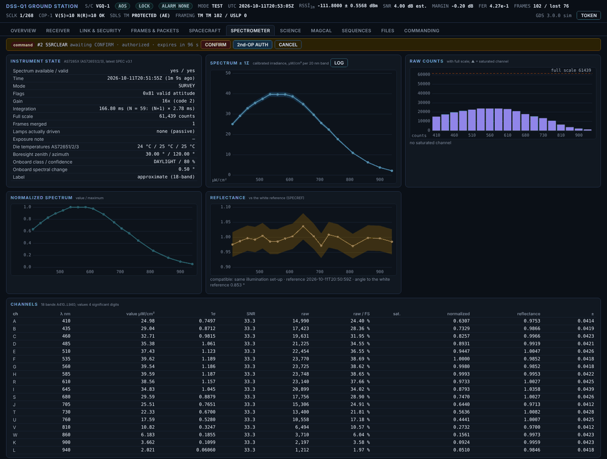

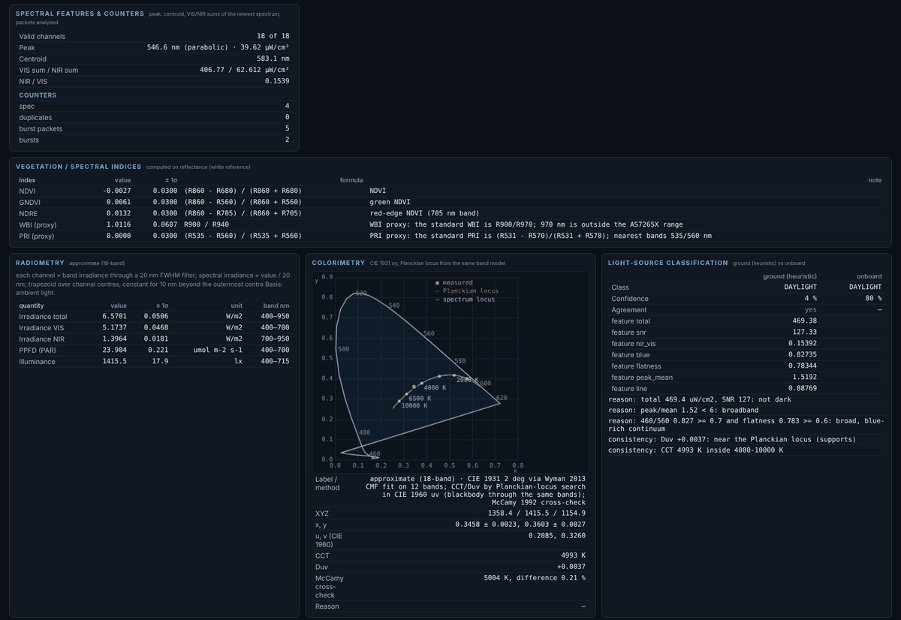

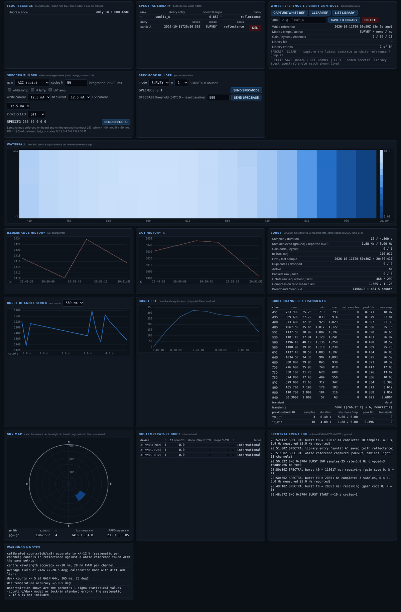

Worked examples below use the E22 simulator run (`spectral.t` of a SURVEY spectrum of
simulated daylight, gain 16x, N = 59).

### 8.1 Instrument state

| Row | Key | Meaning; formula |
|---|---|---|
| Spectrum available / valid | `spectral.available`, `spectral.valid` | a SPEC packet has been analysed; its "valid" flag (b0). Not valid: no derived values |
| Time | `spectral.t` | SCET of the packet (ERT before the time correlation exists) |
| Mode | `spectral.mode`, `spectral.mode_name` | SURVEY, HDR (n exposures merged), LOCKIN or FLUOR (n lamp on-off pairs; "active, on-off" = lamp-on minus lamp-off), BURST (time series in SPECBURST, no spectrum) |
| Flags | `spectral.flags` (`raw`, `valid`, `agc`, `active`, `saturated`, `attitude`, `lamp_bits`, `lamps`) | SPEC flags b0 valid, b1..b3 white / IR / UV lamp lit, b4 AGC, b5 active (on-off), b6 saturated, b7 attitude valid |
| Gain | `spectral.exposure.gain_code`, `spectral.exposure.gain_x` | 0..3 = 1x, 3.7x, 16x, 64x (datasheet Figure 29); "AGC" when the flight chose it |
| Integration | `spectral.exposure.integration_ms`, `spectral.exposure.int_cycles` | (N + 1) x 2.78 ms (Figure 30): N = 59 gives 166.80 ms |
| Full scale | `spectral.exposure.full_scale` | min(65535, 1024 (N + 1) - 1) counts: 61439 at N = 59 |
| Frames merged | `spectral.exposure.n_frames` | exposures merged (HDR) or on-off pairs (LOCKIN, FLUOR); 1 in SURVEY |
| Lamps actually driven | `spectral.flags.lamps`, `spectral.exposure.led_ma` | lamps lit and their LED_DRV current (12.5 / 25 / 50 / 100 mA); "none (passive)" |
| Exposure note | `spectral.exposure.note` | HDR: gain and N are the bracket centre, not necessarily an exposure taken |
| Die temperatures | `spectral.temperature_c` | AS72651 (NIR) / AS72652 (VIS) / AS72653 (UV), whole °C, ±8.5 °C accuracy |
| Boresight zenith / azimuth | `spectral.boresight.zenith_deg`, `spectral.boresight.azimuth_deg` | instrument pointing from the attitude (zenith from the local vertical; azimuth from north, 0..360°) |
| Onboard class / confidence, spectral change | `spectral.onboard.class`, `spectral.onboard.class_id`, `spectral.onboard.confidence`, `spectral.onboard.change_deg` | the spacecraft's own classification and the spectral angle to its slowly adapting baseline (the onboard spectral-event trigger, `SPECBASE` threshold) |
| Label | `spectral.label` | "approximate (18-band)" |

Example: SURVEY, flags 0x81 (valid, attitude), gain 16x (code 2), 166.80 ms, full scale
61439, 1 frame, passive, dies 24 / 25 / 25 °C, boresight 30.00° / 120.00°, onboard DAYLIGHT
80 %, change 0.50°.

### 8.2 Spectrum, raw counts, normalized spectrum, channels table

| Column (Channels table) or chart | Key | Unit, display | Formula; how to read it |
|---|---|---|---|
| ch, λ nm | `spectral.wavelength_nm` | A410, B435, C460, D485, E510, F535, G560, H585, R610, I645, S680, J705, T730, U760, V810, W860, K900, L940 | channel letter (ams naming) and centre wavelength |
| value µW/cm² (Spectrum chart, LOG / LINEAR button) | `spectral.spectrum` | 4 significant digits | the chip's calibrated output, sent as a 16-bit logarithmic code (step 0.0677 %, floor 1e-4 µW/cm²) and decoded exactly |
| 1σ (shaded band) | `spectral.uncertainty` | µW/cm² | the packet's 1σ statistical uncertainty (counting / dark model, or the lock-in standard error) |
| SNR | `spectral.snr` | 1 decimal | value / 1σ |
| raw, raw / FS (Raw counts chart, full-scale line) | `spectral.raw`, `spectral.raw_fraction` | counts; fraction | ADC counts and counts / full scale ("—" in HDR, where each channel comes from its own exposure). Aim for 0.1-0.8 of full scale: below, the noise dominates; near 1, saturation |
| sat. (▲ in the charts) | `spectral.saturated` | SAT in red | the channel reached full scale (SPEC `sat_mask`); its value is a lower bound, and indices using it are marked "[saturated band]": lower the gain or N (`SPECCFG`) or use HDR |
| normalized (Normalized chart) | `spectral.normalized` | 4 decimals | value / largest value: the shape of the spectrum independent of brightness |
| reflectance, ± | `spectral.reflectance.values`, `spectral.reflectance.uncertainty` | 4 decimals | see 8.3 |

Example: G560 (the peak) 40.07 ± 1.203 µW/cm², SNR 33.3, raw 24042 = 0.3913 of 61439;
L940 2.021 µW/cm², raw 1212 (0.0197 of full scale: a weak channel).

### 8.3 Reflectance, white reference and library controls

Reflectance needs a **white reference**: point the instrument at a white diffuse target
under the same light and press CAPTURE WHITE REF (ground directive `SPECREF`; `SPECREF
CLEAR` drops it). The reference keeps the newest valid spectrum's positive, unsaturated
channels (at least 12 needed) and its set-up, and is saved in
`<archive>/spec_white_ref.json` (`[spectral] white_ref_file`).

| Item | Key | Meaning; formula |
|---|---|---|
| Reflectance R_i | `spectral.reflectance.values` | R_i = S_i / W_i (spectrum over reference); channels where the reference is below 3σ give none |
| ± 1σ | `spectral.reflectance.uncertainty` | √((σ_S / W)² + (S σ_W / W²)²) |
| compatible / reason | `spectral.reflectance.compatible`, `spectral.reflectance.reason` | the same illumination is required: same active flag, same lamps, FLUOR only against FLUOR. Otherwise no reflectance and the indices fall back to the raw spectrum |
| reference time | `spectral.reflectance.ref_t` | when the reference was taken |
| angle to the white reference | `spectral.white_ref_angle_deg` | spectral angle between this spectrum and the reference: 0° = the same shape (you are still looking at the white target) |
| White reference panel | `spectral.white_ref` (`t`, `mode`, `mode_name`, `lamps`, `active`, `gain_code`, `int_cycles`, `n_channels`, `spectrum`) | the stored reference; "none: point the instrument at the white target and CAPTURE" |
| Library file / entries | `spectral_library.file`, `spectral_library.entries`, `spectral_library.max_entries` | the library (up to 64 entries, `<archive>/spec_library.json`) |

**Spectral angle** (used for the library, the white reference and on board): the angle
between two spectra as vectors over the channels both have (at least 6), negatives clipped
to 0: θ = 2 atan2(\|u - v\|, \|u + v\|) with u, v the unit vectors; 0° = identical shape,
whatever the brightness.

### 8.4 Spectral features and counters

| Row | Key | Formula |
|---|---|---|
| Valid channels | `spectral.features.n_valid` | channels with a value (of 18) |
| Peak | `spectral.features.peak_nm`, `spectral.features.peak_value` | the largest channel, refined by the vertex of the parabola through it and its two neighbours |
| Centroid | `spectral.features.centroid_nm` | Σ λ_i v_i / Σ v_i (negatives clipped to 0) |
| VIS sum / NIR sum, NIR / VIS | `spectral.features.vis_sum`, `spectral.features.nir_sum`, `spectral.features.nir_vis` | channel sums 410-705 nm and 730-940 nm, and their ratio |
| counters | `spectral.counters.spec`, `spectral.counters.duplicates`, `spectral.counters.burst_packets`, `spectral.counters.bursts` | SPEC packets analysed; playback copies of packets already received (same partition and SCLK, dropped); SPECBURST packets; bursts |

Example: peak 564.2 nm (40.07 µW/cm²), centroid 583.0 nm, VIS 406.83, NIR 62.261 µW/cm²,
NIR / VIS = 0.1530.

### 8.5 Vegetation and spectral indices

Computed on the reflectance when a compatible white reference exists (basis
"reflectance"), else on the raw spectrum (basis "spectrum": then they describe the light,
not a surface, and the panel says so). Not computed in FLUOR mode. Key
`spectral.indices.<index>` with `value`, `sigma` (first-order propagation), `formula`,
`bands_nm`, `note`, `saturated`; `spectral.indices.basis` and `spectral.indices.label`.

| Index | Key | Formula | Note |
|---|---|---|---|
| NDVI | `spectral.indices.ndvi` | (R860 - R680) / (R860 + R680) | Rouse 1974; vegetation about +0.3..+0.9, bare soil about 0..+0.2, water negative (textbook ranges, valid on reflectance only) |
| GNDVI | `spectral.indices.gndvi` | (R860 - R560) / (R860 + R560) | Gitelson 1996 |
| NDRE | `spectral.indices.ndre` | (R860 - R705) / (R860 + R705) | Barnes 2000, red-edge band 705 nm |
| WBI (proxy) | `spectral.indices.wbi_proxy` | R900 / R940 | the standard WBI is R900 / R970; 970 nm is outside the AS7265X range |
| PRI (proxy) | `spectral.indices.pri_proxy` | (R535 - R560) / (R535 + R560) | the standard PRI uses 531 / 570 nm |

σ of a normalised difference (a - b) / (a + b): 2 √((b σ_a)² + (a σ_b)²) / (a + b)²; of a
ratio a / b: √((σ_a / b)² + (a σ_b / b²)²). Example (raw spectrum, no reference): NDVI =
(6.2292 - 29.5711) / (6.2292 + 29.5711) = -0.6520 ± 0.0122: daylight has little light at
860 nm compared with 680 nm, which says nothing about a surface.

### 8.6 Radiometry

Key `spectral.radiometry.<quantity>` with `value`, `sigma`, `unit`, `band_nm`; plus
`spectral.radiometry.label`, `spectral.radiometry.assumption` and `spectral.radiometry.basis`
("ambient light" or "active illumination (lamp-on minus lamp-off)"). Each quantity is a
weighted sum Σ w_i v_i of the channel values (the trapezoid weights of the stated
assumption, with 1 µW/cm² = 0.01 W/m²), σ = √(Σ (w_i σ_i)²).

| Quantity | Key | Band | Unit | Weight function |
|---|---|---|---|---|
| Irradiance total | `spectral.radiometry.irradiance_total` | 400-950 nm | W/m² | 1 |
| Irradiance VIS | `spectral.radiometry.irradiance_vis` | 400-700 nm | W/m² | 1 |
| Irradiance NIR | `spectral.radiometry.irradiance_nir` | 700-950 nm | W/m² | 1 |
| PPFD (PAR) | `spectral.radiometry.ppfd` | 400-700 nm | µmol m⁻² s⁻¹ | photon flux: λ / (h c N_A) |
| Illuminance | `spectral.radiometry.illuminance` | 400-715 nm | lx | 683 lm/W x ȳ(λ) (CIE photopic, Wyman 2013 fit) |

Example: total 6.5636 ± 0.0506 W/m², VIS 5.1687, NIR 1.3949 W/m², PPFD 23.873 ± 0.221
µmol m⁻² s⁻¹, illuminance 1412.9 ± 17.9 lx (a dull daylight scene; full sun is about
100,000 lx, so judge outdoor readings with the ±12 % calibration and the 18-band
approximation in mind).

### 8.7 Colorimetry

Built from the 12 visible channels (410-705 nm) with the CIE 1931 2° colour-matching
functions in the Wyman, Sloan and Shirley (2013) analytic fit. Key `spectral.colorimetry`.

| Row | Keys | Formula |
|---|---|---|
| XYZ | `spectral.colorimetry.X`, `.Y`, `.Z` (full paths `spectral.colorimetry.Y` etc.) | weighted sums with 683 x̄, ȳ, z̄; Y is the illuminance in lx |
| x, y | `spectral.colorimetry.x`, `spectral.colorimetry.y`, `spectral.colorimetry.x_sigma`, `spectral.colorimetry.y_sigma` | x = X / (X + Y + Z), y = Y / (X + Y + Z), first-order 1σ; plotted on the CIE xy chart with the Planckian locus |
| u, v (CIE 1960) | `spectral.colorimetry.u`, `spectral.colorimetry.v` | u = 4X / (X + 15Y + 3Z), v = 6Y / (X + 15Y + 3Z) |
| CCT | `spectral.colorimetry.cct_k`, `spectral.colorimetry.cct_valid` | correlated colour temperature: the blackbody (computed through the same 18-band model) nearest in (u, v), found on a 2-mired grid and refined by golden-section search, 1000-25000 K; amber when \|Duv\| > 0.05 (CIE: not meaningful) |
| Duv | `spectral.colorimetry.duv` | signed distance to the locus in (u, v), positive above it (greenish) |
| McCamy cross-check | `spectral.colorimetry.cct_mccamy_k`, `spectral.colorimetry.mccamy_in_range`, `spectral.colorimetry.cct_mccamy_diff_pct` | n = (x - 0.3320) / (0.1858 - y), CCT = 449 n³ + 3525 n² + 6823.3 n + 5520.33 K (valid about 2000-12500 K) and its difference from the search in % |
| Label / method / reason | `spectral.colorimetry.label`, `spectral.colorimetry.method`, `spectral.colorimetry.available`, `spectral.colorimetry.reason` | why a value is missing |

Example: x = 0.3447 ± 0.0023, y = 0.3611 ± 0.0027, CCT 5036 K, Duv +0.0046, McCamy 5046 K
(+0.19 %): a daylight-like source just above the locus.

### 8.8 Light-source classification

A **heuristic**, explainable decision chain, the same thresholds as the spacecraft's
(`ClassThresholds`, overridable in `[spectral.classifier]`). Key
`spectral.classification` (`class`, `class_id`, `confidence`, `features`, `reasons`,
`consistency`, `onboard`, `agrees`, `label`).

| Step | Feature (key under `spectral.classification.features`) | Rule |
|---|---|---|
| 0 | active flag | lamp-on minus lamp-off spectrum: OWN LAMP |
| 1 | `total` (Σ channels, µW/cm²), `snr` (total / √Σσ²) | total < 0.5 or SNR < 5: DARK |
| 2 | `peak_mean` (largest / mean channel) | >= 6: NARROWBAND (one dominant band) |
| 3 | `nir_vis` | < 0.15: no NIR (LED or discharge lamp); then `line` = min(435/460, 610/645) >= 1.5: FLUORESCENT (Hg 436 / Eu 611 nm lines), else WHITE LED |
| 4 | `nir_vis`, `blue` (460/560) | NIR / VIS >= 0.70 and blue < 0.70: INCANDESCENT/HALOGEN |
| 5 | `blue`, `flatness` (geometric / arithmetic mean of the channels) | blue >= 0.70 and flatness >= 0.60: DAYLIGHT; otherwise UNKNOWN |

**Confidence** = 100 x min(m / ln 2, 1), m = the smallest \|ln(feature / threshold)\| on the
decision path: 100 % when every feature on the path is at least a factor 2 from its
threshold, near 0 when one is right at it. **Consistency** notes (ground only) check the
colorimetry: thermal sources and daylight should lie within \|Duv\| <= 0.01 of the locus,
with CCT 2000-3600 K (incandescent) or 4000-10000 K (daylight). **Agreement** compares with
the onboard class (`agrees`; a change of agreement logs an event, source SPECTRAL).
Example: DAYLIGHT, ground confidence 3 % (NIR / VIS 0.153 is only 2 % above the 0.15
threshold) against onboard 80 %; agrees; Duv +0.0046 and 5036 K support it. A low
confidence is a statement about the margin, not about the class being wrong.

### 8.9 Fluorescence

Only in FLUOR mode (UV lamp excitation, lamp-on minus lamp-off). Channels at or below 460 nm
are the excitation band and are masked. Key `spectral.fluorescence` (`label`, `masked`,
`excitation_max_nm`, `f680_f730` and `blue_green_index` each with `value`, `sigma`, `note`;
`emission_total`, `emission_peak_nm`).

| Metric | Formula | Meaning (heuristic proxies) |
|---|---|---|
| F680 / F730 | channel 680 / channel 730 | red / far-red chlorophyll-fluorescence ratio (emission peaks near 685 and 740 nm) |
| blue-green index | (F485 + F510) / (F680 + F730) | cf. F440 / F690 of UV-induced fluorescence (440 nm is inside the masked band here) |
| emission total, peak | Σ and the largest unmasked channel | how much light the sample re-emits |

### 8.10 Spectral library

`SPECLIB SAVE <name>` stores the newest spectrum (normalized) and, with a compatible white
reference, its reflectance; `SPECLIB DEL <name>`; `SPECLIB LIST`. Names: 1-32 of A-Z a-z 0-9
_ . - starting alphanumeric. Every new spectrum is matched against all entries by spectral
angle (on reflectance when both have it, else on the spectrum; FLUOR masks the excitation
band). Key `spectral.library_match` (`best`, `ranked`: the 3 best with `name`, `angle_deg`,
`basis`). An angle below a few degrees means a very similar shape; what counts as a match
depends on your samples (heuristic: build the library from known samples under the same
light).

### 8.11 Builders: SPECCFG and SPECMODE

The builders offer only legal values, so the spacecraft cannot refuse them for their
arguments:

* **SPECCFG** gain (1x, 3.7x, 16x, 64x or AGC), integration N (1-255, integration shown in
  ms), lamps (white, IR, UV), lamp currents limited to the lamp ratings (white up to code 3
  = 100 mA, IR up to code 2 = 50 mA, UV code 0 = 12.5 mA only; `led_limits.max_code`,
  `led_limits.allowed_led_cur` from `/api/science`, enforced on board too), indicator LED.
  The preview shows the command text, for example `SPECCFG 255 59 0 0 0`.
* **SPECMODE** mode and n within the per-mode range: SURVEY (n unused), HDR 2-4 exposures,
  LOCKIN and FLUOR 1-16 on-off pairs, BURST 1-60 s. **SPECBASE** sets the onboard
  spectral-event threshold in 0.01° (0 = only reset the baseline).

### 8.12 History, waterfall, illuminance and CCT history

Key `spectral_history` (the last 300 valid spectra, `max_rows`): `t`, `sclk`, `mode`,
`class_id`, `lux`, `cct_k` and `values` (each spectrum to 5 significant digits) in time
order, plus `wavelength_nm`. The waterfall shows log irradiance per channel, newest at the
top; the two charts show `spectral_history.lux` and `spectral_history.cct_k` against
`spectral_history.t`. Example: illuminance 1419.1, 1423.3, 1412.9 lx and CCT 5035, 5066,
5036 K for the three simulated spectra.

### 8.13 Burst

`SPECMODE BURST <s>` makes the spacecraft sample all 18 channels as fast as the bus allows
(about 5.56 ms integration per bank) for n seconds and send them in SPECBURST packets (up to
3 samples each, raw or CCSDS 121.0-B-3 Rice-compressed when shorter). Key `spectral_burst`
(`null` before the first burst).

| Row | Key | Meaning; formula |
|---|---|---|
| Samples / duration | `spectral_burst.n_samples`, `spectral_burst.duration_s` | distinct samples (by their ms offset); last - first offset |
| Rate achieved / reported | `spectral_burst.rate_hz_measured`, `spectral_burst.rate_hz_reported` | (n - 1) / duration on the ground; the flight's own figure |
| Gain code / cycles, t0 | `spectral_burst.gain_code`, `spectral_burst.int_cycles`, `spectral_burst.t0_ms` | exposure of the burst; spacecraft ms time of the first sample (the burst's identity) |
| First / last sample | `spectral_burst.t_first`, `spectral_burst.t_last` | ground time of the first and last packet |
| Duplicates / dropped | `spectral_burst.duplicates`, `spectral_burst.dropped` | playback copies; malformed or beyond 8192 samples |
| Active | `spectral_burst.active` | packets still arriving (a burst closes after 30 s without one) |
| Packets raw / Rice, octets, compression ratio | `spectral_burst.compression` (`packets_raw`, `packets_rice`, `octets_raw`, `octets_sent`, `ratio_mean`, `last_ratio`) | ratio = raw octets (36 per sample) / octets sent |
| Broadband mean ± σ | `spectral_burst.broadband` (`mean`, `std`, `channels_nm`) | sum of the channels present in every sample |
| Burst channel series (channel selector) | `spectral_burst.series` (`t_s`, `raw`, `decimation`) | raw counts per channel, decimated to about 300 points |
| Burst FFT | `spectral_burst.fft` (`magnitude`, `df_hz`, `fs_hz`, `nyquist_hz`, `n`, `n_fft`, `peak_hz`, `peak_amplitude`, `window`) | one-sided amplitude spectrum of the broadband series (mean removed, Hann window, resampled to a uniform rate, up to 2048 samples, zero-padded): a flickering lamp shows a peak (mains lighting at twice the mains frequency, if below the Nyquist limit fs / 2) |
| Channels table | `spectral_burst.channels[]` (`nm`, `present`, `mean`, `std`, `min`, `max`, `saturated_samples`, `peak_hz`, `peak_amplitude`) | per-channel statistics and dominant frequency |
| Transients | `spectral_burst.transients` (list of `t_ms`, `duration_ms`, `sign`, `peak_z`, `peak_value`, `n`) | runs of samples with a robust z-score (median, 1.4826 MAD) beyond 6 (heuristic) |
| Previous bursts | `spectral_burst.previous[]` (`t0_ms`, `n_samples`, `duration_s`, `rate_hz_measured`, `rate_hz_reported`, `peak_hz`, `transients`, `t_first`, `t_last`) | the last 5 completed bursts |

### 8.14 Sky map, die-temperature drift, events and notes

* **Sky map** (`spectral_skymap`: `bins[]` with `zen_lo`, `zen_hi`, `az_lo`, `az_hi`, `n`,
  `lux_mean`, `lux_std`, `ppfd_mean`, `ppfd_std`; `n_total`, `zen_step_deg` 15,
  `az_step_deg` 30): mean illuminance per boresight direction bin, from passive (SURVEY,
  HDR) spectra with a valid attitude. Example: one bin, zenith 30-45°, azimuth 120-150°,
  n = 3, 1418.4 ± 4.3 lx.
* **Die-temperature drift** (`spectral.temperature_drift[]`: `device`, `name`, `n`,
  `temp_span_c`, `slope_uw_per_c`, `slope_pct_per_c`, `r`, `label` "informational"): per
  die, the least-squares slope of its six-channel passive signal against its die
  temperature, shown once there are 10 points over at least 2 °C. Informational only:
  changes of the scene light are confounded with it.
* **Spectral event log** (`spectral.events`, the last 50): the spacecraft's spectrometer EVRs
  0x0701-0x0707 (spectral event, light-source change, SPECDIAG line, burst start / end,
  recovery, identification, driver state) and the ground's SPECTRAL events (white
  reference, library, burst complete, class agreement).
* **Warnings & notes** (`spectral.warnings`, `spectral.notes`): saturated channels,
  out-of-range values ignored, an invalid packet; the datasheet notes quoted above.
* `spectral.directives` lists the SPECREF and SPECLIB syntax for the page.

---

## 9 SCIENCE tab

**What it is for.** The other instruments: the three magnetometers (two RM3100 on the boom,
the BMM150 inside the Nicla Sense ME), the attitude from the Nicla's BHI260AP fusion and
from the independent TRIAD solution, and the environment sensors. Values are the newest
real-time MAG (APID 0x020), ATT (0x021) and ENV (0x023) packets on VC1: keys
`tlm.MAG.values.<field>`, `tlm.ATT.values.<field>`, `tlm.ENV.values.<field>` (field tables:
[05_Telemetry_and_Command_Dictionary.md](05_Telemetry_and_Command_Dictionary.md)). Default
cadence ([1.3](#13-how-often-things-change)): MAG 30 s (CRUISE) / 4 s (ENCOUNTER, TEST),
ATT 60 / 8 s, ENV 120 / 30 s; off in SAFE.

```
+---------------------------------------------------------------+-----------------------------+
| Magnetometers: outboard / inboard / body, gradient, dual-     | Attitude: fusion vs TRIAD   |
| sensor separation, sampling, flags, boom radii                | Environment                 |
+---------------------------------------------------------------+-----------------------------+
```

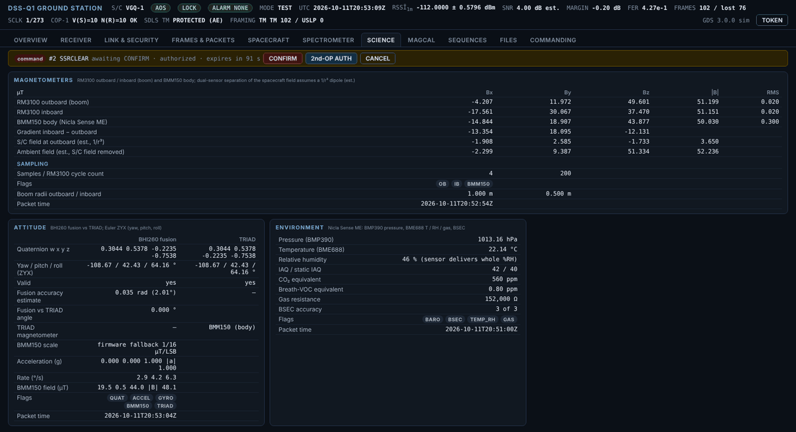

### 9.1 Magnetometers

The MAG vectors are the **mean** of `nsamples` 1 Hz readings over the MAG period, in µT
(raw: no calibration is applied to the MAG packet, even with an onboard MAGCAL active).

| Row | Keys | Formula; meaning |
|---|---|---|
| RM3100 outboard (boom) | `tlm.MAG.values.ob_b_x`, `ob_b_y`, `ob_b_z`, `ob_rms` | the science magnetometer at the boom tip; \|B\| = √(Bx² + By² + Bz²); RMS = fluctuation of the readings within the interval |
| RM3100 inboard | `ib_b_x`, `ib_b_y`, `ib_b_z`, `ib_rms` | the optional second unit at the boom mid-point ("—" when absent) |
| BMM150 body | `body_b_x`, `body_b_y`, `body_b_z`, `body_rms` | the Nicla Sense ME's magnetometer inside the bus |
| Gradient inboard - outboard | - | ΔB = B_ib - B_ob per axis |
| S/C field at outboard (est., 1/r³) | `cfg.r_outboard_m`, `cfg.r_inboard_m` | assuming the spacecraft's own field is a dipole falling as 1/r³: with k = (r_ob / r_ib)³, B_sc,ob = (B_ib - B_ob) / (k - 1) |
| Ambient field (est.) | - | B_amb = B_ob - B_sc,ob: the field with the spacecraft's contribution removed |
| Samples / RM3100 cycle count | `nsamples`, `rm3100_cc` | readings averaged; RM3100 cycle count (`MAGCC`: sensitivity versus rate) |
| Flags | `flags` (`decoded.mag_flags`) | PA_KEYED and LAMP (amber): a reading was taken while the transmitter was keyed or a spectrometer lamp was lit, so the spacecraft's own currents may bias it; OB, IB, BMM150 valid; CAL onboard calibration active |
| Boom radii | `cfg.r_outboard_m`, `cfg.r_inboard_m` | `[science]` configuration (defaults 1.0 m and 0.5 m) |

**Worked example** (E22 sim): outboard (-33.483, -34.185, 6.254) µT, \|B\| = 48.258 µT;
inboard (-43.288, -18.040, -4.534) µT. k = (1.0 / 0.5)³ = 8; gradient (-9.805, 16.145,
-10.788) µT; spacecraft field at the outboard sensor = gradient / 7 = (-1.401, 2.306, -1.541)
µT, magnitude 3.108 µT; ambient field (-32.082, -36.491, 7.795) µT, \|B\| = 49.210 µT. On
hardware this separation is an estimate (est.): it assumes one dipole source and exact boom
radii; verify the magnetic cleanliness ([03_Hardware_Integration.md](03_Hardware_Integration.md)).

### 9.2 Attitude

| Row | Keys | Meaning |
|---|---|---|
| Quaternion w x y z (as sent) | `tlm.ATT.values.q_fus_w` ... `q_fus_z`; `q_triad_w` ... `q_triad_z` | BHI260AP fusion quaternion (device -> ENU, Android convention) and the TRIAD quaternion (NED -> body), Q14 scaling |
| Yaw / pitch / roll (body -> NED, ZYX) | - | both converted on the page to body -> NED (fusion: left-multiplied by the ENU -> NED rotation; TRIAD: conjugated), then Euler ZYX angles in degrees. The fusion world frame is a VERIFY item (T-SC-09) |
| Valid | `flags` b0 QUAT, b4 TRIAD | |
| Fusion accuracy estimate | `q_fus_acc` | rad (and degrees), the BHI260AP's own estimate |
| Fusion vs TRIAD angle | - | 2 acos(\|q1 · q2\|): the rotation between the two solutions; a few degrees is normal, tens of degrees mean one of them is wrong (magnetic disturbance, an uncalibrated boom magnetometer, the gravity vector during motion) |
| TRIAD magnetometer | `flags` b6 TRIAD_RM3100, HK `magcal_state` | which field TRIAD used: the boom RM3100 (amber "UNCALIBRATED: no MAGCAL loaded" when no calibration is active) or the BMM150 |
| BMM150 scale | `flags` b5 MAG_SCALE | read from the BHI260AP, or the firmware fallback 1/16 µT per LSB |
| Acceleration, rate, BMM150 field | `acc_x` ... (g), `gyro_x` ... (°/s), `mag_x` ... (µT) | with \|a\| and \|B\|; TRIAD needs \|a\| between 0.9 and 1.1 g (at rest) |

Example (E22 sim): fusion yaw / pitch / roll 118.76 / 55.90 / -39.84°, TRIAD 118.75 /
55.90 / -39.85°, angle between them 0.007° (the simulator makes them agree), fusion accuracy
0.035 rad (2.01°).

### 9.3 Environment

| Row | Key (`tlm.ENV.values.`) | Unit | Meaning |
|---|---|---|---|
| Pressure (BMP390) | `p` | hPa, 2 decimals | flags b0 |
| Temperature (BME688) | `t` | °C | the same sensor as HK `bus_temp` |
| Relative humidity | `rh` | % (whole %RH from the sensor) | |
| IAQ / static IAQ, CO₂ equivalent, breath-VOC equivalent, BSEC accuracy | `iaq`, `iaq_s`, `co2eq`, `bvoc`, `accuracy` | index, ppm, ppm, 0..3 | Bosch BSEC outputs, valid when flags b1 (BSEC) is set; accuracy 3 = fully calibrated |
| Gas resistance | `gas` | Ω | BME688 heater-plate resistance |
| Flags | `flags` | | BARO, BSEC, TEMP_RH, GAS valid |

Example (E22 sim): 1013.12 hPa, 22.11 °C, 46 %RH, IAQ 42 / 40, 560 ppm CO₂eq, 0.80 ppm
bVOC, 152000 Ω, accuracy 3 of 3.

---

## 10 MAGCAL tab

**What it is for.** Calibrating a boom RM3100 magnetometer on the ground from a rotation of
the spacecraft (hard-iron offset b and symmetric soft-iron matrix M, B_cal = M (B_raw - b)),
then uplinking the result with `MAGCAL`. The flight applies it to the TRIAD attitude only;
the MAG packets stay raw. Procedure: [07_Operations_Procedures.md](07_Operations_Procedures.md)
(it starts with `PKTRATE MAG 1`).

```
+------------------------------------------+------------------------------------------+
| Unit 0 - outboard RM3100                 | Unit 1 - inboard RM3100                  |
| START STOP RESET FIT UPLINK CLEAR ONBOARD| (same)                                   |
| collection, coverage, fit, command       |                                          |
+------------------------------------------+------------------------------------------+
| Onboard calibration and BIST                                                        |
+-------------------------------------------------------------------------------------+
```

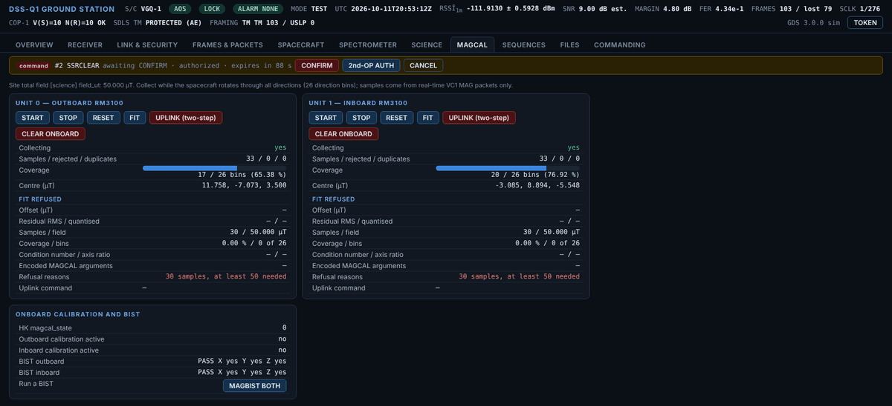

**The note line** shows `magcal.field_ut`, the site's total field from `[science] field_ut`
(the WMM value for your location and date; "NOT SET" refuses every fit), and the rules: only
real-time VC1 MAG packets with `nsamples` = 1 are collected (an averaged vector of a rotating
spacecraft lies inside the ellipsoid and biases the fit), so command `PKTRATE MAG 1` first.

| Row | Key (`magcal.units.<unit>.`) | Meaning |
|---|---|---|
| Collecting | `collecting` | START / STOP (POST `/api/magcal`) |
| Samples / rejected / duplicates | `coverage.n`, `coverage.rejected`, `coverage.duplicates` | stored vectors; invalid (outside ±800 µT) or buffer full (20000); closer than 1 µT to the previous one (the spacecraft did not move) |
| Averaged MAG packets skipped | `averaged_skipped` | packets with nsamples > 1 (amber: send `PKTRATE MAG 1`) |
| Coverage | `coverage.coverage`, `coverage.bins_hit`, `coverage.bins`, `coverage.centre_ut` | fraction of 26 direction bins (cube faces, edges, corners) hit by the directions from a quick sphere-fit centre; the fit needs >= 50 % (13 of 26) |
| fit accepted / REFUSED | `fit.ok`, `fit.reasons` | |
| Offset (µT) | `fit.offset_ut` | hard-iron offset b |
| Soft-iron M rows | `fit.matrix` | symmetric matrix M = R sqrtm(Q / k) of the fitted ellipsoid, R = `field_ut` |
| Residual RMS / quantised | `fit.residual_rms_ut`, `fit.residual_rms_quantised_ut` | RMS of \|B_cal\| - R, with the exact and with the MAGCAL-encoded coefficients; must be <= 5 % of R |
| Samples / field | `fit.n`, `fit.field_ut` | at least 50 samples |
| Coverage / bins | `fit.coverage`, `fit.bins_hit`, `fit.bins` | of the calibrated directions |
| Condition number / axis ratio | `fit.condition`, `fit.axis_ratio` | normal-matrix condition number <= 1000 (a planar or conical rotation fails: full sphere about 15, hemisphere about 200); longest / shortest semi-axis <= 4 |
| Encoded MAGCAL arguments | `fit.encoded` | offsets in 0.01 µT (\|value\| <= 30000), M in Q2.14 (diagonal 8192..32767 = 0.5..2.0, \|off-diagonal\| <= 8192) |
| Uplink command | `command` | the `MAGCAL <unit> ...` text UPLINK queues after a two-step confirmation; CLEAR ONBOARD sends identity and zero offsets |
| (snapshot) | `fit` (also `fit.bins`) | `null` before a FIT |

**Onboard calibration and BIST** (`magcal.onboard`: `state`, `ob_active`, `ib_active`;
`magcal.bist`: `available`, `ob`, `ib` with `tested`, `pass`, `x`, `y`, `z`): HK
`magcal_state` and `mag_bist` ([7.3](#73-housekeeping-hk-all-43-fields)); the MAGBIST BOTH
button runs the RM3100 self-test.

**How to read a fit.** Accept only "fit accepted"; a residual of a few tenths of a µT at
R = 50 µT (under 1 %) with coverage above 80 % is a good rotation. Refusals name the cause:
too few samples, ill-conditioned (rotate through more orientations), coverage, residual
(a moving field source or a changing ambient field during the rotation), or coefficients
outside the MAGCAL ranges. The ground thresholds are engineering choices of this ground
segment ([magcal.py](../dssq-groundstation/python/dssq/magcal.py)), not datasheet values.

---

## 11 SEQUENCES tab

**What it is for.** Writing, checking and uplinking a stored command sequence: up to 32
time-tagged commands the spacecraft executes by itself (`SEQLOAD` per entry, then
`SEQCTRL START`). The table is RAM only on board: empty after every reboot.

```
+-------------------------------------------------------------------------------------+
| Sequence editor: text, first slot, CHECK, UPLINK (two-step), SEQCTRL START / STOP /  |
| CLEAR ALL, DELETE SLOT, result line                                                 |
+-------------------------------------------------------------------------------------+
| Checked entries: slot, line, time, kind, t, command, arguments, stored command hex   |
+-------------------------------------------------------------------------------------+
| Onboard sequence                                                                    |
+-------------------------------------------------------------------------------------+
```

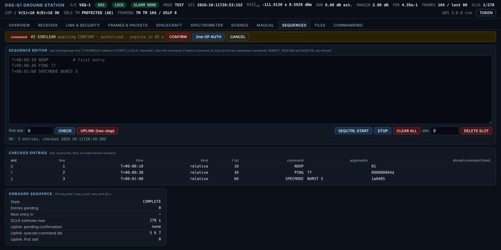

**File format.** One command per line: `T+HH:MM:SS <command>` (relative to `SEQCTRL
START`, up to 7 days) or `SCLK <seconds> <command>` (absolute spacecraft clock, within 7 days
of the SCLK estimate); `#` starts a comment. Commands that can never be stored are refused:
hazardous commands, `REBOOT`, `SEQLOAD`, `SEQCTRL`; a stored command is at most 12 octets
(opcode + arguments). Ground directives cannot be stored.

| Item | Key | Meaning |
|---|---|---|
| CHECK result line | `sequence.file.error` (`line_no`, `message`), `sequence.file.entries`, `sequence.file.checked_t` | "OK: n entries, checked <time>" or "ERROR line n: <message>"; nothing is uplinked |
| Checked entries | `sequence.file.entries[]` (`slot`, `line_no`, `time_text`, `relative`, `t_s`, `mnemonic`, `args`, `cmd_hex`) | each entry as it will be stored: slot, source line, time (relative or absolute SCLK), the command, its arguments and the stored octets in hex |
| (snapshot) | `sequence.file.first_slot`, `sequence.file.text_lines`, `sequence.file.name` | |
| State, entries pending, next entry in | `sequence.onboard.state`, `sequence.onboard.state_name`, `sequence.onboard.count`, `sequence.onboard.next_dt_s` | HK `seq_state`, `seq_count`, `seq_next_dt_s` ([7.3](#73-housekeeping-hk-all-43-fields)) |
| SCLK estimate now | `sequence.sclk_estimate_s` | the spacecraft clock now (newest SCLK + time since its ERT): the reference for absolute times |
| Uplink: pending confirmation, queued ids, first slot | `sequence.uplink.pending_confirm_id`, `sequence.uplink.queued_ids`, `sequence.uplink.first_slot` | UPLINK asks for ONE confirmation for the whole batch, then queues every SEQLOAD in file order through COP-1; `SEQCTRL START` stays a separate command |

Example (E22 sim): no sequence; state IDLE/EMPTY, 0 entries, next entry "—", SCLK estimate
1224 s. After a check of "T+00:00:10 NOOP", the entries table shows slot 0, relative,
t = 10 s, NOOP and its stored octets.

---

## 12 FILES tab

**What it is for.** Everything the station stores: files the spacecraft sent with CFDP,
the per-pass Tracking Data Messages, the XTCE mission database, the receiver data logger
(the 1 Hz `rx_stats` series and the raw CADU archive with their retention and free-space
guard) and the CSV export of any time range. Look at it after a file transfer, after a
pass (TDM), when the free space runs low, and when you need numbers for a report.

```
+-------------------------------------------------------------------------------------+
| CFDP transactions (max KiB, CFDPPUT SSR / EVRLOG / CADU, CFDPCANCEL)                |
+-----------------------------+-----------------------------+-----------------------------+
| Receiver counters and       | Received files              | Tracking Data Messages      |
|  onboard state (+ TDM)      |  (<archive>/files)          |  (WRITE TDM NOW, XTCE)      |
+-----------------------------+-----------------------------+-----------------------------+
| Receiver data logger        | CSV export (range, products, EXPORT, file list)           |
+-----------------------------+-----------------------------------------------------------+
```

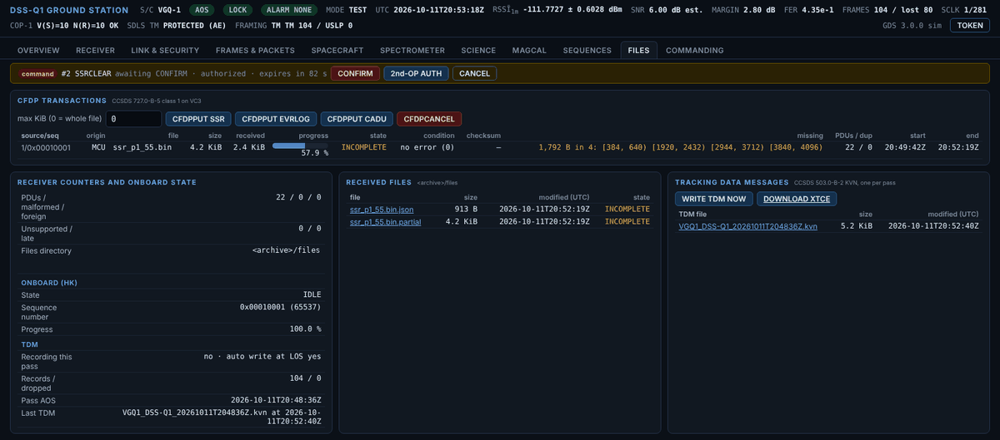

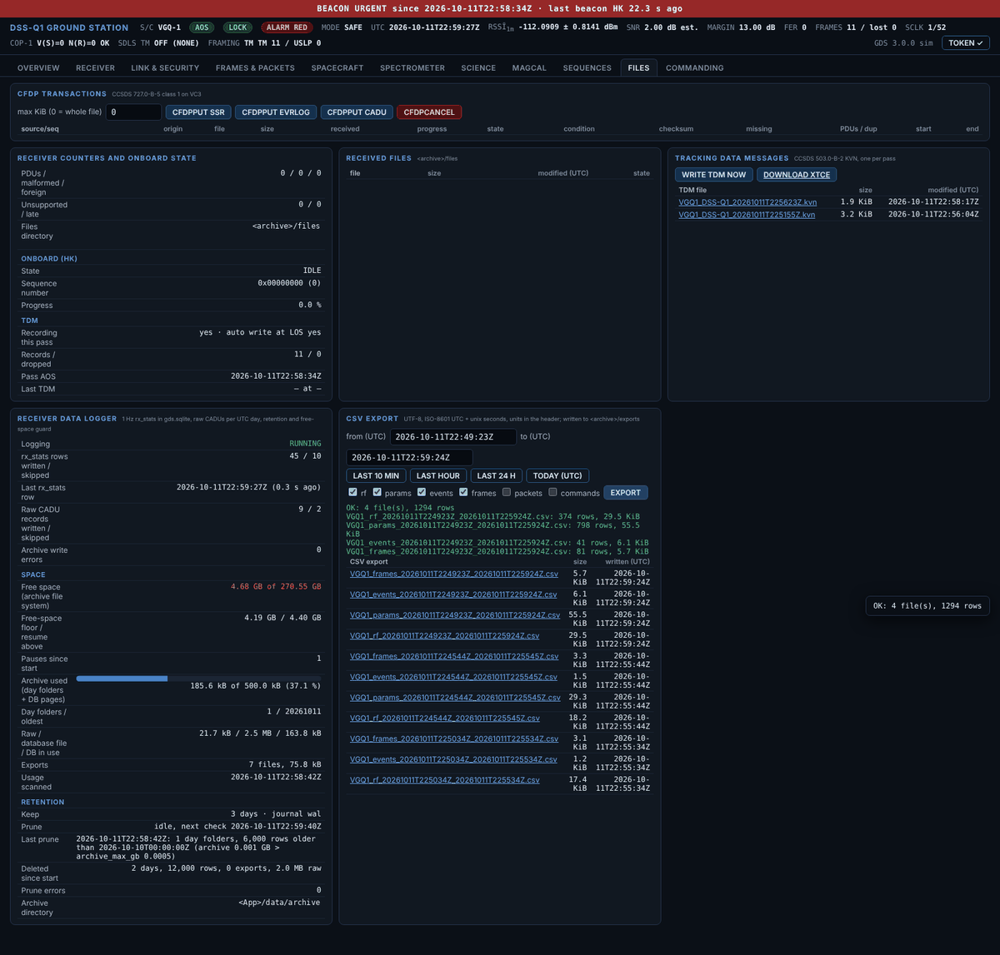

### 12.1 CFDP transactions

CCSDS 727.0-B-5 class 1 (unacknowledged) file delivery on VC3. The buttons send `CFDPPUT
<source> <max_kib>`: SSR (0, the recorder contents as one file), EVRLOG (1, the EGSE event
log) or CADU (2, the latest EGSE CADU archive), `max_kib` 0 = whole file; CFDPCANCEL ends
the transfer in progress. Key `cfdp` (`ccsds.cfdp.Receiver.snapshot()`): open transactions
first, then finished ones, newest first.

| Column | Key (`cfdp.transactions[].`) | Meaning |
|---|---|---|
| source/seq | `source`, `seq` | CFDP entity id of the sender (1 = VGQ-1) and transaction sequence number (hex; EGSE-relayed transactions have bit 31 set) |
| origin, file, size, received | `origin`, `name`, `size`, `received` | who built the file, its name, its size from the Metadata PDU and the octets received |
| progress | `progress` | 100 x received / size, 1 decimal |
| state | `state`, `reason` | RECEIVING; COMPLETE (every octet and the modular checksum match: `<archive>/files/<name>`); INCOMPLETE (EOF with gaps: `<name>.partial`, gaps zero-filled, + `<name>.json`; late File Data within the check time can still complete it); CHECKSUM_FAILURE; CANCELLED (EOF with a non-zero condition, 15 = cancel request); ABANDONED (no PDU for the inactivity time, or the file exceeds `[cfdp] max_file_mib`). The tooltip gives the reason |
| condition | `condition`, `condition_name` | the EOF condition code (0 no error, 8 inactivity detected, 15 cancel request received, ...) |
| checksum | `checksum_ok` | the 32-bit modular checksum (sum of the file's 4-octet words) matched |
| missing | `missing`, `missing_ranges`, `missing_octets` | gaps as [start, end) octet offsets (up to 16 listed) |
| PDUs / dup | `pdus`, `duplicates` | PDUs received; repeated PDUs ignored |
| start, end | `t_start`, `t_end` | first PDU, final state |
| (snapshot) | `path` | the file written (complete, `.partial` or `.json`) |

An existing file is never overwritten: a taken name gets the transaction id inserted.
Example: the screenshot's transaction `ssr_p1_55.bin` ended INCOMPLETE with its missing
ranges listed, because frames were lost during the transfer; a second `CFDPPUT 0` after the
pass is the remedy (class 1 has no retransmission).

### 12.2 Receiver counters, onboard state and TDM summary

| Row | Key | Meaning |
|---|---|---|
| PDUs / malformed / foreign | `cfdp.counters.pdus`, `cfdp.counters.malformed`, `cfdp.counters.foreign` | PDUs received; refused as malformed; from another entity |
| Unsupported / late | `cfdp.counters.unsupported`, `cfdp.counters.late` | PDU types class 1 does not use; File Data for a finished transaction |
| Files directory | `cfdp.files_dir` | `<archive>/files` (`[cfdp] files_dir`) |
| onboard state, sequence number, progress | `cfdp.onboard.state`, `cfdp.onboard.state_name`, `cfdp.onboard.seq`, `cfdp.onboard.progress_pct` | the spacecraft's sender from HK ([7.3](#73-housekeeping-hk-all-43-fields)) |
| TDM recording this pass / auto write | `tdm.enabled`, `tdm.auto_write` | the TDM recorder runs when the archive is enabled; `[tdm] auto_write` writes the pass file at LOS |
| Records / dropped | `tdm.records`, `tdm.dropped` | tracking records of the current pass (one per received frame, up to 100,000) |
| Pass AOS | `tdm.aos_t` | start of the current or last pass |
| Last TDM | `tdm.last_file`, `tdm.last_write_t` | the newest file written and when |

### 12.3 Received files

`GET /api/files` (refreshed every 5 s while the tab is open): `<archive>/files`, newest
first, each with name (a download link), size (KiB / MiB), modification time and state
(COMPLETE for a complete file; INCOMPLETE, CHECKSUM_FAILURE, CANCELLED or ABANDONED for a
`.partial` and its `.json` report).

### 12.4 Tracking Data Messages and XTCE

**TDM**: one CCSDS 503.0-B-2 Tracking Data Message (KVN text) per pass,
`<archive>/tdm/VGQ1_*.kvn`, written at LOS (`[tdm] auto_write`) or by WRITE TDM NOW (ground
directive `TDM WRITE`; rewrites the same file). It records, per received frame (time tag =
UTC at the end of reception): `CARRIER_POWER` (calibrated RSSI, dBW), and with the SX126x
also `PC_N0` (SNR + 10 log10(noise bandwidth), dB-Hz) and `RECEIVE_FREQ_1` (channel
frequency + AFC correction + measured residual); `DOPPLER_INSTANTANEOUS` (range rate, km/s)
only once `[radio] freq_offset_calibrated` is true. E22 TDMs carry CARRIER_POWER only.
`tdm.files` lists the newest 20 (`name`, `size`, `mtime`); `GET /api/tdm` lists them for the
page. Records whose station time lies outside the years 2000-2100 are refused
(`health.tdm_rejected`: check the station clock). Format details:
[18_Data_Products.md](18_Data_Products.md).

**XTCE**: DOWNLOAD XTCE (`GET /api/xtce`) returns the mission database (every packet,
parameter and command of the dictionary) as XTCE XML (`vgq1.xtce.xml`) for other ground
software.

### 12.5 Receiver data logger

The data logger ([datalog.py](../dssq-groundstation/python/dssq/datalog.py)) writes one
`rx_stats` row per second into `<archive>/gds.sqlite` and every received CADU into
`<archive>/<YYYYMMDD>/cadu.bin`, keeps the archive within its age and size limits and
pauses the two growing raw products when the disk runs low. Key `logger`
(`DataLogger.health()`); sizes are SI (1 kB = 1000 octets), as in `station.toml`. With
`--no-archive` the panel says "archive disabled".

| Row | Key | Meaning; normal; if abnormal |
|---|---|---|
| Logging | `logger.enabled`, `logger.paused`, `logger.paused_since` | RUNNING, or PAUSED since <time> (red): the free space fell below the floor; raw CADUs and rx_stats rows stop (frames, packets, parameters, events and commands keep recording), YELLOW alarm "archive logging paused ...", resumes by itself above floor x 1.05 |
| rx_stats rows written / skipped | `logger.rx_rows`, `logger.rx_rows_skipped` | rows written since start (one per second); rows not written (paused or failed) |
| Last rx_stats row | `logger.last_row_t`, `logger.row_age_s` | should be under 2 s old while running |
| Raw CADU records written / skipped | `logger.cadu_records`, `logger.cadu_skipped` | one per received CADU |
| Archive write errors | `logger.write_errors` | failed writes (disk full, I/O error): reception and commanding continue, the recording is incomplete (YELLOW for 60 s after each, WARN event at most once a minute) |
| Free space | `logger.free_bytes`, `logger.total_bytes`, `logger.free_t`, `logger.free_error` | of the archive's file system (read every 5 s); amber below twice the resume level |
| Free-space floor / resume above | `logger.min_free_bytes`, `logger.resume_free_bytes` | `[gds] archive_min_free_mb` (default 2048 MB, 0 = guard off) and floor x 1.05 |
| Pauses since start | `logger.pauses` | |
| Archive used | `logger.used_bytes`, `logger.max_bytes` | day folders + database pages in use, against `[gds] archive_max_gb` (default 16 GB, a bar) |
| Day folders / oldest | `logger.days`, `logger.oldest_day` | YYYYMMDD folders kept |
| Raw / database file / DB in use | `logger.raw_bytes`, `logger.db_file_bytes`, `logger.db_used_bytes` | the database file does not shrink while running (freed pages take the new rows) |
| Exports | `logger.exports`, `logger.exports_bytes` | files in `<archive>/exports` (newest 200 kept) |
| Usage scanned | `logger.usage_t` | |
| Keep / journal | `logger.keep_days`, `logger.journal_mode` | `[gds] archive_keep_days` (default 180, null = no age limit); SQLite journal mode (WAL) |
| Prune | `logger.prune_running`, `logger.prune_cutoff_t`, `logger.next_prune_check_t` | retention check every 60 s: day folders whose whole UTC day ended more than keep_days ago and rows older than that; over the size cap, the oldest day; never today, never a future-dated folder |
| Last prune, deleted since start | `logger.last_prune`, `logger.totals` (`days_deleted`, `rows_deleted`, `exports_deleted`, `bytes_freed`) | each completed prune is also an INFO event (source ARCHIVE) |
| Prune errors | `logger.prune_errors` | |
| Archive directory | `logger.archive_dir` | App Lab: `<App>/data/archive` |

The `rx_stats` row (columns `t`, `los`, `pass_no`, `n_rx`, `rssi_dbm`, `snr_db`, `snr_est_db`,
`noise_dbm`, `margin_db`, `freq_err_hz`, `fer_10m`, `rs_symbols`, `cb_uncorrectable`,
`frames_ok`, `frames_lost`, `afc_hz`, `doppler_hz`, `range_rate_m_s`;
`ReceiverStats.interval_row()`): the means of the RSSI, measured SNR and frequency error
over the second, the newest noise reading (if it belongs to the pass), SNR est. and margin
from them, the 10-minute FER, and **increments** of the counters (receptions, RS symbols,
uncorrectable codeblocks, frames OK and lost) so that the rows of a range sum to its totals;
AFC, Doppler and range rate for the SX126x. Example (E22 sim): 1147 rows, 344 CADU
records, 0 errors, free 13.2 GB of 270.6 GB, floor 2.0 GB / resume 2.2 GB, used 491.0 kB of
16.00 GB, 1 day folder, keep 180 days, journal wal.

### 12.6 CSV export

Pick a range (from / to, ISO 8601 UTC or UNIX seconds; LAST 10 MIN, LAST HOUR, LAST 24 H,
TODAY (UTC)), tick the products and press EXPORT (`POST /api/export`, or the command line
`python -m dssq.export`). One file per product,
`VGQ1_<product>_<from>_<to>.csv` in `<archive>/exports`, listed under the button
(`GET /api/exports`). UTF-8, RFC 4180, a header row whose names carry the unit in brackets,
every row starting with `utc [ISO-8601]` and `unix_time [s]`; an empty field is a value the
station did not have.

| Product | Content |
|---|---|
| rf | the `rx_stats` rows: los, pass, receptions, rssi, snr, snr_est, noise_floor, link_margin, freq_err, fer_10m, rs_symbols_corrected, codeblocks_uncorrectable, frames_ok, frames_lost, afc_correction, doppler, range_rate |
| params | every decoded telemetry parameter with its unit and limit state |
| events | the event log |
| frames, packets, commands | frame and packet records, the command history |

One export runs at a time (BUSY otherwise); an export is refused while logging is paused for
lack of space. Columns and loading in Python or a spreadsheet:
[18_Data_Products.md](18_Data_Products.md).

---

## 13 COMMANDING tab

**What it is for.** Sending commands and following them to execution: the entry line with
live dictionary help, pending confirmations, the command history, the console, the event
log, the GDS health, the station I/O MCU and the full dictionary. Every POST needs the
commanding token ([1.2](#12-opening-the-dashboard)).

```
+-------------------------------------------------------------------------------------+
| Command entry (hint line, result line)                                              |
| Pending confirmations                                                               |
| Command history                                                                     |
+-----------------------------+-----------------------------+-----------------------------+
| Console                     | Event log                   | GDS health                  |
| Station I/O                 |                             |                             |
+-----------------------------+-----------------------------+-----------------------------+
| Dictionary (filter)                                                                 |
+-------------------------------------------------------------------------------------+
```

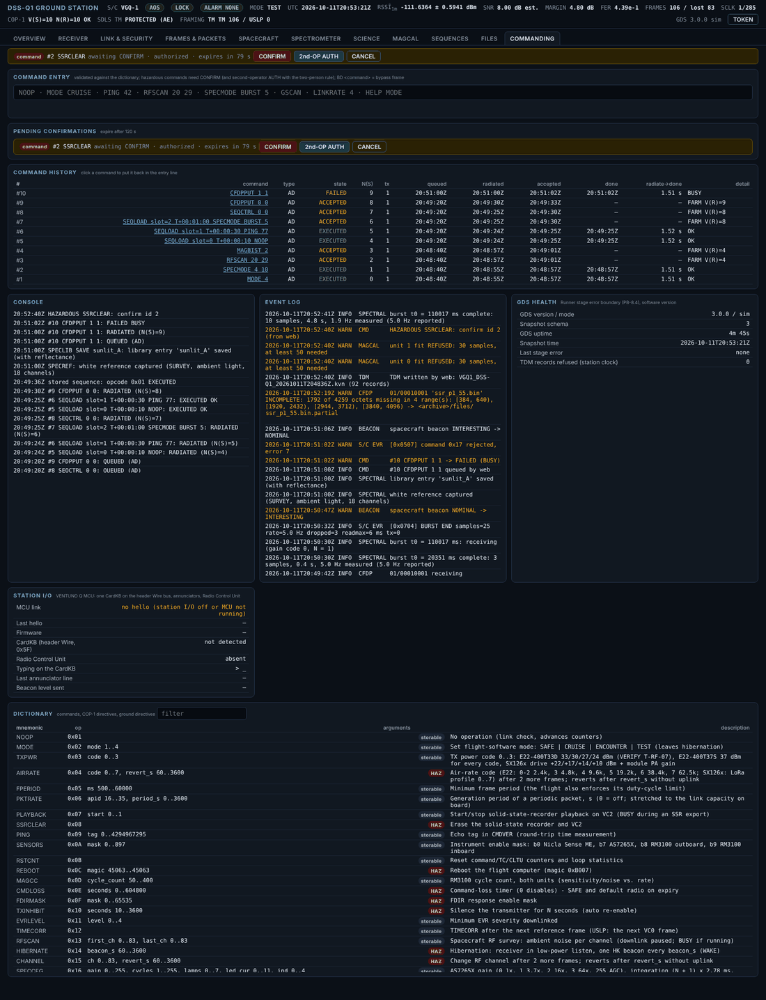

### 13.1 Command entry

Type a command (`MODE CRUISE`, `PING 42`, `RFSCAN 20 29`), a COP-1 directive (`UNLOCK`,
`SETVR <n>`), a ground directive (`GSCAN`, `WAKE`, `LINKRATE`, `LINKCHAN`, `LINKMGR`,
`RADIO`, `SPECREF`, `SPECLIB`, `TDM`, `AFC`, `SDLS`) or `HELP [mnemonic]`; prefix `BD ` to
send a command in a bypass (BD) frame. The hint line shows the arguments, their ranges and
enumerations, the cross-argument rule, whether the command is hazardous and whether it may
be stored in a sequence. `POST /api/cmd` returns the result shown under the line:

| Result | Meaning |
|---|---|
| QUEUED (#id) | accepted into the COP-1 queue |
| CONFIRM (id) | a hazardous command or directive waits for CONFIRM (and 2nd-operator AUTH with `[commanding] require_two_person_for_hazardous`) ([13.2](#132-pending-confirmations)) |
| REJECTED: <reason> | refused before queuing: unknown mnemonic, argument out of range, cross-argument rule, a channel outside `[radio] allowed_channels`, a frame longer than 64 octets with the configured framing and SDLS, or "TC uplink BLOCKED" |
| HELP | the dictionary help, also in the console |
| OK / QUEUED (ground directive) | a ground directive was carried out or scheduled for the radio thread's next quiet window |

### 13.2 Pending confirmations

Key `pending_confirm[]` (`id`, `text`, `kind`, `confirmed`, `authorized`, `t`,
`expires_s`); also the strip under the tabs on every tab. Kinds: command (hazardous),
directive (LINKRATE / LINKCHAN: changes both ends), sdls (SDLS RESETREPLAY), sequence (a
sequence upload), magcal (a MAGCAL upload or clear). CONFIRM (`POST /api/confirm` role
CONFIRM, or an empty Enter on the CardKB), 2nd-OP AUTH (role AUTH, web only, with the
`X-DSSQ-Auth` secret when `[commanding] auth_token` is set), CANCEL (`POST /api/cancel`).
A confirmation expires after 120 s (`expires_s` counts down; "confirmation n expired" in the
console). The station I/O MCU shows the newest one (Q line) so the CardKB can confirm it.

### 13.3 Command history

The last 12 command records (`cop.recent[]`, newest first in the table): `id`, `text` (click
to put it back in the entry line), `kind` (AD, BD, BC) + HAZ, `state`, `ns` (N(S) of the AD
frame), `tx` (transmissions), `t_queued`, `t_radiated`, `t_accepted`, `t_done`, `rtlt_s`
(radiate -> done) and `detail`; also `hazardous`.

| State | Meaning | Colour |
|---|---|---|
| QUEUED | waiting in the FOP queue (sent in the next uplink window after a received frame) | amber |
| RADIATED | sent; waiting for the CLCW | amber |
| ACCEPTED | the CLCW shows the FARM took the frame (N(R) passed it) | amber |
| EXECUTED | CMDVER EXECUTED arrived | green |
| FAILED | CMDVER FAILED (the detail names the error code) | red |
| TIMEOUT | no CMDVER within the verification timeout (`cop.verify_timeout_s`) | red |
| SUSPENDED | the FOP gave up after `[commanding] tx_limit` transmissions; the record was purged | red |

`rtlt_s` is the radiate-to-done time: one frame wait for the uplink window, the spacecraft's
execution and the wait for the frame that carries the CMDVER. For a `PING` it is the
round-trip time of the whole system. Example (E22 sim, CRUISE, 3.17 s frames): NOOP 5.11 s
(1 transmission), MODE 2 5.11 s (2 transmissions), PING 42 3.22 s, RFSCAN 20 29 3.22 s.

### 13.4 Console

Key `console` (the last 30 lines, each [t, text]): what happened to each command ("#4
RFSCAN 20 29: QUEUED (AD)", "RADIATED (N(S)=3)", "EXECUTED OK"), rejections, confirmations
requested and expired, HELP output, directive results and stored-sequence verifications.
Newest first on the page, time of day UTC.

### 13.5 Event log

The station event log, newest first: `events` (the last 80 of 400 kept; also archived);
[section 14](#14-health-events-and-logs).

### 13.6 Dictionary

Every command (mnemonic, opcode, arguments with ranges, badges HAZ / builder / storable,
description), the COP-1 directives (BC) and the ground directives (GDS), from
`GET /api/dictionary`, with a filter box. The generated reference is
[05_Telemetry_and_Command_Dictionary.md](05_Telemetry_and_Command_Dictionary.md).

### 13.7 GDS health panel

| Row | Key | Meaning |
|---|---|---|
| GDS version / mode | `version`, `mode` | software version (3.0.0) and run mode: `host` (systemd or a terminal), `applab` (the App Lab App), `sim` (software spacecraft) |
| Snapshot schema | `schema` | 3; a client written for another schema must not trust the keys |
| GDS uptime | `uptime_s` | time since the GDS started |
| Snapshot time | `utc` | the station clock |
| Stage errors: <stage> | `health.stage_errors` | failures per Runner stage (register, radio_read, ingest, packets, outbox, jobs, afc, tdm, housekeeping, console); each is caught, counted, logged at most once a minute (WARN, source GDS) and the loop continues; YELLOW alarm for 60 s after one |
| Last stage error | `health.last_error` (`stage`, `text`, `t`) | the newest failure; report it (with the log) |
| TDM records refused (station clock) | `health.tdm_rejected` | |
| (snapshot) | `health.archive_write_errors`, `health.archive_last_error` | as `logger.write_errors` with the last error text |

### 13.8 Station I/O panel

The VENTUNO Q MCU (the App's sketch, [06_Displays.md](06_Displays.md)) runs the CardKB
keyboard, the AOS / ALARM / UPLINK lamps, the buzzer and the Radio Control Unit. Key
`station_io`.

| Row | Key | Meaning |
|---|---|---|
| MCU link | `station_io.connected`, `station_io.connected_t` | CONNECTED when a hello (H line, every 5 s) arrived within 12 s; else "no hello (station I/O off or MCU not running)" |
| Firmware | `station_io.fw` | sketch version text ("DSSQ-IO 3.1", "DSSQ-IO 3.1 SX126x") |
| CardKB | `station_io.kb` | present at I2C address 0x5F on the header Wire bus |
| Radio Control Unit | `station_io.rcu` | the MCU drives the E22 M0 / M1 and reads AUX |
| Typing on the CardKB | `station_io.input` | the line being typed (K lines), shown as "> TEXT_" |
| Last annunciator line | `station_io.last_status_line` | the newest S line sent: `S\|aos\|alarm\|uplink\|beacon` |
| Beacon level sent | `station_io.beacon_sent` | its beacon field (-1 = unknown) |

---

## 14 Health, events and logs

**Event log** (`events[]`: `t`, `level` INFO / WARN / ERROR, `source`, `text`): one line
per noteworthy thing the station saw or did, newest first, coloured by level; written to the
archive and the process log as well. The OVERVIEW shows the newest 16, the COMMANDING tab
the newest 80. Sources:

| Source | Typical events |
|---|---|
| RX | AOS; LOS (WARN), "LOS (hibernating)" (INFO) |
| LIMITS | "HK.bus_temp = 61.2 YELLOW" / "... OK" ([7.2](#72-limits-and-how-they-are-checked)) |
| BEACON | "spacecraft beacon NOMINAL -> URGENT" |
| S/C EVR | every spacecraft EVR "[0x0012] MODE SAFE -> CRUISE ..." (playback copies marked) |
| CMD | queued, confirmations requested, EXECUTED / FAILED / TIMEOUT, stored-sequence verifications |
| FOP | retransmissions, lockout, suspension, derived timers |
| SDLS | TM rejects by verdict (at most every 10 s), key file problems, SN file events, epoch regression (ERROR), replay-window reset |
| RADIO | backend connected / lost, model mismatch, ground fault, register read-back |
| LINK | link manager recommendations and mode changes, coordinated rate / channel changes |
| AFC | AFC steps, sign checks, FAULT, RPC failures |
| DECODER, DECOM | RS uncorrectable codeblocks (once a minute), packets the dictionary could not decode, Rice failures |
| CFDP, TDM, SPECTRAL, MAGCAL | transfers, TDM files, white reference / library / burst, calibration collection and fits |
| ARCHIVE, EXPORT | logging paused / resumed, prunes, write errors; CSV exports |
| GDS, INTEROP | stage failures, start-up configuration notes; external TC frames |
| IDENT | station identification radiated (periodic / end); the placeholder-callsign warning at start ([5.9](#59-station-identification)) |

What to do for each event: [14_Troubleshooting_and_Event_Response.md](14_Troubleshooting_and_Event_Response.md).
**Health** (`health`): [13.7](#137-gds-health-panel). **Console**: [13.4](#134-console).
The process log (journal in host mode, the App Lab log otherwise) has the same events plus
tracebacks of stage failures.

---

## 15 Alarm logic

The station alarm (`alarm`: NONE, YELLOW, RED; `alarm_reasons`, RED reasons first;
`alarm_red_count`) is recomputed once a second by `GroundStation._compute_alarm()`. RED if
any RED reason holds, else YELLOW if any YELLOW reason holds, else NONE. It drives the
header pill, the OVERVIEW reasons list, the station ALARM lamp and buzzer
([06_Displays.md](06_Displays.md)) and `dssq_alarm_level` (0 / 1 / 2) on `/metrics`.

**RED reasons**

| Reason text | Condition |
|---|---|
| `<packet>.<field> RED limit` | a telemetry field at or beyond a red limit ([7.2](#72-limits-and-how-they-are-checked)) |
| `LOS` | no valid frame for longer than the LOS timeout after at least one pass, and the spacecraft is not (expected to be) hibernating |
| `LOS: no beacon for <n> s while hibernating` | hibernating, but no frame for more than 7200 s (two maximum beacon intervals) |
| `beacon URGENT` | HK `beacon_level` = 3 |
| `frequency offset > 80 % of FERR_L` | SX126x frequency-offset state ALARM ([4.2](#42-rf-now)) |
| `ground radio fault: <text>` | the station E22-400T37S reported abnormal status within the last 5 s |
| `radio backend unavailable: <reason>` | the GDS has no radio backend (serial port, Router Bridge) |
| `ground radio link down for <n> s` | the radio backend has been disconnected for more than 30 s |
| `TM epoch went backwards with a valid MAC: ...` | an authenticated TM frame with a lower SDLS epoch within the last 24 h (possible GCM nonce reuse, [5.2](#52-sdls)) |

**YELLOW reasons**

| Reason text | Condition |
|---|---|
| `<packet>.<field> YELLOW limit` | a field at or beyond a yellow limit |
| `beacon IMPORTANT` | HK `beacon_level` = 2 |
| `frequency offset > 50 % of FERR_L` | SX126x frequency-offset state WARN |
| `FDIR <names>` | any HK fault-protection flag except HIBERNATE and TX_INHIBIT ([7.5](#75-fault-protection-flags)) |
| `spacecraft reset cause BROWNOUT (check the radio supply)` | HK `reset_cause` = BROWNOUT |
| `<n> SDLS TM rejects in the last 60 s` | TM frames refused by SDLS recently ([5.3](#53-sdls-tm-rejections)) |
| `SDLS service mismatch suspected (spacecraft TM without AE header)` | 3 data frames in a row rejected as BAD_SPI / BAD_IV |
| `radio model mismatch: spacecraft <m>, station <n>` | RF `radio_model` differs from the station's model |
| `ground SX126x hardware mismatch: <detail>` | the station sketch was built for another chip or TCXO voltage |
| `AFC FAULT (frequency-error sign check failed twice): AFC RESET after checking` | [4.7](#47-afc) |
| `SDLS key file not found: <path>` / `SDLS key file unreadable: <error>` | a service other than NONE is configured but the key is missing |
| `TC uplink BLOCKED: <reason>` | the SDLS TC sequence number is blocked ([5.2](#52-sdls)) |
| `archive logging paused: free space <n> MB < [gds] archive_min_free_mb <m> MB (raw CADU, rx_stats)` | the free-space guard ([12.5](#125-receiver-data-logger)) |
| `archive write errors in the last 60 s (<error>)` | an archive write failed |
| `GDS stage errors in the last 60 s (health.stage_errors)` | a Runner stage failed ([13.7](#137-gds-health-panel)) |

Notes: there is no LOS alarm before the first pass of a GDS run, so a station waiting for
the spacecraft is not RED for that (a first start with a key but no SN file is YELLOW "TC uplink
BLOCKED" until the first HK made at least 120 s after the spacecraft's boot - an
SDLS-protected one when `[sdls] tm_service` is AE, [5.2](#52-sdls)). Limit states persist until the next packet of that type, so a
stale RED limit from the last HK of a pass stays until the next HK. A beacon of URGENT or
IMPORTANT appears twice (as the beacon reason and as the HK limit), which is intended.

---

## 16 Machine interfaces: /metrics and the JSON API

All endpoints are served by the GDS web server
([web.py](../dssq-groundstation/python/dssq/display/web.py)) on the dashboard's port.
GET needs no token; every POST needs `X-DSSQ-Token` (and AUTH also `X-DSSQ-Auth` when
configured). Request limits and the security headers: [17_Security_Model.md](17_Security_Model.md).

| Method, path | Returns |
|---|---|
| GET `/` | the dashboard page |
| GET `/api/state` | the snapshot (this document) |
| GET `/api/science` | `spectral`, `spectral_history`, `spectral_burst`, `spectral_skymap`, `spectral_library`, `cfg`, `led_limits` ([8](#8-spectrometer-tab)) |
| GET `/api/dictionary` | commands, directives, ground directives, packets and fields, enumerations, spectrometer constants |
| GET `/metrics` | Prometheus text format 0.0.4 (below) |
| GET `/api/xtce` | XTCE mission database (`vgq1.xtce.xml`) |
| GET `/api/files`, `/api/files/<name>` | received CFDP files (list, download) |
| GET `/api/tdm`, `/api/tdm/<name>` | TDM files |
| GET `/api/exports`, `/api/exports/<name>` | CSV exports |
| POST `/api/cmd` `{"text": "..."}` | a command, directive or HELP ([13.1](#131-command-entry)) |
| POST `/api/confirm` `{"id": n, "role": "CONFIRM"\|"AUTH"}` | confirmation or second-operator authorisation |
| POST `/api/cancel` `{"id": n}` | drops a pending confirmation |
| POST `/api/seq/check`, `/api/seq/uplink` `{"text": "...", "first_slot": n}` | sequence check / upload ([11](#11-sequences-tab)) |
| POST `/api/magcal` `{"action": "start"\|"stop"\|"reset"\|"fit"\|"uplink"\|"clear", "unit": 0\|1}` | MAGCAL ([10](#10-magcal-tab)) |
| POST `/api/tdm/write` `{}` | writes the current pass's TDM |
| POST `/api/export` `{"from": ..., "to": ..., "what": ["rf", ...]}` | CSV export ([12.6](#126-csv-export)) |

**/metrics.** Every scrape builds a fresh snapshot and exposes its numbers as gauges named
`dssq_<path>`, so a metric name follows the snapshot key (a renamed key renames its metric):

| Family | Source |
|---|---|
| `dssq_los`, `dssq_state_<key>` | `rx.state` (passes, pass_duration_s, since_last_frame_s, time_in_lock_pct, los_timeout_s, hibernating) |
| `dssq_rf_<key>` | every numeric scalar of `rx.rf` (e.g. `dssq_rf_rssi_dbm`, `dssq_rf_margin_est_db`, `dssq_rf_sensitivity_dbm`, `dssq_rf_noise_bw_hz`) |
| `dssq_rf_packet_<key>`, `dssq_rf_snr_db_<stat>`, `dssq_rf_freq_err_hz_<stat>`, `dssq_rf_doppler_<key>`, `dssq_rf_afc_<key>` | the nested `rx.rf` blocks |
| `dssq_decoder_<key>`, `dssq_decoder_sdls_rejected{verdict=...}` | `rx.decoder` |
| `dssq_frames_<key>`, `dssq_frames_by_format{format=...}`, `dssq_frames_vc_frames{vc=...}`, `dssq_frames_vc_lost{vc=...}` | `rx.frames` (e.g. `dssq_frames_fer`, `dssq_frames_lost`) |
| `dssq_budget_<key>`, `dssq_budget_uplink_<key>` | `rx.budget` |
| `dssq_beacon_level`, `dssq_alarm_level` (0 NONE, 1 YELLOW, 2 RED), `dssq_uptime_s` | top level |
| `dssq_sdls_<key>` | numeric `link.sdls` values |
| `dssq_cfdp_<counter>`, `dssq_cfdp_transactions` | `cfdp` |
| `dssq_stage_errors{stage=...}`, `dssq_tdm_rejected` | `health` |
| `dssq_logger_<key>` | numeric `logger` values (e.g. `dssq_logger_paused`, `dssq_logger_free_bytes`) |
| `dssq_apid_count`, `dssq_apid_lost`, `dssq_apid_iat_s`, `dssq_apid_age_s` `{packet=...}` | `apids` |
| `dssq_tlm{packet=...,param=...}` | every decoded field of the newest real-time packets (`tlm`) |

Booleans are exported as 0 / 1; text values and missing values produce no sample (a gap in
the series, never a fake number). The simulator snapshots expose 141 families (E22) and 179
(SX126x: AFC, Doppler and the SX126x fields). Example lines: `dssq_rf_rssi_dbm -113.0`,
`dssq_rf_margin_est_db 15.0`, `dssq_frames_fer 0.04178272980501393`,
`dssq_tlm{packet="HK",param="bus_temp"} 32.42`, `dssq_apid_count{packet="HK"} 23`.
Useful alert rules: `dssq_alarm_level >= 2`, `dssq_los == 1`, `dssq_rf_margin_est_db < 3`,
`dssq_logger_paused == 1`, `increase(dssq_decoder_uncorrectable[10m]) > 0`.

---

## 17 Reading the RECEIVER tab during a range test

A range test moves one end step by step away from the other and records, at every test
point, how strong the link is and how many frames survive. The record sheets are in
[21_Test_Records.md](21_Test_Records.md), the predictions in
[02_Link_Budget_and_RF_Analysis.md](02_Link_Budget_and_RF_Analysis.md).

**Before the test**

1. Set `[spacecraft] distance_km` to the first test distance (the link budget's design
   column, FSPL and "range at sensitivity" use it) and confirm the antennas and line losses
   in `station.toml`.
2. Check `rx.rf.rssi_cal_offset_db`: without the T-RF-02 calibration, absolute dBm values
   are uncalibrated; differences between test points are still valid. Write down which.
3. With the spacecraft silent (or before it is switched on) note the noise floor
   (`rx.rf.noise_dbm`) and run `GSCAN` to pick the quietest allowed channel. Record the
   quiet-site floor.
4. Choose the rate code. Start at the most sensitive (E22 code 2 = 2.4 kbit/s, SX126x
   profile 1); `LINKMGR ADVISE` lets the link manager comment without changing anything.
5. Confirm the data logger is RUNNING (FILES tab): the `rx_stats` rows are the permanent
   record of the test; note the UTC start time.

**At each test point**

1. Wait until AOS and at least 60 frames are in the 10-minute window
   (`rx.windows.10m.rssi.n`); at E22 2.4 kbit/s in CRUISE that is about 3 minutes, at SX126x
   profile 1 a frame comes every 43 s, so use the pass window and wait longer.
2. Record from the statistics table: RSSI 10-min mean ± SEM, σ, p10 and fade depth;
   noise mean; SNR (measured for the SX126x, est. for the E22). Use the means, never a
   single reading: one E22 reading has 1 dB steps and fading moves it by several dB.
3. Record the margins: the 10-minute p10 of RSSI minus the sensitivity (the robust margin
   the link manager uses, `linkmgr.recommendation.margin_p10_db`) and the last
   `rx.rf.margin_est_db`. For the SX126x also the SNR margin (`rx.rf.snr_margin_db`).
4. Record the losses: `rx.frames.fer_10m`, `rx.decoder.uncorrectable` and the RS
   corrections (mean of `rx.windows.10m.rs`), and for the SX126x the CRC failures and RS
   rescues.
5. Read the link budget: `rx.budget.excess_loss_db_est` (measured minus free-space loss)
   and `rx.budget.range_at_sensitivity_km_est` (where the link would end with the same
   excess loss).
6. SX126x: check `rx.rf.freq_offset_state` (OK) and the AFC state (TRACK or STATIC, not
   FAULT); note the Doppler only if the static offset is calibrated.

**Interpreting the numbers**

* Margin p10 above 6 dB with FER near 0: a solid point. The link manager suggests a faster
  rate only above target + 9 dB (15 dB with the default 6 dB target) and FER below 1 %.
* Margin p10 between 3 and 6 dB: marginal; expect occasional lost frames in fades.
* Margin p10 below 3 dB, FER above 10 %, RS corrections near 16 per codeblock, or
  uncorrectable codeblocks: the edge of the link at this rate. The last point where FER stays
  below 1 % is the usable range; the first point with no frames at all is the maximum.
* Excess loss: near 0 dB on a clear line of sight; 10-20 dB for partial obstruction or
  ground reflections; more than 20 dB (amber) usually means a station problem (cable,
  connector, pointing, polarisation) or no line of sight.
* Uplink: compare `rx.two_way.uplink_rssi` with the downlink RSSI; with equal powers they
  should agree within a few dB. A one-sided difference points at one receiver or one
  transmitter.
* Worked example (E22 simulator, d = 2 km, code 2): 10-min RSSI mean -111.9213 ± 0.2144
  dBm, p10 -116 dBm, noise -118.1 dBm; margin p10 = -116 - (-128) = 12 dB; FER 10 min
  4.30e-2; excess loss 67.4 dB, range at sensitivity 11.2 km (simulated channel: the
  excess loss is not physical).

**After the test**: export the `rf` product for the test window (FILES, CSV export) and
attach it to the test record; the same rows reproduce every number above.

---

## 18 Snapshot key index

Every top-level key of `/api/state` with its direct children and the section that explains
them. [tests/test_docs.py](../tests/test_docs.py) checks that each key appears in this
document.

| Key | Children | Section |
|---|---|---|
| `schema`, `version`, `utc`, `uptime_s`, `mode` | scalars | [13.7](#137-gds-health-panel), [2](#2-header-bar-and-beacon-banner) |
| `station`, `spacecraft` | text | [2](#2-header-bar-and-beacon-banner) |
| `alarm`, `alarm_reasons`, `alarm_red_count` | text, list, count | [15](#15-alarm-logic) |
| `beacon` | level, name, t, since, history, hibernating, hibernate_expected | [7.7](#77-beacon) |
| `rx` | now, state, rf, budget, windows, hist, decoder, frames, serial, uplink, two_way, series, events, radio_link | [4](#4-receiver-tab) |
| `rx.rf` | freq_mhz, freq_hz, model, air_rate_code, rate_label, air_rate_bps, rssi_dbm, rssi_raw_dbm, rssi_resolution_db, rssi_cal_offset_db, rssi_mw, noise_dbm, noise_source, noise_age_s, snr_est_db, pr_est_dbm, n0_est_dbm_hz, cn0_est_dbhz, cn0_source, ebn0_est_db, noise_bw_hz, noise_bw_source, sensitivity_dbm, sensitivity_source, margin_est_db, required_snr_db, snr_margin_db, freq_offset_limit_hz, freq_offset_abs_median_hz, freq_offset_state, crc_fail_packets, packet_error_rate, packet, snr_db, freq_err_hz, doppler, afc | [4.2](#42-rf-now) |
| `radio` | model ... frame_period_max_s_est (station radio, spacecraft radio, station hardware) | [4.6](#46-radio-configuration) |
| `link` | tm_framing_cfg, tm_framing_seen, tc_framing, sdls, ident, station_id | [5](#5-link--security-tab) |
| `sync` | state, asm_found, asm_bit_errors, slips, discarded_octets, cadus, noise_replies, flywheel_frames, lock_losses, radio_fault_reports | [4.9](#49-frame-synchronizer) |
| `vc` | RT-ENG, RT-SCI, PLAYBACK, FILE (CFDP), OID | [6.2](#62-virtual-channels) |
| `apids` | one entry per packet name | [6.3](#63-packets-by-apid) |
| `tlm` | HK, RF, CMDVER, TIMECORR, RFSCAN, MAG, ATT, SPEC, ENV, SPECBURST: the newest real-time packet of each type received (each apid, values, limits, units, ert, scet, sclk, seq, vcid) | [7](#7-spacecraft-tab), [9](#9-science-tab) |
| `decoded` | mode, fdir, sensors_ok, sensors_missing, reset_cause, farm_state, radio_fault, radio_model, framing, rate_label, air_rate_bps, sdls_tc_service, sdls_tm_service, sdls_tm_state, cfdp_state, seq_state, beacon, mag_bist, magcal, rf_flags, mag_flags | [7.8](#78-onboard-state-and-the-decoded-block) |
| `time` | partition, last_sclk, scet_of_last_sclk, corr_samples, drift_ppm, residual_rms_ms, owlt_s, timecorr_key, sclk_estimate_s | [5.8](#58-time-correlation) |
| `cop` | vs, nr, lockout, suspended, retransmit, queued, outstanding, pending_bypass, farm_b, t1_s, verify_timeout_s, uplink_blocked, build_errors, records, recent, tc_framing, sdls_service, sdls_sn, frame_limit | [5.5](#55-cop-1-fop), [13.3](#133-command-history) |
| `cfdp` | transactions, counters, files_dir, onboard | [12.1](#121-cfdp-transactions) |
| `tdm` | enabled, auto_write, records, dropped, aos_t, last_file, last_write_t, files | [12.4](#124-tracking-data-messages-and-xtce) |
| `sequence` | onboard, file, uplink, sclk_estimate_s | [11](#11-sequences-tab) |
| `magcal` | field_ut, units, onboard, bist | [10](#10-magcal-tab) |
| `health` | stage_errors, last_error, tdm_rejected, archive_write_errors, archive_last_error | [13.7](#137-gds-health-panel) |
| `logger` | enabled ... totals (36 values) | [12.5](#125-receiver-data-logger) |
| `linkmgr` | mode, model, target_margin_db, recommendation, holdoff_s, rate_limits | [4.16](#416-link-manager-and-pass-events) |
| `pending_confirm` | list of id, text, kind, confirmed, authorized, t, expires_s | [13.2](#132-pending-confirmations) |
| `evrs` | list of ert, scet, sclk, severity, event_id, text, vcid | [7.10](#710-spacecraft-evrs) |
| `events` | list of t, level, source, text | [14](#14-health-events-and-logs) |
| `anomalies` | list of t, param, value, mean, sigma, z | [7.11](#711-anomaly-detector) |
| `console` | list of [t, text] | [13.4](#134-console) |
| `station_io` | connected_t, fw, rcu, kb, input, last_status_line, beacon_sent, connected | [13.8](#138-station-io-panel) |
| `cmd_stages`, `cmd_errors`, `cmd_sources` | code -> name | [7.9](#79-other-packets-cmdver-timecorr-rfscan) |

`/api/science`: `spectral`, `spectral_history`, `spectral_burst`, `spectral_skymap`,
`spectral_library`, `cfg` (`r_outboard_m`, `r_inboard_m`, `field_ut`), `led_limits`
(`max_code`, `allowed_led_cur`) ([8](#8-spectrometer-tab), [9](#9-science-tab)).
