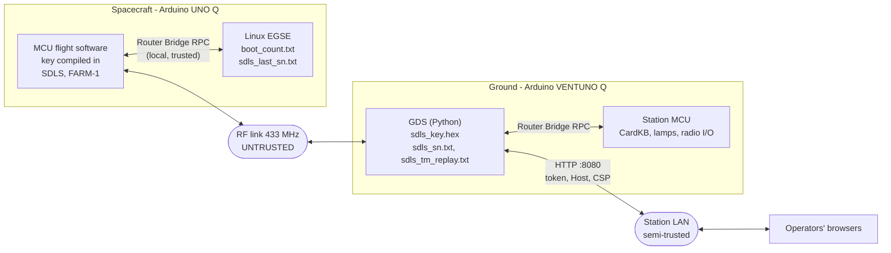

# 17 - Security Model and Recovery

Plain words first: the radio link is protected so that **only the holder of the key can command
the spacecraft**, and (in the default mode) **only the key holder can read its telemetry**. Every
frame carries a counter, so a recorded frame cannot be played back later. The ground station's web
page needs a token before it will send a command. The weak points are the ones every real system
has: the key files, a few counter files that must never go backwards, and the people and machines
that have access to them. This page lists what is protected, against whom, how, what the operator
must do (key generation, rotation, compromise, counter backups), and what risk remains.

Related: decisions D-28 to D-36, D-60 (watchdog), D-61 (station identification), D-62 (UDP
listener) and D-65 (TC counter re-synchronisation) in [12_Design_Decisions.md](12_Design_Decisions.md); protocol
layouts in [04_Space_Data_Link_ICD.md](04_Space_Data_Link_ICD.md); key handling during set-up in
[00_Beginner_Setup_Guide.md](00_Beginner_Setup_Guide.md); routine key operations in
[07_Operations_Procedures.md](07_Operations_Procedures.md); the regulatory rules for encryption in
[09_Regulatory_and_Safety.md](09_Regulatory_and_Safety.md).

---

## 1 Summary of the controls

| Layer | Control | Where |
|---|---|---|
| Uplink (TC) | SDLS AE (AES-256-GCM, SPI 2) or AUTH (HMAC-SHA-256-128, SPI 1); strictly increasing 32-bit sequence number; verified **before** COP-1 | flight `ccsds/sdls.*`, ground `dssq/ccsds/sdls.py` |
| Downlink (TM) | SDLS AE (SPI 3) with (epoch, sn) nonces; flagged null-SA fallback; ground anti-replay on (epoch, sn) | same |
| Nonce safety | epoch = EGSE boot counter, each value offered once; counter files atomic, never lowered, locked | EGSE `python/main.py`, ground `sdls.py` |
| Commanding | 8 hazardous commands need CONFIRM, optionally a second operator (AUTH); stored sequences refuse hazardous opcodes; risky radio changes revert by themselves; the unauthenticated UDP TC interface listens on loopback only | `dssq/dictionary.py`, `gds.py`, `config.py`, flight `autonomy.cpp` |
| Web UI | token for every POST, read-only without a token on a LAN bind, Host / Origin checks, hash-based CSP, text-only rendering, bounded server | `dssq/display/web.py`, `dashboard.html` |
| Secrets at rest | key files mode 0600, git-ignored, never packaged (packaging refuses) | `tools/gen_sdls_key.py`, `.gitignore`, `tools/package_apps.py` |
| Supply chain | Python standard library only at run time; bundled libraries pinned by tag commit and SHA-256; CI actions pinned by commit hash | [22_Bundled_Libraries.md](22_Bundled_Libraries.md), `.github/workflows/ci.yml` |
| Robustness | every RF input is untrusted (ranges checked, bounded parsers, FECF / RS / BCH before SDLS); crash-safe state files; a hung flight loop is reset by the hardware watchdog (IWDG, 40 s) | flight and ground parsers; flight `Flight::watchdog_start()` |
| Identification | both transmitters identify themselves in clear text, by design: the spacecraft in OID frames and EVR 0x0002, the ground station with `DE <callsign> <name>` packets on the uplink, which the spacecraft ignores | flight `config.h` `VGQ_CALLSIGN`, ground `gds.py` `StationIdent` |

---

## 2 Assets

| ID | Asset | Where it lives | Why it matters |
|---|---|---|---|
| A1 | SDLS master key (256 bit) | flight: `vgq1-spacecraft/sketch/src/sdls_key.h`, compiled into the MCU firmware; ground: `<App>/data/sdls_key.hex` under App Lab and in host mode (`--app-data`), unless `[sdls] key_file` is an absolute path; a stand-alone run (`--config`, for example on a PC) uses `[sdls] key_file` relative to its working directory | whoever holds it can command the spacecraft and read AE telemetry |
| A2 | Command authority | the station: web UI, CardKB, hardline tool `dssq.cltu`, the optional UDP TC interface | a wrong or malicious command can silence or damage the mission |
| A3 | Nonce and anti-replay counters | ground `<archive>/sdls_sn.txt` (+ `sdls_sn.txt.lock`), `<archive>/sdls_tm_replay.txt` - security state, not archive data: kept in `<archive_dir>` also with `--no-archive`. The software simulator (`--sim`, App Lab `DSSQ_SIM=1`, with or without an archive) always keeps its own in memory and never reads or writes these files (`gds.py` `GroundStation`, `keep_security_state`); EGSE `vgq1-spacecraft/data/boot_count.txt`, `vgq1-spacecraft/data/sdls_last_sn.txt` | losing or rolling back these breaks the AES-GCM rule "never reuse a nonce" or reopens the replay window (section 6) |
| A4 | Telemetry integrity and confidentiality | the RF link, the archive (`gds.sqlite`, `cadu.bin`), exports | wrong data leads to wrong decisions; AE keeps data private |
| A5 | Web commanding token, second-operator secret | `<App>/data/http_token` (mode 0600) or `[gds] http_token`; `[commanding] auth_token` | whoever holds the token can command through the web UI |
| A6 | Station and spacecraft software | the two App folders, the bundled libraries | tampered software defeats every other control |
| A7 | Lawful operation | callsign identification at both ends (`VGQ_CALLSIGN`, `[station] callsign`; both default to the placeholder `N0CALL`), power, encryption rules | amateur operation must stay identifiable and, normally, unencrypted |

---

## 3 Trust boundaries



* **Untrusted:** everything that arrives over RF, on both ends, even with SDLS on (OID frames are
  never protected, the null SA is accepted, and NONE is a valid service). Telemetry text (EVR texts,
  the OID identification text, file names) is always treated as untrusted text.
* **Semi-trusted:** the station LAN. Anyone on it can reach the dashboard; reading is allowed,
  commanding needs the token.
* **Trusted:** local accounts on both boards (they can read the key files and talk to the Router
  Bridge), the operators, the development machine that generates keys and builds the Apps.

---

## 4 Threats and mitigations

| ID | Threat | Mitigation | Evidence | Residual |
|---|---|---|---|---|
| T1 | Forged telecommand over RF | SDLS AE or AUTH on every TC frame; a frame that fails SDLS never reaches FARM-1, anti-replay or the dispatcher (so it cannot even cause a lockout); commands range-checked by `parse_user_data()` | `ccsds/sdls.h` processing order; `tests/test_sdls.py::test_tc_ae_tamper_and_replay` | none with AE / AUTH; total exposure with NONE |
| T2 | Replay of a recorded uplink frame | sequence number must be strictly greater than the last accepted one (shared by AUTH and AE) | `Sdls::process`; same test | see T3 |
| T3 | Replay right after a spacecraft reset (counter in RAM is 0) | authentic frames are refused until the EGSE restores the counter (`set_sdls_sn`), at most 120 s (`kSdlsSnWaitS`) | D-33; `config.h`; Phase C finding C17 | **if the EGSE is absent**, the window is open after 120 s |
| T4 | Forged telemetry to mislead the operator | AE tag check on every protected frame; a failing frame is dropped and counted, never decoded; (epoch, sn) anti-replay persisted across GDS restarts | D-30; `SdlsTmReceiver`; `test_flight_tm_frames_tamper`, `test_tm_replay_state_persisted_and_restored` | null-SA and OID frames are accepted but flagged UNPROTECTED (`[sdls] accept_null`) |
| T5 | Forged null-SA frame spliced into a protected packet | a change of SDLS status on a VC is a discontinuity; per-packet `protected` flag | D-34; `tests/test_packets.py::test_null_sa_frame_cannot_splice_into_an_ae_frame` | none known |
| T6 | Forged HK used to push the ground's TC counter (towards the 2^32 end) | a running counter is raised only by an HK whose every octet came from verified AE frames. A **held** counter (SN file missing or corrupt, section 7.6) is released by a protected HK, or by any HK when the station's TM service is NONE (no protected HK exists there), onto the **time floor** (4 numbers per second since 2026-01-01, `sn_time_floor()`), which does not depend on the reported value; only a report above the floor, or a station clock before 2026, gets `sdls_last_sn` + 1 000 000 instead; never above 4 227 858 432 (`SDLS_SN_RELEASE_MAX` = 2^32 - 2^26) | D-32, D-65; `test_unprotected_hk_never_moves_the_sn`, `test_spacecraft_sn_only_from_an_all_protected_hk`, `tests/test_sdls.py::test_a_replayed_or_forged_hk_cannot_cause_reuse`, `test_resync_fallbacks_and_limits` | at a TM NONE station a forged HK during a hold can report a number above the floor: the counter then jumps to it + 1 000 000 (only number space is lost; at least 2^26 - 1 numbers stay) or, above the maximum, the uplink stays held until a new key. The floor needs a correct station clock (R15) |
| T7 | AES-GCM nonce reuse (a counter lost, rolled back or used twice) | TM epoch issued once per value, persisted before use; TC counter written before use, never lowered, inter-process lock; a corrupt TC counter file, or a missing one for a key in use with TC AUTH or AE, holds the uplink instead of guessing and is released onto the time floor, above every number the key can have used (section 7.6); the station takes fewer than 3 TC numbers per second (uplink windows at most once per 1.4 s, `WAKE` at most once per 10 s, `dssq.cltu` never above the floor), so the floor stays ahead of them; ground RED alarm `tm_epoch_regressed` | D-30 to D-32, D-65; `tests/test_cfdp.py::test_epoch_nonce_safety_*`; `test_two_processes_never_share_a_sequence_number`; `tests/test_end_to_end.py::test_existing_key_without_sn_file_holds_and_resyncs_above_the_lost_tail`, `test_a_replayed_first_pass_hk_after_archive_loss_cannot_reuse`; `tests/test_station_id.py::test_sdls_numbers_stay_below_3_per_second_whatever_the_downlink_does` | **operator actions** on counter files (section 7); a station clock that is wrong at a release (R15) |
| T8 | Eavesdropping on telemetry | AE encrypts every VC0-VC3 frame | D-28 | OID text and null-SA frames are clear; AE is generally not allowed on amateur bands (then nothing is confidential) |
| T9 | Malformed frames crashing a parser | FECF / RS / BCH before parsing; every length and field range-checked; bounded loops; parsers fuzzed and sanitizer-tested on the host | `tools/host_test` under ASan/UBSan; Phase C | none known |
| T10 | Commanding through the web UI from the LAN | token on every POST (constant-time compare); without a token a LAN-bound server is read-only | D-36; `tests/test_web.py::test_token_and_exposure_rules` | HTTP is plain text (R1) |
| T11 | Cross-site request forgery, DNS rebinding from a browser | POST only as `application/json`; Origin must equal Host; Host allow-list | `test_csrf_and_dns_rebinding_defences`, `test_lan_server_refuses_foreign_host_names` | names outside the rules must be added to `http_allowed_hosts` |
| T12 | Script injection through telemetry text (stored XSS) | every telemetry string inserted as text; one inline script allowed by its SHA-256 hash; no inline handlers | `test_untrusted_texts_are_served_unchanged`, `test_dashboard_has_no_external_resource_and_no_inline_handler`, `test_dashboard_token_handling_and_text_only_rendering` | none known |
| T13 | Denial of service on the web server | 32 connections, 8 per address, 10 s total request deadline, 131 072-octet body limit | `test_slow_clients_cannot_hold_the_slots` | a determined LAN flood can still slow the station; isolate the LAN |
| T14 | Path traversal through downloads and exports | file names matched against strict patterns, regular files only (no symbolic links), directly inside their folder; export names chosen by the server | `test_file_and_tdm_listing_and_download`, `test_web_export_authenticated_with_server_chosen_names` | none known |
| T15 | Formula injection in CSV exports opened in a spreadsheet | text fields starting with `= + - @`, tab or CR are prefixed with an apostrophe | `dssq/export.py`; `tests/test_logger.py::test_export_csv_format` | none known |
| T16 | Commanding through the UDP TC interface (`[interop] tc_frames_udp_listen`) | **off by default** (empty). When set, frames are re-wrapped by the GDS with the station's key and sequence number: the interface has full commanding authority and **no authentication or hazard confirmation** | D-62; `config.py` `parse_udp_listen` (checked when the configuration is validated, before the GDS starts anything, and again by `gds.py` `_start_udp_listener`); `tests/test_radio.py::test_udp_tc_listener_is_loopback_only` | enforced: only a loopback address (127.0.0.0/8 or `[::1]`) is accepted, anything else stops the station at start; set it only when an external mission control system on the station host needs it |
| T17 | Key leakage through Git, packages, backups or logs | key files git-ignored, mode 0600; `package_apps.py` refuses (exit 4) when a key file, key material, a token or a configured secret is found; keys never printed | `.gitignore`; `tools/package_apps.py`; `test_gen_sdls_key_*` | backups and copies are the operator's responsibility (section 7) |
| T18 | Tampered or substituted library / tool | boards download nothing; bundled libraries verified (tag commit + SHA-256 of every file + exact patch); CI actions pinned by commit hash; ground runs on the standard library | [22_Bundled_Libraries.md](22_Bundled_Libraries.md); D-06 | trust in GitHub and Arduino's platform for the initial fetch |
| T19 | A command that cuts the link (wrong rate, channel, TX inhibit, hibernation) | hazardous commands need confirmation; rate/channel changes revert after `revert_s` without uplink; TX inhibit re-enables itself; command-loss timer (24 h) returns to SAFE with the default radio | D-39 | none by design; a wrong **key** is not self-healing (section 7.4) |
| T20 | Local account on a board misusing the Router Bridge | none in software: local accounts are trusted. A local process could, for example, raise the flight's TC counter (`set_sdls_sn`) and so lock out commanding until the ground's counter passes it | Router Bridge has no access control | protect board accounts (passwords, SSH keys) |
| T21 | Physical access to a board | none in software: the flight key is in MCU flash, the ground key on the eMMC; the project does not configure flash read-out protection | - | treat a lost or stolen board as a key compromise (section 7.5) |
| T22 | RF jamming or interference | not preventable; detected (noise floor, RF survey, LOS alarms, frame-loss statistics); the spacecraft keeps running and records to the SSR | [14_Troubleshooting_and_Event_Response.md](14_Troubleshooting_and_Event_Response.md) | outage while it lasts |
| T23 | Power loss corrupting state files | atomic writes (temporary file, fsync, rename, directory fsync); an unreadable counter blocks instead of restarting at 0 | `atomic_write_text`, EGSE `atomic_write_int`, `read_int_file` | directory fsync is best effort on some file systems |
| T24 | Input that hangs the flight loop (a library wait that never returns, for example on a blocked bus or Bridge call) | the hardware watchdog (IWDG) resets the MCU when a `loop()` pass has not completed for 40 s; it is refreshed on the loop thread only; the next boot reports reset cause 3 WATCHDOG | D-60; `Flight::watchdog_start()` / `watchdog_feed()`; host test `iwdg_settings_and_reset_cause` | a hang inside `setup()` is not covered; every reset starts the anti-replay hold (T3) and the TM epoch hold (section 6) |
| T25 | Station identification on the uplink abused or mistaken for a command | the identification is printable ASCII and never contains the CLTU start sequence, so the flight counts it in RF `cltu_bad` and drops it with no EVR, FDIR or COP-1 effect; anyone can send such packets, exactly like noise | D-61; host test `station_id_packet_is_not_a_cltu`; `tests/test_station_id.py::test_flight_drops_a_non_cltu_packet_without_evr_or_fdir` | the callsign and station name are public by design (R13) |

The hardline ("umbilical") path is not a bypass: `python -m dssq.cltu --app-data <ground App>/data`
builds the CLTU with the same key and the same sequence-number file as the GDS (and refuses, exit
status 1, while that file is missing or corrupt: section 7.6), and the flight runs it through the
same CLTU -> TC frame -> SDLS -> FARM-1 -> dispatcher path as an RF uplink.

---

## 5 Choosing an SDLS service

| Service | TC (uplink) | TM (downlink) | Use it for |
|---|---|---|---|
| **AE** (default) | AES-256-GCM: secret and tamper-proof | AES-256-GCM | licences that allow encryption; private bench work |
| **AUTH** | HMAC-SHA-256 truncated to 128 bits: readable but nobody else can command | not available (TM then NONE) | **amateur operation**: commands protected, everything readable |
| **NONE** | none | none | bench work without a key; both ends run NONE automatically when no key is installed, and say so (HK, YELLOW alarm) |

Both ends must match: flight `VGQ_SDLS_TC` / `VGQ_SDLS_TM` in `config.h` (compile time) and ground
`[sdls] tc_service` / `tm_service` in `station.toml`. ⚠ Encryption that obscures the content is
generally **not permitted on amateur frequencies**; check your licence
([09_Regulatory_and_Safety.md](09_Regulatory_and_Safety.md)). Identification (the callsign in every
OID frame and EVR 0x0002; the ground station's `DE <callsign> <name>` packets on the uplink) is
never encrypted.

Layouts (big-endian): TC AE frame = header 5 | SPI 2 | IV 12 | ciphertext | tag 16 | FECF 2 (a TC
packet of at most 27 octets in the 64-octet frame); TM AE frame = header 6 | SPI 2 + IV 12 | 158
octets of data | tag 16 | CLCW 4 | FECF 2 = 200 octets. Additional authenticated data = the primary
header (USLP: including the VC frame count) and the security header. Full details:
[04_Space_Data_Link_ICD.md](04_Space_Data_Link_ICD.md).

---

## 6 Nonce safety - the one rule that must never break

**Plain words.** AES-GCM needs a number that is used only once per key (the "nonce" or IV). If
two different frames are ever encrypted with the same key and the same IV, an eavesdropper can
combine them to recover the plaintexts' difference and the authentication key, and can then forge
frames. So the counters that make up the IV must **only ever go up**, across crashes, restarts,
reboots and restored backups.

**How the IV is built** (12 octets): direction `'TC'` (0x5443) or `'TM'` (0x544D) | epoch (16 bit)
| 0x00000000 | sequence number (32 bit). TC and TM also use different keys
(K_tc_ae, K_tm_ae, derived from the master key).

| Direction | Epoch | Sequence number | Who guarantees uniqueness |
|---|---|---|---|
| TC | always 0 | ground counter in `<archive>/sdls_sn.txt`, +1 per transmission (every COP-1 retransmission gets a fresh number) | the ground: written atomically **before** the frame leaves, under an exclusive lock shared with `dssq.cltu`, never lowered |
| TM | SCLK partition = EGSE boot counter, 1-65534, a **new value for every MCU boot** | flight frame counter, restarts at 1 for each new epoch | the EGSE: `boot_count.txt` written **before** a value is offered; each value offered **at most once** (an unanswered call retires it); the flight refuses 0 and lower epochs and holds encrypted TM until it has an epoch |

**What the operator must never do (with the same key):**

1. Restore an **older** `boot_count.txt` or `sdls_sn.txt` (for example from an old backup or another
   board), or edit them to a lower number.
2. Delete `boot_count.txt` or `sdls_sn.txt` while the key has been used before.
3. Run two GDS instances (or a GDS and a hardline tool) with **different** copies of `sdls_sn.txt`
   (the lock only protects processes that share one file).
4. Run two EGSE instances for one spacecraft (the EGSE assumes it is the only process issuing epochs).
5. Use one key for two spacecraft or two ground stations with separate counter files.

**Detection.** The GDS raises a **RED** alarm `tm_epoch_regressed` when a frame with a valid tag
carries a lower epoch than the last accepted one: a replayed recording, or an EGSE counter that went
back - possible nonce reuse. Do not silence it with `SDLS RESETREPLAY`; follow section 7.6.

**Limits.** At epoch 65 534 the EGSE stops issuing epochs ("epoch space exhausted"); at TC sequence
number 2^32 - 1 the GDS refuses to send; a re-synchronisation of the TC counter (section 7.6) that
would go above 4 227 858 432 (`SDLS_SN_RELEASE_MAX` = 2^32 - 2^26) is refused - from 2059-06-30
the time floor itself is above it. All three require a new key (section 7.3).

---

## 7 Procedures

### 7.1 Generating and installing a key (after importing the Apps)

The App Lab zips never contain a key. Generate **one key pair, once**, for both ends **after**
importing the Apps. `tools/gen_sdls_key.py` is in the repository (not in the zips); run it on any
machine that has the repository and Python 3.11 or newer (a PC, or one of the boards). Every run
makes a new, different key: running it once per board gives two keys that do not match.

1. Generate both files from one new key, straight into the imported App folders:
   ```sh
   python3 tools/gen_sdls_key.py \
       --flight-header ~/ArduinoApps/vgq1-spacecraft/sketch/src/sdls_key.h \
       --ground-key    ~/ArduinoApps/dssq-groundstation/data/sdls_key.hex
   ```
   The two Apps are on two boards: write both files on one machine, then copy each to its board,
   keeping the mode, e.g. `scp -p sdls_key.hex arduino@<ventuno-q>:ArduinoApps/dssq-groundstation/data/`.
   Without options the tool writes inside the repository (`vgq1-spacecraft/sketch/src/sdls_key.h`
   and `dssq-groundstation/data/sdls_key.hex`); copy them to the same places in the imported Apps.
   The ground reads `<App>/data/sdls_key.hex` both under App Lab and in host mode. The tool refuses
   to overwrite existing keys without `--force`.
   Check: both files exist, mode `-rw-------` (`ls -l`).
2. Spacecraft: keep `VGQ_SDLS_TC` / `VGQ_SDLS_TM` in `config.h` at the service you want (default
   2 = AE; amateur operation: `VGQ_SDLS_TC 1`, `VGQ_SDLS_TM 0`). Run the App in App Lab so the
   sketch is rebuilt with the key and uploaded.
   Check: boot EVR 0x0001 names the services (`TC AE TM AE`); HK `sdls_tc_service` = 2,
   `sdls_tm_service` = 2.
3. Ground: set `[sdls] tc_service` / `tm_service` in `<App>/data/station.toml` to the same services;
   restart the ground App.
   Normal at the first start with a new key: the archive has no `sdls_sn.txt` yet, so the GDS logs
   WARN `no SDLS TC sequence-number file ...`, shows YELLOW `TC uplink BLOCKED: ...` and refuses
   commands until an HK arrives that the spacecraft made at least 2 min after its boot
   (`SDLS_SN_RESTORE_WAIT_S` = 120 s; from an AE-protected frame when `tm_service` is AE). It
   then writes the file and continues on the time floor - 4 numbers per second since
   2026-01-01T00:00:00Z, about 98 million in October 2026 - with WARN `SDLS TC sequence number
   re-synchronised to <n> (the time floor: 4 per second since 2026-01-01; sdls_last_sn 0) from
   ...: TC uplink released` (section 7.6). No event is shown while it waits for that HK.
   Hardline commanding (`dssq.cltu`) works only after that.
   Check: the LINK & SECURITY tab shows the services, `sdls_tm_state` PROTECTED once the EGSE has
   given an epoch, no authentication failures, and a NOOP is accepted (CMDVER EXECUTED).
4. Back up the key (section 7.2). Never commit it, never put it in a zip, an e-mail or a chat.

The AUTH SPI defaults to 1 (`--spi` of the tool = `[sdls] spi`); AE always uses SPI 2 (TC) and
3 (TM).

### 7.2 Storing keys and backing up counter files

| File | Contents | Back up? | How often | Restore rule |
|---|---|---|---|---|
| `sdls_key.h` / `sdls_key.hex` | the master key (same key, two formats) | yes - offline, encrypted (password manager, encrypted USB stick) | once per key | any time (it never changes) |
| ground `<archive>/sdls_sn.txt` | last TC sequence number used | yes | after every commanding session (or daily) | **only forward**: never replace a file with a lower number |
| ground `<archive>/sdls_tm_replay.txt` | last accepted TM (epoch, sn) | optional | - | if lost, the GDS restarts its window at (0, 0) with a warning; old genuine frames could then be replayed to it once |
| EGSE `vgq1-spacecraft/data/boot_count.txt` | last epoch issued | yes | after every EGSE start / MCU boot (or daily) | **only forward** (section 7.6) |
| EGSE `vgq1-spacecraft/data/sdls_last_sn.txt` | last TC number the MCU accepted | useful | daily | a lower value only weakens the replay hold until the next accepted command; the EGSE never lowers its copy |
| `<App>/data/http_token`, `[commanding] auth_token` | web secrets | no (recreate instead) | - | delete `http_token` to get a new one at the next start |

All counter files are plain decimal ASCII written atomically, so they can be copied at any time.
App Lab: the ground `<archive>` is `/home/arduino/ArduinoApps/dssq-groundstation/data/archive`;
the EGSE files are in `/home/arduino/ArduinoApps/vgq1-spacecraft/data/`.

### 7.3 Rotating the key (planned)

When: the epoch space is exhausted (EGSE log "SDLS TM epoch space exhausted"), the TC number space
is exhausted, a counter file was lost or rolled back (section 7.6), a board or a copy of the key
left your control, an operator leaves the team, or as a routine precaution. The key is compiled
into the flight software, so rotation needs **access to the UNO Q** (App Lab over the network or
USB): there is no over-the-air rekeying.

1. Bring the spacecraft to a quiet state (no CFDP transfer, no stored sequence armed) and note the
   current HK `sdls_last_sn` and `sclk_partition`.
2. Generate the new key with `--force` (section 7.1, step 1) on a trusted machine.
3. Counters: **keep them running** (do not delete `sdls_sn.txt`, `sdls_last_sn.txt` or
   `boot_count.txt`). Continuing upward is always safe with a new key, and it keeps the flight's
   restored anti-replay value and the ground's TM replay window consistent. Only when the epoch
   space is exhausted: stop the EGSE, delete `boot_count.txt` (the EGSE then starts again at 1), and
   after step 5 send the ground directive `SDLS RESETREPLAY` (two-step confirmation) so the ground
   accepts the new, lower epochs.
4. Install the new flight header and rebuild/upload the flight sketch (section 7.1, step 2).
5. Install the new ground key and restart the ground App (section 7.1, step 3).
6. Check as in section 7.1. A wrong key on one end shows as SDLS authentication failures (HK
   `sdls_auth_fail` on the spacecraft for TC, `tm_auth_fail` on the ground for TM).
7. Destroy every copy of the old key, except - if you want to replay old encrypted archives with
   `python -m dssq.replay` - one offline, labelled copy (the archive's raw `cadu.bin` files can only
   be opened with the key they were made with).

### 7.4 A wrong or missing key on one end

* Symptom: every TC is rejected (EVR 0x0110 + reason, "SDLS rejected TC frame: bad MAC", FDIR flag
  SDLS_AUTH, HK `sdls_auth_fail` rising) and / or every TM data frame fails the tag on the ground
  (`tm_auth_fail` rising); OID frames still arrive, so the link itself is fine.
* There is no way to fix a key mismatch over the air. Re-install the matching key on both ends
  (section 7.1). The flight's command-loss timer (default 24 h) returns the spacecraft to SAFE with
  the default radio, so it stays reachable once the keys match.

### 7.5 Key compromise (the key, a key file or a board left your control)

Assume the holder can command the spacecraft (AE and AUTH) and read AE telemetry from now on.

1. Record what is known: when, which file or board, who had access.
2. Generate a new key on a trusted machine and install it on both ends at once (section 7.3,
   steps 2-6). Until the flight is re-flashed the attacker keeps command authority: plan access to
   the UNO Q first.
3. Review the archive for the exposure period: `commands` table and CMDVER packets (opcode,
   source AD / BD / stored), EVRs, mode changes, stored-sequence loads (EVR 0x0900-0x0907), CFDP
   requests, unexpected radio changes. Export with
   `python -m dssq.export --from <start> --to <end> --what commands,events,packets` (see
   [18_Data_Products.md](18_Data_Products.md)).
4. If a station host was involved: rotate the web token (delete `<App>/data/http_token`, restart),
   change `[commanding] auth_token`, change board passwords and SSH keys, and check the App folders
   against a fresh package (`python3 tools/package_apps.py --verify` on the release zips, then
   compare the imported files).
5. If a board was lost or stolen: also treat its counter files as unknown; for the replacement
   board use the new key only.

### 7.6 A counter file was lost, is corrupt, or went backwards

| File | What the software does | What you do |
|---|---|---|
| ground `sdls_sn.txt` **corrupt or empty** | with a key and TC AUTH or AE: holds the TC uplink (ERROR `SDLS SN file corrupt (<file>: '<text>'): the numbers already used with this key are unknown; held until an HK reports the spacecraft's sdls_last_sn, then the counter continues above every number the key can have used (docs/17_Security_Model.md section 7.6)`, YELLOW `TC uplink BLOCKED`); `dssq.cltu` refuses (exit status 1). Without a key, or with TC NONE, no number is used: nothing is held and the file is left as it is. Released automatically by the next qualifying HK (see "The re-synchronisation rule" below): the counter goes to the time floor, written before the release (WARN `SDLS TC sequence number re-synchronised to <n> (the time floor: 4 per second since 2026-01-01; sdls_last_sn <m>) from ...: TC uplink released`) | wait for that HK (telemetry keeps working meanwhile) and keep the station clock right; nothing else is needed. If none can come (TM AE without the EGSE), write the file by hand as for "missing" |
| ground `sdls_sn.txt` **missing** (a new key's first start, a deleted file, a new archive folder, another station, a backup restored without it) | the same hold, for TC AUTH and AE, with or without an archive (`--no-archive` keeps the file in `<archive_dir>`): WARN `no SDLS TC sequence-number file <file> for the key <key file>: ...` and ERROR `no TC sequence-number file <file> for this key: ...` at start, YELLOW `TC uplink BLOCKED`; `dssq.cltu` refuses (exit status 1, message naming this section) and creates no file. The same HK rule puts the counter on the time floor and writes the file, so a new key starts at the floor of its first release (about 98 million in October 2026), not at 1 | nothing for a new key, and nothing for a used key either while the station clock is right: the floor lies above every number the key can have used. Hardline commanding before the GDS has seen a qualifying HK, or a station that cannot receive one: stop the GDS, write the current time floor into `sdls_sn.txt` - `python3 -c 'import time; print(int((time.time() - 1767225600) * 4))'` with a correct clock - then start the GDS or run `dssq.cltu`. Never write more than the floor: `dssq.cltu` refuses a number above it until the floor has passed it. If a backup or the archive shows that the key already used numbers above the floor (an earlier release with the clock behind), rotate the key (7.3) |
| EGSE `boot_count.txt` **unreadable** | issues no epoch (encrypted TM is held, then sent as flagged null SA after 120 s) and logs "Restore the highest value ever used (never a lower one), or generate a new key ... and delete the file" | do exactly that |
| EGSE `boot_count.txt` **missing** | warns "first start or counter lost: if this flight key was used before, generate a new key" and starts at 1; if the MCU is still running with a higher epoch it refuses the low value and the EGSE raises its counter above it - but if the MCU reboots too, epoch 1 is accepted again: **nonce reuse** | preferred: rotate the key. Otherwise, before the next MCU boot, write a value above every epoch ever used: the maximum of the newest backup, the ground's last accepted epoch (first number in `sdls_tm_replay.txt`) and the highest `sclk_partition` in the archived HK, plus a margin for epochs issued since (each MCU boot, EGSE start or unanswered call uses one; 100 is ample for a day). The space ends at 65 534 |
| EGSE `boot_count.txt` **restored from an older backup** | the MCU refuses a value lower than its current epoch, and the EGSE then raises its counter; after an MCU reboot the regression is invisible to the EGSE | as for "missing". On the ground a RED `tm_epoch_regressed` alarm means it already happened: rotate the key |
| EGSE `sdls_last_sn.txt` lost | restores 0 at the next MCU boot: the flight's replay hold ends at once with the counter at 0 | harmless for nonces; until the next accepted command an old recorded frame could be replayed. Send a NOOP soon after |
| ground `sdls_tm_replay.txt` lost or corrupt | restarts the TM window at (0, 0) with a warning | nothing; it re-learns from the next protected frame |

These procedures follow from the software's rules (the counters may only rise; the flight accepts
any higher TC number and any higher epoch). The hold and re-synchronisation of the ground TC
counter are automatic (`dssq/ccsds/sdls.py` `SdlsSender.observe_spacecraft_sn()`,
`sn_time_floor()`, `SDLS_SN_TIME_T0`, `SDLS_SN_TIME_RATE`, `SDLS_SN_RESYNC_GAP`,
`SDLS_SN_RELEASE_MAX`, `SDLS_SN_RESTORE_WAIT_S`; D-65); everything else in this table is an
operator action.

**The re-synchronisation rule.** In plain words: a held counter does not continue from the number
the spacecraft reports, but from the **time floor** - 4 numbers per second of station clock since
2026-01-01T00:00:00Z (`SDLS_SN_TIME_RATE` = 4, `SDLS_SN_TIME_T0` = 1 767 225 600 s Unix time), about
98 million in October 2026. The station can never have used numbers that fast, so the floor lies
above every number the key has used, however old or false the reported value is.

Which HK releases the hold: one that reports `sdls_last_sn` from an AE-protected frame, or any HK
when the station's `tm_service` is NONE (no protected HK can come there), and that the spacecraft
is not a boot HK: an HK made less than `SDLS_SN_RESTORE_WAIT_S` = 120 s after a flight boot that
reports `sdls_last_sn` 0 never ends a hold, because the flight's counter is RAM 0 after every reset
until the EGSE restores it (`sdls.py` `boot_hk()`). A new key's first start therefore waits for
the first HK made 2 min or more after the spacecraft booted (a new key reports 0); an HK that
already reports a restored, nonzero number releases at once. While the station is held, each
skipped boot HK raises at most once a minute the WARN `an HK made <u> s after a spacecraft boot
reports sdls_last_sn 0 (the flight's TC counter is not restored by the EGSE yet): it does not end
the TC uplink hold - ...; a spacecraft that resets more often keeps the station held: write the
floor by hand (docs/17_Security_Model.md section 7.6)`.

| Case | The counter continues at | Event (`SDLS` source) |
|---|---|---|
| normal: clock on or after 2026-01-01, reported `sdls_last_sn` <= floor | max(file, floor) | WARN `SDLS TC sequence number re-synchronised to <n> (the time floor: 4 per second since 2026-01-01; sdls_last_sn <m>) from an SDLS-protected HK, above every number the key can have used: TC uplink released` (`from an UNPROTECTED HK (TM service NONE)` at a TM NONE station) |
| the file already holds more | the file's number | the same WARN with `(the SN file was higher)` |
| UNPROTECTED report (TM NONE station) above the floor | refused: the uplink stays held | ERROR `SDLS TC counter NOT re-synchronised: an UNPROTECTED HK reports sdls_last_sn <n>, above the time floor <f> - the station clock is behind or the HK is forged: the TC uplink stays blocked; check the clock, then write the floor by hand (docs/17_Security_Model.md section 7.6)`, once per reported value. A forged HK can therefore only delay a release, never place the counter |
| SDLS-protected report above the floor (authenticated, so the station clock is behind) | max(file, `sdls_last_sn` + 1 000 000) (`SDLS_SN_RESYNC_GAP`) | the WARN with `(sdls_last_sn <m> + 1000000)` and `; WARNING: the reported number is above the time floor <f> - is the station clock behind? (docs/17_Security_Model.md section 7.6)` |
| station clock before 2026-01-01 (no floor) | max(file, `sdls_last_sn` + 1 000 000) | the WARN with `(sdls_last_sn <m> + 1000000)` and `; WARNING: the station clock is before 2026-01-01 - no time floor, only the gap above the reported number: set the clock (docs/17_Security_Model.md section 7.6)` |
| target above `SDLS_SN_RELEASE_MAX` = 2^32 - 2^26 = 4 227 858 432 (a forged report, a key near its end, or the floor itself from 2059-06-30) | refused: the uplink stays held | ERROR `SDLS TC counter NOT re-synchronised: <target> (sdls_last_sn <m> + 1000000, time floor <f>) is above 4227858432 - too few numbers would be left for this key (or the HK is forged): the TC uplink stays blocked; generate a new key (docs/17_Security_Model.md section 7.6)`, once per reported value |

Why the floor holds (the argument in the `sdls.py` module docstring, enforced in the code): numbers
are taken only by an uplink window, a `WAKE` and `dssq.cltu`. Windows open at most once per
`WINDOW_MIN_SPACING_S` = 1.4 s of frame receive time (the flight's frames are at least 1.5 s
apart) with at most 4 TC frames each (2 external frames + 2 FOP-1 CLTUs), a `WAKE` runs at most
once per `WAKE_MIN_INTERVAL_S` = 10 s (both in `dssq/gds.py`), and `dssq.cltu` refuses a number above
the floor. That is at most 4 / 1.4 + 1 / 10 = 2.96 numbers per second, below the floor's 4 per
second, so a release made more than 5 s after an earlier one lands above every number used in
between (a burst of at most 5 numbers included). Why no gap
on top of the floor: a key released once numbers its frames from the floor, so a genuine report
is always close to the floor; adding 1 000 000 would put the counter ahead of the floor, and a
second loss with a stale report could then land on numbers already used. Why not the report
alone: no single HK can be proven fresh - a replayed recording after an archive loss, the boot
HK sent before the EGSE restores the flight's counter, or a forged HK at a TM NONE station can
all report a number below numbers the key has already used.

What the rule needs, and what remains (R15): the station clock must be right (NTP); a release
made while the clock is behind an earlier release's clock by more than (numbers used since that
release) / 4 s can land on used numbers. Before 2026-01-01 only the gap protects (WARN). In the
first 5 s after a release up to 5 numbers may run ahead of the floor. From 2059-06-30 every
release is refused (new key). `dssq.cltu` refuses while the SN file holds a value above the floor
(after a gap release, or a hand-written value that is too high) until the floor has passed it.

---

## 8 Web UI access rules (operator view)

| Situation | What happens | What to do |
|---|---|---|
| App Lab (default) and host mode (`--app-data`, the systemd service): the server listens on all interfaces, port 8080 | a token is created once in `<App>/data/http_token` (mode 0600, 128 random bits) and printed to the console (host mode: the service log) | enter it once per browser session (kept in `sessionStorage`, cleared when the tab closes). To keep the page on the board, set `DSSQ_HTTP_HOST=127.0.0.1` (host mode: `Environment=DSSQ_HTTP_HOST=127.0.0.1` in `dssq-gds.service`) |
| Stand-alone run (`python -m dssq.gds --config ...`, for example on a PC), `[gds] http_host = "127.0.0.1"` (default) | only that machine can reach the page; a POST needs the token only when one is configured | reach it remotely through an SSH tunnel: `ssh -L 8080:127.0.0.1:8080 arduino@<board>` |
| LAN bind **without** a token | the dashboard is **read-only**: every POST is refused (403) | set `[gds] http_token` |
| A name other than an IP address, `<name>.local`, a single-label name or the board's host name | refused (DNS-rebinding guard) | add it to `[gds] http_allowed_hosts` |
| Two-person rule (`require_two_person_for_hazardous = true`) | a hazardous command waits for a second AUTH confirmation | the second operator confirms in the web UI; with `[commanding] auth_token` set, the browser asks for that secret every time (never stored) |

The server speaks plain HTTP: the token and the AUTH secret cross the network readable. Use an
isolated station LAN or the SSH tunnel; never expose port 8080 to the internet.

---

## 9 Residual risks

| ID | Risk | Why it remains | Mitigation |
|---|---|---|---|
| R1 | Token and AUTH secret readable on the LAN | the standard-library server has no TLS | isolated LAN, SSH tunnel, loopback bind |
| R2 | No over-the-air rekeying | the key is compiled into the flight firmware; SDLS key management (extended procedures) is not implemented | plan physical / network access to the UNO Q for rotation |
| R3 | Physical access reveals the keys | no secure element; no flash read-out protection configured; key file on the station's eMMC | physical security; treat a lost board as a compromise |
| R4 | Telemetry in clear when the EGSE is absent | after 120 s without an epoch the flight sends flagged null-SA frames (better than reusing a nonce) | keep the EGSE running; set `[sdls] accept_null = false` if clear frames must be refused (then nothing is decoded without the EGSE) |
| R5 | Replay window after a reset without the EGSE | the hold ends after 120 s with the flight counter at 0 | keep the EGSE running; send a command soon after a reset |
| R6 | Nonce reuse through operator error on counter files | the software cannot see a counter that was rolled back while the MCU also rebooted | backups, section 7.6, the RED alarm as a detector |
| R7 | OID identification text is attacker-controllable | amateur identification must stay unencrypted | shown as text only; never trusted |
| R8 | The UDP TC interface is unauthenticated | it exists for an external mission control system | off by default; loopback only (enforced by the configuration check) |
| R9 | Local board accounts are fully trusted | the Router Bridge and the files have no further access control | strong passwords, SSH keys, no shared accounts |
| R10 | Cache-timing side channels | AES uses table look-ups on both ends (not constant time) | threat model is an RF adversary, not code on the same CPU |
| R11 | Key material stays in process memory | CPython cannot wipe memory reliably | file permissions and process isolation |
| R12 | Jamming / denial of service on RF | physics | detection, self-healing radio, the SSR keeps the data |
| R13 | Both stations identify themselves in clear text | amateur rules require it (ITU RR No. 25.9; for example 47 CFR 97.119(a)) | the identification holds only the callsign and the station name, never key, counter or command content |
| R14 | A flight hang during `setup()` is not reset by the watchdog | the watchdog is armed at the end of `setup()`, after its long waits (the Router Bridge registrations wait for the router, D-43) | the flight's own waits in `setup()` are bounded; a power cycle recovers |
| R15 | The release of a held TC counter rests on the station clock, and the HK that ends the hold may be replayed or forged | the station learns the spacecraft's `sdls_last_sn` only from telemetry; at a TM NONE station no HK is authenticated, and with TM AE a fresh archive has no TM replay state, so an old protected HK is accepted once. The time floor replaces trust in that value with trust in the clock | the counter goes to the time floor whatever lower value the HK reports (`test_a_replayed_or_forged_hk_cannot_cause_reuse`, `test_a_replayed_first_pass_hk_after_archive_loss_cannot_reuse`, `test_a_forged_hk_under_tm_none_cannot_reuse`); an HK made within 120 s of a flight boot that reports 0 never releases (`test_the_boot_hk_before_the_restore_never_ends_the_hold`, `test_a_restored_report_soon_after_a_boot_ends_the_hold`); an unprotected report above the floor never releases (`test_a_forged_hk_cannot_place_the_counter_at_a_tm_none_station`); a higher value only uses up number space and a target above 4 227 858 432 is refused (new key). What remains: a release with the clock behind an earlier release's clock by more than (numbers used since) / 4 s can reuse numbers - keep the clock right (NTP); before 2026-01-01 only the 1 000 000 gap protects (WARN), and an unprotected (TM NONE) report then decides where the counter continues; up to 5 numbers may run ahead of the floor in the first 5 s after a release; a new key's release waits up to 2 min after a flight boot (WARN while it waits), and a spacecraft that resets more often than every 2 min keeps the station held until the floor is written by hand; from 2059-06-30 every release is refused; `dssq.cltu` refuses while the SN file holds a value above the floor. Later genuine HKs never lower the counter |

Open items that need hardware are collected in [20_Known_Limitations.md](20_Known_Limitations.md).
